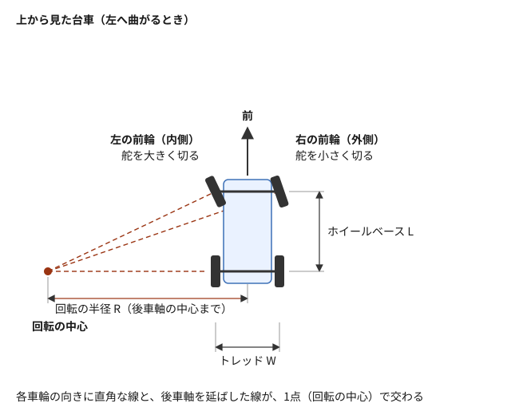
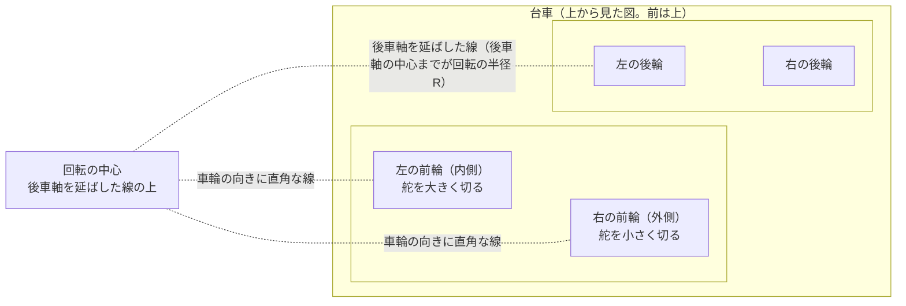
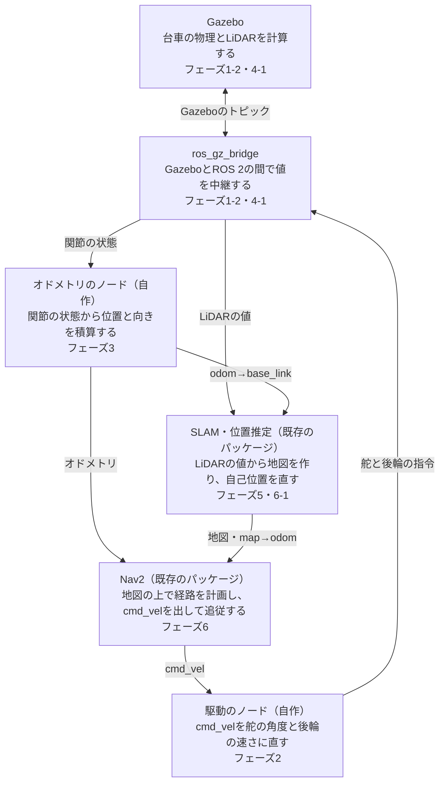

# フェーズ0: アッカーマン式の台車と、自律の移動の全体の構成

[学習計画](learning_plan.md) の最初の読み物。コマンドは実行しない。前輪で舵を切る**アッカーマン式の台車**がどう曲がるか、なぜその場で向きを変えられないかを見た後、台車が自分で目的地まで移動するのに要る部品と、それぞれをこの教材のどのフェーズで作るかを見ておく。前半の2〜4節が台車そのものとシミュレーションの話、後半の5・6節がこの教材の完成形の話である。ここで覚えた用語は、フェーズ1以降の手順書で、説明なしに使う。

- 想定環境: 環境に依らない（環境構築の前でも読める）
- 前提: なし。ROS 2 の語（ノード・トピック等）は、3節で1文ずつ説明し、詳しい説明は親プロジェクトの手順書へリンクする
- 所要の目安: 1コマ（読み物。手を動かす作業は無い）
- 必須の範囲: すべて

> **このページの位置づけ**: 目的は知識の地図を作ることで、完了条件は「コマンドが動く」ではなく「自分の言葉で説明できる」である。2節の角度と回転の半径の数値は、この教材の台車の寸法（2-4節）から計算した値である。TF のフレームの名前と役割は、ROS の規約（REP 105）に基づく。
>
> **期待する結果の出どころ**: このページには、コマンドを実行する手順が無いので、期待する結果も無い。

## 0. 学習目標と完了条件

このページを読み終えたら、次を自分の言葉で説明できる状態を目指す。

1. アッカーマン式の台車が、前輪の舵と後輪の回転で、どう進み、どう曲がるか（2-1節）。
2. 曲がるとき、左右の前輪の舵の角度が違う理由と、回転の中心の位置（2-2節）。
3. 差動二輪の台車と比べて、アッカーマン式の台車にできないこと（その場で向きを変える・真横へ動く）と、最小の回転半径（2-3節・2-4節）。
4. ノード・トピック・TF が何か（3節）。
5. シミュレーションの中で、台車の形・物理・ROS 2 とのつながりを、何が受け持つか（4節）。
6. 自律の移動に要る部品と、それぞれが何を受け取り何を出すか、どのフェーズで作るか（5節・6節）。

**完了条件**: 7節の3つの問いに、答えを見ずに答えられる。

## 1. 全体像: 曲がれる半径に限りがある台車を、目的地まで運ぶ

狭い駐車場で、車を枠に入れる場面を思い浮かべてほしい。ハンドルをいっぱいに切っても、車はその場では回らず、ある大きさの円を描いて曲がる。枠が真横にあっても、横へ滑り込むことはできない。だから運転する人は、一度前へ出て、ハンドルを切り返しながら後ろへ下がり、少しずつ向きを合わせて枠に入れる。

この教材で組み立てる台車も、同じ制約を持つ。前の2つの車輪で舵を切り、後の2つの車輪で進む、自動車と同じ形の台車である。この形を、舵の仕組みの名前を取って**アッカーマン式**と呼ぶ。掃除ロボットのように、左右の車輪の回転の差で向きを変える台車（**差動二輪**）なら、その場でくるりと回れる。アッカーマン式の台車にはそれができない。この制約が、この教材の全体を通じた主題になる。

台車が自分で目的地まで行くには、人の運転と同じ仕事を、いくつかのプログラムに分けて受け持たせる。「進む速さと向きを変える速さ」の指令を、舵の角度と車輪の回転に直すもの。車輪の回り方から、自分がどれだけ進んだかを数えるもの。周りの壁までの距離を測るセンサ。壁の地図を作り、地図の上の自分の位置を知るもの。そして、曲がれる半径を考えながら目的地までの道を選び、その道をたどるもの。この教材では、これらを Gazebo（ロボットを物理の計算で動かすシミュレータ）の中で、1つずつ組み立てていく。

このページでは、まず台車がどう曲がるかを見る（2節）。次に、ROS 2 の語（3節）と、シミュレーションの中の台車の作り（4節）を見る。最後に、自律の移動の部品（5節）と、この教材の完成形（6節）を見る。完成形の全体の図は、6節に置いた。

## 2. アッカーマン式の台車

### 2-1. 前輪で舵を切り、後輪で進む

この教材の台車は、4つの車輪を持つ。後の2つの車輪は、モーターで回って台車を前後へ押す（**駆動輪**）。前の2つの車輪は、自分では回す力を持たず、上から見た向きを変える（**舵を切る**）。舵の角度が0なら台車はまっすぐ進み、舵を左へ切れば左へ曲がる。

台車の動きは、2つの数で表せる。前に進む速さ `v`（単位は m/s。負なら後退）と、上から見た向きを変える速さ `ω`（単位は rad/s。正なら左回り）である。このページでは、`v` を、後車軸の中心（左右の後輪の真ん中の点）が前に進む速さとする（台車の基準の点をどこに置くかは、フェーズ1-1で決める）。ROS 2 の移動ロボットでは、この2つの組を速度の指令として送るのが慣習で、指令を運ぶトピック（3節）の名前は `cmd_vel` がよく使われる。この教材の台車も、フェーズ2-2からは `cmd_vel` で動かす。

一定の `v` と `ω` で走り続けると、台車は円を描く。後車軸の中心が描く円の半径（**回転の半径**）は、進む速さを向きを変える速さで割った値で、

$$R = \frac{v}{\omega}$$

になる。`ω` が小さいほど大きな円になり、`ω`＝0 なら半径が無限大、つまり直進である。

### 2-2. アッカーマンの幾何: 左右の前輪の舵の角度は違う

台車が円を描くとき、4つの車輪はどれも、同じ1点（**回転の中心**）の周りを回る。後輪は舵を切らないので、回転の中心は、後車軸（左右の後輪を結ぶ線）を横へ延ばした線の上にある。前輪は、車輪の向きに直角な線が、その回転の中心を通るように舵を切る。こうすると、どの車輪も横へ引きずられずに、転がるだけで曲がれる。

同じ図（mermaid版）

（左へ曲がるとき。前車軸と後車軸の間の距離がホイールベース L、左右の車輪の間の距離がトレッド W）

図の寸法の比率は模式的で、角度の違いが見えるように、回転の半径を、前後の車軸の間の距離（ホイールベース。次の段落）の2.5倍（この教材の台車で 0.5 m）として描いた。

図のとおり、曲がる側（内側）の前輪は、回転の中心に近いので、舵を大きく切る。外側の前輪は、中心から遠いので、小さく切る。この、左右の舵の角度を変える舵の形を、**アッカーマンの幾何**（アッカーマン・ジオメトリ）と呼ぶ。左右の舵を同じ角度にすると、どちらかの前輪が横へ引きずられ、タイヤがすり減ったり、思った円を描けなかったりする。

前車軸と後車軸の間の距離を**ホイールベース** $L$、左右の車輪の間の距離を**トレッド** $W$ と呼ぶ。後車軸の中心の回転の半径を $R$ とすると、内側と外側の前輪の舵の角度 $\delta_{in}$ と $\delta_{out}$ は、図の直角三角形から、

$$\delta_{in} = \arctan\frac{L}{R - W/2}, \qquad \delta_{out} = \arctan\frac{L}{R + W/2}$$

になる。この教材の台車（ホイールベース 0.20 m、トレッド 0.16 m。2-4節）で、半径 1.0 m の円を左へ描く場合、内側（左）の舵は 0.214 rad（約12.3°）、外側（右）の舵は 0.183 rad（約10.5°）になる。

左右の2つの前輪を、台車の中心の線の上にある1つの前輪に置き換えて考えると、計算が簡単になる。この見方を**自転車モデル**と呼ぶ。自転車モデルの舵の角度 $\delta$ は、

$$\delta = \arctan\frac{L}{R} = \arctan\frac{L \omega}{v}$$

で、上の例では 0.197 rad（約11.3°）と、内側と外側の間の値になる。フェーズ2では、`cmd_vel` の `v`・`ω` から、まず曲率（回転の半径の逆数）を求め、そこから左右の舵の角度と、左右の後輪の回転の速さを求める（後輪も、外側の車輪ほど大きな円を走るので、速く回す）。

実機の自動車や多くの台車では、1つのモーター（またはハンドル）の動きを、リンク機構（棒と関節の組み合わせ）で左右の舵に伝え、機構の形でこの角度の違いを作る。この教材のシミュレーションでは、左右の舵の関節を別々に動かし、角度をフェーズ2で計算して与える。

### 2-3. 差動二輪の台車との違い

差動二輪の台車は、左右の車輪を別々の速さで回し、その差で向きを変える。左右を同じ速さで逆に回せば、その場で回れる（`v`＝0 で `ω`≠0 の動き）。

アッカーマン式の台車は、2-1節の式 $R = v / \omega$ のとおり、`v`＝0 で `ω`≠0 なら、回転の半径が0になる。回転の中心が後車軸の中心に来るので、前輪は、車輪の向きに直角な線が後車軸の中心を通るように舵を切らなければならない。2-2節の式に $R = 0$ を入れると、この教材の台車（2-4節）では、左右の舵を、互いに逆の向きに、それぞれ約 1.19 rad（約68°）切ることになる（自転車モデルの1つの前輪なら、真横の90°）。実際の舵には、これよりずっと小さな上限の角度があるので、これは実現できない。後輪は前後にしか押せないので、真横へ動くこともできない。

アッカーマン式の台車ができるのは、**後車軸を延ばした線の上の点を中心に、ある半径以上の円を描くこと**（と、直進）だけである。その一番小さな半径を、**最小の回転半径**と呼ぶ。最小の回転半径より小さく曲がる指令は、そのままでは実現できない。どう扱うか（舵を上限で切る等）は、[フェーズ2-1](phase2_1_kinematics.md) で決める。

この制約は、目的地までの道の選び方にも響く。差動二輪の台車なら、その場で向きを変えてから直進すればよいが、アッカーマン式の台車は、曲がれる半径を考えた道を選び、狭い場所では切り返し（前進と後退を繰り返して向きを変えること）を使う必要がある。フェーズ4-2の障害物の回避と、フェーズ6の Nav2（目的地までの道を計画し、たどらせるパッケージ群。5節）の設定で、この点を扱う。

### 2-4. この教材の台車の寸法

この教材の台車は、両手に載るくらいの大きさにした。寸法は次のとおりで、どれもこの教材で決めた値である。

| 項目 | 値 |
|---|---|
| ホイールベース $L$ | 0.20 m |
| トレッド $W$ | 0.16 m |
| 車輪の半径 $r$ | 0.04 m |
| 舵の角度の上限 $\delta_{max}$ | 0.6 rad（約34.4°） |

舵の角度の上限は、左右の舵の関節のそれぞれにかける。2-2節のとおり、曲がるときに大きく切るのは内側の舵なので、先に上限に当たるのは内側の舵である。内側の舵が上限の 0.6 rad のとき、後車軸の中心の回転の半径が最小になり、

$$R_{min} = \frac{L}{\tan\delta_{max}} + \frac{W}{2} \approx 0.37 \text{ m}$$

になる。このとき、外側の舵は約 0.416 rad、自転車モデルの舵の角度は約 0.493 rad である。たとえば `v`＝0.2 m/s で走るなら、`ω` は $v / R_{min}$ の約 0.54 rad/s までしか出せない。

この教材では、最小の回転半径を、2-1節の回転の半径と同じく、後車軸の中心が描く円で測る。自動車の諸元表では、一番大きな円を描く外側の前輪で測ることが多い（この教材の台車では、 $L / \sin\delta_{out}$ で約 0.49 m）。ほかの資料の値と比べるときは、どの点で測った半径かを確かめる。

## 3. ROS 2 の語

この教材では、台車を動かすプログラムを ROS 2 の上で書く。**ROS 2** は、ロボットのプログラムを、役割ごとの小さなプログラムに分けて書き、それらの間でデータをやり取りさせるための、ライブラリと道具の集まりである（この教材では Jazzy の版を使う）。ここでは、このページと次のフェーズで出てくる語だけを、1文ずつ説明する。詳しくは、親プロジェクトの [フェーズ0の6節（基本用語集）](https://github.com/SanghunIm1991/ros2MinimalPhysicalAi/blob/main/docs/phase0_overview.md) と、[フェーズ1の3-3節・3-4節（ノードとトピック）](https://github.com/SanghunIm1991/ros2MinimalPhysicalAi/blob/main/docs/phase1_cli_turtlesim.md) で扱っている（どちらも参考。前提にはしない）。

- **ノード**: ROS 2 の上で動く、1つの役割を持ったプログラム。この教材では、運動学の計算（フェーズ2）やオドメトリ（フェーズ3。この節の後半で説明する）を、それぞれノードとして書く。**運動学**は、力や重さを考えずに、舵の角度と車輪の回転の速さから台車の動きがどう決まるか（またはその逆）を、幾何で表すことである。2節の式は、どれも運動学の式である。
- **トピック**: 名前の付いた通り道。送る側のノードがデータを出し、受け取る側のノードがそれを受け取る。`cmd_vel` もトピックの名前である。
- **メッセージの型**: トピックに流すデータの形。たとえば、LiDAR（レーザーで周りの物までの距離を測るセンサ。5節）の距離の値は [`sensor_msgs/msg/LaserScan`](https://github.com/ros2/common_interfaces/blob/jazzy/sensor_msgs/msg/LaserScan.msg)、台車の位置と速度の推定は [`nav_msgs/msg/Odometry`](https://github.com/ros2/common_interfaces/blob/jazzy/nav_msgs/msg/Odometry.msg) という型で送る。`cmd_vel` の型は、フェーズ2-2で扱う。
- **フレーム**: 位置と向きを測るための座標系。台車の本体に固定した `base_link`、各車輪に固定したフレームなど、部品ごとに置く。
- **TF**: フレームの間の位置と向きの関係（座標変換）を、ROS 2 の中で配る仕組み。親から子へのつながりで、木の形になる（**TF の木**）。

台車の位置に関わるフレームは、ROS の規約（REP 105）で、次の3つの名前と役割が決まっている。

| フレーム | 何に固定されているか | 特徴 |
|---|---|---|
| `map` | 地図（世界） | 長い時間が経っても、ずれない。ただし、自分の位置の推定を直すと、台車の位置が飛ぶことがある |
| `odom` | 走り始めた場所 | 台車の位置は滑らかに変わる（飛ばない）。ただし、走るほど誤差が溜まり、ずれていく |
| `base_link` | 台車の本体 | 台車と一緒に動く |

この3つは、`map → odom → base_link` の順につながる。`odom → base_link` は、車輪の回り方から求めた**オドメトリ**（車輪の回り方などから、走り始めた場所に対する位置と向きを積算した推定）で、フェーズ3で作る。`map → odom` は、溜まったずれを地図に合わせて直す分である。フェーズ5では、走りながら地図を作る SLAM（5節）がこれを出す。フェーズ6で、保存した地図の上を走るときに、何がこれを出すか（SLAM を地図の上の位置の推定だけに使う設定にするか、Nav2 に含まれる、地図と LiDAR の値から位置を推定する部品 AMCL を使うか）は、フェーズ6-1で決める。

## 4. シミュレーションの中の台車

この教材では、実機の台車を使わず、PC の上のシミュレーションの中で台車を動かす。シミュレーションの中の台車は、次の部品でできている。

- **URDF**: ロボットの部品（**リンク**）と、それらをつなぐ**関節**を書く、XML の形式。この教材の台車は、本体・4つの車輪・2つの舵の部品を、回る関節と舵を切る関節でつないで書く（フェーズ1-1）。形のほかに、重さ・慣性・ぶつかる形も書くと、Gazebo で物理の計算ができる（フェーズ1-2）。URDF を書くのを助けるマクロの形式 **xacro** も使う。
- **robot_state_publisher**: URDF と、関節の角度を受け取って、各部品のフレームの TF を計算して配る、ROS 2 の標準のノード（フェーズ1-1）。
- **Gazebo**（Harmonic）: 台車の重さ・車輪と地面の摩擦・関節を動かす力を計算する、3D の物理シミュレータ。LiDAR などのセンサの値も計算する（フェーズ1-2・4-1）。
- **ros_gz_bridge**: Gazebo の中の通信（Gazebo のトピック）と、ROS 2 のトピックの間で、データを中継するノード。ROS 2 の側から舵と後輪へ指令を送り、関節の状態とセンサの値を受け取る（フェーズ1-2）。

Gazebo には、アッカーマン式の台車を `v`・`ω` で動かす部品も付いているが、この教材では使わない。舵の角度と後輪の速さを自分で計算する部分（フェーズ2）と、オドメトリを自分で積算する部分（フェーズ3）が、この教材で学ぶ中心だからである。Gazebo の側には、関節を1つずつ角度や速さで動かす部品だけを付ける。フェーズ3の任意の節では、同じ台車を、ROS 2 の **ros2_control**（ロボットの関節を動かす制御のプログラムを、シミュレーションと実機で同じ形で使えるようにする仕組み）が用意している、アッカーマン式の台車のための標準のコントローラ（`ackermann_steering_controller`）で動かし、自作のものと比べる。

**実機では、何が入れ替わるか**: 実機の台車には Gazebo が無い。代わりに、本物の本体とモーターとセンサがある。センサやモーターの信号を読み書きし、決まった形のデータとやり取りするプログラムや基板を、**ドライバ**と呼ぶ。舵と後輪への指令は、モーターを回す基板（モーターのドライバ）へ送られ、関節の状態は、車輪の回転を数えるセンサ（エンコーダ）や、舵の角度のセンサから来る。LiDAR の値は、LiDAR の信号を読んで決まった形のデータに直す、LiDAR のドライバのノードが出す。シミュレーションでは、Gazebo と ros_gz_bridge が、これらの代わりをしている。その先の運動学・オドメトリ・SLAM・Nav2 のノードは、同じ形のデータを受け取るので、そのまま使えるように作れる。実機への移植は、発展の章で扱う。

## 5. 自律の移動に要る部品

台車が目的地まで自分で移動するには、次の部品が要る。表の「受け取るもの」と「出すもの」が、部品どうしのつながりである。

| 部品 | 受け取るもの | 出すもの | 作る・学ぶフェーズ |
|---|---|---|---|
| 台車の模型（URDF と robot_state_publisher） | 関節の角度 | 台車の形と、部品ごとのフレームの TF | フェーズ1 |
| 駆動（運動学） | 速度の指令（`cmd_vel` の `v`・`ω`） | 左右の舵の角度と、左右の後輪の回転の速さの指令 | フェーズ2 |
| オドメトリ | 関節の状態（後輪の回転の速さと舵の角度） | 走り始めた場所に対する位置と向き（`nav_msgs/msg/Odometry` と TF の `odom → base_link`） | フェーズ3 |
| センサ（LiDAR） | （周りの壁や物） | 水平な面の上の、周りの物までの距離（`sensor_msgs/msg/LaserScan`） | フェーズ4 |
| 地図と自己位置（SLAM） | LiDAR の距離とオドメトリ | 壁の地図と、地図の上の位置（TF の `map → odom`） | フェーズ5（フェーズ6で地図の上の位置を何が出すかは、フェーズ6-1で決める。3節） |
| 計画と追従（Nav2） | 地図・地図の上の位置・LiDAR の距離・目的地 | 目的地までの道と、その道をたどるための速度の指令（`cmd_vel`） | フェーズ6 |

**LiDAR** は、レーザーの光を回しながら出し、跳ね返ってくるまでの時間から、周りの物までの距離を測るセンサである。この教材では、水平の1つの面の上を測る、2D の LiDAR を使う。**SLAM**（Simultaneous Localization and Mapping）は、走りながら地図を作り、同時にその地図の上の自分の位置を推定する技術である。**Nav2** は、ROS 2 の移動ロボット向けのパッケージ群で、地図の上で道を計画する**計画器**と、その道をたどる速度の指令を出す**追従器**（Nav2 の文書では、コントローラと呼ぶ）などでできている。

表の最後の行が最初の行の手前につながる（Nav2 が出す `cmd_vel` を、駆動が受け取る）ことに注目してほしい。Nav2 は、舵の角度や車輪の回転の速さは扱わず、`v`・`ω` を出すだけである。`v`・`ω` を、この台車の舵と車輪の動きに直すのは、フェーズ2で作る駆動の部品の仕事である。ただし、Nav2 が最小の回転半径より小さく曲がる指令や、その場で回る指令を出すと、駆動の部品はそれを実現できない（2-3節）。そのため、フェーズ6では、Nav2 の計画器と追従器に、曲がれる半径を考えたものを選んで設定する。

## 6. この教材のゴール（完成形の構成）

この教材のゴールは、フェーズ6で、Gazebo の中の台車が、フェーズ5で作った地図の上で、Nav2 によって目的地まで自律で移動することである。次の図は、そのときに動かす一式の見通しである。各箱の最後の行は、その部品を作る（または使い方を学ぶ）フェーズを示す。

同じ図（mermaid版）

図の「SLAM・位置推定」の箱は、フェーズ5では走りながら地図を作り、フェーズ6では保存した地図の上の位置を推定する（何を使うかは、フェーズ6-1で決める。3節）。図を簡単にするため、次のつながりは描いていない。Nav2 も、LiDAR の値を受け取って、地図に無い障害物を避ける。robot_state_publisher（フェーズ1-1）は、車輪や LiDAR の部品のフレームの TF を配る。RViz2（ROS 2 の3D の表示のツール）は、地図・LiDAR の値・計画された道・台車の形を重ねて表示する。

この構成の要は、**仕事を部品に分け、部品どうしを決まった形のデータでつなぐこと**である。Nav2 は `cmd_vel` を出すだけで、舵の角度を知らなくてよい。SLAM は、オドメトリと LiDAR の値の形が合っていれば、それがシミュレーションから来たか実機から来たかを知らなくてよい。この教材は、この分け方に沿って、土台の部品（図の上の、Gazebo に近い側）から1つずつ作り、完成した部品の上に次の部品を重ねていく。

| フェーズ | 作るもの・学ぶこと | 図の中の部品 |
|---|---|---|
| 1 | URDF で台車を書き、Gazebo に出して、関節を ROS 2 から動かす | Gazebo・ros_gz_bridge |
| 2 | `v`・`ω` から舵の角度と後輪の速さを求め、`cmd_vel` で台車を走らせる | 駆動のノード |
| 3 | 関節の状態から位置と向きを積算し、オドメトリと TF を出す | オドメトリのノード |
| 4 | LiDAR を載せて値を見て、障害物の手前で止まり、切り返して避ける | Gazebo（LiDAR）・ros_gz_bridge |
| 5 | 走らせながら地図を作り、保存する | SLAM |
| 6 | 曲がれる半径を考えた設定で Nav2 を動かし、目的地まで自律で移動させる | Nav2 |

## 7. 確かめの問い

学習計画のフェーズ0の完了条件の問いに、2-2節の問いを1つ加えた。答えを見ずに、自分の言葉で答えてから開く。

**問い1**: アッカーマン式の台車が、`v`＝0 で `ω`≠0 の指令（その場で向きを変える指令）を実現できないのはなぜか。

答え

回転の半径は $R = v / \omega$ なので、`v`＝0 で `ω`≠0 なら半径は0になり、回転の中心が後車軸の中心に来る。そのためには、前輪の向きに直角な線が後車軸の中心を通るように、左右の前輪を逆の向きに大きく切らなければならない（この教材の台車では、それぞれ約 1.19 rad。自転車モデルの1つの前輪なら、真横の90°）。舵には上限の角度（この教材の台車では 0.6 rad）があるので、これは実現できない。後輪は前後にしか押せないので、真横へ動くこともできない（2-3節）。

**問い2**: 自律の移動に要る部品を5つ挙げ、それぞれが何を受け取り何を出すかを答える。

答え

5節の表の6つの部品から5つを挙げればよい。たとえば、次のとおりである。

- 駆動: `cmd_vel` の `v`・`ω` を受け取り、左右の舵の角度と左右の後輪の回転の速さの指令を出す（フェーズ2）。
- オドメトリ: 関節の状態を受け取り、走り始めた場所に対する位置と向き（`odom → base_link`）を出す（フェーズ3）。
- LiDAR: 周りの物までの距離を測り、`LaserScan` として出す（フェーズ4）。
- SLAM: LiDAR の距離とオドメトリを受け取り、地図と、地図の上の位置（`map → odom`）を出す（フェーズ5）。
- Nav2: 地図・位置・LiDAR の距離・目的地を受け取り、道を計画して、それをたどる `cmd_vel` を出す（フェーズ6）。

**問い3**: この教材の台車が、半径 1.0 m の円を左へ描くとき、左右どちらの前輪の舵を大きく切るか。理由も答える。

答え

左（内側）の前輪を大きく切る（約 0.214 rad。右は約 0.183 rad）。どの車輪も同じ回転の中心の周りを回り、各前輪は、車輪の向きに直角な線が回転の中心を通るように舵を切る。舵の角度は、前輪から回転の中心までの、前後の距離（ホイールベース $L$）と横の距離で決まる。前後の距離は左右で同じだが、横の距離は、左の前輪が $R - W/2$（0.92 m）、右の前輪が $R + W/2$（1.08 m）で、左のほうが短い。そのため、 $\arctan$ の中の比が大きくなり、左の舵の角度が大きくなる（2-2節）。

## 8. 用語集

このページで出てきた用語を、英字で始まる用語をアルファベット順に、続けてそのほかの用語を50音順にまとめた。

| 用語 | 意味 | 節 |
|---|---|---|
| AMCL | Nav2 に含まれる、地図と LiDAR の値から、地図の上の位置を推定する部品 | 3 |
| `cmd_vel` | 進む速さ `v` と向きを変える速さ `ω` の指令を運ぶトピックの、慣習の名前 | 2-1 |
| Gazebo | 台車の物理とセンサを計算する、3D の物理シミュレータ。この教材では Harmonic を使う | 4 |
| LiDAR | レーザーの光で、周りの物までの距離を測るセンサ。この教材では 2D のものを使う | 5 |
| Nav2 | ROS 2 の移動ロボット向けのパッケージ群。道を計画する計画器と、道をたどる追従器などでできている | 5 |
| robot_state_publisher | URDF と関節の角度から、部品ごとのフレームの TF を計算して配る、ROS 2 の標準のノード | 4 |
| ROS 2 | ロボットのプログラムを役割ごとの小さなプログラムに分け、その間でデータをやり取りさせるための、ライブラリと道具の集まり | 3 |
| ros2_control | ロボットの関節を動かす制御のプログラムを、シミュレーションと実機で同じ形で使えるようにする仕組み | 4 |
| ros_gz_bridge | Gazebo のトピックと ROS 2 のトピックの間で、データを中継するノード | 4 |
| SLAM | 走りながら地図を作り、同時に地図の上の自分の位置を推定する技術 | 5 |
| TF（TF の木） | フレームの間の位置と向きの関係を、ROS 2 の中で配る仕組み。親から子へのつながりで木の形になる | 3 |
| URDF・xacro | ロボットのリンクと関節を書く XML の形式・それを短く書くためのマクロの形式 | 4 |
| アッカーマン式の台車 | 前の2輪で舵を切り、後の2輪で進む、自動車と同じ形の台車 | 1 |
| アッカーマンの幾何 | 曲がるとき、内側の前輪を外側より大きく切り、どの車輪も同じ回転の中心の周りを回るようにする舵の形 | 2-2 |
| 運動学 | 力や重さを考えずに、舵の角度と車輪の回転の速さから台車の動きがどう決まるか（またはその逆）を、幾何で表すこと | 3 |
| オドメトリ | 車輪の回り方などから、走り始めた場所に対する位置と向きを積算した推定 | 3 |
| 回転の中心・回転の半径 | 曲がる台車のすべての車輪が周りを回る1点・その点から後車軸の中心までの距離 | 2-1・2-2 |
| 切り返し | 前進と後退を繰り返して、向きを変えること | 2-3 |
| 駆動輪 | モーターで回って台車を押す車輪。この教材の台車では後の2輪 | 2-1 |
| 最小の回転半径 | 台車の後車軸の中心が描ける、一番小さな円の半径。この教材の台車では約 0.37 m | 2-3・2-4 |
| 差動二輪 | 左右の車輪の回転の差で向きを変える台車。その場で回れる | 1・2-3 |
| 自転車モデル | 左右の前輪を、中心の線の上の1つの前輪に置き換えて考える見方 | 2-2 |
| トピック | 名前の付いた通り道。送る側のノードがデータを出し、受け取る側のノードが受け取る | 3 |
| ドライバ | センサやモーターの信号を読み書きし、決まった形のデータとやり取りするプログラムや基板 | 4 |
| トレッド | 左右の車輪の間の距離 | 2-2 |
| ノード | ROS 2 の上で動く、1つの役割を持ったプログラム | 3 |
| フレーム | 位置と向きを測るための座標系 | 3 |
| ホイールベース | 前車軸と後車軸の間の距離 | 2-2 |
| メッセージの型 | トピックに流すデータの形 | 3 |
| リンク・関節 | URDF で書く、ロボットの部品・部品どうしのつなぎ目 | 4 |

## 次へ

学習計画（[`docs/learning_plan.md`](learning_plan.md)）の次の段階は、環境構築（ROS 2 Jazzy と Gazebo Harmonic を用意する）と、フェーズ1-1（URDF で台車の形と関節を書き、RViz2 で見る）である。それぞれの手順書は作成中で、できたら README の「読む順番」に足す。

## 出典

このページの技術的な記述は、次の文書を読んで、自分の言葉でまとめたもの（逐語の転載ではない）。

- ROS の座標系の規約（3節のフレーム）: [REP 105: Coordinate Frames for Mobile Platforms](https://www.ros.org/reps/rep-0105.html)
- メッセージの型の定義（3節・5節）: [`sensor_msgs/msg/LaserScan`](https://github.com/ros2/common_interfaces/blob/jazzy/sensor_msgs/msg/LaserScan.msg)、[`nav_msgs/msg/Odometry`](https://github.com/ros2/common_interfaces/blob/jazzy/nav_msgs/msg/Odometry.msg)（ROS 2 の `common_interfaces` の `jazzy` ブランチ）
- Nav2 の構成（5節）と AMCL（3節）: [Nav2 の文書](https://docs.nav2.org/)
- シミュレーションの部品（4節）: [`ros_gz_bridge` の説明](https://github.com/gazebosim/ros_gz/blob/jazzy/ros_gz_bridge/README.md)、[`robot_state_publisher`](https://github.com/ros/robot_state_publisher/tree/jazzy)、Gazebo のアッカーマン式の台車の部品（[`AckermannSteering`](https://gazebosim.org/api/sim/8/classgz_1_1sim_1_1systems_1_1AckermannSteering.html)、Gazebo Sim 8）、ros2_control の [`ackermann_steering_controller`](https://control.ros.org/jazzy/doc/ros2_controllers/ackermann_steering_controller/doc/userdoc.html)
- ROS 2 の語（3節）: 親プロジェクトの [フェーズ0](https://github.com/SanghunIm1991/ros2MinimalPhysicalAi/blob/main/docs/phase0_overview.md) と [フェーズ1](https://github.com/SanghunIm1991/ros2MinimalPhysicalAi/blob/main/docs/phase1_cli_turtlesim.md)
- 2節のアッカーマンの幾何・自転車モデル・最小の回転半径は、一般的な運動学の説明を、筆者の言葉で書いたもの。数値は、この教材の台車の寸法から計算した。
- 図（`img/phase0_*.svg`）は、この教材で作ったもの。
