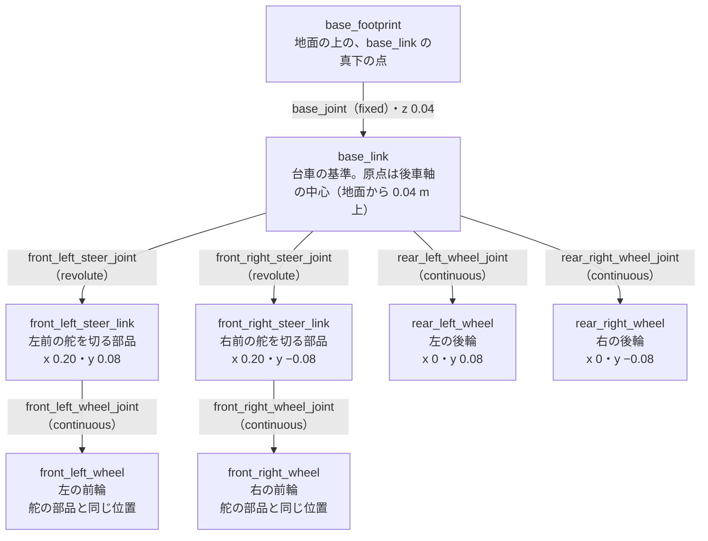
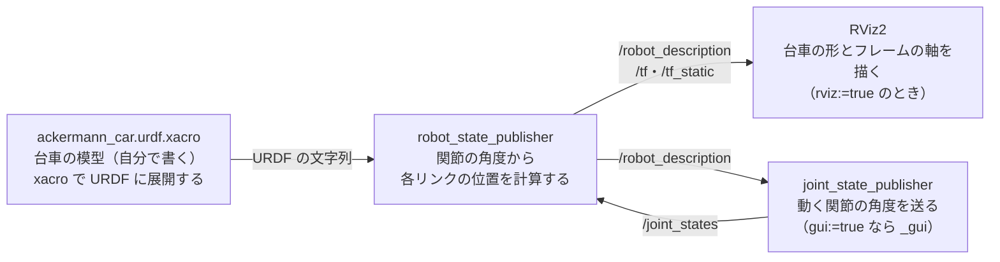

# フェーズ1-1: URDF で台車の形と関節を書き、RViz2 で見る

[学習計画](learning_plan.md) のフェーズ1の前半。[フェーズ0](phase0_overview.md) の2節で見たアッカーマン式の台車を、ロボットの部品と関節を書く形式 **URDF** で書き、ROS 2 の中で、部品ごとの位置（TF）として扱えるようにする。この台車の模型は、フェーズ1-2で Gazebo に出して動かし、フェーズ2以降の運動学・オドメトリ・センサのすべての土台になる。新しい概念は、**関節と TF の木**の1つである。

- 想定環境: Ubuntu 24.04、ROS 2 Jazzy（画面を使う。RViz2 と、スライダーのウィンドウを開く）
- 前提: [フェーズ0](phase0_overview.md)。環境構築（手順書は作成中。ROS 2 Jazzy が入っていればよい。4-1節で、使うパッケージを確かめる）。親プロジェクトの [フェーズ2](https://github.com/SanghunIm1991/ros2MinimalPhysicalAi/blob/main/docs/phase2_packages.md) の2-1・2-2・2-4・2-5節（ワークスペースを作り、Python のパッケージを作って、ビルドし、環境に登録する）と、[フェーズ4](https://github.com/SanghunIm1991/ros2MinimalPhysicalAi/blob/main/docs/phase4_launch.md) の4-1節（Python 形式の launch のファイル）
- 所要の目安: 1〜2コマ
- 言語: 台車の模型は xacro（XML）、launch のファイルは Python

> **このページの位置づけ**: 書くのは、台車の見た目（形と色）と関節だけである。重さ・慣性・ぶつかる形は、Gazebo で物理の計算をするときに要るので、フェーズ1-2で足す。URDF と RViz2 の一般的な使い方（関節の種類ごとの動き、xacro の仕組み、RViz2 の表示の変え方）は、親プロジェクトの [URDF と RViz2 の章](https://github.com/SanghunIm1991/ros2MinimalPhysicalAi/blob/main/docs/interlude_urdf_rviz.md) で、公式のチュートリアルに沿って扱っている（参考。前提にはしない）。
>
> **期待する結果の出どころ**: `ros2 pkg prefix`・`ros2 pkg create`・`colcon build`・`xacro`・`check_urdf`・`ros2 launch --show-args` の表示と、7節の launch のログ・`ros2 node list`・`tf2_echo`・`ros2 topic echo` の表示は、作成時に使い捨てのワークスペースで実際に実行して確かめたものである（7節は、`gui:=false rviz:=false` で、画面を開かずに起動した）。時刻・pid・秒数・パス・ユーザー名は、実行ごと・環境ごとに変わる。7-2節の、`Ctrl+C` で止めたときの `KeyboardInterrupt` の行も、作成時に確かめた。8節の RViz2 の画面と、スライダーのウィンドウの見え方は、作成時には開いて確かめておらず、URDF の中身とツールの説明から想定したものである。7-1節と10節に書いた誤りのときの表示（`Package ... not found`・`Frame [map] does not exist` 等）は、作成時には起こしておらず、ツールの振る舞いから想定した要旨である。

## 0. 学習目標と完了条件

1. 台車を、リンク（部品）と関節の木として設計し、関節の種類（固定・舵を切る・回る）を選べる（2節・3節）。
2. xacro の変数とマクロを使って、台車の寸法を1か所にまとめ、4つの車輪を短く書ける（5節）。
3. URDF の木を `check_urdf` で確かめ、`robot_state_publisher` が出す TF で、部品の位置を数値で確かめられる（6節・7節）。
4. RViz2 で台車の形と TF の木を表示し、スライダーで舵を切ったときの前輪の動きを見られる（8節）。

**完了条件**:

- `check_urdf` が、根を `base_footprint` とする8つのリンクの木を表示する（6-2節）。
- `tf2_echo` で見た `base_link` から左右の前輪の舵の部品（`front_left_steer_link`・`front_right_steer_link`）までの位置が、x がホイールベースの 0.200 m、y がトレッドの半分の ±0.080 m に、1 mm 以内で一致する（7-2節）。

## 1. 全体像

この台車の模型は、8つのリンクを7つの関節でつないだ木である。根は、地面の上の点 `base_footprint` で、台車の基準の `base_link` は、その 0.04 m 上（後車軸の中心）にある。前輪は、舵を切る部品（`front_*_steer_link`）の先に、回る関節でつなぐ。


<details>
<summary>同じ図（mermaid版）</summary>



</details>

この模型を、launch のファイル `display.launch.py` で、次のノードに渡す。


<details>
<summary>同じ図（mermaid版）</summary>



</details>

- **robot_state_publisher**: URDF をパラメータ `robot_description` で受け取り、同じ中身をトピック `/robot_description`（型は [`std_msgs/msg/String`](https://github.com/ros2/common_interfaces/blob/jazzy/std_msgs/msg/String.msg)）に送るノード。さらに、動く関節の角度（`/joint_states`）を受け取って、各リンクの位置と向きを計算し、TF として送る。固定の関節の先のリンクはトピック `/tf_static` に、動く関節の先のリンクは `/tf` に送る（型はどちらも [`tf2_msgs/msg/TFMessage`](https://github.com/ros2/geometry2/blob/jazzy/tf2_msgs/msg/TFMessage.msg)）。
- **joint_state_publisher**: `/robot_description` を読み、動く関節の名前と角度を、トピック `/joint_states`（型は [`sensor_msgs/msg/JointState`](https://github.com/ros2/common_interfaces/blob/jazzy/sensor_msgs/msg/JointState.msg)）に送り続けるノード。角度はすべて0である。**joint_state_publisher_gui** は、同じ働きに、関節ごとのスライダーのウィンドウを付けたもので、スライダーの角度を送る。このページでは、関節の角度を手で与えて形を確かめるために使う。フェーズ1-2からは、Gazebo の中の実際の関節の角度を送るので、どちらも使わなくなる。
- **RViz2**: TF と、ロボットの形・センサのデータなどを、3D の画面に重ねて描く表示のツール。

TF が無いと、RViz2 は、どの部品をどこに描けばよいかが分からない。動く関節の先の部品の TF は、関節の角度が届かないと計算できないので、`/joint_states` を送るノードも一緒に起動する。

## 2. リンクと関節で台車を表す

### 2-1. リンクと関節

URDF では、ロボットを**リンク**（形を持つ部品、または形を持たない点）と、2つのリンクをつなぐ**関節**で表す。関節は、親のリンクと子のリンクを1つずつ持ち、子は親に対して、決まった位置にあり、決まった動き方だけをする。リンクには、それぞれ自分の座標系（フレーム）があり、TF の名前は、リンクの名前と同じになる。

関節には、次の3つの書き方の要素がある。

- **`origin`**: 親のリンクのフレームから見た、関節（子のリンクのフレームの原点）の位置 `xyz` と向き `rpy`（x・y・z 軸の周りの回転の角度。単位は rad）。
- **`axis`**: 関節が回る（または滑る）軸の向き。子のリンクのフレームで書く。
- **`type`**: 関節の種類。この台車で使うのは、次の3つである。

| 種類 | 動き | この台車での使い道 |
|---|---|---|
| `fixed` | 動かない | `base_footprint` と `base_link` をつなぐ |
| `revolute` | 軸の周りに、上限と下限の間で回る（`limit` で範囲を書く） | 前輪の舵を切る関節。範囲は ±0.6 rad |
| `continuous` | 軸の周りに、上限なく回り続ける | 4つの車輪が転がる関節 |

座標の向きは、ROS の規約（[REP 103](https://www.ros.org/reps/rep-0103.html)）に従い、台車の前が x、左が y、上が z である。長さの単位は m、角度の単位は rad である。

### 2-2. 前輪を2つの関節に分ける

前輪は、舵を切る動き（上から見た向きを変える。z 軸の周り）と、転がる動き（車輪の軸の周り。y 軸の周り）の、2つの動きを持つ。`revolute` と `continuous` の関節は、1つの軸の周りの回転しか持てないので、前輪の間に、形を持たない**舵の部品** `front_*_steer_link` を挟む。`base_link` → 舵の部品は舵を切る関節（`revolute`、z 軸の周り）で、舵の部品 → 前輪は転がる関節（`continuous`、y 軸の周り）でつなぐ。舵の部品が z 軸の周りに回ると、その子の前輪も一緒に向きを変え、前輪の転がる軸の向きも変わる。これが、舵を切った前輪である。

後輪は、舵を切らないので、`base_link` に転がる関節で直接つなぐ。

### 2-3. 基準の点: `base_link` と `base_footprint`

`base_link` の原点は、**後車軸の中心**（左右の後輪の軸の真ん中の点）に置く。フェーズ0の2-1節で、`v` を後車軸の中心の速さとしたのと合わせるためである。こうすると、フェーズ2の自転車モデルの式（ $\delta = \arctan(L\omega/v)$ ）と、フェーズ3のオドメトリの式を、ずらさずにそのまま使える。台車の本体の箱は、`base_link` の原点より少し前に置く（3-1節）。

`base_link` の高さは、車輪の軸の高さ（地面から、車輪の半径の 0.04 m 上）になる。地面の上の、`base_link` の真下の点を、形を持たないリンク `base_footprint` として、木の根に置く。移動ロボットでは、地面の上を動く位置を `base_footprint` で、台車の本体の位置を `base_link` で表すことがよくある（`base_footprint` の決め方は、ROS の規約の [REP 120](https://www.ros.org/reps/rep-0120.html) にある。フェーズ5・6で、地図の上の2D の位置を扱うときに使う）。

## 3. 仕様

### 3-1. 寸法

寸法は、フェーズ0の2-4節で決めたものに、見た目の大きさ（車輪の幅と本体の箱）を足した。どれもこの教材で決めた値である。

| 項目 | xacro の変数 | 値 |
|---|---|---|
| ホイールベース | `wheelbase` | 0.20 m |
| トレッド | `track` | 0.16 m |
| 車輪の半径 | `wheel_radius` | 0.04 m |
| 車輪の幅 | `wheel_width` | 0.025 m |
| 舵の角度の上限 | `steer_max` | 0.6 rad（下限は −0.6 rad） |
| 本体の箱（長さ・幅・高さ） | `body_length`・`body_width`・`body_height` | 0.19 m・0.12 m・0.05 m |

本体の箱は、後ろの端を後車軸より 0.04 m 後ろ（x＝−0.04）に、前の端を x＝0.15 に置いた。幅は、舵が0のときに、左右の車輪の内側に収まる大きさにした（車輪の内側の面は、中心から 0.08−0.0125＝0.0675 m、箱の側面は 0.06 m）。前の端を前車軸（x＝0.20）より手前で止めたのは、舵を切った前輪が箱にめり込まないようにするためである。前輪は、舵を切ると、舵の軸の周りの半径約 0.042 m（車輪の半径と、幅の半分から求めた、車輪の角までの距離）の範囲を動くので、箱の前の端を x＝0.20−0.042≒0.158 より手前に置けば、舵を上限の 0.6 rad まで切っても、前輪と箱は重ならない。

### 3-2. リンクと関節

| 関節 | 種類 | 親 → 子 | 位置 `origin`（m） | 軸 `axis` |
|---|---|---|---|---|
| `base_joint` | `fixed` | `base_footprint` → `base_link` | (0, 0, 0.04) | ― |
| `front_left_steer_joint` | `revolute`（±0.6 rad） | `base_link` → `front_left_steer_link` | (0.20, 0.08, 0) | z |
| `front_right_steer_joint` | `revolute`（±0.6 rad） | `base_link` → `front_right_steer_link` | (0.20, −0.08, 0) | z |
| `front_left_wheel_joint` | `continuous` | `front_left_steer_link` → `front_left_wheel` | (0, 0, 0) | y |
| `front_right_wheel_joint` | `continuous` | `front_right_steer_link` → `front_right_wheel` | (0, 0, 0) | y |
| `rear_left_wheel_joint` | `continuous` | `base_link` → `rear_left_wheel` | (0, 0.08, 0) | y |
| `rear_right_wheel_joint` | `continuous` | `base_link` → `rear_right_wheel` | (0, −0.08, 0) | y |

舵を切る関節は、正の角度で上から見て反時計回り（左へ切る）になる（z 軸が上向きなので、右ねじの向き）。車輪の関節は、正の角度で、台車が前へ進む向きに転がる（y 軸が左向きなので、左から見て反時計回り。車輪の上の端が前へ動く）。

`revolute` の関節には、角度の範囲のほかに、関節を動かす力の上限 `effort` と、速さの上限 `velocity` を書く決まりがある。このページでは使わないが、フェーズ1-2の Gazebo では使われる。ここでは、どちらも 10 にした（Gazebo で舵が指令どおりに動くことを、この教材の作成時の予備の実験で確かめた値。フェーズ1-2で使う）。

## 4. 準備

### 4-1. 使うパッケージを確かめる

このページで使う ROS 2 のパッケージが入っているかを確かめる。

```bash
ros2 pkg prefix xacro

ros2 pkg prefix robot_state_publisher

ros2 pkg prefix joint_state_publisher

ros2 pkg prefix joint_state_publisher_gui

ros2 pkg prefix rviz2

ros2 pkg prefix tf2_ros

which check_urdf
```

**期待する結果**（7つのコマンドの表示をまとめた）:

```text
$ ros2 pkg prefix xacro
/opt/ros/jazzy
$ ros2 pkg prefix robot_state_publisher
/opt/ros/jazzy
$ ros2 pkg prefix joint_state_publisher
/opt/ros/jazzy
$ ros2 pkg prefix joint_state_publisher_gui
/opt/ros/jazzy
$ ros2 pkg prefix rviz2
/opt/ros/jazzy
$ ros2 pkg prefix tf2_ros
/opt/ros/jazzy
$ which check_urdf
/opt/ros/jazzy/bin/check_urdf
```

`ros2 pkg prefix` は、パッケージが入っている場所を表示する。6つのパッケージで `/opt/ros/jazzy` が出て、`which` で `check_urdf` のコマンドの場所が出れば、ROS 2 と一緒に入っている。`Package not found` と出たものがあれば、そのパッケージを導入する（パッケージの名前の `_` を `-` にし、前に `ros-jazzy-` を付けたものが、apt のパッケージの名前になる）。たとえば、xacro と joint_state_publisher_gui が無い場合は、次のとおりである。

```bash
sudo apt install ros-jazzy-xacro ros-jazzy-joint-state-publisher-gui
```

**期待する結果**: 導入が終わった後、上の `ros2 pkg prefix` で、どれも `/opt/ros/jazzy` が出る。

### 4-2. パッケージを作る

ワークスペース `~/ros2_ws` の `src` に、Python のパッケージ `ackermann_description` を作る（ワークスペースが無ければ、先に `mkdir -p ~/ros2_ws/src` で作る）。台車の模型を入れるパッケージの名前の末尾に `_description` を付けるのは、ROS 2 でよく使われる慣習である。

```bash
cd ~/ros2_ws/src

ros2 pkg create --build-type ament_python --license Apache-2.0 ackermann_description

mkdir -p ackermann_description/urdf ackermann_description/launch
```

**期待する結果**（`ros2 pkg create` の表示）:

```text
going to create a new package
package name: ackermann_description
destination directory: /home/<ユーザー名>/ros2_ws/src
package format: 3
version: 0.0.0
description: TODO: Package description
maintainer: ['<ユーザー名> <<ユーザー名>@todo.todo>']
licenses: ['Apache-2.0']
build type: ament_python
dependencies: []
creating folder ./ackermann_description
creating ./ackermann_description/package.xml
creating source folder
creating folder ./ackermann_description/ackermann_description
creating ./ackermann_description/setup.py
creating ./ackermann_description/setup.cfg
creating folder ./ackermann_description/resource
creating ./ackermann_description/resource/ackermann_description
creating ./ackermann_description/ackermann_description/__init__.py
creating folder ./ackermann_description/test
creating ./ackermann_description/test/test_copyright.py
creating ./ackermann_description/test/test_flake8.py
creating ./ackermann_description/test/test_pep257.py
```

`<ユーザー名>` の部分には、PC のユーザー名が入る。`creating` の行が、作られたフォルダとファイルである。`mkdir` は何も表示しない。

このパッケージには、ノードのプログラムを書かない（フェーズ2で、ノードを書く別のパッケージを作る）。中身は、台車の模型のファイル（`urdf/`）と、launch のファイル（`launch/`）である。

## 5. 台車の模型を書く（xacro）

### 5-1. xacro の3つの仕組み

URDF は XML なので、4つの車輪のように同じ形が並ぶと長くなり、寸法を変えるときに直す場所も多い。**xacro** は、URDF に次の3つの仕組みを足したマクロの形式で、`xacro` のコマンドで、ふつうの URDF に展開する。

- **変数**（`<xacro:property name="..." value="..."/>`）: 寸法に名前を付け、`${名前}` で使う。
- **式**（`${...}`）: 変数どうしの計算（`${body_length / 2 - wheel_radius}`、`${-track / 2}` 等）を書ける。`pi`（円周率）も使える。
- **マクロ**（`<xacro:macro name="..." params="...">`）: 引数を取る、XML の雛形。`<xacro:マクロの名前 引数="値"/>` で呼ぶと、中身が引数を入れて展開される。

### 5-2. サンプル

ファイル: `~/ros2_ws/src/ackermann_description/urdf/ackermann_car.urdf.xacro`

```xml
<?xml version="1.0"?>
<!-- アッカーマン式の台車の模型（フェーズ1-1: 見た目と関節だけ） -->
<robot name="ackermann_car" xmlns:xacro="http://www.ros.org/wiki/xacro">

  <!-- 台車の寸法（この教材で決めた値。単位は m と rad） -->
  <xacro:property name="wheelbase" value="0.20"/>
  <xacro:property name="track" value="0.16"/>
  <xacro:property name="wheel_radius" value="0.04"/>
  <xacro:property name="wheel_width" value="0.025"/>
  <xacro:property name="steer_max" value="0.6"/>
  <xacro:property name="body_length" value="0.19"/>
  <xacro:property name="body_width" value="0.12"/>
  <xacro:property name="body_height" value="0.05"/>

  <material name="body_blue"><color rgba="0.25 0.45 0.80 1"/></material>
  <material name="tire_black"><color rgba="0.10 0.10 0.10 1"/></material>

  <!-- 地面の上の、base_link の真下の点 -->
  <link name="base_footprint"/>

  <!-- 台車の基準。原点は後車軸の中心 -->
  <link name="base_link">
    <visual>
      <origin xyz="${body_length / 2 - wheel_radius} 0 0"/>
      <geometry><box size="${body_length} ${body_width} ${body_height}"/></geometry>
      <material name="body_blue"/>
    </visual>
  </link>

  <joint name="base_joint" type="fixed">
    <parent link="base_footprint"/>
    <child link="base_link"/>
    <origin xyz="0 0 ${wheel_radius}"/>
  </joint>

  <!-- 車輪のリンク（円柱を x 軸の周りに 90° 回して、軸を y に向ける） -->
  <xacro:macro name="wheel_link" params="name">
    <link name="${name}">
      <visual>
        <origin rpy="${-pi / 2} 0 0"/>
        <geometry><cylinder radius="${wheel_radius}" length="${wheel_width}"/></geometry>
        <material name="tire_black"/>
      </visual>
    </link>
  </xacro:macro>

  <!-- 後輪: base_link に、y 軸の周りに回る関節でつなぐ -->
  <xacro:macro name="rear_wheel" params="side y">
    <xacro:wheel_link name="rear_${side}_wheel"/>
    <joint name="rear_${side}_wheel_joint" type="continuous">
      <parent link="base_link"/>
      <child link="rear_${side}_wheel"/>
      <origin xyz="0 ${y} 0"/>
      <axis xyz="0 1 0"/>
    </joint>
  </xacro:macro>

  <!-- 前輪: 舵を切る関節（z 軸の周り）の先に、回る関節（y 軸の周り）をつなぐ -->
  <xacro:macro name="front_wheel" params="side y">
    <link name="front_${side}_steer_link"/>
    <joint name="front_${side}_steer_joint" type="revolute">
      <parent link="base_link"/>
      <child link="front_${side}_steer_link"/>
      <origin xyz="${wheelbase} ${y} 0"/>
      <axis xyz="0 0 1"/>
      <limit lower="${-steer_max}" upper="${steer_max}" effort="10" velocity="10"/>
    </joint>
    <xacro:wheel_link name="front_${side}_wheel"/>
    <joint name="front_${side}_wheel_joint" type="continuous">
      <parent link="front_${side}_steer_link"/>
      <child link="front_${side}_wheel"/>
      <axis xyz="0 1 0"/>
    </joint>
  </xacro:macro>

  <xacro:rear_wheel side="left" y="${track / 2}"/>
  <xacro:rear_wheel side="right" y="${-track / 2}"/>
  <xacro:front_wheel side="left" y="${track / 2}"/>
  <xacro:front_wheel side="right" y="${-track / 2}"/>

</robot>
```

### 5-3. 解説

- **寸法の変数**: 3-1節の表の値を、ファイルの先頭にまとめた。寸法を変えるときは、ここだけを直せば、関節の位置も形の大きさも一緒に変わる。
- **`material`**: 見た目の色を、赤・緑・青・不透明度（`rgba`、それぞれ0〜1）で名前を付けて決め、`visual` の中で名前で使う。色は見た目の表示だけに使われる（Gazebo も、模型を読み込むときにこの色を引き継ぐ。フェーズ1-2の2-3節）。
- **`base_link` の `visual`**: 形（`geometry`）と、リンクのフレームの中での形の置き場所（`origin`）を書く。箱の形の原点は箱の中心なので、`origin` を前へ `${body_length / 2 - wheel_radius}`（0.055 m）ずらして、箱の後ろの端を x＝−0.04、前の端を x＝0.15 に置く（3-1節）。関節の `origin` はフレームの位置を決め、`visual` の `origin` は、そのフレームの中での絵の置き方だけを決める。
- **`wheel_link` のマクロ**: 4つの車輪の形を、名前だけを変えて作る。円柱の形は、軸が z 向き（立った向き）なので、x 軸の周りに −90°（`${-pi / 2}`）回して、軸を y 向き（車輪の軸の向き）に寝かせる。
- **`rear_wheel` と `front_wheel` のマクロ**: 左右で違うのは名前（`side`）と y の位置（`y`）だけなので、それを引数にした。前輪のマクロは、2-2節のとおり、舵の部品（形を持たない `<link .../>`）と、舵を切る関節・転がる関節の2つを作る。前輪の転がる関節には `origin` を書いていない。書かなければ、位置と向きは0（親のフレームと同じ）になり、前輪は舵の部品と同じ位置に来る。
- **最後の4行**: マクロを呼んで、4つの車輪を作る。右側の y は、`${-track / 2}` で負の値にする。

## 6. 展開して、木を確かめる

### 6-1. xacro で URDF に展開する

xacro のファイルを、ふつうの URDF に展開して、ファイルに保存する。

```bash
xacro ~/ros2_ws/src/ackermann_description/urdf/ackermann_car.urdf.xacro > /tmp/ackermann_car.urdf

grep -B1 -A6 'joint name="front_left_steer_joint"' /tmp/ackermann_car.urdf
```

**期待する結果**（`grep` の表示）:

```text
  <link name="front_left_steer_link"/>
  <joint name="front_left_steer_joint" type="revolute">
    <parent link="base_link"/>
    <child link="front_left_steer_link"/>
    <origin xyz="0.2 0.08 0"/>
    <axis xyz="0 0 1"/>
    <limit effort="10" lower="-0.6" upper="0.6" velocity="10"/>
  </joint>
```

`xacro` は、誤りが無ければ何も表示しない。`grep` の表示では、マクロの引数と式が計算されて、左前の舵の関節の位置が `0.2 0.08 0`（`${wheelbase}` と `${track / 2}`）、範囲が `-0.6`〜`0.6` になっている。xacro のファイルに誤り（閉じていないタグ、無い変数の名前等）があると、`xacro` が誤りの場所を表示して止まる。

### 6-2. check_urdf で木を確かめる

`check_urdf` は、URDF を読み、リンクと関節の木の形を表示するコマンドである（ROS 2 と一緒に入る）。

```bash
check_urdf /tmp/ackermann_car.urdf
```

**期待する結果**:

```text
robot name is: ackermann_car
---------- Successfully Parsed XML ---------------
root Link: base_footprint has 1 child(ren)
    child(1):  base_link
        child(1):  front_left_steer_link
            child(1):  front_left_wheel
        child(2):  front_right_steer_link
            child(1):  front_right_wheel
        child(3):  rear_left_wheel
        child(4):  rear_right_wheel
```

`Successfully Parsed XML` は、URDF として読めたことを示す。その下が、字下げで親子を表した木である。根（`root Link`）が `base_footprint`、その子が `base_link`、`base_link` の子が2つの舵の部品と2つの後輪、舵の部品の子が前輪で、1節の図と同じ8つのリンクの木になっていれば、完了条件の1つ目を満たす。子の並びは、子へつながる関節の名前の ABC 順で、ファイルに書いた順とは限らない。木が2つに分かれている（親の無いリンクが2つある）と、`check_urdf` は誤りを表示する。

## 7. launch のファイルで起動し、TF を数値で確かめる

### 7-1. launch のファイルとパッケージの設定

ファイル: `~/ros2_ws/src/ackermann_description/launch/display.launch.py`

```python
"""台車の模型を robot_state_publisher に渡し、関節の角度を送るノードと RViz2 を起動する。"""
from launch import LaunchDescription
from launch.actions import DeclareLaunchArgument
from launch.conditions import IfCondition, UnlessCondition
from launch.substitutions import Command, LaunchConfiguration, PathJoinSubstitution
from launch_ros.actions import Node
from launch_ros.parameter_descriptions import ParameterValue
from launch_ros.substitutions import FindPackageShare


def generate_launch_description():
    """launch の引数と、起動するノードをまとめて返す。"""
    gui = LaunchConfiguration('gui')
    rviz = LaunchConfiguration('rviz')
    xacro_file = PathJoinSubstitution(
        [FindPackageShare('ackermann_description'), 'urdf', 'ackermann_car.urdf.xacro'])
    robot_description = ParameterValue(Command(['xacro ', xacro_file]), value_type=str)

    return LaunchDescription([
        DeclareLaunchArgument(
            'gui', default_value='true',
            description='true: スライダーで関節を動かす / false: 関節の角度をすべて0で送る'),
        DeclareLaunchArgument(
            'rviz', default_value='true', description='true: RViz2 を起動する'),
        Node(package='robot_state_publisher', executable='robot_state_publisher',
             parameters=[{'robot_description': robot_description}]),
        Node(package='joint_state_publisher_gui', executable='joint_state_publisher_gui',
             condition=IfCondition(gui)),
        Node(package='joint_state_publisher', executable='joint_state_publisher',
             condition=UnlessCondition(gui)),
        Node(package='rviz2', executable='rviz2', condition=IfCondition(rviz)),
    ])
```

- **`FindPackageShare` と `PathJoinSubstitution`**: インストールした先の `share/ackermann_description/urdf/ackermann_car.urdf.xacro` のパスを、起動するときに組み立てる。
- **`Command(['xacro ', xacro_file])`**: 起動するときに `xacro` のコマンドを実行し、展開した URDF の文字列を得る（6-1節で手で実行したものと同じ）。`ParameterValue(..., value_type=str)` は、その文字列を、そのまま文字列のパラメータとして渡すための書き方である（書かないと、launch が中身を YAML として読もうとして、誤りになることがある）。
- **`parameters=[{'robot_description': robot_description}]`**: ノードに、名前と値の組でパラメータを渡す書き方（親プロジェクトのフェーズ4の4-4節で扱っている。参考）。
- **`gui` と `rviz` の引数**: `IfCondition` は値が `true` のとき、`UnlessCondition` は `false` のときだけ、そのノードを起動する。`gui` で、スライダーの付いた joint_state_publisher_gui と、付いていない joint_state_publisher のどちらか一方を起動する。既定は、どちらの引数も `true` である。

ビルドしたときに、`urdf/` と `launch/` のファイルが `install/` へコピーされるように、`setup.py` の `data_files` に2行を足す（先頭の `from glob import glob` も足す）。足したのは、`from glob import glob` の行と、`data_files` の最後の2行である。

ファイル: `~/ros2_ws/src/ackermann_description/setup.py`

```python
from glob import glob

from setuptools import find_packages, setup

package_name = 'ackermann_description'

setup(
    name=package_name,
    version='0.0.0',
    packages=find_packages(exclude=['test']),
    data_files=[
        ('share/ament_index/resource_index/packages',
            ['resource/' + package_name]),
        ('share/' + package_name, ['package.xml']),
        ('share/' + package_name + '/urdf', glob('urdf/*.xacro')),
        ('share/' + package_name + '/launch', glob('launch/*.launch.py')),
    ],
    install_requires=['setuptools'],
    zip_safe=True,
    maintainer='<ユーザー名>',
    maintainer_email='<ユーザー名>@todo.todo',
    description='TODO: Package description',
    license='Apache-2.0',
    extras_require={
        'test': [
            'pytest',
        ],
    },
    entry_points={
        'console_scripts': [
        ],
    },
)
```

`maintainer` と `maintainer_email` は、`ros2 pkg create` が書いた値のままでよい（`<ユーザー名>` の部分は、PC のユーザー名になっている）。

`package.xml` には、このパッケージが実行するときに使うパッケージを、`exec_depend` として書く（`<license>` の行の後、`<test_depend>` の行の前に足す）。書いておくと、ほかの人がこのパッケージを使うときに、何を導入すればよいかが分かる（`rosdep` という道具で、まとめて導入することもできる）。

ファイル: `~/ros2_ws/src/ackermann_description/package.xml`（足す行）

```xml
  <exec_depend>xacro</exec_depend>
  <exec_depend>robot_state_publisher</exec_depend>
  <exec_depend>joint_state_publisher</exec_depend>
  <exec_depend>joint_state_publisher_gui</exec_depend>
  <exec_depend>rviz2</exec_depend>
  <exec_depend>launch_ros</exec_depend>
```

ビルドして、launch の引数を確かめる。

```bash
cd ~/ros2_ws

colcon build --symlink-install --packages-select ackermann_description

source ~/ros2_ws/install/setup.bash

ros2 launch ackermann_description display.launch.py --show-args
```

**期待する結果**（`colcon build` と `--show-args` の表示。秒数は環境によって変わる）:

```text
$ colcon build --symlink-install --packages-select ackermann_description
Starting >>> ackermann_description
Finished <<< ackermann_description [7.18s]

Summary: 1 package finished [8.30s]
$ ros2 launch ackermann_description display.launch.py --show-args
Arguments (pass arguments as '<name>:=<value>'):

    'gui':
        true: スライダーで関節を動かす / false: 関節の角度をすべて0で送る
        (default: 'true')

    'rviz':
        true: RViz2 を起動する
        (default: 'true')
```

`Summary: 1 package finished` で、ビルドが通ったことが分かる。`--show-args` は、ノードを起動せずに、launch のファイルの引数の一覧を表示する。`gui` と `rviz` の2つが、説明と既定の値付きで出れば、launch のファイルが読めて、インストールされている。`ros2 launch` が `Package 'ackermann_description' not found` と表示した場合は、`source ~/ros2_ws/install/setup.bash` を実行していない。`file 'display.launch.py' was not found` と表示した場合は、`setup.py` の `data_files` の行が足りない（足した後に、もう一度ビルドする）。

### 7-2. 画面を開かずに起動し、TF を見る

先に、画面を開かずに（`gui:=false rviz:=false`）起動して、TF の値を数値で確かめる。T1 で起動したまま、T2 でコマンドを実行する。

```bash
# T1
source ~/ros2_ws/install/setup.bash

ros2 launch ackermann_description display.launch.py gui:=false rviz:=false

# T2
source ~/ros2_ws/install/setup.bash

ros2 node list

ros2 run tf2_ros tf2_echo base_link front_left_steer_link
```

`tf2_echo` は、2つのフレームの間の位置と向きを、1秒ごとに表示し続けるので、確かめたら `Ctrl+C` で止める。

**期待する結果**（T1 のログの抜粋と、T2 の表示。時刻・pid・パスは実行ごとに変わる）:

```text
# T1（ros2 launch）
[INFO] [launch]: All log files can be found below /home/<ユーザー名>/.ros/log/<日時>-<ホスト名>-<pid>
[INFO] [launch]: Default logging verbosity is set to INFO
[INFO] [robot_state_publisher-1]: process started with pid [3129]
[INFO] [joint_state_publisher-2]: process started with pid [3130]
[robot_state_publisher-1] [INFO] [1794233049.323425497] [robot_state_publisher]: Robot initialized
[joint_state_publisher-2] [INFO] [1794233049.890834370] [joint_state_publisher]: Waiting for robot_description to be published on the robot_description topic...
[joint_state_publisher-2] [INFO] [1794233050.047068040] [joint_state_publisher]: Got description, configuring robot
# T2（ros2 node list）
/joint_state_publisher
/robot_state_publisher
# T2（tf2_echo）
[INFO] [1794233052.424790927] [tf2_echo]: Waiting for transform base_link ->  front_left_steer_link: Invalid frame ID "base_link" passed to canTransform argument target_frame - frame does not exist
At time 1794233055.346967072
- Translation: [0.200, 0.080, 0.000]
- Rotation: in Quaternion (xyzw) [0.000, 0.000, 0.000, 1.000]
- Rotation: in RPY (radian) [0.000, -0.000, 0.000]
- Rotation: in RPY (degree) [0.000, -0.000, 0.000]
- Matrix:
  1.000  0.000  0.000  0.200
  0.000  1.000  0.000  0.080
  0.000  0.000  1.000  0.000
  0.000  0.000  0.000  1.000
```

T1 では、`robot_state_publisher` が URDF を読んで `Robot initialized` を出し、`joint_state_publisher` が `/robot_description` を受け取って `Got description` を出す。T2 の `ros2 node list` に、この2つのノードが出る。

`tf2_echo` の最初の `Waiting for transform ... frame does not exist` は、起動の直後で、まだ TF を受け取っていないという知らせで、誤りではない（1〜2秒で、位置の表示に変わる）。`Translation` が、`base_link` から見た `front_left_steer_link` の位置で、x が 0.200 m（ホイールベース）、y が 0.080 m（トレッドの半分）、z が 0 である。`Rotation` は、舵の角度が0なので、回転なし（**四元数**（向きを4つの数で表す形。ROS 2 の TF は向きをこの形で持つ）で `[0, 0, 0, 1]`、x・y・z 軸の周りの角度で `[0, 0, 0]`）である。

同じように、T2 で `tf2_echo` の2つ目の引数を変えて、ほかのフレームを見る（それぞれ、確かめたら `Ctrl+C` で止める）。

```bash
# T2
ros2 run tf2_ros tf2_echo base_link front_right_steer_link

ros2 run tf2_ros tf2_echo base_link rear_left_wheel

ros2 run tf2_ros tf2_echo base_link base_footprint
```

**期待する結果**（3つの表示の `Translation` の行。時刻は実行ごとに変わる）:

```text
$ ros2 run tf2_ros tf2_echo base_link front_right_steer_link
- Translation: [0.200, -0.080, 0.000]
$ ros2 run tf2_ros tf2_echo base_link rear_left_wheel
- Translation: [0.000, 0.080, 0.000]
$ ros2 run tf2_ros tf2_echo base_link base_footprint
- Translation: [0.000, 0.000, -0.040]
```

右前の舵の部品は y が負（右）、左の後輪は x が0（後車軸の上）、`base_footprint` は `base_link` の 0.04 m 下にある。左右の前輪の舵の部品の位置が、x は 0.200、y は ±0.080 で、3-2節の表と 1 mm 以内（表示の桁の範囲）で一致すれば、完了条件の2つ目を満たす。

最後に、`joint_state_publisher` が送っている関節の角度を見る。

```bash
# T2
ros2 topic echo --once /joint_states
```

**期待する結果**（`stamp` の値は実行ごとに変わる）:

```text
header:
  stamp:
    sec: 1794233181
    nanosec: 671908544
  frame_id: ''
name:
- rear_left_wheel_joint
- rear_right_wheel_joint
- front_left_steer_joint
- front_left_wheel_joint
- front_right_steer_joint
- front_right_wheel_joint
position:
- 0.0
- 0.0
- 0.0
- 0.0
- 0.0
- 0.0
velocity: []
effort: []
---
```

`name` に、動く6つの関節（舵を切る2つと、車輪の4つ）が並び、`position` の同じ順番の位置に、その角度（rad）が入る。`gui:=false` の joint_state_publisher は、すべて0を送る。固定の `base_joint` は、角度を持たないので含まれない。`velocity` と `effort` は、送っていないので空である。

確かめたら、T1 を `Ctrl+C` で止める。止めるときに、T1 に `joint_state_publisher` の `KeyboardInterrupt` の行が続けて出ることがあるが、`Ctrl+C` で止めたときの表示で、誤りではない。

## 8. RViz2 で形を見て、舵を切る

### 8-1. 起動して、表示の項目を足す

今度は、既定の引数（`gui` と `rviz` がどちらも `true`）で起動する。RViz2 のウィンドウと、スライダーのウィンドウ（Joint State Publisher）が開く。

```bash
# T1
source ~/ros2_ws/install/setup.bash

ros2 launch ackermann_description display.launch.py
```

RViz2 は、設定のファイルを渡さずに起動すると、格子（Grid）だけを表示した状態で開く（前に「File」→「Save Config」で既定の設定を保存していれば、その設定で開く）。次の手順で、台車を表示する。

1. 左の「Displays」の欄の「Global Options」の「Fixed Frame」を、`map` から `base_footprint` に変える（欄をクリックして、名前を入力するか、一覧から選ぶ）。Fixed Frame は、画面の中で動かないものとして描くフレームである。
2. 左下の「Add」を押し、一覧から「RobotModel」を選んで「OK」を押す。追加された「RobotModel」の項目を開き、「Description Source」が「Topic」で、「Description Topic」が `/robot_description` になっていることを確かめる（空なら `/robot_description` を入力する）。
3. もう一度「Add」を押し、「TF」を選んで「OK」を押す。

**期待する結果**（画面の見え方は、作成時には開いて確かめておらず、想定したもの）: RViz2 の3D の画面に、格子の上に、青い箱の本体と、4つの黒い車輪が描かれる。本体の長い向きが、赤い軸（x、台車の前）の向きで、前輪は赤い軸の先の側にあり、本体の前の端より前に出ている。TF の表示では、8つのフレームの軸と名前が描かれ、`base_link` の軸は、本体の後ろ寄り（後輪の軸の高さ）にある。手順1の後も、左の欄の「Global Status」に、Fixed Frame の誤りが表示されていなければ、TF が正しく届いている。

画面の見方を変えるには、3D の画面の上で、左のボタンでドラッグすると回り、ホイールで近づき・遠ざかり、Shift を押しながら左のボタンでドラッグすると平行に動く。表示の項目を足した状態は、「File」→「Save Config As」でファイルに保存しておくと、次からは、`rviz2 -d <保存したファイル>` で同じ表示で開ける（このページの launch のファイルは、設定のファイルを使わない）。

### 8-2. スライダーで舵を切る

スライダーのウィンドウには、動く6つの関節のスライダーが並ぶ。

**期待する結果**（想定したもの）: `front_left_steer_joint` と `front_right_steer_joint` のスライダーは、−0.6〜0.6 の範囲で動く。左前の舵のスライダーを正の向きへ動かすと、RViz2 の左前の車輪が、上から見て反時計回り（左）に向きを変え、TF の表示の `front_left_steer_link` と `front_left_wheel` の軸も一緒に回る。車輪の4つのスライダーを動かすと、車輪がその軸の周りに回る（車輪は一様な黒い円柱なので、回っているのは、TF の軸の向きで分かる）。スライダーで、0.6 より大きな舵の角度は選べない。

このとき、T2 で `ros2 run tf2_ros tf2_echo base_link front_left_steer_link` を実行すると、`Rotation: in RPY (radian)` の3つ目（z 軸の周りの回転、ヨー）が、スライダーで選んだ舵の角度になる（舵の部品は、z 軸の周りにしか回らないので、ほかの2つは0のまま）。

左右の舵のスライダーは、別々に動く。フェーズ0の2-2節で見たとおり、実際に曲がるには、アッカーマンの幾何に合うように、左右の舵を違う角度にする必要がある。その角度の計算は、フェーズ2で書く。確かめたら、T1 を `Ctrl+C` で止める（RViz2 とスライダーのウィンドウも閉じる）。

## 9. まとめ

- 台車を、8つのリンクと7つの関節の木で表した。前輪は、形を持たない舵の部品を挟んで、舵を切る関節（`revolute`）と転がる関節（`continuous`）に分けた。
- 基準の `base_link` の原点を、後車軸の中心に置いた。地面の上の点 `base_footprint` を、木の根にした。
- xacro の変数とマクロで、寸法を1か所にまとめ、4つの車輪を短く書いた。
- `check_urdf` で木の形を、`tf2_echo` で各部品の位置を、数値で確かめた。前輪の舵の部品は、`base_link` から (0.200, ±0.080, 0) にある。
- `robot_state_publisher` は、URDF と関節の角度（`/joint_states`）から TF を計算する。フェーズ1-2では、`/joint_states` を、joint_state_publisher の代わりに、Gazebo の中の実際の関節の角度から送る。

## 10. つまずきやすい点

- **RViz2 に何も描かれない**: Fixed Frame が `map` のままだと、`map` のフレームが無いので、台車を描けない（左の欄に `Frame [map] does not exist` のような誤りが出る）。8-1節の手順1で `base_footprint` にする。RobotModel の Description Topic が空のときも、形が描かれない。
- **車輪だけが描かれない、または原点に集まる**: `/joint_states` を送るノードが起動していないと、動く関節の先のリンクの TF が計算されない。`ros2 node list` に `joint_state_publisher`（または `joint_state_publisher_gui`）があるかを確かめる。
- **車輪が、円板を地面に平らに寝かせた向きで描かれる**: 円柱の `visual` の `origin` の `rpy` を書き忘れると、円柱の軸が z 向き（上向き）のままになり、車輪の円板が横倒しになって、地面と平行に描かれる。
- **xacro の式やマクロが展開されない**: `${...}` の式は、ファイルを `xacro` のコマンドで展開したときだけ計算される。`.urdf.xacro` のファイルを、展開せずに `robot_state_publisher` に渡すと、`${wheelbase}` のような文字がそのまま残り、誤りになる。また、`<robot>` に `xmlns:xacro="http://www.ros.org/wiki/xacro"` を書き忘れると、`xacro:` で始まる要素（`xacro:property`・`xacro:macro` 等）が XML として読めず、`xacro` が誤りを表示する。
- **ファイルを直したのに反映されない**: `--symlink-install` でビルドしていれば、`urdf/` と `launch/` のファイルの直しは、ビルドし直さずに、launch を起動し直すだけで反映される。新しいファイルを足したとき（`glob` で拾われるファイルが増えたとき）は、もう一度ビルドする。

## 次へ

[フェーズ1-2](phase1_2_gazebo.md)（台車を Gazebo に出し、関節を動かす）で、この模型に重さ・慣性・ぶつかる形を足し、Gazebo の中で舵と後輪を ROS 2 から動かす。

## 出典

このページの技術的な記述は、次の文書を読んで、自分の言葉でまとめたもの（逐語の転載ではない）。サンプルのコードと模型は、この教材で書いたもの。

- URDF の書き方: [URDF の公式チュートリアル（ROS 2 Jazzy）](https://docs.ros.org/en/jazzy/Tutorials/Intermediate/URDF/URDF-Main.html)、[URDF の XML の仕様（ROS Wiki）](https://wiki.ros.org/urdf/XML)、`check_urdf` のコマンド（[urdfdom](https://github.com/ros/urdfdom)）
- xacro: [xacro のリポジトリ（`ros2` ブランチ）](https://github.com/ros/xacro/tree/ros2)
- 座標の向きと単位: [REP 103: Standard Units of Measure and Coordinate Conventions](https://www.ros.org/reps/rep-0103.html)。`base_footprint`: [REP 120: Coordinate Frames for Humanoid Robots](https://www.ros.org/reps/rep-0120.html)
- RViz2 と `tf2_echo` の使い方: [RViz の User Guide（Jazzy）](https://docs.ros.org/en/jazzy/Tutorials/Intermediate/RViz/RViz-User-Guide/RViz-User-Guide.html)、[tf2 の入門のチュートリアル（Jazzy）](https://docs.ros.org/en/jazzy/Tutorials/Intermediate/Tf2/Introduction-To-Tf2.html)
- ノード: [`robot_state_publisher`](https://github.com/ros/robot_state_publisher/tree/jazzy)、[`joint_state_publisher`](https://github.com/ros/joint_state_publisher/tree/ros2)
- メッセージの型: [`std_msgs/msg/String`](https://github.com/ros2/common_interfaces/blob/jazzy/std_msgs/msg/String.msg)、[`sensor_msgs/msg/JointState`](https://github.com/ros2/common_interfaces/blob/jazzy/sensor_msgs/msg/JointState.msg)、[`tf2_msgs/msg/TFMessage`](https://github.com/ros2/geometry2/blob/jazzy/tf2_msgs/msg/TFMessage.msg)
- launch の書き方: 親プロジェクトの [フェーズ4](https://github.com/SanghunIm1991/ros2MinimalPhysicalAi/blob/main/docs/phase4_launch.md)
- 図（`img/phase1_1_*.svg`）は、この教材で作ったもの。
