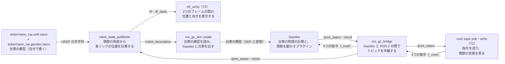

# フェーズ1-2: 台車を Gazebo に出し、関節を動かす

[学習計画](learning_plan.md) のフェーズ1の後半。[フェーズ1-1](phase1_1_urdf.md) で URDF に書いた台車に、重さ・慣性・ぶつかる形を足して、物理を計算するシミュレータ **Gazebo** の中に出す。さらに、舵と後輪の関節を動かすプラグインを付け、ROS 2 のトピックから舵の角度と後輪の速さを指令して、台車が指令どおりに動くことを確かめる。ここで作る「関節に指令を送るトピック」と「関節の状態のトピック」は、フェーズ2の運動学のノードと、フェーズ3のオドメトリのノードが、そのまま使う。新しい概念は、**物理の模型（慣性・衝突）と関節の制御**の1つである。

- 想定環境: Ubuntu 24.04、ROS 2 Jazzy、Gazebo Harmonic（画面を使う。Gazebo のウィンドウを開く）
- 前提: [フェーズ1-1](phase1_1_urdf.md)（このページは、フェーズ1-1で作ったパッケージ `ackermann_description` を直して使う）。環境構築（手順書は作成中。ROS 2 Jazzy と、Gazebo Harmonic と `ros-jazzy-ros-gz` が入っていればよい。4-1節で、使うパッケージを確かめる）。親プロジェクトの [フェーズ2](https://github.com/SanghunIm1991/ros2MinimalPhysicalAi/blob/main/docs/phase2_packages.md) の2-1・2-2・2-4・2-5節と、[フェーズ4](https://github.com/SanghunIm1991/ros2MinimalPhysicalAi/blob/main/docs/phase4_launch.md) の4-1節（フェーズ1-1と同じ）
- 所要の目安: 1〜2コマ
- 言語: 台車の模型は xacro（XML）、中継の設定は YAML、launch のファイルは Python

> **このページの位置づけ**: 舵と後輪には、ここでは `ros2 topic pub` で、手で決めた値を送る。台車を曲げるときの左右の舵の角度と後輪の速さを、前に進む速さと向きを変える速さから計算するのは、フェーズ2の内容である。
>
> **期待する結果の出どころ**: `ros2 pkg prefix`・`gz sim --version`・`xacro`・`check_urdf`・`gz sdf`・`ros2 pkg create`・`colcon build`・`ros2 launch --show-args` の表示と、7節の launch のログ・`ros2 node list`・`ros2 topic list`・`ros2 topic hz`・`gz model`・`ros2 topic pub`・`ros2 topic echo`・`tf2_echo` の表示は、作成時に使い捨てのワークスペースで実際に実行して確かめたものである（7節は、Gazebo を画面なしで起動した。launch の引数 `gz_args:='-r -s empty.sdf'`）。時刻・pid・秒数・パス・ユーザー名・小さな桁の値（`1e-17` のような0に近い値）は、実行ごと・環境ごとに変わる（`ros2 pkg create` の `maintainer` の行は、Git に名前とメールアドレスを設定している環境では、その値になることがある）。7-1節の Gazebo の画面の見え方と、2-3節の Gazebo の画面での色の見え方は、作成時には開いて確かめておらず、模型とワールドの中身から想定したものである。7-4節の最後の `Ctrl+C` のときのログは、画面なしで起動したときのものを、読者の起動の形に合わせて書き換えた（`cmd` の中の `-s` を除いた）。9節に書いた誤りのときの表示は、作成時には起こしておらず、ツールの振る舞いから想定した要旨である。

## 0. 学習目標と完了条件

1. Gazebo で物理を計算するのに要る、重さ・慣性・ぶつかる形を URDF に書き、見た目の形との違いを説明できる（2節・5節）。
2. Gazebo のプラグインで、舵の関節を角度で、後輪の関節を速さで動かす設定を書ける（2-4節・5節）。
3. `ros_gz_bridge` で、ROS 2 と Gazebo の間のトピックを中継し、ROS 2 から関節に指令を送り、関節の状態を受け取れる（2-5節・6節・7節）。

**完了条件**:

- 起動して数秒後に、`gz model` で見た台車の高さ（z）とロール・ピッチ（x・y 軸の周りの傾き）が、表示の桁で0になっている（台車が倒れずに地面の上に静止している。7-2節）。
- 左前の舵に 0.4 rad を指令した後、`/joint_states` の `front_left_steer_joint` の角度が 0.4 rad と 0.01 rad 以内で一致し、`tf2_echo` で見た `front_left_steer_link` のヨー（z 軸の周りの回転）が 0.400 rad になる（7-3節）。
- 左右の後輪に 5 rad/s を指令した後、`/joint_states` の後輪の速さが 5.0 rad/s になり、`gz model` で見た台車が x の正の向き（前）へ進み、横のずれ（y）が 0.01 m 以内に収まる（7-4節）。

## 1. 全体像

このページで作る launch のファイル `sim.launch.py` は、Gazebo を起動し、台車の模型を Gazebo に出して、ROS 2 との間のトピックの中継を始める。

![sim.launch.py が起動するものと、データの流れ。xacro が展開した台車の模型（ackermann_car.urdf.xacro と ackermann_car.gazebo.xacro）の URDF の文字列を、robot_state_publisher が受け取り、/robot_description で配る。ros_gz_sim create は、それを読んで、Gazebo に台車を出す（Gazebo の形式の SDF に変換される）。Gazebo の中の台車のプラグインは関節の状態を /joint_states に出し、Gazebo は時刻を /clock に出して、ros_gz_bridge が ROS 2 へ中継する。robot_state_publisher は、/joint_states と /clock から、各リンクの位置を /tf と /tf_static に送り、T2 の tf2_echo で見る。T2 の ros2 topic pub は、舵の角度と後輪の速さの4つの指令（/front_left_steer_cmd 等）を送り、ros_gz_bridge が Gazebo へ中継する。T2 の ros2 topic echo は /joint_states を見る](img/phase1_2_flow.svg)

<details>
<summary>同じ図（mermaid版）</summary>



</details>

- **Gazebo**: 重さ・力・摩擦・ぶつかりを計算して、模型を動かすシミュレータ。この教材では Gazebo Harmonic（`gz sim` のコマンド）を使う。
- **ros_gz_sim create**: ROS 2 のトピック `/robot_description` から台車の模型を読み、動いている Gazebo の中に出す（一度出したら終わるプログラム）。
- **ros_gz_bridge**: Gazebo の中のトピックと、ROS 2 のトピックを、型を変換して中継するノード（2-5節）。
- **robot_state_publisher**: フェーズ1-1と同じノード。フェーズ1-1では joint_state_publisher が送っていた関節の角度（`/joint_states`）を、ここでは Gazebo の中の実際の関節の角度から受け取る。

## 2. 物理の模型と、関節を動かす仕組み

### 2-1. 見た目の形・ぶつかる形・重さ

フェーズ1-1の台車は、見た目の形（`visual`）だけを持っていた。RViz2 で形を描くにはそれで足りるが、Gazebo で台車を動かすには、物理の計算に使う2つの情報を、リンクごとに足す必要がある。

| 要素 | 書くもの | 使い道 |
|---|---|---|
| `visual` | 見た目の形と色 | 画面に描く（RViz2・Gazebo）。物理の計算には使わない |
| `collision` | ぶつかる形 | ほかのものとの接触（車輪と地面、台車と壁）を計算する |
| `inertial` | 重さ（質量）と、回しにくさ（慣性モーメント）と、重心の位置 | 力を受けたときに、どれだけ加速し、どれだけ回るかを計算する |

`collision` を書かないリンクは、ほかのものとぶつからない（地面をすり抜ける）。この台車では、見た目と同じ箱と円柱を、ぶつかる形にも使う。形が複雑なロボットでは、計算を軽くするために、ぶつかる形を見た目より単純な形（箱や円柱）にすることが多い。

### 2-2. 慣性モーメント

**慣性モーメント**は、ある軸の周りの回しにくさで、同じ重さでも、重さが軸から遠くに分布しているほど大きい。リンクの慣性は、3つの軸の周りの値 `ixx`・`iyy`・`izz` と、軸の間の結びつきを表す `ixy`・`ixz`・`iyz` で書く。中身が一様な、単純な形の値は、公式で計算できる（左右・前後に対称な形では、`ixy`・`ixz`・`iyz` は0になる）。

| 形 | `ixx` | `iyy` | `izz` |
|---|---|---|---|
| 直方体（質量 $m$、辺の長さ $x$ と $y$ と $z$） | $m(y^2+z^2)/12$ | $m(x^2+z^2)/12$ | $m(x^2+y^2)/12$ |
| 円柱（質量 $m$、半径 $r$、高さ $h$、軸は z 向き） | $m(3r^2+h^2)/12$ | $m(3r^2+h^2)/12$ | $mr^2/2$ |

慣性の値を桁違いに間違えると、Gazebo の中で、台車が震えたり、跳ねたり、関節が指令どおりに動かなかったりする。形から公式で計算しておけば、桁を間違えにくい。このページでは、この公式を xacro のマクロにして、寸法と質量から計算させる（5-3節）。

### 2-3. Gazebo は、URDF を SDF に変換して読む

Gazebo が模型を書く形式は、URDF ではなく **SDF**（Simulation Description Format）である。Gazebo は、URDF を受け取ると、SDF に変換してから読む。変換のときに、次のことが起こる。

- **固定の関節でつながったリンクは、1つにまとめられる**。この台車では、`base_link` が、親の `base_footprint` にまとめられ、Gazebo の中には `base_link` という名前のリンクが無くなる（重さと形は `base_footprint` が持つ）。ROS 2 の側の TF は、URDF から `robot_state_publisher` が計算するので、`base_link` はこれまでどおり使える。
- **重さの無い動くリンクは、捨てられる**。舵の部品 `front_*_steer_link` は、形を持たないが、動く関節の先にあるので、小さな仮の重さを与える（5-3節）。
- **見た目の色（`material`）は、引き継がれる**。フェーズ1-1で書いた色が、Gazebo の画面でも使われる（`gz sdf -p` で変換すると、`material` の `ambient`・`diffuse` に、色の値が入る）。
- **URDF に無い、Gazebo だけの設定**（摩擦の係数・プラグイン）は、`<gazebo>` の要素に書く。この要素は、RViz2 や `robot_state_publisher` からは無視される。

### 2-4. 関節を動かすプラグイン

Gazebo の模型には、**プラグイン**（模型やワールドに足す、決まった働きをするプログラム）を付けられる。Gazebo に付属するもののうち、次の3つを使う。どれも、Gazebo の中のトピック（ROS 2 のトピックとは別の仕組み。2-5節）でやり取りする。

| プラグイン | 働き | この台車での使い道 |
|---|---|---|
| `JointPositionController` | 関節を、指令の角度へ動かす | 左右の舵の関節。指令は角度（rad） |
| `JointController` | 関節を、指令の速さで回す | 左右の後輪の関節。指令は回転の速さ（rad/s） |
| `JointStatePublisher` | 関節の角度と速さを、トピックに出す | 動く6つの関節 |

`JointPositionController` は、標準では、角度の誤差から関節に加える力を決める（PID 制御）。この設定では、形を持たない軽い舵の部品を力で安定させるのが難しく、作成時の予備の実験では、舵が指令の角度に届かなかった。そこで、関節の速さを指令する設定（`use_velocity_commands`）にする。この設定では、プラグインは、物理の計算の1刻みで指令の角度に着く速さを求めて、関節の速さとして与える（PID の係数は使わない）。実際の速さは、URDF の関節の速さの上限（`velocity`、フェーズ1-1で 10 rad/s にした）で抑えられるので、舵は 10 rad/s 以下の速さで指令の角度へ回る。

`JointController` は、標準では、関節の速さを、指令の値にそのまま合わせる。どちらのプラグインも、新しい指令が来るまで、最後に受け取った指令を保ち続ける（起動の直後は、角度0・速さ0）。

後輪の回転の速さ $\omega_w$ と、台車が進む速さ $v$ は、車輪が滑らなければ、車輪の半径 $r$ を使って $v = r\omega_w$ の関係にある。この台車（半径 $r$ が 0.04 m）では、後輪を 5 rad/s で回すと、0.2 m/s で進む。

### 2-5. Gazebo と ROS 2 をつなぐ: ros_gz_bridge とシミュレーションの時刻

Gazebo の中のトピック（gz-transport という仕組み）と、ROS 2 のトピックは、別の仕組みで、そのままでは互いに見えない。メッセージの型も別である（Gazebo の `gz.msgs.Double` と ROS 2 の [`std_msgs/msg/Float64`](https://github.com/ros2/common_interfaces/blob/jazzy/std_msgs/msg/Float64.msg) 等）。**ros_gz_bridge** は、決めたトピックを、型を変換しながら、決めた向きに中継する。中継するトピックと型の組は、YAML のファイルに書く（6-2節）。

Gazebo の中の時刻は、シミュレーションの時刻で、Gazebo を起動したときに0から始まり、PC が重くて計算が遅れると、実際の時刻より遅く進む。Gazebo は、この時刻をトピック `/clock` に出す。ROS 2 のノードは、パラメータ `use_sim_time` を `true` にすると、PC の時計の代わりに `/clock` の時刻を使う。`robot_state_publisher` に `use_sim_time` を付けるのは、Gazebo から来る `/joint_states` の時刻と、送る TF の時刻を、シミュレーションの時刻にそろえるためである。

## 3. 仕様

### 3-1. 重さと慣性

重さは、この教材で決めた値である。慣性は、2-2節の公式で、xacro が計算する。

| リンク | 形（ぶつかる形） | 質量 | 慣性 |
|---|---|---|---|
| `base_link`（本体） | 箱 0.19×0.12×0.05 m | 1.5 kg | 直方体の公式（重心は箱の中心） |
| 4つの車輪 | 円柱 半径 0.04 m・幅 0.025 m | 0.08 kg | 円柱の公式（軸を y に向ける） |
| `front_*_steer_link`（舵の部品） | なし | 0.02 kg | 各軸 1e-6 kg·m²（小さな仮の値） |
| `base_footprint` | なし | なし | なし（固定の関節で `base_link` とまとめられる） |

車輪と地面の摩擦の係数は、2つの向き（`mu1`・`mu2`）とも 1.0 にする。

### 3-2. トピック

指令のトピックの名前は、関節の名前から `_joint` を除き、`_cmd` を付けたものにした。Gazebo の中と ROS 2 の側で、同じ名前を使う。

| トピック | 向き | ROS 2 の型 | Gazebo の型 | 中身 |
|---|---|---|---|---|
| `/front_left_steer_cmd` | ROS 2 → Gazebo | `std_msgs/msg/Float64` | `gz.msgs.Double` | 左前の舵の角度の指令（rad。±0.6 の範囲） |
| `/front_right_steer_cmd` | ROS 2 → Gazebo | `std_msgs/msg/Float64` | `gz.msgs.Double` | 右前の舵の角度の指令（rad） |
| `/rear_left_wheel_cmd` | ROS 2 → Gazebo | `std_msgs/msg/Float64` | `gz.msgs.Double` | 左の後輪の回転の速さの指令（rad/s） |
| `/rear_right_wheel_cmd` | ROS 2 → Gazebo | `std_msgs/msg/Float64` | `gz.msgs.Double` | 右の後輪の回転の速さの指令（rad/s） |
| `/joint_states` | Gazebo → ROS 2 | [`sensor_msgs/msg/JointState`](https://github.com/ros2/common_interfaces/blob/jazzy/sensor_msgs/msg/JointState.msg) | `gz.msgs.Model` | 動く6つの関節の角度と速さ（1秒に50回） |
| `/clock` | Gazebo → ROS 2 | [`rosgraph_msgs/msg/Clock`](https://github.com/ros2/rcl_interfaces/blob/jazzy/rosgraph_msgs/msg/Clock.msg) | `gz.msgs.Clock` | シミュレーションの時刻 |

## 4. 準備

### 4-1. 使うパッケージを確かめる

Gazebo と、ROS 2 から Gazebo を使うパッケージが入っているかを確かめる。

```bash
gz sim --version

ros2 pkg prefix ros_gz_sim

ros2 pkg prefix ros_gz_bridge
```

**期待する結果**（3つのコマンドの表示をまとめた。版の数字は、導入した時期によって変わる）:

```text
$ gz sim --version
Gazebo Sim, version 8.15.0
Copyright (C) 2018 Open Source Robotics Foundation.
Released under the Apache 2.0 License.

$ ros2 pkg prefix ros_gz_sim
/opt/ros/jazzy
$ ros2 pkg prefix ros_gz_bridge
/opt/ros/jazzy
```

`gz sim --version` の版が 8 で始まれば、Gazebo Harmonic である。`gz: command not found` や `Package not found` と出た場合は、ROS 2 Jazzy と組み合わせて使う Gazebo の一式を、次のコマンドで導入する（Gazebo Harmonic と、`ros_gz_sim`・`ros_gz_bridge` が一緒に入る）。

```bash
sudo apt install ros-jazzy-ros-gz
```

**期待する結果**: 導入が終わった後、上の3つのコマンドで、Gazebo の版と `/opt/ros/jazzy` が出る。

## 5. 台車の模型に、重さ・ぶつかる形・Gazebo の設定を足す

### 5-1. 台車の模型

フェーズ1-1で書いたファイルを、次のとおりに書き換える。フェーズ1-1から足したのは、重さの変数・慣性のマクロ（`box_inertial`・`cylinder_inertial`）・本体と車輪の `collision` と `inertial`・舵の部品の `inertial`・最後の `xacro:include` の行である。寸法と関節は変えていない。

ファイル: `~/ros2_ws/src/ackermann_description/urdf/ackermann_car.urdf.xacro`

```xml
<?xml version="1.0"?>
<!-- アッカーマン式の台車の模型（フェーズ1-2: 重さ・慣性・ぶつかる形と、Gazebo の設定を足した） -->
<robot name="ackermann_car" xmlns:xacro="http://www.ros.org/wiki/xacro">

  <!-- 台車の寸法（この教材で決めた値。単位は m と rad） -->
  <xacro:property name="wheelbase" value="0.20"/>
  <xacro:property name="track" value="0.16"/>
  <xacro:property name="wheel_radius" value="0.04"/>
  <xacro:property name="wheel_width" value="0.025"/>
  <xacro:property name="steer_max" value="0.6"/>
  <xacro:property name="body_length" value="0.19"/>
  <xacro:property name="body_width" value="0.12"/>
  <xacro:property name="body_height" value="0.05"/>

  <!-- 重さ（この教材で決めた値。単位は kg） -->
  <xacro:property name="body_mass" value="1.5"/>
  <xacro:property name="wheel_mass" value="0.08"/>
  <xacro:property name="steer_mass" value="0.02"/>

  <material name="body_blue"><color rgba="0.25 0.45 0.80 1"/></material>
  <material name="tire_black"><color rgba="0.10 0.10 0.10 1"/></material>

  <!-- 直方体の慣性（中身が一様な箱） -->
  <xacro:macro name="box_inertial" params="m x y z *origin">
    <inertial>
      <xacro:insert_block name="origin"/>
      <mass value="${m}"/>
      <inertia ixx="${m * (y * y + z * z) / 12}" iyy="${m * (x * x + z * z) / 12}"
               izz="${m * (x * x + y * y) / 12}" ixy="0" ixz="0" iyz="0"/>
    </inertial>
  </xacro:macro>

  <!-- 円柱の慣性（中身が一様な円柱。軸は z 向き） -->
  <xacro:macro name="cylinder_inertial" params="m r h *origin">
    <inertial>
      <xacro:insert_block name="origin"/>
      <mass value="${m}"/>
      <inertia ixx="${m * (3 * r * r + h * h) / 12}" iyy="${m * (3 * r * r + h * h) / 12}"
               izz="${m * r * r / 2}" ixy="0" ixz="0" iyz="0"/>
    </inertial>
  </xacro:macro>

  <!-- 地面の上の、base_link の真下の点 -->
  <link name="base_footprint"/>

  <!-- 台車の基準。原点は後車軸の中心 -->
  <link name="base_link">
    <visual>
      <origin xyz="${body_length / 2 - wheel_radius} 0 0"/>
      <geometry><box size="${body_length} ${body_width} ${body_height}"/></geometry>
      <material name="body_blue"/>
    </visual>
    <collision>
      <origin xyz="${body_length / 2 - wheel_radius} 0 0"/>
      <geometry><box size="${body_length} ${body_width} ${body_height}"/></geometry>
    </collision>
    <xacro:box_inertial m="${body_mass}" x="${body_length}" y="${body_width}" z="${body_height}">
      <origin xyz="${body_length / 2 - wheel_radius} 0 0"/>
    </xacro:box_inertial>
  </link>

  <joint name="base_joint" type="fixed">
    <parent link="base_footprint"/>
    <child link="base_link"/>
    <origin xyz="0 0 ${wheel_radius}"/>
  </joint>

  <!-- 車輪のリンク（円柱を x 軸の周りに 90° 回して、軸を y に向ける） -->
  <xacro:macro name="wheel_link" params="name">
    <link name="${name}">
      <visual>
        <origin rpy="${-pi / 2} 0 0"/>
        <geometry><cylinder radius="${wheel_radius}" length="${wheel_width}"/></geometry>
        <material name="tire_black"/>
      </visual>
      <collision>
        <origin rpy="${-pi / 2} 0 0"/>
        <geometry><cylinder radius="${wheel_radius}" length="${wheel_width}"/></geometry>
      </collision>
      <xacro:cylinder_inertial m="${wheel_mass}" r="${wheel_radius}" h="${wheel_width}">
        <origin rpy="${-pi / 2} 0 0"/>
      </xacro:cylinder_inertial>
    </link>
  </xacro:macro>

  <!-- 後輪: base_link に、y 軸の周りに回る関節でつなぐ -->
  <xacro:macro name="rear_wheel" params="side y">
    <xacro:wheel_link name="rear_${side}_wheel"/>
    <joint name="rear_${side}_wheel_joint" type="continuous">
      <parent link="base_link"/>
      <child link="rear_${side}_wheel"/>
      <origin xyz="0 ${y} 0"/>
      <axis xyz="0 1 0"/>
    </joint>
  </xacro:macro>

  <!-- 前輪: 舵を切る関節（z 軸の周り）の先に、回る関節（y 軸の周り）をつなぐ -->
  <xacro:macro name="front_wheel" params="side y">
    <link name="front_${side}_steer_link">
      <!-- 形は無いが、Gazebo は重さの無い動く部品を捨てるので、小さな仮の値を与える -->
      <inertial>
        <mass value="${steer_mass}"/>
        <inertia ixx="1e-6" iyy="1e-6" izz="1e-6" ixy="0" ixz="0" iyz="0"/>
      </inertial>
    </link>
    <joint name="front_${side}_steer_joint" type="revolute">
      <parent link="base_link"/>
      <child link="front_${side}_steer_link"/>
      <origin xyz="${wheelbase} ${y} 0"/>
      <axis xyz="0 0 1"/>
      <limit lower="${-steer_max}" upper="${steer_max}" effort="10" velocity="10"/>
    </joint>
    <xacro:wheel_link name="front_${side}_wheel"/>
    <joint name="front_${side}_wheel_joint" type="continuous">
      <parent link="front_${side}_steer_link"/>
      <child link="front_${side}_wheel"/>
      <axis xyz="0 1 0"/>
    </joint>
  </xacro:macro>

  <xacro:rear_wheel side="left" y="${track / 2}"/>
  <xacro:rear_wheel side="right" y="${-track / 2}"/>
  <xacro:front_wheel side="left" y="${track / 2}"/>
  <xacro:front_wheel side="right" y="${-track / 2}"/>

  <!-- Gazebo だけで使う設定（摩擦と、関節を動かすプラグイン） -->
  <xacro:include filename="ackermann_car.gazebo.xacro"/>

</robot>
```

### 5-2. Gazebo の設定のファイル

Gazebo だけで使う設定を、別のファイルに分けて書く。5-1節のファイルの最後の `xacro:include` の行で、このファイルの中身が、その場所に読み込まれる。

ファイル: `~/ros2_ws/src/ackermann_description/urdf/ackermann_car.gazebo.xacro`

```xml
<?xml version="1.0"?>
<!-- 台車の模型のうち、Gazebo だけで使う設定（ackermann_car.urdf.xacro から読み込む） -->
<robot xmlns:xacro="http://www.ros.org/wiki/xacro">

  <!-- 車輪のタイヤと地面の摩擦の係数 -->
  <xacro:macro name="wheel_friction" params="name">
    <gazebo reference="${name}">
      <mu1>1.0</mu1>
      <mu2>1.0</mu2>
    </gazebo>
  </xacro:macro>

  <xacro:wheel_friction name="rear_left_wheel"/>
  <xacro:wheel_friction name="rear_right_wheel"/>
  <xacro:wheel_friction name="front_left_wheel"/>
  <xacro:wheel_friction name="front_right_wheel"/>

  <!-- 舵の関節を、指令の角度へ動かすプラグイン（関節の速さを指令する設定） -->
  <xacro:macro name="steer_controller" params="side">
    <plugin filename="gz-sim-joint-position-controller-system"
            name="gz::sim::systems::JointPositionController">
      <joint_name>front_${side}_steer_joint</joint_name>
      <topic>/front_${side}_steer_cmd</topic>
      <use_velocity_commands>true</use_velocity_commands>
    </plugin>
  </xacro:macro>

  <!-- 後輪の関節を、指令の速さで回すプラグイン -->
  <xacro:macro name="wheel_controller" params="side">
    <plugin filename="gz-sim-joint-controller-system"
            name="gz::sim::systems::JointController">
      <joint_name>rear_${side}_wheel_joint</joint_name>
      <topic>/rear_${side}_wheel_cmd</topic>
    </plugin>
  </xacro:macro>

  <gazebo>
    <xacro:steer_controller side="left"/>
    <xacro:steer_controller side="right"/>
    <xacro:wheel_controller side="left"/>
    <xacro:wheel_controller side="right"/>
    <!-- 動く関節の角度と速さを、1秒に50回送るプラグイン -->
    <plugin filename="gz-sim-joint-state-publisher-system"
            name="gz::sim::systems::JointStatePublisher">
      <topic>/joint_states</topic>
      <update_rate>50</update_rate>
    </plugin>
  </gazebo>

</robot>
```

### 5-3. 解説

- **重さの変数**: 3-1節の質量を、寸法と同じように、ファイルの先頭にまとめた。
- **`box_inertial` と `cylinder_inertial` のマクロ**: 2-2節の公式を、そのまま式で書いた。`*origin` は、マクロを呼ぶときに中に書いた要素（ここでは `<origin .../>`）を1つ受け取る引数で、`<xacro:insert_block name="origin"/>` の場所に入る。`inertial` の `origin` は、リンクのフレームの中での重心の位置と、慣性の軸の向きである。
- **本体の `collision` と `inertial`**: `visual` と同じ箱を、同じ位置（前へ 0.055 m）に置いた。重心も箱の中心にある。
- **車輪の `collision` と `inertial`**: `visual` と同じ円柱を、同じ向き（x 軸の周りに −90°）に置いた。慣性の `origin` にも同じ回転を書くので、円柱の公式（軸は z 向き）を、そのまま使える。
- **舵の部品の `inertial`**: 形を持たないが、重さが無いと Gazebo が捨てる（2-3節）ので、小さな仮の値を与えた。車輪と比べて十分に軽いので、台車の動きにはほとんど影響しない。
- **`xacro:include`**: 別の xacro のファイルを読み込む。`filename` に書いたパスは、読み込む側のファイルと同じフォルダからの相対のパスとして探される。
- **`<gazebo reference="...">`**: `reference` に書いたリンクに、Gazebo だけの設定を足す。`mu1`・`mu2` は、接触の面の2つの向きの摩擦の係数である。
- **`<gazebo>`（`reference` なし）**: 模型の全体に、Gazebo だけの設定を足す。ここに、2-4節のプラグインを並べた。`filename` はプラグインのプログラムの名前、`name` はその中の働きの名前で、どちらも Gazebo の決まった書き方である。`topic` は、プラグインが使う Gazebo の中のトピックの名前で、書かなければ、プラグインが決めた長い名前になる。
- **`update_rate`**: `JointStatePublisher` が関節の状態を送る頻度（1秒あたりの回数）。書かなければ、物理の計算の刻み（この教材のワールドでは、1秒に1000回）ごとに送る。

### 5-4. Gazebo の形式に変換して確かめる

ファイルを足したので、パッケージをビルドし直す（`--symlink-install` でも、新しいファイルを足したときは、ビルドが要る）。その後、xacro を展開して、Gazebo の形式の SDF に変換し、リンクの名前を見る。`gz sdf -p` は、URDF を SDF に変換して表示するコマンドである。

```bash
cd ~/ros2_ws

colcon build --symlink-install --packages-select ackermann_description

xacro ~/ros2_ws/src/ackermann_description/urdf/ackermann_car.urdf.xacro > /tmp/ackermann_car.urdf

check_urdf /tmp/ackermann_car.urdf

gz sdf -p /tmp/ackermann_car.urdf | grep '<link name'
```

**期待する結果**（`check_urdf` の先頭の3行と、`grep` の表示。`colcon build` の表示は、フェーズ1-1と同じなので省いた）:

```text
$ check_urdf /tmp/ackermann_car.urdf
robot name is: ackermann_car
---------- Successfully Parsed XML ---------------
root Link: base_footprint has 1 child(ren)
$ gz sdf -p /tmp/ackermann_car.urdf | grep '<link name'
    <link name='base_footprint'>
    <link name='front_left_steer_link'>
    <link name='front_left_wheel'>
    <link name='front_right_steer_link'>
    <link name='front_right_wheel'>
    <link name='rear_left_wheel'>
    <link name='rear_right_wheel'>
```

`check_urdf` の木は、フェーズ1-1と同じ8つのリンクのままである（この後の行は省いた）。SDF のリンクは7つで、`base_link` が無い。2-3節のとおり、固定の関節でつながった `base_link` が、`base_footprint` にまとめられたためである。舵の部品の2つは、重さを与えたので残っている。

まとめられたリンクの重さは、次のコマンドで見られる。

```bash
gz sdf -p /tmp/ackermann_car.urdf | grep -A 12 "<link name='base_footprint'>"
```

**期待する結果**（抜粋。小さな桁の値は環境によって変わる）:

```text
    <link name='base_footprint'>
      <inertial>
        <pose>0.055 0 0.039999999999999987 0 0 0</pose>
        <mass>1.5</mass>
        <inertia>
          <ixx>0.0021125000000000011</ixx>
          <ixy>0</ixy>
          <ixz>-4.3368086899420177e-19</ixz>
          <iyy>0.0048250000000000003</iyy>
          <iyz>0</iyz>
          <izz>0.0063125000000000021</izz>
        </inertia>
      </inertial>
```

`base_footprint` が、本体の質量 1.5 kg を持ち、重心（`pose` の最初の3つ）は、`base_footprint` から前へ 0.055 m、上へ 0.04 m（`base_link` の高さ）の、箱の中心にある。`ixx` は $1.5 \times (0.12^2+0.05^2)/12 = 0.0021125$ で、2-2節の直方体の公式の値と一致する（`0.0021125000000000011` の末尾の桁や、`-4.3e-19` のような0に近い値は、計算の丸めの誤差である）。

## 6. Gazebo で動かすパッケージを作る

### 6-1. パッケージを作る

Gazebo を起動する launch のファイルと、中継の設定は、台車の模型とは別のパッケージ `ackermann_gazebo` に置く（模型と、それを動かす環境を分けておくと、後のフェーズで、壁のあるワールドを足したり、模型をほかの使い方で読んだりしやすい）。

```bash
cd ~/ros2_ws/src

ros2 pkg create --build-type ament_python --license Apache-2.0 ackermann_gazebo

mkdir -p ackermann_gazebo/launch ackermann_gazebo/config
```

**期待する結果**（`ros2 pkg create` の表示の抜粋）:

```text
going to create a new package
package name: ackermann_gazebo
destination directory: /home/<ユーザー名>/ros2_ws/src
package format: 3
version: 0.0.0
description: TODO: Package description
maintainer: ['<ユーザー名> <<ユーザー名>@todo.todo>']
licenses: ['Apache-2.0']
build type: ament_python
dependencies: []
creating folder ./ackermann_gazebo
creating ./ackermann_gazebo/package.xml
```

この後に、フェーズ1-1の `ackermann_description` と同じ並びで、`creating` の行が続く。

### 6-2. 中継の設定

ファイル: `~/ros2_ws/src/ackermann_gazebo/config/bridge.yaml`

```yaml
# ROS 2 と Gazebo の間で中継するトピック（ros_gz_bridge の parameter_bridge が読む）

# Gazebo の中の時刻 → ROS 2
- ros_topic_name: /clock
  gz_topic_name: /clock
  ros_type_name: rosgraph_msgs/msg/Clock
  gz_type_name: gz.msgs.Clock
  direction: GZ_TO_ROS

# 関節の角度と速さ → ROS 2
- ros_topic_name: /joint_states
  gz_topic_name: /joint_states
  ros_type_name: sensor_msgs/msg/JointState
  gz_type_name: gz.msgs.Model
  direction: GZ_TO_ROS

# 舵の角度の指令（rad） ROS 2 → Gazebo
- ros_topic_name: /front_left_steer_cmd
  gz_topic_name: /front_left_steer_cmd
  ros_type_name: std_msgs/msg/Float64
  gz_type_name: gz.msgs.Double
  direction: ROS_TO_GZ

- ros_topic_name: /front_right_steer_cmd
  gz_topic_name: /front_right_steer_cmd
  ros_type_name: std_msgs/msg/Float64
  gz_type_name: gz.msgs.Double
  direction: ROS_TO_GZ

# 後輪の回転の速さの指令（rad/s） ROS 2 → Gazebo
- ros_topic_name: /rear_left_wheel_cmd
  gz_topic_name: /rear_left_wheel_cmd
  ros_type_name: std_msgs/msg/Float64
  gz_type_name: gz.msgs.Double
  direction: ROS_TO_GZ

- ros_topic_name: /rear_right_wheel_cmd
  gz_topic_name: /rear_right_wheel_cmd
  ros_type_name: std_msgs/msg/Float64
  gz_type_name: gz.msgs.Double
  direction: ROS_TO_GZ
```

1つの `-` の項目が、1つのトピックの中継である。`ros_topic_name` と `gz_topic_name` は、ROS 2 の側と Gazebo の側のトピックの名前、`ros_type_name` と `gz_type_name` は、それぞれの側の型、`direction` は中継の向き（`GZ_TO_ROS` は Gazebo から ROS 2 へ、`ROS_TO_GZ` は ROS 2 から Gazebo へ）である。関節の状態の Gazebo の型は、関節の一覧を持つ模型の型 `gz.msgs.Model` で、ros_gz_bridge が `sensor_msgs/msg/JointState` に変換する。

### 6-3. launch のファイル

ファイル: `~/ros2_ws/src/ackermann_gazebo/launch/sim.launch.py`

```python
"""Gazebo を起動し、台車の模型を出して、ROS 2 とのトピックの中継を始める。"""
from launch import LaunchDescription
from launch.actions import DeclareLaunchArgument, IncludeLaunchDescription
from launch.launch_description_sources import PythonLaunchDescriptionSource
from launch.substitutions import Command, LaunchConfiguration, PathJoinSubstitution
from launch_ros.actions import Node
from launch_ros.parameter_descriptions import ParameterValue
from launch_ros.substitutions import FindPackageShare


def generate_launch_description():
    """launch の引数と、起動するもの（Gazebo とノード）をまとめて返す。"""
    gz_args = LaunchConfiguration('gz_args')
    xacro_file = PathJoinSubstitution(
        [FindPackageShare('ackermann_description'), 'urdf', 'ackermann_car.urdf.xacro'])
    robot_description = ParameterValue(Command(['xacro ', xacro_file]), value_type=str)
    gz_sim_launch = PathJoinSubstitution(
        [FindPackageShare('ros_gz_sim'), 'launch', 'gz_sim.launch.py'])
    bridge_config = PathJoinSubstitution(
        [FindPackageShare('ackermann_gazebo'), 'config', 'bridge.yaml'])

    return LaunchDescription([
        DeclareLaunchArgument(
            'gz_args', default_value='-r empty.sdf',
            description='gz sim に渡す引数（ワールドのファイル等）'),
        IncludeLaunchDescription(
            PythonLaunchDescriptionSource(gz_sim_launch),
            launch_arguments={'gz_args': gz_args, 'on_exit_shutdown': 'true'}.items()),
        Node(package='robot_state_publisher', executable='robot_state_publisher',
             parameters=[{'robot_description': robot_description, 'use_sim_time': True}]),
        Node(package='ros_gz_sim', executable='create',
             arguments=['-topic', 'robot_description', '-name', 'ackermann_car', '-z', '0.01']),
        Node(package='ros_gz_bridge', executable='parameter_bridge',
             parameters=[{'config_file': bridge_config}]),
    ])
```

- **`gz_args` の引数**: `gz sim` のコマンドに渡す引数。既定の `-r empty.sdf` は、Gazebo に付属する空のワールド（地面と光だけがある）を開き、すぐにシミュレーションを始める（`-r` が無いと、止まった状態で開く）。`-s` を足すと、画面を開かずに物理の計算だけをする。
- **`IncludeLaunchDescription`**: ほかのパッケージの launch のファイルを、この launch の中で起動する。`ros_gz_sim` の `gz_sim.launch.py` は、Gazebo（`gz sim`）を起動する launch のファイルで、`gz_args` をそのまま `gz sim` に渡す。`on_exit_shutdown` を `true` にすると、Gazebo のウィンドウを閉じたときに、この launch で起動したノードもすべて止まる。
- **`robot_state_publisher`**: フェーズ1-1の `display.launch.py` と同じ書き方に、`use_sim_time` を足した（2-5節）。
- **`create`**: `-topic robot_description` で、`robot_state_publisher` が配る模型を読み、`-name` の名前の模型として Gazebo に出す。`-z 0.01` は、出す高さ（m）で、地面に少しでもめり込んだ状態で出さないように、1 cm 上から落とす。
- **`parameter_bridge`**: ros_gz_bridge のノード。パラメータ `config_file` で、6-2節の YAML のファイルを渡す。

### 6-4. パッケージの設定と、ビルド

`launch/` と `config/` のファイルが `install/` へコピーされるように、`setup.py` を、フェーズ1-1と同じように直す。足したのは、`from glob import glob` の行と、`data_files` の最後の2行である。

ファイル: `~/ros2_ws/src/ackermann_gazebo/setup.py`

```python
from glob import glob

from setuptools import find_packages, setup

package_name = 'ackermann_gazebo'

setup(
    name=package_name,
    version='0.0.0',
    packages=find_packages(exclude=['test']),
    data_files=[
        ('share/ament_index/resource_index/packages',
            ['resource/' + package_name]),
        ('share/' + package_name, ['package.xml']),
        ('share/' + package_name + '/launch', glob('launch/*.launch.py')),
        ('share/' + package_name + '/config', glob('config/*.yaml')),
    ],
    install_requires=['setuptools'],
    zip_safe=True,
    maintainer='<ユーザー名>',
    maintainer_email='<ユーザー名>@todo.todo',
    description='TODO: Package description',
    license='Apache-2.0',
    extras_require={
        'test': [
            'pytest',
        ],
    },
    entry_points={
        'console_scripts': [
        ],
    },
)
```

`maintainer` と `maintainer_email` は、`ros2 pkg create` が書いた値のままでよい。

`package.xml` には、実行するときに使うパッケージを足す（`<license>` の行の後、`<test_depend>` の行の前）。台車の模型のパッケージ `ackermann_description` も、ここに書く。

ファイル: `~/ros2_ws/src/ackermann_gazebo/package.xml`（足す行）

```xml
  <exec_depend>ackermann_description</exec_depend>
  <exec_depend>xacro</exec_depend>
  <exec_depend>robot_state_publisher</exec_depend>
  <exec_depend>ros_gz_sim</exec_depend>
  <exec_depend>ros_gz_bridge</exec_depend>
  <exec_depend>launch_ros</exec_depend>
```

ビルドして、launch の引数を確かめる。

```bash
cd ~/ros2_ws

colcon build --symlink-install --packages-select ackermann_gazebo

source ~/ros2_ws/install/setup.bash

ros2 launch ackermann_gazebo sim.launch.py --show-args
```

**期待する結果**（`colcon build` の表示と、`--show-args` の表示の先頭。秒数は環境によって変わる）:

```text
$ colcon build --symlink-install --packages-select ackermann_gazebo
Starting >>> ackermann_gazebo
Finished <<< ackermann_gazebo [2.42s]

Summary: 1 package finished [2.61s]
$ ros2 launch ackermann_gazebo sim.launch.py --show-args
Arguments (pass arguments as '<name>:=<value>'):

    'gz_args':
        gz sim に渡す引数（ワールドのファイル等）
        (default: '-r empty.sdf')

    'gz_version':
        Gazebo Sim's major version
        (default: '8')
```

`gz_args` の後に、`gz_version`・`ign_args`・`debugger`・`on_exit_shutdown` 等の引数が続く。これらは、取り込んだ `gz_sim.launch.py` の引数で、このページでは使わない（`on_exit_shutdown` は、この launch のファイルの中で `true` を渡している）。

## 7. 動かす

### 7-1. 起動する

T1 で、シミュレーションを起動する。この教材では、フェーズ1-2以降、T1 をシミュレーション（`sim.launch.py`）に使う（README の「ターミナルの番号」）。

```bash
# T1
source ~/ros2_ws/install/setup.bash

ros2 launch ackermann_gazebo sim.launch.py
```

Gazebo のウィンドウが開く。PC が重く、画面を開かずに動かしたい場合は、`ros2 launch ackermann_gazebo sim.launch.py gz_args:='-r -s empty.sdf'` で起動する（このページの手順は、画面が無くても、すべてコマンドで確かめられる）。

**期待する結果**（T1 のログの抜粋。時刻・pid・パスは実行ごとに変わる。Gazebo の画面が出すログの行は、作成時には確かめていない）:

```text
[INFO] [launch]: All log files can be found below /home/<ユーザー名>/.ros/log/<日時>-<ホスト名>-<pid>
[INFO] [launch]: Default logging verbosity is set to INFO
[INFO] [gazebo-1]: process started with pid [1795]
[INFO] [robot_state_publisher-2]: process started with pid [1796]
[INFO] [create-3]: process started with pid [1798]
[INFO] [parameter_bridge-4]: process started with pid [1799]
[create-3] [INFO] [1794324583.252596164] [ros_gz_sim]: Requesting list of world names.
[robot_state_publisher-2] [INFO] [1794324583.266303120] [robot_state_publisher]: Robot initialized
[create-3] [INFO] [1794324583.989923081] [ros_gz_sim]: Waiting messages on topic [robot_description].
[create-3] [INFO] [1794324584.003549347] [ros_gz_sim]: Entity creation successful.
[INFO] [create-3]: process has finished cleanly [pid 1798]
[parameter_bridge-4] [INFO] [1794324584.281890802] [ros_gz_bridge]: Creating GZ->ROS Bridge: [/clock (gz.msgs.Clock) -> /clock (rosgraph_msgs/msg/Clock)] (Lazy 0)
[parameter_bridge-4] [INFO] [...] [ros_gz_bridge]: Creating GZ->ROS Bridge: [/joint_states (gz.msgs.Model) -> /joint_states (sensor_msgs/msg/JointState)] (Lazy 0)
[parameter_bridge-4] [INFO] [...] [ros_gz_bridge]: Creating ROS->GZ Bridge: [/front_left_steer_cmd (std_msgs/msg/Float64) -> /front_left_steer_cmd (gz.msgs.Double)] (Lazy 0)
```

`gazebo-1`（Gazebo）・`robot_state_publisher-2`・`create-3`・`parameter_bridge-4` の4つが起動する。`create` は、`Entity creation successful` で台車を Gazebo に出し、`process has finished cleanly` で終わる（一度出したら終わるプログラムなので、誤りではない）。`parameter_bridge` は、YAML のファイルに書いた6つのトピックの中継を、`Creating ... Bridge` の行で1つずつ知らせる（2行目以降は時刻を `...` にし、残りの3行は省いた）。指令を初めて中継したときに、`Passing message from ROS std_msgs/msg/Float64 to Gazebo gz.msgs.Double` の行が1回だけ出る。

Gazebo の画面（想定したもの）: 灰色の地面の中央に、青い箱の本体と4つの黒い車輪の台車が出る。台車は長さ約 0.2 m と小さいので、開いた直後の視点では、点のようにしか見えないことがある。マウスのホイールで中央に寄るか、右の一覧（Entity Tree）の `ackermann_car` を右クリックして「Move to」を選ぶと、台車の近くへ視点が動く。台車は止まったままで、倒れたり、跳ねたり、滑り出したりしない。画面の左下の再生のボタンが一時停止の形（シミュレーションが進んでいる）で、シミュレーションの時刻が進んでいく。

### 7-2. ノードとトピックと、台車の位置を確かめる

T2 で、ノードとトピックの一覧と、`/joint_states` の頻度を見る。

```bash
# T2
source ~/ros2_ws/install/setup.bash

ros2 node list

ros2 topic list

ros2 topic hz /joint_states
```

`ros2 topic hz` は、トピックの頻度を表示し続けるので、数秒見たら `Ctrl+C` で止める。

**期待する結果**（`ros2 topic hz` は抜粋。値は少し揺れる）:

```text
$ ros2 node list
/robot_state_publisher
/ros_gz_bridge
$ ros2 topic list
/clock
/front_left_steer_cmd
/front_right_steer_cmd
/joint_states
/parameter_events
/rear_left_wheel_cmd
/rear_right_wheel_cmd
/robot_description
/rosout
/tf
/tf_static
$ ros2 topic hz /joint_states
average rate: 49.939
	min: 0.019s max: 0.021s std dev: 0.00022s window: 51
```

ノードは、`robot_state_publisher` と、ros_gz_bridge（`/ros_gz_bridge`）の2つである（Gazebo は ROS 2 のノードではなく、`create` は終わっているので、出ない）。トピックには、3-2節の6つと、`robot_state_publisher` が出す `/robot_description`・`/tf`・`/tf_static` がある。`/joint_states` は、5-2節の `update_rate` のとおり、1秒に約50回届く。

Gazebo の中の台車の位置と向きは、`gz model` のコマンドで見られる（ROS 2 を通さず、Gazebo に直接たずねる）。

```bash
# T2
gz model -m ackermann_car -p
```

**期待する結果**:

```text

Requesting state for world [empty]...

Model: [10]
  - Name: ackermann_car
  - Pose [ XYZ (m) ] [ RPY (rad) ]:
    [-0.000000 -0.000000 -0.000000]
    [0.000000 -0.000000 -0.000000]
```

`Pose` の1行目が位置（x・y・z、m）、2行目が向き（x・y・z 軸の周りの回転の角度。ロール・ピッチ・ヨー、rad）である。模型の位置は、根のリンク `base_footprint`（地面の上の点）の位置になる。6-3節で 0.01 m の高さに出した台車が、地面まで落ちて z が0になり、ロールとピッチも0なので、倒れずに地面の上に静止している（完了条件の1つ目）。`-0.000000` の `-` は、0にごく近い負の値という意味で、誤差の範囲である。`Model: [10]` の数字は、Gazebo の中の番号で、環境によって変わることがある。

### 7-3. 舵を切る

T2 で、左前の舵に 0.4 rad を指令し、関節の状態と TF を見る。

```bash
# T2
ros2 topic pub --once /front_left_steer_cmd std_msgs/msg/Float64 "{data: 0.4}"

ros2 topic echo --once /joint_states

ros2 run tf2_ros tf2_echo base_link front_left_steer_link
```

`ros2 topic pub --once` は、メッセージを1つ送って終わる。`tf2_echo` は、確かめたら `Ctrl+C` で止める。

**期待する結果**（`ros2 topic pub` の表示、`ros2 topic echo` の表示、`tf2_echo` の表示の抜粋。時刻と、0に近い小さな値は実行ごとに変わる）:

```text
$ ros2 topic pub --once /front_left_steer_cmd std_msgs/msg/Float64 "{data: 0.4}"
publisher: beginning loop
publishing #1: std_msgs.msg.Float64(data=0.4)

$ ros2 topic echo --once /joint_states
header:
  stamp:
    sec: 21
    nanosec: 820000000
  frame_id: ''
name:
- front_left_steer_joint
- front_left_wheel_joint
- front_right_steer_joint
- front_right_wheel_joint
- rear_left_wheel_joint
- rear_right_wheel_joint
position:
- 0.4
- 0.0998930285978863
- -1.001131232359199e-21
- 8.559040538443403e-10
- -5.4597812402264155e-14
- 1.6557537322585896e-13
velocity:
- -8.111951922041417e-18
- 9.852308647158842e-17
- -2.316118380842093e-19
- 1.0802677897683172e-16
- -1.7802815644013673e-17
- -1.548994470334327e-17
effort:
- 0.0
- 0.0
- 0.0
- 0.0
- 0.0
- 0.0
---
$ ros2 run tf2_ros tf2_echo base_link front_left_steer_link
At time 23.340000000
- Translation: [0.200, 0.080, 0.000]
- Rotation: in Quaternion (xyzw) [0.000, 0.000, 0.199, 0.980]
- Rotation: in RPY (radian) [0.000, -0.000, 0.400]
- Rotation: in RPY (degree) [0.000, -0.000, 22.918]
```

`ros2 topic pub` の `publishing #1` は、指令を1つ送ったという表示である（相手が見つかるまで、`Waiting for at least 1 matching subscription(s)...` の行が出てから送ることもある）。

`/joint_states` の `name` と `position` を同じ順番で読むと、`front_left_steer_joint` が 0.4 で、指令どおりに舵が切れている（完了条件の2つ目の前半）。右前の舵（`front_right_steer_joint`）は、指令していないので0のまま（`e-21` は0に近い値）である。左前の車輪（`front_left_wheel_joint`）が約 0.1 rad だけ回っているのは、舵を切ったときの、地面との接触の計算に伴う小さなずれである（舵の軸は車輪の中心を通るので、形の上では転がる必要は無い。台車の動きには影響しない）。`header` の `stamp` は、シミュレーションの時刻（Gazebo を起動してからの秒数）で、PC の時計の時刻ではない。`effort` は、プラグインが関節の力を送っていないので0である。

`tf2_echo` では、`Translation` はフェーズ1-1と同じ (0.200, 0.080, 0.000) のまま、`Rotation: in RPY (radian)` の3つ目（ヨー）が 0.400 になる（完了条件の2つ目の後半）。`robot_state_publisher` が、Gazebo から届いた舵の角度で、TF を計算している。`At time` も、シミュレーションの時刻である。起動の直後と同じように、最初に `Waiting for transform ...` の行が出ることがある。

作成時に、同じ設定の台車で、舵に段階の指令（0 rad から 0.4 rad 等）を与えて測ったところ、指令を送る直前に受け取った `/joint_states` の時刻から、舵の角度が指令と 0.01 rad 以内に入った `/joint_states` の時刻までは、シミュレーションの時刻で 0.2 秒以下だった。2-4節のとおり、舵は、関節の速さの上限の 10 rad/s 以下で回るので、0.4 rad なら、計算の上では 0.04 秒で回りきる。残りは、主に、指令が中継されて届くまでの時間と、`/joint_states` の間隔（0.02 秒）によると考えられる。

舵を0に戻しておく。

```bash
# T2
ros2 topic pub --once /front_left_steer_cmd std_msgs/msg/Float64 "{data: 0.0}"
```

**期待する結果**: `publishing #1: std_msgs.msg.Float64(data=0.0)` が表示される。この後、`ros2 topic echo --once /joint_states` を実行すると、`front_left_steer_joint` の角度が0（0に近い小さな値）に戻っている。

### 7-4. 後輪を回して進める

T2 で、左右の後輪に 5 rad/s を指令し、その後に、台車の位置と関節の速さを見る。2-4節の $v = r\omega_w$ から、台車は 0.04×5＝0.2 m/s で進む。

```bash
# T2
ros2 topic pub --once /rear_left_wheel_cmd std_msgs/msg/Float64 "{data: 5.0}"

ros2 topic pub --once /rear_right_wheel_cmd std_msgs/msg/Float64 "{data: 5.0}"

gz model -m ackermann_car -p

ros2 topic echo --once /joint_states --field velocity
```

**期待する結果**（`gz model` と `ros2 topic echo` の表示。位置は、指令を送ってから `gz model` を実行するまでの時間によって変わる。作成時は、指令の直後に実行した）:

```text
$ gz model -m ackermann_car -p

Requesting state for world [empty]...

Model: [10]
  - Name: ackermann_car
  - Pose [ XYZ (m) ] [ RPY (rad) ]:
    [0.110101 -0.000000 -0.000000]
    [-0.000000 -0.000000 -0.000004]
$ ros2 topic echo --once /joint_states --field velocity
array('d', [1.8632322460012528e-17, 4.999999999971724, 4.51465406505392e-18, 4.999999999971721, 5.0, 5.000000000000004])
---
```

位置の x が増え、y はほぼ0（0.01 m 以内）、ヨーもほぼ0なので、台車はまっすぐ前へ進んでいる（完了条件の3つ目）。`gz model` を何回か実行すると、x が増えていくのが分かる。`--field velocity` は、メッセージの `velocity` だけを表示する指定で、数の並び（`array('d', [...])` は、小数の配列という意味の表示）は `name` と同じ（7-3節の表示の順番）である。後輪の2つ（5つ目と6つ目）が指令の 5.0 rad/s で、駆動していない前輪の2つ（2つ目と4つ目）も、地面につられて同じ 5.0 rad/s で転がっている。前輪が後輪と同じ速さで回るのは、車輪が滑らずに、台車が $r\omega_w$ の速さで進んでいることの表れである。

2つの `ros2 topic pub` は、別々のコマンドなので、左の後輪の指令が先に届き、右の後輪の指令は少し遅れて（作成時は1.5〜4秒ほど後に）届く。その間、右の後輪は、起動の直後の指令（速さ0）に保たれていて、ブレーキのように働くので、台車はほとんど進まず、左の後輪だけが地面の上で空回りする（作成時の記録では、左の後輪の角度が、右より 7.5〜22 rad 多く回っていた。前輪の回った角度は、右の後輪とほぼ同じだった）。両方の指令が届いてから、台車はまっすぐ進む。

確かめたら、後輪を止める。

```bash
# T2
ros2 topic pub --once /rear_left_wheel_cmd std_msgs/msg/Float64 "{data: 0.0}"

ros2 topic pub --once /rear_right_wheel_cmd std_msgs/msg/Float64 "{data: 0.0}"

gz model -m ackermann_car -p

gz model -m ackermann_car -p
```

**期待する結果**（`gz model` の位置の行。値は、止めるまでに進んだ距離によって変わる）:

```text
$ gz model -m ackermann_car -p
    [1.899960 -0.000007 -0.000000]
$ gz model -m ackermann_car -p
    [1.899960 -0.000007 -0.000000]
```

2回の `gz model` で x が変わらなければ、台車は止まっている。

最後に、T1 を `Ctrl+C` で止める（Gazebo のウィンドウも閉じる）。

**期待する結果**（T1 のログの抜粋。作成時は画面なしで起動したので、`cmd` の中は `-r -s empty.sdf` だった）:

```text
[WARNING] [launch]: user interrupted with ctrl-c (SIGINT)
[INFO] [parameter_bridge-4]: sending signal 'SIGINT' to process[parameter_bridge-4]
[INFO] [robot_state_publisher-2]: sending signal 'SIGINT' to process[robot_state_publisher-2]
[INFO] [gazebo-1]: sending signal 'SIGINT' to process[gazebo-1]
[ERROR] [gazebo-1]: process has died [pid 1795, exit code -2, cmd 'ruby /opt/ros/jazzy/opt/gz_tools_vendor/bin/gz sim -r empty.sdf --force-version 8'].
[INFO] [launch]: process[gazebo-1] was required: shutting down launched system
```

`gazebo-1` の `[ERROR] ... process has died ... exit code -2` は、`Ctrl+C`（SIGINT、番号2）で止められたという知らせで、誤りではない。`Ctrl+C` では、launch が、起動したすべてのプロセスに SIGINT を送って止める（`sending signal 'SIGINT'` の行）。6-3節の `on_exit_shutdown` は、Gazebo のウィンドウを閉じたときのように、Gazebo だけが先に終わったときに、ほかのノードも止めるための設定である。

## 8. まとめ

- Gazebo で動かすために、リンクに、ぶつかる形（`collision`）と、重さと慣性（`inertial`）を足した。慣性は、直方体と円柱の公式を xacro のマクロにして、寸法と質量から計算した。
- Gazebo は、URDF を SDF に変換して読む。固定の関節でつながった `base_link` は `base_footprint` にまとめられ、重さの無い動くリンクは捨てられるので、舵の部品に小さな仮の重さを与えた。
- Gazebo だけの設定（摩擦とプラグイン）を、別のファイル `ackermann_car.gazebo.xacro` に分けた。舵は `JointPositionController`（関節の速さを指令する設定）で角度を、後輪は `JointController` で速さを指令し、`JointStatePublisher` で関節の状態を出した。
- 新しいパッケージ `ackermann_gazebo` の `sim.launch.py` で、Gazebo・`robot_state_publisher`（`use_sim_time`）・`create`・ros_gz_bridge をまとめて起動し、6つのトピックを中継した。
- ROS 2 から舵に 0.4 rad を指令すると、`/joint_states` と TF の舵の角度が 0.4 rad になり、後輪に 5 rad/s を指令すると、台車がまっすぐ前へ進んだ。

## 9. つまずきやすい点

- **台車が地面をすり抜けて落ちる**: `collision` を書いていないリンクは、地面とぶつからない。車輪の `collision` を確かめる。`gz model -m ackermann_car -p` の z が負の向きに増え続けていれば、落ちている。
- **台車が震える、跳ねる、勝手に滑り出す**: 慣性の値の桁を間違えると、起こりやすい。慣性を手で書かずに、2-2節の公式で計算する。5-4節の `gz sdf -p` で、`mass` と `inertia` の値を確かめられる。
- **舵の部品が無い、舵が動かない**: 舵の部品の `inertial` を書き忘れると、2-3節のとおり、Gazebo への変換のときにリンクが捨てられ、舵の関節が無くなる。5-4節の `gz sdf -p ... | grep '<link name'` で、`front_left_steer_link` と `front_right_steer_link` があるかを確かめる。
- **指令を送っても動かない**: Gazebo の中のトピックの名前（5-2節の `topic`）と、中継の設定の `gz_topic_name`（6-2節）が1文字でも違うと、指令が届かない（エラーは出ない）。`gz topic -l` で Gazebo の中のトピックの一覧を、`ros2 topic list` で ROS 2 の側の一覧を見て、名前を比べる。
- **`ackermann_car.gazebo.xacro` が見つからない**: 新しいファイルを足した後に `ackermann_description` をビルドし直していないと、`install/` にコピーされず、launch のときに `xacro` が誤りを表示する。5-4節の最初の `colcon build` を実行し直す（5-4節の `xacro` は `src/` の下のファイルを直接読むので、このときは誤りにならない）。
- **`ros2 topic echo /joint_states` が「A message was lost!!!」と表示する**: `JointStatePublisher` に `update_rate` を書かないと、物理の計算の刻みごと（1秒に1000回）に送るので、`ros2 topic echo` の受け取りが追いつかず、取りこぼしの知らせが出る。5-2節の `update_rate` を書く。
- **TF の時刻が合わない、RViz2 等で「古い」と言われる**: Gazebo を使うときは、Gazebo の時刻（`/clock`）を使うノードと、PC の時計を使うノードが混ざらないように、ノードに `use_sim_time` を付ける（2-5節。このページでは `robot_state_publisher` に付けた）。
- **左右の後輪の指令を別々に送ると、台車がすぐに進まない**: 7-4節のとおり、2つ目の指令が届くまで、もう一方の後輪がブレーキになる。フェーズ2で、4つの指令を1つのノードからまとめて送る形にする。

## 次へ

[フェーズ2-1](phase2_1_kinematics.md)（アッカーマンの運動学を、ROS 2 を使わないクラスで確かめる）で、前に進む速さと向きを変える速さから、左右の舵の角度と後輪の速さを求める計算を書く。フェーズ2-2で、その計算をノードで包み、このページの4つの指令のトピックに送って、台車を円を描いて走らせる。

## 出典

このページの技術的な記述は、次の文書を読んで、自分の言葉でまとめたもの（逐語の転載ではない）。サンプルのコード・模型・設定は、この教材で書いたもの。

- URDF の `collision`・`inertial`: [URDF の公式チュートリアル（ROS 2 Jazzy）の「Adding physical and collision properties」](https://docs.ros.org/en/jazzy/Tutorials/Intermediate/URDF/Adding-Physical-and-Collision-Properties-to-a-URDF-Model.html)、[URDF の XML の仕様（ROS Wiki）](https://wiki.ros.org/urdf/XML)
- 慣性モーメントの公式: [List of moments of inertia（Wikipedia）](https://en.wikipedia.org/wiki/List_of_moments_of_inertia)
- URDF を Gazebo で使うときの変換と `<gazebo>` の要素: [SDFormat の「URDF の拡張」の説明](https://sdformat.org/tutorials?tut=sdformat_urdf_extensions)
- Gazebo のプラグイン: Gazebo Sim（Harmonic）の [`JointPositionController`](https://github.com/gazebosim/gz-sim/blob/gz-sim8/src/systems/joint_position_controller/JointPositionController.hh)・[`JointController`](https://github.com/gazebosim/gz-sim/blob/gz-sim8/src/systems/joint_controller/JointController.hh)・[`JointStatePublisher`](https://github.com/gazebosim/gz-sim/blob/gz-sim8/src/systems/joint_state_publisher/JointStatePublisher.hh) の説明（ヘッダーのファイルの冒頭）。速さの指令の設定の振る舞いは、[`JointPositionController` の実装](https://github.com/gazebosim/gz-sim/blob/gz-sim8/src/systems/joint_position_controller/JointPositionController.cc) を読んで確かめた
- ROS 2 と Gazebo の連携: [ros_gz のリポジトリ（`jazzy` ブランチ）](https://github.com/gazebosim/ros_gz/tree/jazzy)（`ros_gz_sim` と `ros_gz_bridge` の README）、[Gazebo の「ROS 2 Integration」の説明（Harmonic）](https://gazebosim.org/docs/harmonic/ros2_integration)
- メッセージの型: [`std_msgs/msg/Float64`](https://github.com/ros2/common_interfaces/blob/jazzy/std_msgs/msg/Float64.msg)、[`sensor_msgs/msg/JointState`](https://github.com/ros2/common_interfaces/blob/jazzy/sensor_msgs/msg/JointState.msg)、[`rosgraph_msgs/msg/Clock`](https://github.com/ros2/rcl_interfaces/blob/jazzy/rosgraph_msgs/msg/Clock.msg)
- launch の書き方: 親プロジェクトの [フェーズ4](https://github.com/SanghunIm1991/ros2MinimalPhysicalAi/blob/main/docs/phase4_launch.md)
- 図（`img/phase1_2_flow.svg`）は、この教材で作ったもの。
