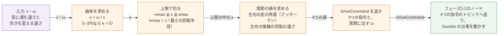

# フェーズ2-1: アッカーマンの運動学を、ROS 2 を使わないクラスで確かめる

[学習計画](learning_plan.md) のフェーズ2の前半。台車に「前に進む速さ `v`」と「向きを変える速さ `ω`」を指令したとき、左右の前輪の舵を何 rad 切り、左右の後輪を何 rad/s で回せばよいかを計算する。[フェーズ0](phase0_overview.md) の2節で見たアッカーマンの幾何の式を、Python のクラスに書き、ROS 2 を使わずに、決めた入力の組で手計算の値と比べる。曲がれない指令（その場で回る指令や、最小の回転半径より小さく曲がる指令）をどう扱うかも、ここで決める。このクラスは、フェーズ2-2で ROS 2 のノードに包み、[フェーズ1-2](phase1_2_gazebo.md) で作った4つの指令のトピックへ送って、Gazebo の台車を円を描いて走らせる。新しい概念は、**速度の指令を関節の値に直す計算**（運動学）の1つである。

- 想定環境: Ubuntu 24.04、ROS 2 Jazzy（このページでは、Gazebo もノードも起動しない）
- 前提: [フェーズ0](phase0_overview.md) の2節（アッカーマンの幾何・自転車モデル・最小の回転半径）。[フェーズ1-2](phase1_2_gazebo.md)（このページの寸法は、フェーズ1で模型に書いたもの。このページのクラスは、フェーズ2-2で、フェーズ1-2の4つの指令のトピックにつなぐ）。親プロジェクトの [フェーズ2](https://github.com/SanghunIm1991/ros2MinimalPhysicalAi/blob/main/docs/phase2_packages.md) の2-1・2-2・2-4・2-5節（パッケージを作り、ビルドする）
- 所要の目安: 1コマ
- 言語: Python

> **このページの位置づけ**: ここでは、関節の値を計算して表示するまでを行い、台車は動かさない。計算を ROS 2 から切り離したクラスにしておくと、Gazebo を起動せずに、`python3` だけで値を確かめられる。値が正しいことを先に確かめておけば、フェーズ2-2で台車が思った円を描かないときに、原因を計算の外（トピックの名前・中継・物理）に絞れる。
>
> **期待する結果の出どころ**: `ros2 pkg create`・`python3`（クラスの表示と課題の値）・`colcon build`・`python3 -c` の表示は、作成時に使い捨てのワークスペースで実際に実行して確かめたものである。パス・ユーザー名・ビルドの秒数は、環境ごとに変わる（`ros2 pkg create` の `maintainer` の行は、Git に名前とメールアドレスを設定している環境では、その値になることがある）。計算の値は、同じコードなら同じになる。8節に書いた誤りのときの表示は、作成時には起こしておらず、Python の振る舞いから想定した要旨である。

## 0. 学習目標と完了条件

1. `v`・`ω` から、曲率（回転の半径の逆数）を求め、アッカーマンの幾何で、左右の舵の角度と左右の後輪の回転の速さを計算できる（2節）。
2. 曲がれない指令（`v`＝0 の指令と、最小の回転半径より小さく曲がる指令）の扱いを決め、クラスに書ける（2-4節・2-5節・3節）。
3. 計算を ROS 2 を使わないクラスに分け、`python3` だけで、手計算の値と比べて確かめられる（5節・6節）。

**完了条件**: 6-1節で表示した、6つの入力の組（直進・左の旋回・右の旋回・`v`＝0・上限を超える `ω`・後退）に対する出力が、3-2節の手計算の値と、小数点以下6桁まで一致する（差が 1e-6 以内）。

## 1. 全体像

このページで書くクラス `AckermannKinematics` は、`v` と `ω` を受け取り、曲率を求めて上限の中に切り、左右の舵の角度と左右の後輪の回転の速さを返す。


<details>
<summary>同じ図（mermaid版）</summary>



紫の箱は入力（フェーズ2-2では `cmd_vel` から受け取る）、橙の箱はこのページで書くクラスの中の計算、緑の箱はフェーズ2-2で作る部分である。

</details>

- **入力**: ROS 2 の移動ロボットでは、速度の指令を、トピック `cmd_vel` に [`geometry_msgs/msg/Twist`](https://github.com/ros2/common_interfaces/blob/jazzy/geometry_msgs/msg/Twist.msg) の型で送るのが慣習である。`v` は `linear.x`、`ω` は `angular.z` に入る。このページでは、`v` と `ω` を、ただの2つの数としてクラスに渡す。
- **出力**: フェーズ1-2の4つの指令（`/front_left_steer_cmd`・`/front_right_steer_cmd`・`/rear_left_wheel_cmd`・`/rear_right_wheel_cmd`）に入れる値。向きの決まりは、フェーズ1-2の関節と同じで、舵は左へ切る向きが正、後輪は台車が前へ進む向きが正である。

## 2. 運動学: `v`・`ω` から関節の値を求める

### 2-1. 曲率で考える

[フェーズ0](phase0_overview.md) の2-1節のとおり、一定の `v` と `ω` で走ると、後車軸の中心は、半径 $R = v / \omega$ の円を描く。左右の舵の角度も、後輪の速さも、この半径から決まる。

ただし、半径をそのまま計算に使うと困ることがある。直進（ `ω`＝0）では、半径は無限大になり、`v / ω` は0で割る計算になる。そこで、半径の逆数の**曲率**

$$\kappa = \frac{1}{R} = \frac{\omega}{v}$$

で考える。曲率は、道の曲がり具合を表す数で、直進なら0、小さな円ほど大きい。符号は、前へ進みながら左へ曲がるときが正、右へ曲がるときが負である。直進が0という普通の数で表せるので、直進を特別に扱わなくて済む。曲率を決めると、台車が描く道の形が決まり、 `v` はその道を進む速さを決める。向きを変える速さは、 $\omega = v \kappa$ で戻せる。

曲率を求める式 $\omega / v$ は、 `v`＝0 のときに0で割る計算になる。この場合の扱いは、2-5節で決める。

### 2-2. 左右の舵の角度

[フェーズ0](phase0_overview.md) の2-2節で、左へ曲がるときの内側（左）と外側（右）の舵の角度を、

$$\delta_{in} = \arctan\frac{L}{R - W/2}, \qquad \delta_{out} = \arctan\frac{L}{R + W/2}$$

と求めた（ $L$ はホイールベース、 $W$ はトレッド）。右へ曲がるときは、 $R$ を負の数にすると、同じ2つの式が、そのまま左と右の舵の角度になる（左が外側、右が内側になり、どちらの角度も負、つまり右へ切る向きになる）。そこで、内側・外側ではなく、左・右の名前で、

$$\delta_{left} = \arctan\frac{L}{R - W/2}, \qquad \delta_{right} = \arctan\frac{L}{R + W/2}$$

とする。この式に $R = 1/\kappa$ を入れ、分母と分子に $\kappa$ をかけると、曲率で書いた式になる。

$$\delta_{left} = \arctan\frac{L \kappa}{1 - \kappa W/2}, \qquad \delta_{right} = \arctan\frac{L \kappa}{1 + \kappa W/2}$$

直進（ $\kappa = 0$）では、どちらも $\arctan 0 = 0$ になり、0で割る計算は出てこない。分母の $1 \mp \kappa W/2$ は、2-4節の上限の中では、いつも正である。

自転車モデルの舵の角度（フェーズ0の2-2節）は、曲率で書くと $\delta = \arctan(L \kappa)$ で、左右の舵の角度の間の値になる。このページのクラスは、左右の舵を別々に動かすので、自転車モデルの角度は計算に使わない。

### 2-3. 左右の後輪の速さ

台車が円を描くとき、台車のどの点も、同じ回転の中心の周りを、同じ速さ `ω` で回る。円の上を進む速さは、回転の中心からの距離に比例する。後車軸の中心は距離 $R$ の円を速さ $v$ で進むので、左の後輪（中心から $R - W/2$）と右の後輪（中心から $R + W/2$）が進む速さは、

$$v_{left} = \omega (R - W/2) = v (1 - \kappa W/2), \qquad v_{right} = \omega (R + W/2) = v (1 + \kappa W/2)$$

になる。後輪の回転の速さは、フェーズ1-2の2-4節の $v = r \omega_w$ の関係から、これを車輪の半径 $r$ で割った値である。左へ曲がるとき（ $\kappa > 0$）は、内側の左の後輪を遅く、外側の右の後輪を速く回す。左右の平均は、 $v / r$ のままである。

左右の後輪を同じ速さで回すと、内側の後輪が回りすぎ、外側の後輪が回り足りないので、どちらかの後輪が地面の上で滑る。実際の自動車は、左右の後輪の回転の差を、機械の部品（差動装置、デファレンシャル・ギア）で自然に作る。この台車は、左右の後輪を別々の関節で回すので、差を計算して与える。前輪は、駆動しない（Gazebo の中で自由に回る）ので、回転の速さは計算しない。

### 2-4. 舵の上限と、曲率の上限

舵の角度には、上限 $\delta_{max}$（この台車では 0.6 rad）がある。[フェーズ0](phase0_overview.md) の2-4節のとおり、先に上限に当たるのは内側の舵で、内側の舵が上限のときに、後車軸の中心の回転の半径が最小になる。

$$R_{min} = \frac{L}{\tan\delta_{max}} + \frac{W}{2}, \qquad \kappa_{max} = \frac{1}{R_{min}}$$

この台車では、 $R_{min}$ は 0.372339 m、 $\kappa_{max}$ は 2.685723（単位は 1/m）である。曲率の大きさが $\kappa_{max}$ を超える指令は、そのままでは実現できない。この扱いには、次の2つの作り方がある。

| 作り方 | 曲率 | `v` | 実際に出す `ω` |
|---|---|---|---|
| A: 曲率を上限で切り、`v` を保つ（このページの作り方） | $\pm\kappa_{max}$ | 指令のまま | $v \kappa_{max}$（指令より小さい） |
| B: 曲率を上限で切り、`ω` を保つ | $\pm\kappa_{max}$ | $\omega / \kappa_{max}$（指令より小さい） | 指令のまま |

どちらも、台車は最小の回転半径の円を描き、指令より大きな円で曲がる。このページでは、A を選ぶ。指令の `v` をそのまま守るので、どの指令でも、台車が進む速さを予想しやすいからである（B は9節で触れる）。上限で切ったときは、実際に出す `ω` が指令と違うので、クラスはその値も返す（フェーズ2-2のノードが、切ったことをログに出せるように）。

曲率を上限で切ると、内側の舵の角度は、2-2節の式でちょうど $\delta_{max}$ になる（外側は、それより小さい）。舵の関節ごとに角度を切るのではなく、曲率を切るのは、左右の舵と後輪の4つの値が、同じ1つの円に合ったままになるようにするためである。

### 2-5. `v`＝0 の指令と、後退

**`v`＝0**: 曲率 $\omega / v$ は、0で割る計算になる。[フェーズ0](phase0_overview.md) の2-3節のとおり、アッカーマン式の台車は、その場で向きを変えられない。このページでは、 `v`＝0 のときは、 `ω` によらず曲率を0にする（後輪を止め、舵をまっすぐにする）。止まっている間に舵だけを動かしても、台車の向きは変わらないからである。前の舵の角度を残す作り方もあるが、クラスが前の値を覚えておく必要があるので、このページでは、入力だけで出力が決まる形にする。

**後退（ `v` が負）**: 2-1節から2-3節の式は、 `v` が負のときも、そのまま使える。たとえば、`v`＝−0.2 m/s、`ω`＝0.2 rad/s（後ろへ進みながら、上から見て左回りに向きを変える）では、曲率は $0.2 / (-0.2) = -1$ になり、舵を右へ切る。自動車で後ろへ下がりながらハンドルを右へ切ると、車の後ろが右へ回り込み、車体が上から見て左回りに向きを変えるのと同じである。後輪は、どちらも負（後ろへ進む向き）に回り、曲率が負なので、左の後輪のほうが速く回る（回転の中心が台車の右にあり、左の後輪が外側になる）。

## 3. 仕様

### 3-1. クラスと、決めた扱い

新しいパッケージ `ackermann_drive` を作り、計算のクラスを `ackermann_kinematics.py` に書く。フェーズ2-2では、同じパッケージに、このクラスを包むノードを足す。

| 名前 | 中身 |
|---|---|
| `AckermannKinematics(wheelbase, track, wheel_radius, steer_max)` | 台車の寸法（m と rad）を受け取るクラス。作るときに、最小の回転半径 `min_radius` と、曲率の上限 `max_curvature` を求めておく |
| `compute(v, omega)` | `v`（m/s）と `omega`（rad/s）から、関節への指令を求め、`DriveCommand` で返す |
| `DriveCommand` | `steer_left`・`steer_right`（rad）、`wheel_left`・`wheel_right`（rad/s）、`omega`（実際に出す向きを変える速さ。rad/s）の5つの値 |

**ROS 2 を使わない**（`import rclpy` をしない）。寸法は、クラスの中に書かずに、作るときに受け取る（フェーズ2-2で、ノードのパラメータから渡せるように）。このページでは、フェーズ1の模型と同じ値（ホイールベース 0.20 m・トレッド 0.16 m・車輪の半径 0.04 m・舵の角度の上限 0.6 rad）を渡す。

決めた扱いは、次のとおりである（2-4節・2-5節）。

| 指令 | 扱い | 舵 | 後輪 |
|---|---|---|---|
| `ω`＝0 | 曲率0（直進） | 左右とも0 | 左右とも $v / r$ |
| `v`＝0 | `ω` によらず曲率0 | 左右とも0 | 左右とも0（止まる） |
| 曲率の大きさが $\kappa_{max}$ を超える | 曲率を $\pm\kappa_{max}$ に切り、`v` を保つ | 内側が $\pm\delta_{max}$ | 2-3節の式。実際に出す `ω` は $v \kappa_{max}$ |
| `v` が負（後退） | 同じ式 | 2-2節の式 | 左右とも負 |

### 3-2. 確かめる入力の組と、手計算の値

6-1節では、次の6つの入力の組で、クラスの出力を確かめる。直進と `v`＝0 の組は、3-1節の扱いのとおりの値になる。ほかの組の値は、2節の半径で書いた式で、電卓で計算できる。

| 組 | `v`（m/s） | `ω`（rad/s） | 曲率（1/m） | `steer_left` | `steer_right` | `wheel_left` | `wheel_right` | 実際の `ω` |
|---|---|---|---|---|---|---|---|---|
| 直進 | 0.2 | 0.0 | 0 | 0 | 0 | 5.000000 | 5.000000 | 0 |
| 左の旋回 | 0.2 | 0.2 | 1 | 0.214061 | 0.183111 | 4.600000 | 5.400000 | 0.200000 |
| 右の旋回 | 0.2 | −0.2 | −1 | −0.183111 | −0.214061 | 5.400000 | 4.600000 | −0.200000 |
| `v`＝0 | 0.0 | 0.5 | 0（2-5節） | 0 | 0 | 0 | 0 | 0 |
| 上限を超える | 0.2 | 1.0 | 5 → 2.685723 | 0.600000 | 0.416303 | 3.925711 | 6.074289 | 0.537145 |
| 後退 | −0.2 | 0.2 | −1 | −0.183111 | −0.214061 | −5.400000 | −4.600000 | 0.200000 |

手計算の例（左の旋回）: 半径は $R = 0.2 / 0.2 = 1$ m。左の舵は $\arctan(0.2 / (1 - 0.08)) = \arctan 0.217391 = 0.214061$ rad、右の舵は $\arctan(0.2 / 1.08) = 0.183111$ rad。左の後輪は $0.2 \times 0.92 / 0.04 = 4.6$ rad/s、右の後輪は $0.2 \times 1.08 / 0.04 = 5.4$ rad/s。

手計算の例（上限を超える）: 指令の曲率は $1.0 / 0.2 = 5$ で、 $\kappa_{max}$ の 2.685723 を超えるので、曲率を 2.685723（半径 $R_{min}$ = 0.372339 m）に切る。左（内側）の舵は $\arctan(0.2 / (0.372339 - 0.08))$ で、ちょうど上限の 0.6 rad になる。右の舵は $\arctan(0.2 / 0.452339) = 0.416303$ rad。実際の `ω` は $0.2 \times 2.685723 = 0.537145$ rad/s で、指令の 1.0 rad/s の約半分になる。

## 4. パッケージを作る

計算のクラスと、フェーズ2-2で書くノードを置くパッケージ `ackermann_drive` を作る（台車の模型の `ackermann_description`、シミュレーションの起動の `ackermann_gazebo` とは分ける）。

```bash
cd ~/ros2_ws/src

ros2 pkg create --build-type ament_python --license Apache-2.0 ackermann_drive
```

**期待する結果**（表示の抜粋）:

```text
going to create a new package
package name: ackermann_drive
destination directory: /home/<ユーザー名>/ros2_ws/src
package format: 3
version: 0.0.0
description: TODO: Package description
maintainer: ['<ユーザー名> <<ユーザー名>@todo.todo>']
licenses: ['Apache-2.0']
build type: ament_python
dependencies: []
creating folder ./ackermann_drive
creating ./ackermann_drive/package.xml
creating source folder
creating folder ./ackermann_drive/ackermann_drive
```

この後に、`setup.py`・`setup.cfg`・`resource/`・`ackermann_drive/__init__.py`・`test/` を作る `creating` の行が続く。Python のコードは、パッケージと同じ名前の内側のフォルダ `ackermann_drive/ackermann_drive/` に置く。

## 5. 運動学のクラスを書く

### 5-1. サンプル

ファイル: `~/ros2_ws/src/ackermann_drive/ackermann_drive/ackermann_kinematics.py`

```python
from dataclasses import dataclass
import math


# 関節への4つの指令と、実際に出す向きを変える速さ（舵の上限で切った後の値）。
@dataclass
class DriveCommand:
    steer_left: float   # 左前の舵の角度 [rad]（正が左へ切る向き）
    steer_right: float  # 右前の舵の角度 [rad]
    wheel_left: float   # 左の後輪の回転の速さ [rad/s]（正が前へ進む向き）
    wheel_right: float  # 右の後輪の回転の速さ [rad/s]
    omega: float        # 実際に出す、向きを変える速さ [rad/s]


# アッカーマン式の台車の運動学。前に進む速さと向きを変える速さから、関節への指令を求める。
class AckermannKinematics:
    # 台車の寸法 [m・rad] を受け取り、最小の回転半径と、曲率の上限を求めておく。
    def __init__(self, wheelbase, track, wheel_radius, steer_max):
        self.wheelbase = wheelbase
        self.track = track
        self.wheel_radius = wheel_radius
        # 内側の舵が上限の角度のときの、後車軸の中心の回転の半径
        self.min_radius = wheelbase / math.tan(steer_max) + track / 2
        self.max_curvature = 1.0 / self.min_radius

    # v [m/s] と omega [rad/s] から、左右の舵の角度と、左右の後輪の回転の速さを求める。
    def compute(self, v, omega):
        if v == 0.0:
            # その場では向きを変えられないので、曲率を0にする（止まって、舵をまっすぐにする）
            curvature = 0.0
        else:
            curvature = omega / v
            # 最小の回転半径より小さく曲がる指令は、曲率の上限で切る
            curvature = min(max(curvature, -self.max_curvature), self.max_curvature)
        half = self.track / 2
        steer_left = math.atan(self.wheelbase * curvature / (1 - curvature * half))
        steer_right = math.atan(self.wheelbase * curvature / (1 + curvature * half))
        wheel_left = v * (1 - curvature * half) / self.wheel_radius
        wheel_right = v * (1 + curvature * half) / self.wheel_radius
        return DriveCommand(steer_left, steer_right, wheel_left, wheel_right, v * curvature)


# ROS 2 を使わずにクラスだけを動かし、決めた入力の組に対する出力を表示する。
def main():
    kin = AckermannKinematics(wheelbase=0.20, track=0.16, wheel_radius=0.04, steer_max=0.6)
    print(f'min_radius = {kin.min_radius:.6f} m')
    cases = [(0.2, 0.0), (0.2, 0.2), (0.2, -0.2), (0.0, 0.5), (0.2, 1.0), (-0.2, 0.2)]
    print('    v  omega | steer_left steer_right wheel_left wheel_right omega_out')
    for v, omega in cases:
        c = kin.compute(v, omega)
        print(f'{v:5.1f} {omega:6.1f} | {c.steer_left:10.6f} {c.steer_right:11.6f} '
              f'{c.wheel_left:10.6f} {c.wheel_right:11.6f} {c.omega:9.6f}')


if __name__ == '__main__':
    main()
```

### 5-2. 解説

- **`DriveCommand`**: 返す5つの値をまとめたデータクラス。`@dataclass` を付けると、フィールドを並べるだけで、`DriveCommand(0.1, 0.1, 5.0, 5.0, 0.0)` のように作れ、`c.steer_left` のように名前で読める（`__init__` を自分で書かなくてよい）。4つの値を順番だけで返すと、左右や舵と後輪を取り違えやすいので、名前を付けた。
- **`__init__`**: 寸法を受け取り、2-4節の式で、最小の回転半径 `min_radius` と、曲率の上限 `max_curvature` を求めておく。寸法は作るときに一度決まれば変わらないので、`compute` のたびに計算し直さない。
- **`compute` の最初の `if`**: 2-5節の `v`＝0 の扱い。`v` が0でなければ、曲率 `omega / v` を求め、`min(max(…))` で、 $-\kappa_{max}$ から $\kappa_{max}$ の間に切る（2-4節の作り方 A）。
- **舵の角度**: 2-2節の曲率で書いた式。`half` はトレッドの半分 $W/2$。
- **後輪の回転の速さ**: 2-3節の式を、車輪の半径で割ったもの。
- **最後の `v * curvature`**: 実際に出す `ω`（2-1節の $\omega = v \kappa$）。上限で切らなかったときは、指令の `omega` と同じ値になる。
- **`main`**: ROS 2 を使わずに、3-2節の6つの入力の組を計算して、小数点以下6桁で表示する。`if __name__ == '__main__':` は、このファイルを `python3` で直接実行したときだけ `main` を呼ぶための決まった書き方で、フェーズ2-2のノードから `import` したときは、`main` は呼ばれない。

## 6. ROS 2 を使わずに確かめる

### 6-1. クラスだけを実行する

このファイルは ROS 2 を使わないので、ビルドも `source` もせずに、`python3` でそのまま実行できる。

```bash
python3 ~/ros2_ws/src/ackermann_drive/ackermann_drive/ackermann_kinematics.py
```

**期待する結果**:

```text
min_radius = 0.372339 m
    v  omega | steer_left steer_right wheel_left wheel_right omega_out
  0.2    0.0 |   0.000000    0.000000   5.000000    5.000000  0.000000
  0.2    0.2 |   0.214061    0.183111   4.600000    5.400000  0.200000
  0.2   -0.2 |  -0.183111   -0.214061   5.400000    4.600000 -0.200000
  0.0    0.5 |   0.000000    0.000000   0.000000    0.000000  0.000000
  0.2    1.0 |   0.600000    0.416303   3.925711    6.074289  0.537145
 -0.2    0.2 |  -0.183111   -0.214061  -5.400000   -4.600000  0.200000
```

1行目の最小の回転半径は2-4節の値と、3行目から後の6つの行は3-2節の表の値と比べる。見出しの行の最初の `omega` は指令の `ω`、最後の `omega_out` は実際に出す `ω`（`DriveCommand` の `omega`）である。6つの行は、上から、直進・左の旋回・右の旋回・`v`＝0・上限を超える・後退の組である。

- **直進**: 舵は左右とも0で、後輪は左右とも $0.2 / 0.04 = 5$ rad/s。フェーズ1-2の7-4節で、後輪に手で 5 rad/s を指令したときと同じ値である。
- **左の旋回と右の旋回**: 左右の舵と、左右の後輪の値が、互いに入れ替わる（舵と実際の `ω` は、符号も逆になる）。内側の舵は外側より大きく、内側の後輪は外側より遅い（2-2節・2-3節）。
- **`v`＝0**: `ω` に 0.5 を指令しても、すべて0になる（2-5節）。
- **上限を超える**: 左の舵が、ちょうど上限の 0.600000 rad になり、実際の `ω` は、指令の 1.0 rad/s ではなく 0.537145 rad/s になる（2-4節）。
- **後退**: 舵は右の旋回と同じ向き（右）に切り、後輪は左右とも負で、左のほうが速い（2-5節）。

表示の6桁が3-2節の値と一致すれば、完了条件を満たす。

> 課題1: `main` の `cases` に `(0.1, 0.2)` を足して実行する前に、半径 $R = 0.1 / 0.2 = 0.5$ m の円の値を、2節の半径で書いた式で手計算する。左の舵は $\arctan(0.2 / 0.42)$、右の舵は $\arctan(0.2 / 0.58)$、後輪は、2-3節の $\omega (R \mp W/2) / r$ で $0.2 \times 0.42 / 0.04$ と $0.2 \times 0.58 / 0.04$ である（実行すると、`0.444419`・`0.332059`・`2.100000`・`2.900000`・`0.200000` と表示される。半径 0.5 m は最小の回転半径より大きいので、上限では切られない）。
>
> 課題2: `cases` に `(0.4, 1.0)` を足して実行し、上限を超える組 `(0.2, 1.0)` と比べる。どちらも `ω` は 1.0 rad/s だが、`(0.4, 1.0)` の曲率は 2.5 で、 $\kappa_{max}$ より小さいので、切られずに、実際の `ω` が 1.0 のままになる（左の舵は `0.558599`、後輪は `8.000000` と `12.000000`）。曲がれるかどうかは、`ω` の大きさではなく、 `v` と `ω` の比（曲率）で決まることを確かめる。

### 6-2. ビルドして、パッケージからクラスを読み込む

フェーズ2-2のノードは、このクラスを、パッケージから `import` して使う。ビルドして、ほかのフォルダからでも読み込めることを確かめておく。

```bash
cd ~/ros2_ws

colcon build --symlink-install --packages-select ackermann_drive

source ~/ros2_ws/install/setup.bash

python3 -c "from ackermann_drive.ackermann_kinematics import AckermannKinematics; kin = AckermannKinematics(0.20, 0.16, 0.04, 0.6); print(kin.compute(0.2, 0.2))"
```

**期待する結果**（秒数は環境によって変わる）:

```text
$ colcon build --symlink-install --packages-select ackermann_drive
Starting >>> ackermann_drive
Finished <<< ackermann_drive [2.10s]

Summary: 1 package finished [2.32s]
$ python3 -c "from ackermann_drive.ackermann_kinematics import AckermannKinematics; kin = AckermannKinematics(0.20, 0.16, 0.04, 0.6); print(kin.compute(0.2, 0.2))"
DriveCommand(steer_left=0.2140606835638215, steer_right=0.18311081726248413, wheel_left=4.6000000000000005, wheel_right=5.4, omega=0.2)
```

`DriveCommand(...)` の表示は、`@dataclass` が作る表示の形で、5つの値が名前付きで並ぶ。値は、6-1節の左の旋回の行と同じである（6-1節は6桁に丸めて表示した）。`wheel_left` の `4.6000000000000005` の末尾の `5` は、小数を2進数で計算するときの丸めの誤差で、 `4.6` との差は 1e-15 程度である。

`--symlink-install` でビルドしたので、この後で `ackermann_kinematics.py` を直しても、ビルドし直さずに、直した内容が読み込まれる。

## 7. まとめ

- `v`・`ω` を、曲率 $\kappa = \omega / v$ に直して考えると、直進を0で表せ、0で割る計算を避けられる。
- 左右の舵の角度は $\arctan(L \kappa / (1 \mp \kappa W/2))$、左右の後輪が進む速さは $v (1 \mp \kappa W/2)$ で、左へ曲がるときは、内側（左）の舵を大きく切り、内側の後輪を遅く回す。
- 曲率の大きさは、最小の回転半径の逆数 $\kappa_{max}$ までに切り、`v` を保つ（実際に出す `ω` は小さくなる）。`v`＝0 の指令は、曲率を0にして、止まる。後退は、同じ式で扱える。
- 計算を ROS 2 を使わないクラス `AckermannKinematics` に分け、`python3` だけで、6つの入力の組の出力が手計算の値と一致することを確かめた。

## 8. つまずきやすい点

- **`ZeroDivisionError: float division by zero` と表示される**: 半径 `v / omega` を先に求めると、直進（ `omega`＝0）で0で割る。曲率 `omega / v` を使い、`v`＝0 のときは割り算の前に分ける（5-1節の `if`）。
- **後退のときに、舵が 3 rad 近い角度になる**: 自転車モデルの角度を `math.atan2(L * omega, v)` と書くと、 `v` が負のときに、90°（約 1.57 rad）より大きな角度が返る（例: `v`＝−0.2、`ω`＝0.2 で約 2.94 rad）。`atan2` は、2つの引数の符号から、−π から π までの角度を選ぶためである。舵の角度は、5-1節のように `math.atan`（−π/2 から π/2 まで）で求める。
- **左右が逆になる**: 舵は左へ切る向きが正、後輪は前へ進む向きが正で、 `ω` は左回りが正（上から見て）である。左へ曲がる指令（ `ω` が正）で、`steer_left` が `steer_right` より大きく、`wheel_left` が `wheel_right` より小さいことを、6-1節の左の旋回の行で確かめる。
- **`-0.000000` と表示される**: `v` が負で `ω`＝0 のとき、曲率が `-0.0`（符号が負の0）になり、舵の角度も `-0.000000` と表示される。Python の浮動小数点数の決まりで、値は0と同じに扱われる（`-0.0 == 0.0` は `True`）。
- **`v` が0の近くで、舵が端から端へ振れる**: `v` が0ちょうどなら舵はまっすぐになるが、0でないごく小さな値（例: 0.001）なら、曲率 `omega / v` が大きくなって上限で切られ、舵が上限まで切れる。そのため、`v` が0の付近で揺れる指令では、舵がまっすぐと上限の間を行き来する。このページのクラスは、決めたとおりに計算しているだけで、誤りではない。フェーズ2-2で `cmd_vel` を手で送るときは、 `v` に0か、はっきりした値を送る。
- **`ModuleNotFoundError: No module named 'ackermann_drive'` と表示される**: 6-2節の `python3 -c` を、ビルドの前や、`source ~/ros2_ws/install/setup.bash` をしていないターミナルで実行すると、パッケージが見つからない。6-1節の `python3 ファイルのパス` の実行は、ファイルを直接読むので、ビルドしなくても動く。

## 9. 発展: ほかの作り方

- **舵の角度を前の値のまま残す**: 2-5節で、 `v`＝0 の指令では舵をまっすぐにしたが、止まるたびに舵が中央へ戻るのを避けたいときは、前の舵の角度を覚えておき、 `v`＝0 の間はその角度を送り続ける作り方もある。その場合、クラスに前の値を持たせ、6-1節の確かめ方も、入力の順番を考えたものにする必要がある。
- **`ω` を保つ**: 2-4節の作り方 B。曲がりきれないときに速さを落とすので、指令した向きの変わり方（`ω`）は保たれるが、指令の `v` より遅く進む。描く円は、A と同じ最小の回転半径の円である。

## 次へ

フェーズ2-2（運動学のノードで、台車を円を描いて走らせる）で、このクラスをノードで包み、`cmd_vel` を受けて、フェーズ1-2の4つの指令のトピックへ送る。一定の `v`・`ω` で走らせ、Gazebo の中で台車が描く円の半径を、2-1節の $v / \omega$ と比べる。手順書は作成中で、できたら README の「読む順番」に足す。

## 出典

このページの技術的な記述は、次の文書を読んで、自分の言葉でまとめたもの（逐語の転載ではない）。サンプルのコードは、この教材で書いたもの。

- アッカーマンの幾何・曲率・最小の回転半径: [フェーズ0](phase0_overview.md) の2節と同じく、一般的な運動学の説明を、筆者の言葉で書いたもの。数値は、この教材の台車の寸法から計算した。
- 速度の指令の型と、向き・単位の決まり（左回りが正、m と rad）: [`geometry_msgs/msg/Twist`](https://github.com/ros2/common_interfaces/blob/jazzy/geometry_msgs/msg/Twist.msg)、[REP 103: Standard Units of Measure and Coordinate Conventions](https://www.ros.org/reps/rep-0103.html)
- Python の `dataclasses`・`math.atan`・`math.atan2`: [Python の公式の文書（`dataclasses`）](https://docs.python.org/3/library/dataclasses.html)、[Python の公式の文書（`math`）](https://docs.python.org/3/library/math.html)
- パッケージの作り方: 親プロジェクトの [フェーズ2](https://github.com/SanghunIm1991/ros2MinimalPhysicalAi/blob/main/docs/phase2_packages.md)
- 図（`img/phase2_1_flow.svg`）は、この教材で作ったもの。
