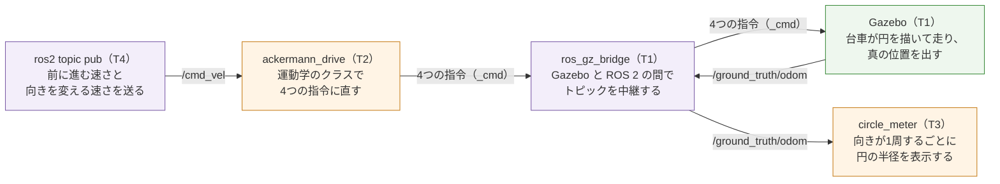

# フェーズ2-2: 運動学のノードで、台車を円を描いて走らせる

[学習計画](learning_plan.md) のフェーズ2の後半。[フェーズ2-1](phase2_1_kinematics.md) で書いた運動学のクラスを ROS 2 のノードで包み、速度の指令 `cmd_vel` を受けて、[フェーズ1-2](phase1_2_gazebo.md) の4つの指令のトピックへ、左右の舵の角度と左右の後輪の速さを送る。Gazebo の中で台車を一定の速さで走らせ、台車が描く円の半径を、Gazebo が知っている台車の真の位置から測って、 `v`/`ω` と比べる。ここで作るノードは、フェーズ6で Nav2 が出す `cmd_vel` も、そのまま受け取る。真の位置のトピックは、フェーズ3で、自作のオドメトリの誤差を測るのにも使う。新しい概念は、**速度の指令で台車を動かすノード**（指令が途切れたら止める仕組みを含む）の1つである。

- 想定環境: Ubuntu 24.04、ROS 2 Jazzy、Gazebo Harmonic（このページでは、Gazebo の画面を開かなくても進められる。台車の動きを目で見たいときは、画面を開いて起動する）
- 前提: [フェーズ2-1](phase2_1_kinematics.md)（このページは、フェーズ2-1で作ったパッケージ `ackermann_drive` に足す）。[フェーズ1-2](phase1_2_gazebo.md)（このページは、フェーズ1-2の `ackermann_car.gazebo.xacro` と `bridge.yaml` に足す）。親プロジェクトの [フェーズ3-1](https://github.com/SanghunIm1991/ros2MinimalPhysicalAi/blob/main/docs/phase3_1_pubsub.md) の2節と3節（Python 版の Publisher・Subscriber・タイマー、実行ファイルの登録）
- 所要の目安: 1〜2コマ
- 言語: Python（ノード）、xacro（XML。Gazebo の設定）、YAML（中継の設定）

> **このページの位置づけ**: 台車への指令は、ここでは `ros2 topic pub` で、手で決めた `v`・`ω` を送る。台車の位置を、車輪の回り方から自分で数える（オドメトリ）のは、フェーズ3の内容である。このページでは、Gazebo が知っている真の位置を、答え合わせにだけ使う。
>
> **期待する結果の出どころ**: `colcon build`・`ros2 pkg executables` の表示と、6節のノードのログ・`ros2 topic list`・`ros2 topic echo`・`ros2 topic pub` の表示は、作成時に使い捨てのワークスペースで実際に実行して確かめたものである（Gazebo は、画面なしで起動した。launch の引数 `gz_args:='-r -s empty.sdf'`）。時刻・秒数・パス・小さな桁の値（`1e-18` のような0に近い値）は、実行ごと・環境ごとに変わる。円の半径は、作成時に4回実行して、4回とも同じ値になった（円の中心は、1回だけ 1 mm 違った）。ログの中の `cmd_vel timeout: stop` の行が、指令を送っている途中にも出ることがあるのは、作成時の実行で起きたことである（8節）。8節のうち、最初の `ros2 topic list` が2つのトピックだけを表示したことは、作成時の実行で起きたことである。8節のほかの誤りのときの表示（`does not appear to be published yet` 等）は、作成時には起こしておらず、ツールの振る舞いから想定した要旨である。

## 0. 学習目標と完了条件

1. `cmd_vel`（[`geometry_msgs/msg/Twist`](https://github.com/ros2/common_interfaces/blob/jazzy/geometry_msgs/msg/Twist.msg)）を受け、運動学のクラスで関節の値に直して送るノードを書ける（2-1節・5-1節）。
2. 指令が途切れたら台車を止める仕組み（時間切れ）が要る理由を説明し、タイマーで書ける（2-2節・5-1節）。
3. Gazebo の台車の真の位置を ROS 2 に中継し、台車が描いた円の半径を測れる（2-3節・2-4節・4節・5-2節）。

**完了条件**:

- `v`＝0.2 m/s、`ω`＝0.4 rad/s を送り続けたとき、`circle_meter` が表示する2周目の円の半径（x と y の両方）が、 `v`/`ω`＝0.5 m と5%以内（0.475〜0.525 m）で一致する（6-2節）。
- `v`＝0.2 m/s、`ω`＝1.0 rad/s（最小の回転半径より小さく曲がる指令）を送ったとき、`ackermann_drive` が `omega 1.000 -> 0.537` の警告を出し、その指令だけで走った周（x と y の半径がそろった周）の円の半径が、最小の回転半径 0.372 m と5%以内で一致する（6-3節）。

## 1. 全体像

このページでは、フェーズ1-2のシミュレーション（T1）に、2つの自作のノード（T2・T3）をつなぎ、T4 から指令を送る。


<details>
<summary>同じ図（mermaid版）</summary>



紫の箱は ROS 2 のノード・コマンド、橙の箱はこのページで書くノード、緑の箱は Gazebo（シミュレータ）である。

</details>

- **ackermann_drive**: このページで書く駆動のノード。`cmd_vel` を受けるたびに、フェーズ2-1の `AckermannKinematics` で4つの値を求めて送る。
- **circle_meter**: このページで書く、測るためのノード。台車の真の位置から、円の半径を求めて表示する。
- **/ground_truth/odom**: Gazebo が知っている台車の真の位置と向き。このページで、Gazebo の設定と中継の設定に足す（4節）。

## 2. 仕組み

### 2-1. 速度の指令 `cmd_vel`

ROS 2 の移動ロボットは、速度の指令を、トピック `cmd_vel` に [`geometry_msgs/msg/Twist`](https://github.com/ros2/common_interfaces/blob/jazzy/geometry_msgs/msg/Twist.msg) の型で受け取るのが慣習である。`Twist` は、並進の速さ `linear`（x・y・z）と、回転の速さ `angular`（x・y・z）の2つを持つ。地面の上を走る台車では、前に進む速さ `v` を `linear.x`（m/s）に、上から見て左回りに向きを変える速さ `ω` を `angular.z`（rad/s）に入れ、ほかの4つは使わない。アッカーマン式の台車は、真横へ動けないので、`linear.y` が来ても無視する。

`cmd_vel` を受けるノードを1つ決めておくと、指令を出す側（このページでは `ros2 topic pub`、フェーズ6では Nav2）は、台車の舵や車輪の仕組みを知らなくてよい。指令を出す側と、台車を動かす側を、`cmd_vel` という共通の約束で分けておくのである。

### 2-2. 指令が途切れたら止める

フェーズ1-2の2-4節のとおり、Gazebo の関節のプラグインは、新しい指令が来るまで、最後の指令を保ち続ける。そのため、`cmd_vel` を送る側が止まったり（プログラムの終了や、通信の途切れ）、送るのをやめたりすると、台車は最後の指令のまま走り続ける。実機なら、壁にぶつかるまで止まらない。

そこで、駆動のノードは、`cmd_vel` が決めた時間（**時間切れ**、`cmd_timeout`。このページでは1.0秒）より長く届かなければ、止まる指令（後輪の速さ0、舵はまっすぐ）を1回送る。指令を出す側は、走らせ続けたい間、同じ指令を繰り返し送り続ける必要がある。`ros2 topic pub` は、`-r 10` を付けると、1秒に10回送る（付けないと1秒に1回なので、1.0秒の時間切れにかかりやすい）。

時間切れは、タイマーで見張る。0.1秒ごとに、最後に `cmd_vel` を受けてからの時間を調べ、`cmd_timeout` を超えていたら止める。

### 2-3. 台車の真の位置

Gazebo は、物理の計算をしているので、台車が世界のどこにいて、どちらを向いているか（真の位置）を知っている。Gazebo に付属するプラグイン `OdometryPublisher` は、模型の真の位置と向きと速さを、決めた周期で、[`nav_msgs/msg/Odometry`](https://github.com/ros2/common_interfaces/blob/jazzy/nav_msgs/msg/Odometry.msg) に当たる Gazebo の型（`gz.msgs.Odometry`）でトピックに出す（既定では平面の値として出すので、高さ z は0、向きは z 軸の周りの回転だけになる）。名前に「オドメトリ」と付いているが、このプラグインが出すのは、車輪の回り方から数えた値ではなく、Gazebo の世界の座標での真の値である。このページでは、トピックの名前を `/ground_truth/odom`（真の値のオドメトリ）にして、フェーズ3で自分で数えるオドメトリと区別する。

`Odometry` の型は、位置と向き（`pose.pose`。向きは四元数）と、速さ（`twist.twist`）と、それぞれの不確かさ（`covariance`）を持つ。このページで使うのは、位置 `pose.pose.position` の x・y と、向き `pose.pose.orientation` から求めるヨー（z 軸の周りの回転の角度）だけである。

真の位置は、シミュレーションだから得られる値で、実機には無い。実機では、オドメトリ（フェーズ3）や、地図の上の自己位置の推定（フェーズ5・6）で、位置を推し量る。

### 2-4. 1周を数えて、円の半径を測る

一定の `v`・`ω` で走る台車は、円を描く（[フェーズ0](phase0_overview.md) の2-1節）。円の半径は、1周分の位置の x の最大と最小の差の半分（y も同じ）で求められる。1周の区切りは、時間ではなく、台車の向きの変化で数える。円を1周すると、台車の向きは、ちょうど 2π rad（360°）変わるからである。時間で区切ると、走り出しの加速や、上限で切られて実際の `ω` が変わったときに、区切りがずれる。

向きの変化を足していくときは、角度が π と −π の境目で飛ぶことに気をつける。たとえば、向きが 3.1 rad から −3.1 rad に変わったのは、約 0.08 rad の回転であって、−6.2 rad の回転ではない。そこで、変化の量を −π〜π の範囲に直してから足す（5-2節）。

1周目は、止まった状態からの走り出しを含むので、2周目の値を、完了条件に使う。

## 3. 仕様

| ノード（実行ファイル） | 受ける | 送る | パラメータ |
|---|---|---|---|
| `ackermann_drive` | `cmd_vel`（`geometry_msgs/msg/Twist`） | `/front_left_steer_cmd`・`/front_right_steer_cmd`・`/rear_left_wheel_cmd`・`/rear_right_wheel_cmd`（[`std_msgs/msg/Float64`](https://github.com/ros2/common_interfaces/blob/jazzy/std_msgs/msg/Float64.msg)。フェーズ1-2の3-2節） | 寸法の4つ（`wheelbase` 0.20・`track` 0.16・`wheel_radius` 0.04・`steer_max` 0.6）、`cmd_timeout` 1.0（秒） |
| `circle_meter` | `/ground_truth/odom`（`nav_msgs/msg/Odometry`） | なし（ログに表示する） | なし |

- `ackermann_drive` は、`cmd_vel` を受けるたびに、フェーズ2-1の `compute` で4つの値を求めて、4つのトピックへまとめて送る（フェーズ1-2の7-4節のように、左右の後輪の指令が別々に届いて、片方がブレーキになることがない）。
- 実際の `ω` が指令と違うとき（上限で切られたときと、`v`＝0 で曲がる指令を受けたとき。フェーズ2-1の3-1節）は、警告のログを出す（同じ警告は2秒に1回まで）。
- `cmd_vel` が `cmd_timeout` 秒より長く届かなければ、止まる指令を1回送り、ログを出す。
- `circle_meter` は、向きの変化の合計が 2π rad に達するごとに、その周の x・y の最大と最小から、半径（x と y のそれぞれ）と円の中心を表示する。

Gazebo の側には、真の位置のプラグインと、その中継を足す（4節）。

| トピック | 向き | ROS 2 の型 | Gazebo の型 | 中身 |
|---|---|---|---|---|
| `/ground_truth/odom` | Gazebo → ROS 2 | `nav_msgs/msg/Odometry` | `gz.msgs.Odometry` | 台車の真の位置と向きと速さ（1秒に50回）。座標の名前は `world`（世界）と `base_footprint`（台車） |

## 4. Gazebo に、真の位置を出させる

### 4-1. Gazebo の設定に、プラグインを足す

フェーズ1-2で書いた Gazebo の設定のファイルに、`OdometryPublisher` を足す。足したのは、`<gazebo>` の要素の最後のプラグイン（コメントを含めて8行）である。

ファイル: `~/ros2_ws/src/ackermann_description/urdf/ackermann_car.gazebo.xacro`

```xml
<?xml version="1.0"?>
<!-- 台車の模型のうち、Gazebo だけで使う設定（ackermann_car.urdf.xacro から読み込む） -->
<robot xmlns:xacro="http://www.ros.org/wiki/xacro">

  <!-- 車輪のタイヤと地面の摩擦の係数 -->
  <xacro:macro name="wheel_friction" params="name">
    <gazebo reference="${name}">
      <mu1>1.0</mu1>
      <mu2>1.0</mu2>
    </gazebo>
  </xacro:macro>

  <xacro:wheel_friction name="rear_left_wheel"/>
  <xacro:wheel_friction name="rear_right_wheel"/>
  <xacro:wheel_friction name="front_left_wheel"/>
  <xacro:wheel_friction name="front_right_wheel"/>

  <!-- 舵の関節を、指令の角度へ動かすプラグイン（関節の速さを指令する設定） -->
  <xacro:macro name="steer_controller" params="side">
    <plugin filename="gz-sim-joint-position-controller-system"
            name="gz::sim::systems::JointPositionController">
      <joint_name>front_${side}_steer_joint</joint_name>
      <topic>/front_${side}_steer_cmd</topic>
      <use_velocity_commands>true</use_velocity_commands>
    </plugin>
  </xacro:macro>

  <!-- 後輪の関節を、指令の速さで回すプラグイン -->
  <xacro:macro name="wheel_controller" params="side">
    <plugin filename="gz-sim-joint-controller-system"
            name="gz::sim::systems::JointController">
      <joint_name>rear_${side}_wheel_joint</joint_name>
      <topic>/rear_${side}_wheel_cmd</topic>
    </plugin>
  </xacro:macro>

  <gazebo>
    <xacro:steer_controller side="left"/>
    <xacro:steer_controller side="right"/>
    <xacro:wheel_controller side="left"/>
    <xacro:wheel_controller side="right"/>
    <!-- 動く関節の角度と速さを、1秒に50回送るプラグイン -->
    <plugin filename="gz-sim-joint-state-publisher-system"
            name="gz::sim::systems::JointStatePublisher">
      <topic>/joint_states</topic>
      <update_rate>50</update_rate>
    </plugin>
    <!-- 台車の真の位置と向き（Gazebo の世界の座標）を、1秒に50回送るプラグイン -->
    <plugin filename="gz-sim-odometry-publisher-system"
            name="gz::sim::systems::OdometryPublisher">
      <odom_frame>world</odom_frame>
      <robot_base_frame>base_footprint</robot_base_frame>
      <odom_topic>/ground_truth/odom</odom_topic>
      <odom_publish_frequency>50</odom_publish_frequency>
    </plugin>
  </gazebo>

</robot>
```

- **`odom_frame`・`robot_base_frame`**: メッセージの `header.frame_id`（どの座標で測った位置か）と `child_frame_id`（何の位置か）に入る名前。真の位置は、Gazebo の世界の座標で測るので `world` に、台車の基準は、模型の根元のリンク `base_footprint` にした（書かないと、`ackermann_car/odom` 等の名前になる）。
- **`odom_topic`**: Gazebo の中のトピックの名前。
- **`odom_publish_frequency`**: 1秒に送る回数。

このプラグインは、TF（座標の関係）も Gazebo の中のトピックに出すが、ROS 2 へは中継しない。真の位置を TF に混ぜると、フェーズ3で自分で出す、`odom` から台車への TF とぶつかるからである。

### 4-2. 中継の設定に、真の位置を足す

フェーズ1-2で書いた中継の設定のファイルの最後に、次の行を足す。

ファイル: `~/ros2_ws/src/ackermann_gazebo/config/bridge.yaml`（最後に足す行）

```yaml
# 台車の真の位置と向き → ROS 2
- ros_topic_name: /ground_truth/odom
  gz_topic_name: /ground_truth/odom
  ros_type_name: nav_msgs/msg/Odometry
  gz_type_name: gz.msgs.Odometry
  direction: GZ_TO_ROS
```

2つのファイルは、それぞれのパッケージの `install/` に置かれる（フェーズ1-2で `--symlink-install` でビルドしていれば、直したファイルがそのまま使われるが、ここでは念のため、5-3節でまとめてビルドし直す）。

## 5. ノードを書く

### 5-1. 駆動のノード

ファイル: `~/ros2_ws/src/ackermann_drive/ackermann_drive/drive_node.py`

```python
from ackermann_drive.ackermann_kinematics import AckermannKinematics
from geometry_msgs.msg import Twist
import rclpy
from rclpy.node import Node
from std_msgs.msg import Float64

# 指令を送るトピックの名前（フェーズ1-2の4つの指令）
STEER_LEFT = '/front_left_steer_cmd'
STEER_RIGHT = '/front_right_steer_cmd'
WHEEL_LEFT = '/rear_left_wheel_cmd'
WHEEL_RIGHT = '/rear_right_wheel_cmd'


# cmd_vel を受け、運動学のクラスで関節の値に直して、4つの指令のトピックへ送るノード。
class DriveNode(Node):
    # パラメータを宣言し、運動学のクラスと、Subscriber・Publisher・タイマーを作る。
    def __init__(self):
        super().__init__('ackermann_drive')
        wheelbase = self.declare_parameter('wheelbase', 0.20).value
        track = self.declare_parameter('track', 0.16).value
        wheel_radius = self.declare_parameter('wheel_radius', 0.04).value
        steer_max = self.declare_parameter('steer_max', 0.6).value
        self.cmd_timeout = self.declare_parameter('cmd_timeout', 1.0).value
        self.kin = AckermannKinematics(wheelbase, track, wheel_radius, steer_max)
        self.pubs = [self.create_publisher(Float64, name, 10)
                     for name in (STEER_LEFT, STEER_RIGHT, WHEEL_LEFT, WHEEL_RIGHT)]
        self.create_subscription(Twist, 'cmd_vel', self.on_cmd_vel, 10)
        self.last_cmd_time = None
        self.create_timer(0.1, self.check_timeout)
        self.get_logger().info(
            f'min_radius={self.kin.min_radius:.3f} m, cmd_timeout={self.cmd_timeout} s')

    # cmd_vel を受けるたびに、関節の値を計算して送る。
    def on_cmd_vel(self, msg):
        v = msg.linear.x
        omega = msg.angular.z
        cmd = self.kin.compute(v, omega)
        self.send(cmd)
        self.last_cmd_time = self.get_clock().now()
        if abs(cmd.omega - omega) > 1e-9:
            self.get_logger().warn(
                f'cannot turn as commanded: omega {omega:.3f} -> {cmd.omega:.3f} rad/s',
                throttle_duration_sec=2.0)

    # cmd_vel が cmd_timeout 秒より長く届かなければ、止まる指令を1回送る。
    def check_timeout(self):
        if self.last_cmd_time is None:
            return
        elapsed = (self.get_clock().now() - self.last_cmd_time).nanoseconds * 1e-9
        if elapsed > self.cmd_timeout:
            self.send(self.kin.compute(0.0, 0.0))
            self.last_cmd_time = None
            self.get_logger().info('cmd_vel timeout: stop')

    # DriveCommand の4つの値を、それぞれのトピックへ送る。
    def send(self, cmd):
        values = (cmd.steer_left, cmd.steer_right, cmd.wheel_left, cmd.wheel_right)
        for pub, value in zip(self.pubs, values):
            pub.publish(Float64(data=value))


def main():
    rclpy.init()
    node = DriveNode()
    try:
        rclpy.spin(node)
    except KeyboardInterrupt:
        pass
    finally:
        node.destroy_node()
        rclpy.try_shutdown()
```

**`drive_node.py` の解説**

- **`import` の並び**: 同じパッケージの `ackermann_drive.ackermann_kinematics` も、ほかのパッケージと一緒に、名前の順に並べた。ROS 2 の Python のパッケージの書式の点検（`colcon test` で動く flake8）が、この並びを求めるためである。
- **パラメータ**: `declare_parameter(名前, 既定値)` で、ノードの設定の値（**パラメータ**）を宣言し、`.value` で今の値を受け取る。起動するときに `--ros-args -p cmd_timeout:=2.0` のように渡すと、既定値の代わりにその値が使われる。寸法をパラメータにしたのは、寸法の違う台車でも、コードを直さずに使えるようにするためである。パラメータの詳しい使い方は、親プロジェクトの [フェーズ3-3](https://github.com/SanghunIm1991/ros2MinimalPhysicalAi/blob/main/docs/phase3_3_parameters.md) にある（このページでは、ここに書いた範囲だけを使う）。
- **`self.pubs`**: 4つの Publisher を、リストの内包表記で、トピックの名前の順に作る。`send` で、`DriveCommand` の4つの値と、同じ順に組にして送る（`zip`）。
- **`create_subscription(Twist, 'cmd_vel', ...)`**: トピックの名前を `/` で始めていない。ROS 2 の名前の決まりで、`/` で始まらない名前は、ノードの名前空間（このページでは無し）の下の名前になり、ここでは `/cmd_vel` と同じである。複数の台車を動かすときに、台車ごとに名前空間を付けて分けられるように、`cmd_vel` はこの書き方にするのが慣習である。
- **`on_cmd_vel`**: 2-1節のとおり、`linear.x` と `angular.z` だけを使う。計算して送った後に、受けた時刻を覚える。実際の `ω` が指令と違えば（上限で切られたときと、`v`＝0 で `ω` が0でない指令のとき）、警告を出す。`throttle_duration_sec=2.0` は、同じ行のログを2秒に1回までに間引く指定で、1秒に10回届く指令に、毎回警告を出さないようにする。
- **`check_timeout`**: 2-2節の時間切れ。0.1秒ごとに呼ばれ、最後の指令からの時間が `cmd_timeout` を超えたら、`compute(0.0, 0.0)`（フェーズ2-1の3-1節のとおり、舵は0、後輪は0）を送る。送った後は `last_cmd_time` を `None` にして、止まる指令を何度も送らないようにする。時刻の差は `Duration` の型なので、`.nanoseconds`（ナノ秒の整数）を秒に直して比べる。
- **`main`**: `Ctrl+C` で止めたときに、`KeyboardInterrupt` の表示を出さずに終わる形。親プロジェクトのフェーズ3-1も同じ形だが、そちらは `KeyboardInterrupt` に加えて `ExternalShutdownException`（launch 等の外から止められたとき）も受ける。このページの2つのノードは `ros2 run` で起動するので、`KeyboardInterrupt` だけを受ける。

### 5-2. 円の半径を測るノード

ファイル: `~/ros2_ws/src/ackermann_drive/ackermann_drive/circle_meter.py`

```python
import math

from nav_msgs.msg import Odometry
import rclpy
from rclpy.node import Node


# 台車の真の位置を受け、向きが1周（2π）変わるごとに、描いた円の半径を表示するノード。
class CircleMeter(Node):
    # 真の位置のトピックの Subscriber を作り、1周分の記録を空にする。
    def __init__(self):
        super().__init__('circle_meter')
        self.create_subscription(Odometry, '/ground_truth/odom', self.on_odom, 10)
        self.lap = 0
        self.reset()

    # 1周分の記録（x・y の最大と最小、向きの変化の合計）を空にする。
    def reset(self):
        self.xs = []
        self.ys = []
        self.turned = 0.0
        self.last_yaw = None

    # 位置と向きを受け取るたびに記録し、向きが1周変わったら半径を表示する。
    def on_odom(self, msg):
        p = msg.pose.pose.position
        q = msg.pose.pose.orientation
        yaw = math.atan2(2 * (q.w * q.z + q.x * q.y), 1 - 2 * (q.y * q.y + q.z * q.z))
        if self.last_yaw is not None:
            # 向きの変化を -π〜π に直してから足す（π と -π の境目をまたいでも正しく数える）
            d = yaw - self.last_yaw
            self.turned += math.atan2(math.sin(d), math.cos(d))
        self.last_yaw = yaw
        self.xs.append(p.x)
        self.ys.append(p.y)
        if abs(self.turned) >= 2 * math.pi:
            self.lap += 1
            rx = (max(self.xs) - min(self.xs)) / 2
            ry = (max(self.ys) - min(self.ys)) / 2
            cx = (max(self.xs) + min(self.xs)) / 2
            cy = (max(self.ys) + min(self.ys)) / 2
            self.get_logger().info(
                f'lap {self.lap}: radius x={rx:.3f} y={ry:.3f} m, '
                f'center=({cx:.3f}, {cy:.3f})')
            self.reset()


def main():
    rclpy.init()
    node = CircleMeter()
    try:
        rclpy.spin(node)
    except KeyboardInterrupt:
        pass
    finally:
        node.destroy_node()
        rclpy.try_shutdown()
```

**`circle_meter.py` の解説**

- **ヨーの計算**: 向きは、四元数（x・y・z・w の4つの数。フェーズ1-1で `tf2_echo` に出たもの）で届く。`atan2(2(wz + xy), 1 − 2(y² + z²))` は、四元数から z 軸の周りの回転の角度（ヨー）を求める決まった式で、−π〜π の値になる。
- **向きの変化の合計 `turned`**: 2-4節のとおり、前の向きとの差 `d` を、`atan2(sin d, cos d)` で −π〜π に直してから足す（`atan2` に同じ角度の sin と cos を渡すと、その角度を −π〜π の範囲で返す）。左回りなら正、右回りなら負に増えるので、大きさ（`abs`）が 2π に達したら1周とする。
- **半径と中心**: 1周分の x・y の最大と最小から求める。円なら、x と y の半径は同じ値になり、どちらかだけが違えば、その周は円ではない（途中で指令が変わった等）。
- **1周ごとに `reset`**: 次の周を、新しく数え直す。

### 5-3. 実行ファイルとして登録し、ビルドする

2つのノードを、`ros2 run` で起動できるように登録する。`setup.py` の `console_scripts` に、2行を足した。

ファイル: `~/ros2_ws/src/ackermann_drive/setup.py`

```python
from setuptools import find_packages, setup

package_name = 'ackermann_drive'

setup(
    name=package_name,
    version='0.0.0',
    packages=find_packages(exclude=['test']),
    data_files=[
        ('share/ament_index/resource_index/packages',
            ['resource/' + package_name]),
        ('share/' + package_name, ['package.xml']),
    ],
    install_requires=['setuptools'],
    zip_safe=True,
    maintainer='<ユーザー名>',
    maintainer_email='<ユーザー名>@todo.todo',
    description='TODO: Package description',
    license='Apache-2.0',
    extras_require={
        'test': [
            'pytest',
        ],
    },
    entry_points={
        'console_scripts': [
            'ackermann_drive = ackermann_drive.drive_node:main',
            'circle_meter = ackermann_drive.circle_meter:main',
        ],
    },
)
```

`maintainer` と `maintainer_email` は、`ros2 pkg create` が書いた値のままでよい。

`package.xml` には、ノードが使うパッケージを足す（`<license>` の行の後、`<test_depend>` の行の前）。

ファイル: `~/ros2_ws/src/ackermann_drive/package.xml`（足す行）

```xml
  <exec_depend>rclpy</exec_depend>
  <exec_depend>geometry_msgs</exec_depend>
  <exec_depend>std_msgs</exec_depend>
  <exec_depend>nav_msgs</exec_depend>
```

4節で直した2つのパッケージと一緒に、ビルドする。

```bash
cd ~/ros2_ws

colcon build --symlink-install --packages-select ackermann_description ackermann_gazebo ackermann_drive

source ~/ros2_ws/install/setup.bash

ros2 pkg executables ackermann_drive
```

**期待する結果**（秒数は環境によって変わる。`Starting` と `Finished` の行の順番も、実行ごとに変わることがある）:

```text
$ colcon build --symlink-install --packages-select ackermann_description ackermann_gazebo ackermann_drive
Starting >>> ackermann_description
Starting >>> ackermann_drive
Finished <<< ackermann_drive [2.38s]
Finished <<< ackermann_description [2.40s]
Starting >>> ackermann_gazebo
Finished <<< ackermann_gazebo [2.16s]

Summary: 3 packages finished [4.77s]
$ ros2 pkg executables ackermann_drive
ackermann_drive ackermann_drive
ackermann_drive circle_meter
```

`ackermann_gazebo` は、`package.xml` に `ackermann_description` を書いた（フェーズ1-2の6-4節）ので、`ackermann_description` が終わってからビルドされる。`ros2 pkg executables` の各行は、「パッケージの名前 実行ファイルの名前」で、`setup.py` に登録した2つが出れば、`ros2 run` で起動できる。

## 6. 動かす

### 6-1. 起動する

4つのターミナルを使う。T1 でシミュレーションを、T2 で駆動のノードを、T3 で円の半径を測るノードを起動し、T4 で確かめ、指令を送る。

```bash
# T1
source ~/ros2_ws/install/setup.bash

ros2 launch ackermann_gazebo sim.launch.py

# T2
source ~/ros2_ws/install/setup.bash

ros2 run ackermann_drive ackermann_drive

# T3
source ~/ros2_ws/install/setup.bash

ros2 run ackermann_drive circle_meter
```

**期待する結果**（T2 の表示。時刻は実行ごとに変わる。T1 の表示は、中継の行（`Creating GZ->ROS Bridge: [/ground_truth/odom ...]`）が1つ増えるほかは、フェーズ1-2の7-1節と同じで、T3 は台車が1周するまで何も表示しない）:

```text
[INFO] [1794618886.898076451] [ackermann_drive]: min_radius=0.372 m, cmd_timeout=1.0 s
```

T2 の `min_radius` は、フェーズ2-1の2-4節の最小の回転半径（0.372339 m を3桁で表示）で、運動学のクラスが、既定の寸法で作られたことを示す。

T4 で、トピックがそろっていることと、真の位置が届いていることを確かめる。

```bash
# T4
source ~/ros2_ws/install/setup.bash

ros2 topic echo --once /ground_truth/odom --field pose.pose.position

ros2 topic list
```

**期待する結果**（0に近い小さな桁の値は、実行ごとに変わる）:

```text
$ ros2 topic echo --once /ground_truth/odom --field pose.pose.position
x: -1.585477913058456e-18
y: -1.0298751064758616e-19
z: 0.0
---
$ ros2 topic list
/clock
/cmd_vel
/front_left_steer_cmd
/front_right_steer_cmd
/ground_truth/odom
/joint_states
/parameter_events
/rear_left_wheel_cmd
/rear_right_wheel_cmd
/robot_description
/rosout
/tf
/tf_static
```

`/cmd_vel` は、T2 の `ackermann_drive` が受ける側として作ったトピックで、`/ground_truth/odom` は、4節で足した中継が作ったトピックである。真の位置の x と y は、`1e-18` のような0に近い値で、台車が世界の原点に止まっていることを示す（Gazebo の中の小さな計算の誤差で、ちょうど0にはならない）。

### 6-2. 円を描いて走らせる

T4 から、`v`＝0.2 m/s、`ω`＝0.4 rad/s（半径 0.5 m の円）を、1秒に10回送り続ける。

```bash
# T4
ros2 topic pub -r 10 /cmd_vel geometry_msgs/msg/Twist "{linear: {x: 0.2}, angular: {z: 0.4}}"
```

**期待する結果**（T4 の表示の先頭）:

```text
publisher: beginning loop
publishing #1: geometry_msgs.msg.Twist(linear=geometry_msgs.msg.Vector3(x=0.2, y=0.0, z=0.0), angular=geometry_msgs.msg.Vector3(x=0.0, y=0.0, z=0.4))

publishing #2: geometry_msgs.msg.Twist(linear=geometry_msgs.msg.Vector3(x=0.2, y=0.0, z=0.0), angular=geometry_msgs.msg.Vector3(x=0.0, y=0.0, z=0.4))
```

台車は、左回りに円を描いて走り出す。1周は、シミュレーションの時刻で $2\pi / 0.4$ の約16秒である。ログの時刻は PC の時計なので、Gazebo が実時間より遅く進む PC では、ログの時刻の差はもっと長くなる（作成時は、1周が約19秒だった）。T3 に `lap 2` が出るまで待つ。

**期待する結果**（T3 の表示。時刻は実行ごとに変わる）:

```text
[INFO] [1794618915.782876364] [circle_meter]: lap 1: radius x=0.512 y=0.512 m, center=(0.000, 0.512)
[INFO] [1794618935.081622941] [circle_meter]: lap 2: radius x=0.512 y=0.512 m, center=(0.000, 0.512)
```

- **半径**: 2周目の半径は、x も y も 0.512 m で、 `v`/`ω`＝0.5 m との差は +2.4% である。5%以内なので、完了条件を満たす。少し大きいのは、Gazebo の中で、タイヤと地面の間に、わずかな滑りやたわみがあるためと考えられる（運動学の式は、滑らない車輪を前提にしている）。
- **中心**: 円の中心は (0.000, 0.512) で、出発した原点の真左（y の正の向き）にある。前を向いて左へ曲がる円の中心は、後車軸を左へ延ばした線の上にある（フェーズ0の2-2節）ので、この位置になる。

走っている間に、別のターミナルを開いて、駆動のノードが送っている指令を見てもよい。

```bash
# T5（任意）
source ~/ros2_ws/install/setup.bash

ros2 topic echo --once /front_left_steer_cmd

ros2 topic echo --once /rear_right_wheel_cmd
```

**期待する結果**:

```text
$ ros2 topic echo --once /front_left_steer_cmd
data: 0.44441920990109895
---
$ ros2 topic echo --once /rear_right_wheel_cmd
data: 5.8
---
```

曲率は $0.4 / 0.2 = 2$（半径 0.5 m）で、左の舵の 0.4444 rad は、フェーズ2-1の課題1の値（`0.444419`）と同じである。右の後輪は、 $0.2 \times (1 + 2 \times 0.08) / 0.04 = 5.8$ rad/s になる。

T4 を `Ctrl+C` で止めると、1.0秒後に、T2 が止まる指令を送り、台車が止まる。

**期待する結果**（T2 の表示に足される行）:

```text
[INFO] [1794618941.283861933] [ackermann_drive]: cmd_vel timeout: stop
```

指令を送っている途中にも、この行が1回出ることがある（8節）。

### 6-3. 最小の回転半径より小さく曲がる指令を送る

T4 から、`v`＝0.2 m/s、`ω`＝1.0 rad/s を送る。曲率は 5 で、フェーズ2-1の2-4節の上限 2.685723 を超える。

```bash
# T4
ros2 topic pub -r 10 /cmd_vel geometry_msgs/msg/Twist "{linear: {x: 0.2}, angular: {z: 1.0}}"
```

**期待する結果**（T2 の表示。同じ警告が、約2秒ごとに続く）:

```text
[WARN] [1794618947.706550816] [ackermann_drive]: cannot turn as commanded: omega 1.000 -> 0.537 rad/s
[WARN] [1794618949.706553566] [ackermann_drive]: cannot turn as commanded: omega 1.000 -> 0.537 rad/s
```

`ω` の指令 1.0 rad/s は、上限で切られて 0.537 rad/s になる（フェーズ2-1の3-2節の「上限を超える」の組と同じ値）。台車は、最小の回転半径の円を描く。1周は、シミュレーションの時刻で $2\pi / 0.537$ の約12秒である（作成時のログの時刻では、約15秒だった）。x と y の半径がそろった周が出るまで待つ。

**期待する結果**（T3 の表示。`lap` の番号と中心の位置は、6-2節からの続きなので、実行ごとに変わる）:

```text
[INFO] [1794618955.196859499] [circle_meter]: lap 3: radius x=0.400 y=0.496 m, center=(0.113, 0.497)
[INFO] [1794618969.852624143] [circle_meter]: lap 4: radius x=0.373 y=0.373 m, center=(0.085, 0.620)
```

- **`lap 3`**: 6-2節の指令を止め、この指令を送り始めた周で、途中で円の大きさが変わったので、x と y の半径がそろわない。この周の値は使わない。
- **`lap 4`**: この指令だけで走った周で、半径は x も y も 0.373 m である。最小の回転半径 0.372 m との差は1%未満で、完了条件を満たす。

確かめ終わったら、T4・T3・T2・T1 の順に、`Ctrl+C` で止める。

## 7. まとめ

- 駆動のノード `ackermann_drive` は、`cmd_vel` の `linear.x`・`angular.z` を、フェーズ2-1の運動学のクラスで4つの関節の値に直し、4つの指令のトピックへまとめて送る。寸法は、パラメータで変えられる。
- Gazebo の関節のプラグインは最後の指令を保つので、`cmd_vel` が `cmd_timeout`（1.0秒）より長く届かなければ、タイマーで見張って、止まる指令を送る。指令を出す側は、同じ指令を送り続ける（`ros2 topic pub -r 10`）。
- Gazebo の `OdometryPublisher` で台車の真の位置を出し、`/ground_truth/odom` として ROS 2 へ中継した。フェーズ3で、自作のオドメトリの答え合わせに使う。
- `circle_meter` で、向きの変化が 2π に達するごとに、円の半径を測った。`v`＝0.2・`ω`＝0.4 では 0.512 m（ `v`/`ω` との差 +2.4%）、上限を超える指令では 0.373 m（最小の回転半径との差1%未満）だった。

## 8. つまずきやすい点

- **台車が少し走っては止まる**: `ros2 topic pub` に `-r 10` を付け忘れると、1秒に1回しか送らないので、1.0秒の時間切れと競り合い、走ったり止まったりする。`-r 10` を付ける。
- **指令を送っている途中で `cmd_vel timeout: stop` が出る**: PC が忙しいと、`ros2 topic pub` の送る間隔が乱れたり、受け取りが遅れたりして、時間切れにかかることがある（作成時の確認でも、1回の走行の途中に1回ほど出た）。次の指令が届けば、すぐに走り出すので、円の半径の測定には響かない（作成時の4回の確認では、途中で出た回も、半径は同じ値になった）。頻繁に出るときは、`ros2 run ackermann_drive ackermann_drive --ros-args -p cmd_timeout:=2.0` のように、時間切れを延ばす。
- **T2 を先に止めたら、台車が走り続ける**: 駆動のノードを止めると、時間切れで止める仕組みも一緒に止まるので、Gazebo の台車は、最後の指令のまま走り続ける（2-2節）。先に T4 を止めて、台車が止まってから T2 を止める。走り続けてしまったら、T2 をもう一度起動して、T4 から `ros2 topic pub --once /cmd_vel geometry_msgs/msg/Twist "{}"`（すべて0の指令）を1回送る。
- **T3 が何も表示しない**: `circle_meter` は、向きが1周変わるまで何も表示しない。止まっているときや、直進しているときは、いつまでも表示しない。`ros2 topic echo --once /ground_truth/odom --field pose.pose.position` で、真の位置が届いているかを確かめる。届いていなければ、4-2節の中継の設定を足した後に、`ackermann_gazebo` をビルドし直したかと、T1 を起動し直したかを確かめる。
- **`ros2 topic echo` が「does not appear to be published yet」と表示する、`ros2 topic list` が `/parameter_events` と `/rosout` の2つしか表示しない**: 起動の直後や、そのターミナルで最初に `ros2` のコマンドを使ったときは、ほかのノードのトピックの一覧が、まだ伝わっていないことがある（作成時の確認でも、最初の `ros2 topic list` が2つだけを表示したことがあった）。数秒待ってから、もう一度実行する。
- **半径が 0.5 m より大きく外れる、x と y の半径がそろわない**: 1周目は走り出しを含むので、2周目の値を見る。途中で指令を変えた周も、x と y がそろわない（6-3節の `lap 3`）。

## 次へ

[フェーズ3-1](phase3_1_odometry.md)（自転車モデルのオドメトリと TF）で、関節の状態（`/joint_states` の後輪の回転の速さと舵の角度）から、台車の位置と向きを自分で積算するノードを書き、このページで中継した真の位置 `/ground_truth/odom` と比べる。

## 出典

このページの技術的な記述は、次の文書を読んで、自分の言葉でまとめたもの（逐語の転載ではない）。サンプルのコード・設定は、この教材で書いたもの。

- 速度の指令の型と、向き・単位の決まり: [`geometry_msgs/msg/Twist`](https://github.com/ros2/common_interfaces/blob/jazzy/geometry_msgs/msg/Twist.msg)、[REP 103: Standard Units of Measure and Coordinate Conventions](https://www.ros.org/reps/rep-0103.html)
- 真の位置のプラグイン: Gazebo Sim（Harmonic）の [`OdometryPublisher`](https://github.com/gazebosim/gz-sim/blob/gz-sim8/src/systems/odometry_publisher/OdometryPublisher.hh) の説明（ヘッダーのファイルの冒頭）。世界の座標の位置を出すことは、[実装](https://github.com/gazebosim/gz-sim/blob/gz-sim8/src/systems/odometry_publisher/OdometryPublisher.cc) を読んで確かめた
- 中継: [ros_gz のリポジトリ（`jazzy` ブランチ）](https://github.com/gazebosim/ros_gz/tree/jazzy)（`ros_gz_bridge` の README）
- メッセージの型: [`nav_msgs/msg/Odometry`](https://github.com/ros2/common_interfaces/blob/jazzy/nav_msgs/msg/Odometry.msg)、[`std_msgs/msg/Float64`](https://github.com/ros2/common_interfaces/blob/jazzy/std_msgs/msg/Float64.msg)
- ノード・パラメータ・ログの書き方: 親プロジェクトの [フェーズ3-1](https://github.com/SanghunIm1991/ros2MinimalPhysicalAi/blob/main/docs/phase3_1_pubsub.md)・[フェーズ3-3](https://github.com/SanghunIm1991/ros2MinimalPhysicalAi/blob/main/docs/phase3_3_parameters.md)
- 図（`img/phase2_2_flow.svg`）は、この教材で作ったもの。
