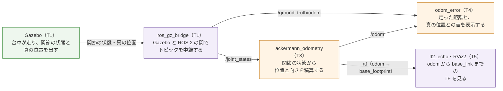

# フェーズ3-1: 自転車モデルのオドメトリと TF

[学習計画](learning_plan.md) のフェーズ3の必須の部分。台車の関節の状態（後輪の回転の速さと、左右の舵の角度）から、台車が走り始めた場所に対する位置と向きを積算する**オドメトリ**を書く。計算は、[フェーズ2-1](phase2_1_kinematics.md) と同じく、まず ROS 2 を使わないクラスで確かめ、次にノードで包んで、[`nav_msgs/msg/Odometry`](https://github.com/ros2/common_interfaces/blob/jazzy/nav_msgs/msg/Odometry.msg) のトピック `/odom` と、TF の `odom → base_footprint` を出す。[フェーズ2-2](phase2_2_drive_node.md) の駆動のノードで台車を円を描いて走らせ、同じページで中継した真の位置と比べて、積算の誤差がどう溜まるかを見る。ここで作るオドメトリは、フェーズ5の SLAM と、フェーズ6の Nav2 が、そのまま使う。新しい概念は、**オドメトリ（関節の状態からの位置の積算）と、それを TF で配ること**の1つである。

- 想定環境: Ubuntu 24.04、ROS 2 Jazzy、Gazebo Harmonic（Gazebo の画面を開かなくても進められる。6-4節の RViz2 は、画面を開く）
- 前提: [フェーズ2-2](phase2_2_drive_node.md)（このページは、パッケージ `ackermann_drive` に足し、フェーズ2-2の駆動のノードと真の位置のトピックを使う）。[フェーズ1-1](phase1_1_urdf.md) の TF の木（`base_footprint` から各車輪まで）。親プロジェクトの節は、フェーズ2-2と同じ
- 所要の目安: 1〜2コマ
- 言語: Python

> **このページの位置づけ**: 学習計画のフェーズ3の任意の節（同じ台車を ros2_control の標準のコントローラで動かし、自作のオドメトリと比べる）は、別の手順書の [フェーズ3-2](phase3_2_ros2_control.md) に分けた。このページは、フェーズ3-2を読まなくても、フェーズ4へ進める。
>
> **期待する結果の出どころ**: 4節の `python3` の表示、5-4節の `colcon build`・`ros2 pkg executables` の表示、6節のノードのログ・`ros2 topic echo`・`tf2_echo` の表示は、作成時に使い捨てのワークスペースで実際に実行して確かめたものである（Gazebo は、画面なしで起動した。launch の引数 `gz_args:='-r -s empty.sdf'`）。時刻・秒数・パス・小さな桁の値（`1e-18` のような0に近い値）は、実行ごと・環境ごとに変わる。6-3節の誤差の値は、走らせた時間と PC の速さで少し変わる。6-4節の RViz2 の画面の見え方は、作成時には開いて確かめておらず、設定とツールの振る舞いから想定したものである。8節に書いた誤りのときの表示は、作成時には起こしておらず、ツールの振る舞いから想定した要旨である。

## 0. 学習目標と完了条件

1. 後輪の回転の速さと左右の舵の角度から、台車の速さ `v` と向きを変える速さ `ω` を求め、位置と向きを積算する式を説明できる（2節）。
2. 積算を ROS 2 を使わないクラスに書き、円の式の値と比べて確かめられる（4節）。
3. 積算の結果を `nav_msgs/msg/Odometry` と TF で配るノードを書き、TF の木が `odom` から車輪までつながることを確かめられる（2-5節・5節・6節）。
4. オドメトリの誤差が、走るほど溜まる理由を説明できる（2-4節・6-3節）。

**完了条件**:

- 4節の表示で、半周（8秒）走った後の積算の位置と、円の式の位置の差（`error`）が 1e-5 m より小さい。
- `v`＝0.2 m/s、`ω`＝0.4 rad/s で台車を1周以上（約20秒以上）走らせたとき、`odom_error` が表示する、オドメトリと真の位置の差が、走った距離の5%以内に収まる（6-3節）。
- `tf2_echo odom base_link` が、`odom` から `base_link` までの位置と向きを表示する（高さ z が 0.040。6-2節）。

## 1. 全体像

このページでは、フェーズ2-2のシミュレーション（T1）と駆動のノード（T2）に、オドメトリのノード（T3）と、誤差を表示するノード（T4）をつなぎ、T5 から指令を送って、TF を見る。


<details>
<summary>同じ図（mermaid版）</summary>



紫の箱は ROS 2 のノード・コマンド、橙の箱はこのページで書くノード、緑の箱は Gazebo（シミュレータ）である。

</details>

- **ackermann_odometry**: このページで書くオドメトリのノード。`/joint_states` を受けるたびに、位置と向きを積算し、`/odom` と TF を出す。
- **駆動のノード（T2）**: 図には無いが、フェーズ2-2の `ackermann_drive` が、T5 から受けた `cmd_vel` で台車を走らせる。
- **odom_error**: このページで書く、答え合わせのためのノード。オドメトリの位置と、Gazebo の真の位置の差を表示する。真の位置は、実機には無いので、このノードはシミュレーションでだけ使える。

## 2. オドメトリの理論

### 2-1. オドメトリ: 車輪の回り方から、位置を数える

目隠しをして歩くときでも、「まっすぐ10歩、右へ90°向きを変えて5歩」と数えておけば、だいたいの位置は分かる。**オドメトリ**は、これと同じやり方で、車輪がどれだけ回り、舵をどれだけ切ったかから、台車が走り始めた場所に対する位置と向きを、少しずつ足して求める（積算する）方法である。

オドメトリは、外の世界を見ないので、いつでも滑らかに値が出る。その代わりに、小さな誤差を足し続けるので、走るほどずれていく（2-4節）。このずれを、LiDAR で見た壁の地図と照らして直すのが、フェーズ5の SLAM である。

### 2-2. 関節の状態から、`v` と `ω` を求める

フェーズ1-2の `/joint_states` には、後輪の回転の速さ（rad/s）と、舵の角度（rad）が入っている。フェーズ2-1の運動学を、逆向きに使う。

**台車の速さ**: 後車軸の中心の速さ `v` は、左右の後輪が進む速さの平均で、

$$v = r \frac{\omega_{left} + \omega_{right}}{2}$$

になる（ $r$ は車輪の半径、 $\omega_{left}$ と $\omega_{right}$ は左右の後輪の回転の速さ。台車の向きを変える速さ $\omega$ とは別の量である）。フェーズ2-1の2-3節のとおり、左右の後輪の速さは $v (1 \mp \kappa W/2)$ で、平均すると $v$ に戻る。

**曲率**: フェーズ2-1の2-2節の式 $\tan\delta_{left} = L \kappa / (1 - \kappa W/2)$ を、曲率 $\kappa$ について解くと、

$$\kappa = \frac{\tan\delta_{left}}{L + (W/2) \tan\delta_{left}}$$

になる。右の舵からも、同じように $\kappa = \tan\delta_{right} / (L - (W/2) \tan\delta_{right})$ で求められる。左右の舵がアッカーマンの幾何どおりに切れていれば、2つの値は同じになる。実際の舵の角度には、少しの遅れやずれがあるので、このページでは2つの平均を使う。

**向きを変える速さ**: フェーズ2-1の2-1節の $\omega = v \kappa$ で求める。

### 2-3. 位置と向きを積算する

`/joint_states` は、1秒に50回（0.02秒ごと）届く。届くたびに、前に届いてからの時間 $\Delta t$ の間、 `v` と `ω` が一定だったとみなして、位置 $(x, y)$ と向き $\theta$ を進める。

$$\theta_{mid} = \theta + \frac{\omega \Delta t}{2}, \qquad x \leftarrow x + v \cos\theta_{mid} \Delta t, \qquad y \leftarrow y + v \sin\theta_{mid} \Delta t, \qquad \theta \leftarrow \theta + \omega \Delta t$$

位置を進めるときに、 $\Delta t$ の始めの向き $\theta$ ではなく、中ほどの向き $\theta_{mid}$ を使うのがこつである。曲がっている間、向きは $\Delta t$ の間にも変わり続けるので、始めの向きのまま進めると、1歩ごとに、本当の弧の向きより外側を向いて進むので、通った道が本当の円からずれる。中ほどの向きを使うと、このずれがずっと小さくなる（4節で、2つのやり方の差を数字で見る）。

向き $\theta$ は、−π〜π の範囲に直しておく（フェーズ2-2の2-4節と同じく、`atan2(sin θ, cos θ)` で直す）。

$\Delta t$ には、PC の時計ではなく、`/joint_states` のメッセージに付いている時刻（`header.stamp`。Gazebo のシミュレーションの時刻）の差を使う。Gazebo は、PC が重いと実時間より遅く進む（フェーズ1-2の2-5節）ので、PC の時計の差を使うと、進んだ時間を多く見積もってしまう。

### 2-4. 誤差が溜まる理由

オドメトリの誤差には、主に次の3つの出どころがある。

| 出どころ | 例 | 溜まり方 |
|---|---|---|
| 積算の方法 | 始めの向きのまま進める（2-3節） | 刻みを細かくするほど小さくなる |
| 寸法の誤り | 車輪の半径が、思っているより少し大きい | 走った距離に比例して溜まる |
| 滑り | タイヤが地面の上で、横や前後に少し滑る | 走り方（曲がり方・加速）によって溜まる |

フェーズ2-2の6-2節では、半径 0.5 m の指令で、台車は半径 0.512 m の円を描いた。オドメトリは、舵の角度から半径 0.5 m の円を走ったと数えるので、向きを変える速さを、実際より数%大きく見積もる（半径の違いだけなら約2%。6-3節の最後の向きの差 約 0.93 rad を、向きを変えた量の合計 約 26 rad で割ると、約3.5%になった。走り始めの加速や滑りも加わるためと考えられる）。この差が、走るほど溜まっていく（6-3節）。

向きの誤差は、特に効く。向きが少しずれると、その後に走る距離のすべてが、ずれた向きに足されるからである。

### 2-5. TF: `odom → base_footprint`

フェーズ0の3節のとおり、ROS の規約（[REP 105](https://www.ros.org/reps/rep-0105.html)）では、走り始めた場所に固定したフレームを `odom` と呼び、オドメトリは、`odom` から台車へのつながりを TF で配る。

この教材の台車の TF の木は、フェーズ1-1で作ったとおり、地面の上の点 `base_footprint` を根元にして、`base_footprint → base_link → 各車輪` とつながっている（`robot_state_publisher` が配る）。そこで、オドメトリは、根元の `base_footprint` に、親の `odom` をつなぐ。

```text
odom ──（このページのオドメトリ）──> base_footprint ──（robot_state_publisher）──> base_link ──> 各車輪
```

TF の木では、1つのフレームの親は1つだけである。オドメトリが `odom → base_link` を出すと、`base_link` の親が `odom` と `base_footprint` の2つになり、木が壊れる。REP 105 では、台車のフレームを `base_link` と書いているが、地面の上の点 `base_footprint` を置く台車では、`odom` を `base_footprint` につなぐ（REP 105 は、`base_footprint` のような中間のフレームを足してよいとしている）。

TF に加えて、同じ位置と向きを、[`nav_msgs/msg/Odometry`](https://github.com/ros2/common_interfaces/blob/jazzy/nav_msgs/msg/Odometry.msg) の型でトピック `/odom` にも出す。TF は「今どこにいるか」を、ほかのノードが座標の変換に使うためのもの、`/odom` は、速さ（`twist`）も含めて、オドメトリの値そのものを使うノード（フェーズ6の Nav2 等）のためのものである。

## 3. 仕様

| ファイル | 中身 |
|---|---|
| `bicycle_odometry.py` | 2節の計算のクラス `BicycleOdometry`。**ROS 2 を使わない** |
| `odometry_node.py` | `BicycleOdometry` を包むノード `ackermann_odometry`（実行ファイルの名前も同じ） |
| `odom_error.py` | 答え合わせのノード `odom_error`（実行ファイルの名前も同じ） |

- `BicycleOdometry(wheelbase, track, wheel_radius)`: 寸法を受け取り、位置と向きを0から始める。`update(wheel_left, wheel_right, steer_left, steer_right, dt)` で、2-2節・2-3節の計算をして、`x`・`y`・`yaw`・`v`・`omega` を進める。
- `ackermann_odometry`:
  - 受ける: `/joint_states`（[`sensor_msgs/msg/JointState`](https://github.com/ros2/common_interfaces/blob/jazzy/sensor_msgs/msg/JointState.msg)）。使うのは、`rear_left_wheel_joint`・`rear_right_wheel_joint` の速さ（`velocity`）と、`front_left_steer_joint`・`front_right_steer_joint` の角度（`position`）。
  - 送る: `/odom`（`nav_msgs/msg/Odometry`。`header.frame_id` は `odom`、`child_frame_id` は `base_footprint`）と、TF の `odom → base_footprint`（[`geometry_msgs/msg/TransformStamped`](https://github.com/ros2/common_interfaces/blob/jazzy/geometry_msgs/msg/TransformStamped.msg)）。どちらも、`/joint_states` を受けるたびに、そのメッセージの時刻で送る。
  - パラメータ: 寸法の3つ（`wheelbase` 0.20・`track` 0.16・`wheel_radius` 0.04）。
- `odom_error`:
  - 受ける: `/odom` と `/ground_truth/odom`（どちらも `nav_msgs/msg/Odometry`）。
  - 2秒ごとに、真の位置で数えた走った距離と、2つの位置の差と、差を距離で割った割合（%）を、ログに出す。
  - 真の位置の原点は Gazebo の世界の原点、オドメトリの原点は走り始めた場所で、台車は世界の原点から、x の正の向きを向いて走り始める（フェーズ1-2の6-3節）ので、2つの座標は、走り始めにはそろっている。

## 4. 積算のクラスを、ROS 2 を使わずに確かめる

ファイル: `~/ros2_ws/src/ackermann_drive/ackermann_drive/bicycle_odometry.py`

```python
import math


# 関節の状態（後輪の回転の速さと、左右の舵の角度）から、台車の位置と向きを積算する。
class BicycleOdometry:
    # 台車の寸法 [m] を受け取り、位置と向きを0（走り始めた場所）にする。
    def __init__(self, wheelbase, track, wheel_radius):
        self.wheelbase = wheelbase
        self.track = track
        self.wheel_radius = wheel_radius
        self.x = 0.0
        self.y = 0.0
        self.yaw = 0.0
        self.v = 0.0
        self.omega = 0.0

    # 左右の舵の角度 [rad] から、後車軸の中心が描く円の曲率 [1/m] を求める（2つの平均）。
    def curvature(self, steer_left, steer_right):
        half = self.track / 2
        k_left = math.tan(steer_left) / (self.wheelbase + half * math.tan(steer_left))
        k_right = math.tan(steer_right) / (self.wheelbase - half * math.tan(steer_right))
        return (k_left + k_right) / 2

    # dt 秒の間の関節の状態から、位置と向きを進める（向きは、dt の中ほどの値を使う）。
    def update(self, wheel_left, wheel_right, steer_left, steer_right, dt):
        self.v = self.wheel_radius * (wheel_left + wheel_right) / 2
        self.omega = self.v * self.curvature(steer_left, steer_right)
        mid_yaw = self.yaw + self.omega * dt / 2
        self.x += self.v * math.cos(mid_yaw) * dt
        self.y += self.v * math.sin(mid_yaw) * dt
        self.yaw = math.atan2(math.sin(self.yaw + self.omega * dt),
                              math.cos(self.yaw + self.omega * dt))


# 一定の v・omega で t 秒走ったときの、本当の位置と向き（円または直線の式）。
def exact_pose(v, omega, t):
    if omega == 0.0:
        return v * t, 0.0, 0.0
    r = v / omega
    yaw = omega * t
    return r * math.sin(yaw), r * (1 - math.cos(yaw)), math.atan2(math.sin(yaw), math.cos(yaw))


# ROS 2 を使わずに、運動学のクラスが出す関節の値を与えて積算し、式の値と比べる。
def main():
    from ackermann_drive.ackermann_kinematics import AckermannKinematics
    kin = AckermannKinematics(wheelbase=0.20, track=0.16, wheel_radius=0.04, steer_max=0.6)
    dt = 0.02
    print('    v omega     t |         x         y       yaw | error [m]')
    for v, omega, t in [(0.2, 0.0, 5.0), (0.2, 0.4, 8.0), (0.2, 0.4, 16.0), (-0.2, 0.4, 8.0)]:
        cmd = kin.compute(v, omega)
        odom = BicycleOdometry(wheelbase=0.20, track=0.16, wheel_radius=0.04)
        for _ in range(round(t / dt)):
            odom.update(cmd.wheel_left, cmd.wheel_right, cmd.steer_left, cmd.steer_right, dt)
        ex, ey, eyaw = exact_pose(v, cmd.omega, t)
        error = math.hypot(odom.x - ex, odom.y - ey)
        print(f'{v:5.1f} {omega:5.1f} {t:5.1f} | {odom.x:9.6f} {odom.y:9.6f} {odom.yaw:9.6f} '
              f'| {error:.1e}')
        print(f'{"(exact)":>17} | {ex:9.6f} {ey:9.6f} {eyaw:9.6f} |')


if __name__ == '__main__':
    main()
```

**`bicycle_odometry.py` の解説**

- **`curvature`**: 2-2節の、左右の舵の角度から曲率を求める2つの式の平均。
- **`update`**: 2-2節で `v` と `ω` を求め、2-3節の式で位置と向きを進める。`v` と `omega` は、ノードが `/odom` の速さとして送るので、インスタンスに残しておく。
- **`exact_pose`**: 確かめるための、答えの式。一定の `v`・`ω` で走ると、台車は原点から左に中心のある半径 $R = v / \omega$ の円を描くので、 $t$ 秒後の位置は $(R \sin\omega t, R(1 - \cos\omega t))$、向きは $\omega t$ になる（ `ω`＝0 なら、x の向きに $vt$ 進む）。
- **`main`**: フェーズ2-1の運動学のクラスで、`v`・`ω` の指令から関節の値（4つの指令）を求め、それを、関節が指令どおりに動いたものとして `update` に0.02秒ずつ与える。4つの組（直進5秒、左の旋回8秒＝約半周、左の旋回16秒＝約1周、後退しながら左回り8秒）の積算の結果と、答えの式の値を並べ、位置の差（`error`）を表示する。`from ... import` を `main` の中に書いたのは、ノード（5節）がこのファイルを読み込むときに、使わない運動学のクラスまで読み込まないようにするためである。

このファイルは、フェーズ2-1のクラスを `ackermann_drive.ackermann_kinematics` として読み込むので、ビルドした後に、`source` してから実行する（フェーズ2-1の6-2節で、`ackermann_drive` をビルド済み）。

```bash
source ~/ros2_ws/install/setup.bash

python3 ~/ros2_ws/src/ackermann_drive/ackermann_drive/bicycle_odometry.py
```

**期待する結果**:

```text
    v omega     t |         x         y       yaw | error [m]
  0.2   0.0   5.0 |  1.000000  0.000000  0.000000 | 6.7e-16
          (exact) |  1.000000  0.000000  0.000000 |
  0.2   0.4   8.0 | -0.029187  0.999150 -3.083185 | 2.7e-06
          (exact) | -0.029187  0.999147 -3.083185 |
  0.2   0.4  16.0 |  0.058275  0.003408  0.116815 | 1.6e-07
          (exact) |  0.058275  0.003408  0.116815 |
 -0.2   0.4   8.0 |  0.029187 -0.999150 -3.083185 | 2.7e-06
          (exact) |  0.029187 -0.999147 -3.083185 |
```

各組の1行目が積算の結果、`(exact)` の行が答えの式の値、`error` が2つの位置の差（m）である。

- **直進**: 5秒で x が 1.0 m（0.2 m/s × 5秒）。差は `6.7e-16` で、計算の丸めの誤差だけである。
- **左の旋回（8秒）**: 向きは 0.4 × 8 = 3.2 rad で、−π〜π に直すと −3.083185 rad（ほぼ真後ろ）。y は約 1.0 m で、直径（半径 0.5 m の2倍）のあたりにいる。差は `2.7e-06` m で、完了条件の 1e-5 m より小さい。
- **左の旋回（16秒）**: 約1周して、出発点の近くに戻る（1周は $2\pi / 0.4$ ＝約15.7秒なので、少し行き過ぎている）。
- **後退**: 左の旋回と比べて、x と y の符号がどちらも逆になる（向きは同じ）。フェーズ2-1の2-5節のとおり、後ろへ進みながら左回りに向きを変えると、台車は右の後ろへ回り込む。

> 課題: `update` の `mid_yaw = self.yaw + self.omega * dt / 2` を `mid_yaw = self.yaw` に変えて（始めの向きのまま進める）実行し、左の旋回（8秒）の `error` がどう変わるかを見る（作成時は `4.0e-03` m になり、中ほどの向きを使ったときの1000倍以上になった）。確かめたら、元に戻す。

## 5. ノードを書く

### 5-1. オドメトリのノード

ファイル: `~/ros2_ws/src/ackermann_drive/ackermann_drive/odometry_node.py`

```python
import math

from ackermann_drive.bicycle_odometry import BicycleOdometry
from geometry_msgs.msg import TransformStamped
from nav_msgs.msg import Odometry
import rclpy
from rclpy.node import Node
from rclpy.time import Time
from sensor_msgs.msg import JointState
from tf2_ros import TransformBroadcaster

# 積算に使う関節の名前（フェーズ1-1の模型）
JOINTS = ('rear_left_wheel_joint', 'rear_right_wheel_joint',
          'front_left_steer_joint', 'front_right_steer_joint')


# /joint_states から台車の位置と向きを積算し、/odom と odom → base_footprint の TF を出すノード。
class OdometryNode(Node):
    # パラメータを宣言し、積算のクラスと、Subscriber・Publisher・TF の送り手を作る。
    def __init__(self):
        super().__init__('ackermann_odometry')
        wheelbase = self.declare_parameter('wheelbase', 0.20).value
        track = self.declare_parameter('track', 0.16).value
        wheel_radius = self.declare_parameter('wheel_radius', 0.04).value
        self.odom = BicycleOdometry(wheelbase, track, wheel_radius)
        self.pub = self.create_publisher(Odometry, 'odom', 10)
        self.tf_broadcaster = TransformBroadcaster(self)
        self.create_subscription(JointState, '/joint_states', self.on_joint_states, 10)
        self.last_stamp = None
        self.get_logger().info('publishing /odom and TF odom -> base_footprint')

    # 関節の状態を受けるたびに、前の時刻からの dt だけ積算し、結果を送る。
    def on_joint_states(self, msg):
        try:
            idx = [msg.name.index(name) for name in JOINTS]
        except ValueError:
            return
        stamp = Time.from_msg(msg.header.stamp)
        if self.last_stamp is not None:
            dt = (stamp - self.last_stamp).nanoseconds * 1e-9
            if dt > 0.0:
                wl, wr = msg.velocity[idx[0]], msg.velocity[idx[1]]
                sl, sr = msg.position[idx[2]], msg.position[idx[3]]
                self.odom.update(wl, wr, sl, sr, dt)
        self.last_stamp = stamp
        self.publish(msg.header.stamp)

    # 今の位置と向きを、Odometry のメッセージと TF にして送る。
    def publish(self, stamp):
        o = self.odom
        qz = math.sin(o.yaw / 2)
        qw = math.cos(o.yaw / 2)
        msg = Odometry()
        msg.header.stamp = stamp
        msg.header.frame_id = 'odom'
        msg.child_frame_id = 'base_footprint'
        msg.pose.pose.position.x = o.x
        msg.pose.pose.position.y = o.y
        msg.pose.pose.orientation.z = qz
        msg.pose.pose.orientation.w = qw
        msg.twist.twist.linear.x = o.v
        msg.twist.twist.angular.z = o.omega
        self.pub.publish(msg)
        tf = TransformStamped()
        tf.header.stamp = stamp
        tf.header.frame_id = 'odom'
        tf.child_frame_id = 'base_footprint'
        tf.transform.translation.x = o.x
        tf.transform.translation.y = o.y
        tf.transform.rotation.z = qz
        tf.transform.rotation.w = qw
        self.tf_broadcaster.sendTransform(tf)


def main():
    rclpy.init()
    node = OdometryNode()
    try:
        rclpy.spin(node)
    except KeyboardInterrupt:
        pass
    finally:
        node.destroy_node()
        rclpy.try_shutdown()
```

**`odometry_node.py` の解説**

- **関節の番号を名前で探す**: `/joint_states` の `name`・`position`・`velocity` は、同じ番号どうしが組になった並びで、関節の並び順は決まっていない。そこで、`msg.name.index(名前)` で、使う4つの関節の番号を、毎回名前で探す。4つのうち1つでも無いメッセージ（`ValueError`）は、使わない。
- **`dt` の求め方**: 2-3節のとおり、メッセージの時刻 `header.stamp` の差を使う。`Time.from_msg` で ROS 2 の時刻の型に直し、差の `.nanoseconds` を秒に直す。最初のメッセージは、前の時刻が無いので積算しない。時刻が進んでいない（`dt` が0以下）メッセージも、積算しない。
- **`publish`**: 位置と向きを、`/odom` と TF の2つで送る。どちらも、受けた `/joint_states` と同じ時刻を付ける（この時刻の関節の状態から求めた値だから）。
- **向きの四元数**: 平面の上の向き（z 軸の周りの回転 θ）だけなので、四元数は $(x, y, z, w) = (0, 0, \sin(\theta/2), \cos(\theta/2))$ になる。`Odometry()` と `TransformStamped()` は、作った時点で x と y が0なので、z と w だけを入れる。
- **`TransformBroadcaster`**: TF を `/tf` のトピックへ送る道具（`tf2_ros` のパッケージ）。`sendTransform` に、親（`header.frame_id`）と子（`child_frame_id`）と、子の位置と向きを渡す。
- **`create_publisher(Odometry, 'odom', 10)`**: フェーズ2-2の `cmd_vel` と同じく、`/` を付けずに書いた（トピックの名前は `/odom` になる）。

ノードのパラメータ `use_sim_time` は、使わない。このノードは、自分の時計を読まずに、受けたメッセージの時刻だけを使うからである。

### 5-2. 誤差を表示するノード

ファイル: `~/ros2_ws/src/ackermann_drive/ackermann_drive/odom_error.py`

```python
import math

from nav_msgs.msg import Odometry
import rclpy
from rclpy.node import Node


# 自作のオドメトリと真の位置を受け、走った距離と位置の差を、2秒ごとに表示するノード。
class OdomError(Node):
    # 2つのトピックの Subscriber と、表示のタイマーを作る。
    def __init__(self):
        super().__init__('odom_error')
        self.create_subscription(Odometry, '/odom', self.on_odom, 10)
        self.create_subscription(Odometry, '/ground_truth/odom', self.on_truth, 10)
        self.create_timer(2.0, self.report)
        self.odom_xy = None
        self.truth_xy = None
        self.distance = 0.0

    # 自作のオドメトリの位置を覚える。
    def on_odom(self, msg):
        p = msg.pose.pose.position
        self.odom_xy = (p.x, p.y)

    # 真の位置を覚え、前の位置からの移動の長さを、走った距離に足す。
    def on_truth(self, msg):
        p = msg.pose.pose.position
        if self.truth_xy is not None:
            self.distance += math.hypot(p.x - self.truth_xy[0], p.y - self.truth_xy[1])
        self.truth_xy = (p.x, p.y)

    # 走った距離と、2つの位置の差と、その割合を表示する。
    def report(self):
        if self.odom_xy is None or self.truth_xy is None:
            return
        error = math.hypot(self.odom_xy[0] - self.truth_xy[0],
                           self.odom_xy[1] - self.truth_xy[1])
        ratio = 100 * error / self.distance if self.distance > 0.0 else 0.0
        self.get_logger().info(
            f'distance={self.distance:.3f} m, error={error:.3f} m ({ratio:.1f}%)')


def main():
    rclpy.init()
    node = OdomError()
    try:
        rclpy.spin(node)
    except KeyboardInterrupt:
        pass
    finally:
        node.destroy_node()
        rclpy.try_shutdown()
```

**`odom_error.py` の解説**

- **2つのトピックを、別々に受ける**: 2つの位置は、届くたびに覚えておき、表示はタイマー（2秒ごと）で行う。2つのメッセージの時刻は厳密にはそろっていないが、1秒に50回届くので、差は最大でも0.02秒分（0.2 m/s なら約 0.004 m）で、この比べ方では無視できる。
- **走った距離**: 真の位置の、前の位置との距離（`math.hypot` は、2辺から斜辺の長さを求める）を足していく。
- **割合**: 2つの位置の差を、走った距離で割った値（%）。完了条件は、これが5%以内であること。

### 5-3. 実行ファイルとして登録し、ビルドする

`setup.py` の `console_scripts` に、2行を足した。

ファイル: `~/ros2_ws/src/ackermann_drive/setup.py`

```python
from setuptools import find_packages, setup

package_name = 'ackermann_drive'

setup(
    name=package_name,
    version='0.0.0',
    packages=find_packages(exclude=['test']),
    data_files=[
        ('share/ament_index/resource_index/packages',
            ['resource/' + package_name]),
        ('share/' + package_name, ['package.xml']),
    ],
    install_requires=['setuptools'],
    zip_safe=True,
    maintainer='<ユーザー名>',
    maintainer_email='<ユーザー名>@todo.todo',
    description='TODO: Package description',
    license='Apache-2.0',
    extras_require={
        'test': [
            'pytest',
        ],
    },
    entry_points={
        'console_scripts': [
            'ackermann_drive = ackermann_drive.drive_node:main',
            'circle_meter = ackermann_drive.circle_meter:main',
            'ackermann_odometry = ackermann_drive.odometry_node:main',
            'odom_error = ackermann_drive.odom_error:main',
        ],
    },
)
```

`package.xml` には、フェーズ2-2で足した行の後に、2行を足す。

ファイル: `~/ros2_ws/src/ackermann_drive/package.xml`（足す行）

```xml
  <exec_depend>sensor_msgs</exec_depend>
  <exec_depend>tf2_ros</exec_depend>
```

```bash
cd ~/ros2_ws

colcon build --symlink-install --packages-select ackermann_drive

source ~/ros2_ws/install/setup.bash

ros2 pkg executables ackermann_drive
```

**期待する結果**（秒数は環境によって変わる）:

```text
$ colcon build --symlink-install --packages-select ackermann_drive
Starting >>> ackermann_drive
Finished <<< ackermann_drive [2.20s]

Summary: 1 package finished [2.39s]
$ ros2 pkg executables ackermann_drive
ackermann_drive ackermann_drive
ackermann_drive ackermann_odometry
ackermann_drive circle_meter
ackermann_drive odom_error
```

フェーズ2-2の2つに、このページの `ackermann_odometry` と `odom_error` が加わった（名前の順に並ぶ）。

## 6. 動かす

### 6-1. 起動する

5つのターミナルを使う。T1 でシミュレーションを、T2 でフェーズ2-2の駆動のノードを、T3 でオドメトリのノードを、T4 で誤差を表示するノードを起動し、T5 で確かめ、指令を送る。

```bash
# T1
source ~/ros2_ws/install/setup.bash

ros2 launch ackermann_gazebo sim.launch.py

# T2
source ~/ros2_ws/install/setup.bash

ros2 run ackermann_drive ackermann_drive

# T3
source ~/ros2_ws/install/setup.bash

ros2 run ackermann_drive ackermann_odometry

# T4
source ~/ros2_ws/install/setup.bash

ros2 run ackermann_drive odom_error
```

**期待する結果**（T3 と T4 の表示。時刻は実行ごとに変わる。T1 と T2 の表示は、フェーズ2-2の6-1節と同じ）:

```text
# T3（ackermann_odometry）
[INFO] [1794620837.922691069] [ackermann_odometry]: publishing /odom and TF odom -> base_footprint
# T4（odom_error）
[INFO] [1794620839.772266609] [odom_error]: distance=0.000 m, error=0.000 m (0.0%)
[INFO] [1794620841.755458468] [odom_error]: distance=0.000 m, error=0.000 m (0.0%)
```

T4 は、台車が止まっている間、2秒ごとに、走った距離0・差0を表示し続ける。

### 6-2. TF の木を確かめる

T5 で、オドメトリの値と、`odom` から `base_link` までの TF を見る。

```bash
# T5
source ~/ros2_ws/install/setup.bash

ros2 topic echo --once /odom --field pose.pose

ros2 run tf2_ros tf2_echo odom base_link
```

**期待する結果**（`tf2_echo` は、`Ctrl+C` で止めるまで、1秒ごとに表示を続ける。抜粋。小さな桁の値と時刻は、実行ごとに変わる）:

```text
$ ros2 topic echo --once /odom --field pose.pose
position:
  x: 2.537799335192934e-18
  y: -7.975390701077079e-61
  z: 0.0
orientation:
  x: 0.0
  y: 0.0
  z: -4.139640513634369e-43
  w: 1.0
---
$ ros2 run tf2_ros tf2_echo odom base_link
[INFO] [1794620847.943834875] [tf2_echo]: Waiting for transform odom ->  base_link: Invalid frame ID "odom" passed to canTransform argument target_frame - frame does not exist
At time 23.680000000
- Translation: [0.000, -0.000, 0.040]
- Rotation: in Quaternion (xyzw) [0.000, 0.000, -0.000, 1.000]
- Rotation: in RPY (radian) [0.000, 0.000, -0.000]
- Rotation: in RPY (degree) [0.000, 0.000, -0.000]
- Matrix:
  1.000  0.000  0.000  0.000
 -0.000  1.000 -0.000 -0.000
 -0.000  0.000  1.000  0.040
  0.000  0.000  0.000  1.000
```

- **`/odom`**: 走り始める前なので、位置は0（`1e-18` のような0に近い値）、向きの四元数は `w: 1.0`（回転なし）である。止まっていても、後輪の速さに Gazebo の小さな計算の誤差が乗るので、ちょうど0にはならない。
- **`tf2_echo` の最初の行**: 起動の直後は、TF をまだ受け取っていないので「frame does not exist」と出る。1秒ほどで、`At time` の表示に変わる。
- **`Translation: [0.000, -0.000, 0.040]`**: `odom` から見た `base_link` の位置。x と y はオドメトリの位置（0）、z の 0.040 m は、フェーズ1-1で決めた、`base_footprint` から `base_link` までの高さ（車輪の半径）である。`odom → base_footprint`（このページのオドメトリ）と `base_footprint → base_link`（`robot_state_publisher`）が、1本の木につながったことを示す。`-0.000` は、0にごく近い負の値を3桁で表示したもので、0と同じである。
- **`At time 23.680000000`**: TF の時刻は、Gazebo のシミュレーションの時刻（起動してからの秒数）である。

`Ctrl+C` で `tf2_echo` を止める。

### 6-3. 円を描いて走らせ、誤差を見る

T5 から、フェーズ2-2の6-2節と同じ指令を、1秒に10回送り続ける。

```bash
# T5
ros2 topic pub -r 10 /cmd_vel geometry_msgs/msg/Twist "{linear: {x: 0.2}, angular: {z: 0.4}}"
```

T4 の表示を見ながら、約1分（4周ほど）走らせてから、T5 を `Ctrl+C` で止める。

**期待する結果**（T4 の表示の抜粋。時刻と、細かな値は実行ごとに変わる）:

```text
[INFO] [1794620861.756247884] [odom_error]: distance=0.292 m, error=0.008 m (2.6%)
[INFO] [1794620869.755495966] [odom_error]: distance=1.867 m, error=0.076 m (4.1%)
[INFO] [1794620877.755421524] [odom_error]: distance=3.442 m, error=0.119 m (3.5%)
[INFO] [1794620885.755456568] [odom_error]: distance=5.021 m, error=0.184 m (3.7%)
[INFO] [1794620901.755429070] [odom_error]: distance=7.462 m, error=0.238 m (3.2%)
[INFO] [1794620917.755782062] [odom_error]: distance=10.621 m, error=0.344 m (3.2%)
[INFO] [1794620933.755656478] [odom_error]: distance=13.068 m, error=0.434 m (3.3%)
[INFO] [1794620935.755477829] [odom_error]: distance=13.380 m, error=0.429 m (3.2%)
[INFO] [1794620937.755414975] [odom_error]: distance=13.380 m, error=0.429 m (3.2%)
```

- **割合**: 1周（約 3.2 m）を過ぎてからは、3〜4%で、5%以内に収まる（完了条件）。走り始めの数秒は、走った距離が小さいので、割合が大きく出ることがある。
- **差（`error`）**: 0.008 m から 0.43 m ほどへと、走った距離にほぼ比例して増えていく。オドメトリの誤差は、走るほど溜まる（2-4節）。ただし、同じ円を回り続ける場合は、2つの位置がどちらも円の上にあるので、差は円の大きさ（直径の約 1 m）で頭打ちになり、向きの差が π を超えると、かえって小さくなる。比例して増えるように見えるのは、向きの差が小さいうちである。
- **最後の2行**: T5 を止めると、1.0秒後にフェーズ2-2の時間切れで台車が止まり、走った距離と差が、そのまま変わらなくなる。

止まった後の、オドメトリと真の位置を比べる。

```bash
# T5
ros2 topic echo --once /odom --field pose.pose

ros2 topic echo --once /ground_truth/odom --field pose.pose
```

**期待する結果**（値は、走らせた時間によって変わる）:

```text
$ ros2 topic echo --once /odom --field pose.pose
position:
  x: 0.4690762369287999
  y: 0.6856886990426962
  z: 0.0
orientation:
  x: 0.0
  y: 0.0
  z: 0.82972500208009
  w: 0.5581723935516649
---
$ ros2 topic echo --once /ground_truth/odom --field pose.pose
position:
  x: 0.44042118954051435
  y: 0.25768146982627865
  z: 0.0
orientation:
  x: 4.956423406012793e-11
  y: -1.0293754605042146e-09
  z: 0.4918031079101665
  w: 0.8707064390768574
---
```

位置の差は、 $\sqrt{(0.469 - 0.440)^2 + (0.686 - 0.258)^2}$ で約 0.429 m で、T4 の最後の表示と同じである。向きは、四元数の z と w から $\theta = 2 \arctan(z / w)$ で求めると、オドメトリは約 1.96 rad、真の向きは約 1.03 rad で、約 0.93 rad 違う。2-4節のとおり、オドメトリは、半径 0.5 m の円を走ったと数えるので、約 13.4 m 走る間に、向きを変えた量を実際より多く見積もり、その差が向きの誤差として溜まった。

### 6-4. RViz2 で見る（任意）

RViz2 で、オドメトリが動かす台車を見る。T5 で RViz2 を起動する。TF の時刻は Gazebo のシミュレーションの時刻なので、RViz2 にも `use_sim_time` を付けて、同じ時刻を使わせる（付けないと、RViz2 は PC の時計を使うので、届いた TF を古すぎるとみなして、台車を描かないことがある）。

```bash
# T5
source ~/ros2_ws/install/setup.bash

rviz2 --ros-args -p use_sim_time:=true
```

フェーズ1-1の8-1節と同じく、左下の「Add」から「RobotModel」と「TF」を足し、「RobotModel」の「Description Topic」が `/robot_description` になっていることを確かめる。左の「Global Options」の「Fixed Frame」には、`odom` と入力する（フェーズ1-1では `base_footprint` にした）。

**期待する結果**: 画面の中央（`odom` の原点）に台車が表示される。新しいターミナル（T6）を開き、`source ~/ros2_ws/install/setup.bash` の後に 6-3節の指令を送ると、台車が円を描いて動き、TF の表示の `odom` の座標軸は、走り始めた場所に残る。「Fixed Frame」を `base_link` に変えると、台車は画面の中央に止まり、`odom` の座標軸のほうが動いて見える。

## 7. まとめ

- オドメトリは、後輪の回転の速さの平均から台車の速さ `v` を、左右の舵の角度から曲率と `ω` を求め、刻みの中ほどの向きを使って、位置と向きを積算する。刻みの時間には、`/joint_states` の時刻（シミュレーションの時刻）の差を使う。
- 積算のクラス `BicycleOdometry` を ROS 2 を使わずに確かめ、円の式の値との差が 1e-5 m より小さいことを見た。始めの向きのまま進めると、差は1000倍以上になる。
- ノード `ackermann_odometry` で、`/odom` と TF の `odom → base_footprint` を出し、`robot_state_publisher` の `base_footprint → base_link → 各車輪` とつないで、TF の木を1本にした。
- 円を約4周走らせると、オドメトリと真の位置の差は、走った距離の3〜4%で、走るほど増えた。タイヤの滑りで、台車が舵の角度の示す円より少し大きな円を描くことが、主な原因と考えられる。

## 8. つまずきやすい点

- **`tf2_echo` が「frame does not exist」と出し続ける**: `odom` が無いなら、T3 のオドメトリのノードが動いているか、`ros2 topic echo --once /odom` で確かめる。`base_link` が無いなら、T1 のシミュレーション（`robot_state_publisher`）が動いているかを確かめる。
- **TF が2つの親を持つ、RViz2 の台車がちらつく**: オドメトリの TF を `odom → base_link` にすると、`base_link` の親が2つになる（2-5節）。`child_frame_id` を `base_footprint` にする。
- **オドメトリの台車が、真の位置よりずっと速く（遅く）進む**: 寸法のパラメータが模型と違うと、走った距離に比例してずれる。T3 の起動のときに、`--ros-args -p wheel_radius:=0.4` のように、既定値と違う値を誤って渡していないかを確かめる。
- **`/odom` も TF も出ない**: 5-1節のノードは、使う4つの関節の名前が `/joint_states` に1つでも無いと、そのメッセージを黙って捨てる（`ValueError` で `return`）。`JOINTS` の名前が模型（フェーズ1-1）の関節の名前と同じかと、`ros2 topic echo --once /joint_states --field name` で、届いている名前を確かめる。
- **オドメトリの値がおかしい（速すぎる、向きがずれる）**: `dt` に PC の時計を使うと、Gazebo が実時間より遅く進む PC では、進んだ時間を多く見積もり、速すぎる値になる。`/joint_states` の名前の順番を決め打ちにすると、別の関節の値を使ってしまうことがある。5-1節のとおり、メッセージの時刻と、名前で探した番号を使う。
- **T4 の割合が、走り始めに大きい**: 走った距離が小さいうちは、小さな差でも割合が大きく出る。1周（約 3.2 m）を過ぎてからの値を見る。
- **RViz2 に台車が描かれない、TF の時刻の警告が出る**: 6-4節のとおり、`use_sim_time:=true` を付けて RViz2 を起動する。Fixed Frame が `odom` になっているかも確かめる。
- **T5 から `ros2 run tf2_ros tf2_echo` が見つからない**: `tf2_ros` は ROS 2 と一緒に入るパッケージで、ふつうは入っている。`source /opt/ros/jazzy/setup.bash`（`~/ros2_ws/install/setup.bash` の中で読まれる）をしたターミナルで実行する。

## 次へ

[フェーズ3-2](phase3_2_ros2_control.md)（任意）で、同じ台車を ros2_control の標準のコントローラ（`ackermann_steering_controller`）で動かし、このページの自作のオドメトリと比べる。必須の流れは、[フェーズ4-1](phase4_1_lidar.md)（LiDAR を台車に載せる）へ進む。

## 出典

このページの技術的な記述は、次の文書を読んで、自分の言葉でまとめたもの（逐語の転載ではない）。サンプルのコードは、この教材で書いたもの。

- フレームの名前と役割（`odom`・`base_footprint`・`base_link`）: [REP 105: Coordinate Frames for Mobile Platforms](https://www.ros.org/reps/rep-0105.html)
- TF を送る書き方: [tf2 の公式チュートリアル（ROS 2 Jazzy）の「Writing a broadcaster (Python)」](https://docs.ros.org/en/jazzy/Tutorials/Intermediate/Tf2/Writing-A-Tf2-Broadcaster-Py.html)
- メッセージの型: [`nav_msgs/msg/Odometry`](https://github.com/ros2/common_interfaces/blob/jazzy/nav_msgs/msg/Odometry.msg)、[`sensor_msgs/msg/JointState`](https://github.com/ros2/common_interfaces/blob/jazzy/sensor_msgs/msg/JointState.msg)、[`geometry_msgs/msg/TransformStamped`](https://github.com/ros2/common_interfaces/blob/jazzy/geometry_msgs/msg/TransformStamped.msg)
- 自転車モデルとオドメトリの積算: 一般的な運動学の説明を、筆者の言葉で書いたもの。数値は、この教材の台車の寸法から計算した値と、使い捨ての環境で測った値
- 図（`img/phase3_1_flow.svg`）は、この教材で作ったもの。
