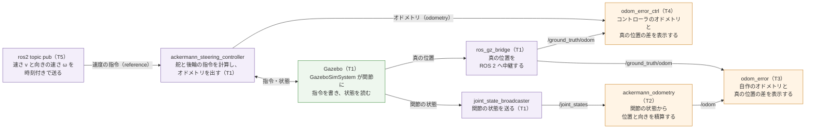

# フェーズ3-2: ros2_control の標準のコントローラと比べる（任意）

[学習計画](learning_plan.md) のフェーズ3の任意の部分。フェーズ1〜3では、舵と後輪を Gazebo の関節のプラグインで1つずつ動かし、指令の計算（[フェーズ2](phase2_1_kinematics.md)）とオドメトリ（[フェーズ3-1](phase3_1_odometry.md)）を自分で書いた。このページでは、同じ台車を、ROS 2 の **ros2_control** と、それが用意しているアッカーマン式の台車のための標準のコントローラ `ackermann_steering_controller` で動かす。コントローラが計算する舵の角度と後輪の速さを、フェーズ2-1の値と比べ、コントローラが出すオドメトリを、フェーズ3-1の自作のオドメトリと真の位置と比べる。自分で書いたものと標準の部品が同じ計算をしていることを確かめると、どちらを使うかを、中身を分かった上で選べる。ros2_control は、シミュレーションと実機で、関節を読み書きする部分だけを差し替えられるので、実機に移す発展の章の土台にもなる。新しい概念は、**ros2_control（コントローラと、関節を読み書きするハードウェアの部品を分ける仕組み）**の1つである。

- 想定環境: Ubuntu 24.04、ROS 2 Jazzy、Gazebo Harmonic（Gazebo の画面を開かなくても進められる）。ros2_control のパッケージ（`ros-jazzy-gz-ros2-control`・`ros-jazzy-ros2-controllers`）を使う（4-1節の冒頭で、入っているかを確かめる）
- 前提: [フェーズ3-1](phase3_1_odometry.md)（このページは、フェーズ3-1のオドメトリのノードと誤差を表示するノードを、そのまま使う）。[フェーズ2-1](phase2_1_kinematics.md) の2節（舵の角度と後輪の速さの式）。[フェーズ1-2](phase1_2_gazebo.md)・[フェーズ2-2](phase2_2_drive_node.md)（このページは、フェーズ1-2の台車の模型と、フェーズ2-2で足した Gazebo の設定に足す）。親プロジェクトの節は、フェーズ3-1と同じ
- 所要の目安: 1〜2コマ
- 言語: xacro（XML。台車の模型）、YAML（コントローラと中継の設定）、Python（launch のファイル）。ノードは新しく書かない

> **このページの位置づけ**: 任意の手順書で、フェーズ4以降は、このページに依存しない。このページで足す設定は、xacro の引数 `use_ros2_control` を `true` にしたときだけ効く。引数の既定値は `false` なので、フェーズ1-2の `sim.launch.py` での起動と、フェーズ4以降の手順は、このページを進めた後も、そのまま使える。
>
> **期待する結果の出どころ**: 4節の `dpkg-query`・`xacro`・`check_urdf`・`grep` の表示、5-4節の `colcon build`・`ros2 launch --show-args` の表示、6節の launch のログ・`ros2 topic list`・`ros2 topic echo`・`ros2 topic pub`・ノードのログの表示は、作成時に使い捨てのワークスペースで実際に実行して確かめたものである（Gazebo は、画面なしで起動した。launch の引数 `gz_args:='-r -s empty.sdf'`）。時刻・pid・秒数・パス・小さな桁の値（`1e-18` のような0に近い値）は、実行ごと・環境ごとに変わる。6-3節の誤差の値は、走らせた時間と PC の速さで少し変わる。8節のうち、`Timestamp in header is missing` の警告、`--use-sim-time` を付けずに送ったときに台車が止まらないこと、最初の `ros2 topic list` の一覧が欠けることは、作成時の実行で起きたものである。9節の付け替えも、作成時に、使い捨ての launch のファイルで確かめた。8節のほかの誤りのときの表示は、作成時には起こしておらず、ツールの振る舞いとソースのコードから想定した要旨である。

## 0. 学習目標と完了条件

1. ros2_control の部品（ハードウェアの部品・インターフェース・コントローラ・コントローラマネージャ）の役目と、実機に移すときに何を差し替えるかを説明できる（2-1節）。
2. 台車の模型に ros2_control の記述を足し、コントローラの設定を書いて、Gazebo の中でコントローラを起動できる（4節・5節・6-1節）。
3. `ackermann_steering_controller` が計算する舵の角度と後輪の速さが、フェーズ2-1の式と同じになることを、式と表示の値で確かめられる（2-2節・6-2節）。
4. コントローラのオドメトリと、フェーズ3-1の自作のオドメトリを、真の位置と比べ、計算の違いを説明できる（2-3節・6-3節）。

**完了条件**:

- `v`＝0.2 m/s、`ω`＝0.4 rad/s の指令で、コントローラが出す舵の角度の指令（`steering_angle_command`）と後輪の速さの指令（`linear_velocity_command`）が、フェーズ2-1の値（右 0.332・左 0.444 rad、右 5.800・左 4.200 rad/s）と、小数点以下3桁で一致する（6-2節）。
- 同じ指令で1周以上（約20秒以上）走らせたとき、コントローラのオドメトリと真の位置の差が、走った距離の5%以内に収まる（6-3節）。
- 走らせた後の、コントローラのオドメトリの位置と自作のオドメトリの位置の差が 0.01 m より小さい（6-3節）。

## 1. 全体像

このページでは、T1 で、ros2_control で動かす台車のシミュレーションを起動する。T2 と T3 で、フェーズ3-1の自作のオドメトリのノードと誤差を表示するノードを、T4 で、誤差を表示するノードをもう1つ（コントローラのオドメトリを見る設定で）起動し、T5 から指令を送り、T6 で確かめる。フェーズ2-2の駆動のノード `ackermann_drive` は、使わない（コントローラが、その役目をする）。


<details>
<summary>同じ図（mermaid版）</summary>



紫の箱は ROS 2 のノード・コマンド、橙の箱は自作のノード（フェーズ3-1）、緑の箱は Gazebo（シミュレータ）である。

</details>

- **ackermann_steering_controller**: このページで使う標準のコントローラ。`v`・`ω` の指令から舵の角度と後輪の速さを計算して関節に書き（フェーズ2-2の駆動のノードの役目）、関節の状態からオドメトリを積算する（フェーズ3-1のオドメトリのノードの役目）。ROS 2 のノードとして見えるが、別のプロセスではなく、T1 の Gazebo の中で動く（2-1節）。
- **joint_state_broadcaster**: 関節の状態を `/joint_states` に送るコントローラ。フェーズ1-2では、Gazebo のプラグイン `JointStatePublisher` と中継がしていた役目である。
- **自作のノード**: フェーズ3-1の `ackermann_odometry` と `odom_error` を、書き換えずに使う。`odom_error` は、名前とトピックを付け替えて、もう1つ起動する（`odom_error_ctrl`）。
- **TF の `odom → base_footprint`**: 図には無いが、フェーズ3-1と同じく、T2 の自作のオドメトリが出す（コントローラには出させない。2-3節）。

## 2. ros2_control の仕組みと、コントローラの計算

### 2-1. ros2_control の部品

フェーズ1〜3の作り方では、関節を動かす部分が、Gazebo の中だけの書き方（関節ごとのプラグインと、そのトピック）になっている。実機に移すときは、この部分を、モーターのドライバに合わせて書き直すことになる。

**ros2_control** は、「指令を計算する部分」と「関節を実際に読み書きする部分」を分け、その間を、決まった形でつなぐ ROS 2 の仕組みである。関節を読み書きする部分は、シミュレーションなら Gazebo の関節、実機ならモーターのドライバに差し替えるが、指令を計算する部分（コントローラ）と、その上のノードは、どちらでも同じものを使える。

| 部品 | 役目 | このページで使うもの |
|---|---|---|
| ハードウェアの部品 | 関節の状態を読み、指令を書き込む。実機とシミュレーションで差し替える部分 | `gz_ros2_control/GazeboSimSystem`（Gazebo の関節を読み書きする） |
| インターフェース | 関節ごとに、書ける値（指令のインターフェース）と、読める値（状態のインターフェース）を決める。値の種類は、角度（`position`）・速さ（`velocity`）・力（`effort`） | 後輪は、指令が速さ、状態が角度と速さ。舵は、指令も状態も角度。前輪は、状態の角度と速さだけ |
| コントローラ | 状態を読み、トピックで受けた目標から指令を計算して、書き込む | `ackermann_steering_controller`・`joint_state_broadcaster` |
| コントローラマネージャ | 決まった周期（`update_rate`）で、ハードウェアの読み → コントローラの計算 → ハードウェアへの書き、を繰り返す。コントローラの読み込みと、有効・無効の切り替えも受け付ける | Gazebo の中で動く `controller_manager`（`gz_ros2_control` のプラグインが起動する） |

コントローラは、コントローラマネージャの中で、決まった周期で順に呼ばれる。このページでは、周期を1秒に100回にする（`/joint_states` も、1秒に100回届く）。

**舵の角度の指令**: `GazeboSimSystem` は、角度の指令を受けた関節を、指令の角度との差に比例した速さで回して、指令の角度へ近づける。比例の係数は、プラグインの既定値（`position_proportional_gain` 0.1）と、コントローラマネージャの周期（1秒に100回）をかけた、1秒あたり10である（差が 0.1 rad なら、1 rad/s で回す）。このため、指令の角度との差は、約0.1秒で3分の1ほどに、約0.3秒で20分の1ほどに縮む。フェーズ1-2の `JointPositionController` は、1刻みで指令の角度に着く速さを与え、関節の速さの上限（10 rad/s）で抑えられるので、0.44 rad の指令に約0.04秒で着く。仕組みは違うが、どちらも、台車の動きに比べて十分に速い。

**実機に移すとき**: 4-3節で書く、模型の中の `<ros2_control>` の記述のうち、`<hardware>` の `<plugin>`（ハードウェアの部品）を、モーターのドライバと通信する部品に差し替える。コントローラとその設定、その上のノードは、そのまま使える。

ros2_control の仕組みは、親プロジェクトの間章の [5-1節](https://github.com/SanghunIm1991/ros2MinimalPhysicalAi/blob/main/docs/interlude_gazebo_physics.md#5-1-ros2_controlの仕組み) にも、腕のロボットの例で説明がある（参考。このページを進めるのに、読む必要はない）。

### 2-2. 舵の角度と後輪の速さの計算

`ackermann_steering_controller` は、`v`・`ω` の指令を、次の順に計算する（ソースのコードを読んでまとめた。出典を参照）。

1. 自転車モデルの舵の角度 $\phi = \arctan(\omega L / v)$ を求める。 $\tan\phi = L \omega / v = L \kappa$ なので、フェーズ2-1の2-2節の、曲率で書いた自転車モデルの角度と同じである。
2. 左右の舵の角度を、 $\phi$ から求める。式を変形すると、

$$\tan\delta_{left} = \frac{L \tan\phi}{L - (W/2) \tan\phi} = \frac{L \kappa}{1 - \kappa W/2}, \qquad \tan\delta_{right} = \frac{L \kappa}{1 + \kappa W/2}$$

になり、フェーズ2-1の2-2節の式と同じである。

3. 後輪の回転の速さを、回転の半径 $R = L / \tan\phi$ から、 $(v / r)(R \mp W/2) / R$ で求める（左が −、右が ＋）。 $R = 1/\kappa$ なので、 $(v / r)(1 \mp \kappa W/2)$ になり、フェーズ2-1の2-3節の式と同じである。ただし、ここでの $\phi$ は、手順1の指令の角度ではなく、関節の状態から求めた今の舵の角度（2-3節と同じく、左右の舵から求めて平均した自転車モデルの角度）である（5-1節の設定 `open_loop: false` のとき）。舵が指令の角度に着けば、手順1の $\phi$ と同じになる。

つまり、舵が指令の角度に着いた後は、コントローラが関節に送る4つの値は、フェーズ2-2の駆動のノードと同じになる（6-2節で、値で確かめる）。

**自作の駆動のノードとの違い**: 同じ式でも、式の外の扱いは違う。

| 場面 | フェーズ2-2の `ackermann_drive` | `ackermann_steering_controller` |
|---|---|---|
| 指令の型とトピック | `cmd_vel`（[`geometry_msgs/msg/Twist`](https://github.com/ros2/common_interfaces/blob/jazzy/geometry_msgs/msg/Twist.msg)） | `/ackermann_steering_controller/reference`（[`geometry_msgs/msg/TwistStamped`](https://github.com/ros2/common_interfaces/blob/jazzy/geometry_msgs/msg/TwistStamped.msg)。時刻付き） |
| 指令が途切れたとき | `cmd_timeout`（1.0秒）の後、後輪を止め、舵をまっすぐにする | `reference_timeout`（このページでは1.0秒）の後、後輪を止める。舵は、最後の角度のまま |
| 古い指令 | 区別しない | 時刻が `reference_timeout` より古い指令は、受け取らずにエラーを出す |
| 舵の上限を超える指令 | 曲率を上限で切り、`v` を保つ（フェーズ2-1の2-4節） | 舵の角度を切らずに送る（関節の上限で止まる）。後輪の速さは、測った舵の角度から求めた円に合わせる（指令が大きく、左右の舵がどちらも上限に当たると、アッカーマンの幾何から外れ、タイヤが滑る。たとえば `v`＝0.2、`ω`＝1.0 では、外側の舵の指令も 0.62 rad になる） |
| `v`＝0、`ω` が0でない | 曲率を0にする（後輪を止め、舵をまっすぐにする） | $\phi = \pm\pi/2$ になり、舵を大きく切る指令を出す。後輪は止まったまま（6-4節） |
| 左右の関節の順 | 名前で決める | パラメータの並びで決め、**右、左の順**に書く（3-2節） |

時刻付きの指令は、届くまでに時間がかかった古い指令で台車が動くのを防ぐための仕組みである。時刻には、コントローラの時計（シミュレーションの時刻）で測った値を入れる必要がある（6-2節）。

### 2-3. オドメトリの計算

`ackermann_steering_controller` は、関節の状態から、フェーズ3-1と同じ自転車モデルのオドメトリを積算する（5-1節の設定 `open_loop: false` のとき。`true` にすると、関節の状態を見ずに、指令の `v`・`ω` を積算する）。

| 計算 | フェーズ3-1の `ackermann_odometry` | `ackermann_steering_controller` |
|---|---|---|
| 曲率 | 左右の舵の角度から、それぞれ曲率を求め、平均する | 左右の舵の角度から、それぞれ自転車モデルの角度（同じ曲率になる角度）を求め、角度で平均する |
| 速さ `v` | 左右の後輪の速さの平均 | 左右の後輪の速さを、それぞれ後車軸の中心の速さに直してから平均する |
| 積算 | 刻みの中ほどの向きを使う（フェーズ3-1の2-3節） | 刻みの間を円の弧として積算する（向きが変わらないときは、中ほどの向き） |
| 頻度 | `/joint_states` が届くたび（このページでは1秒に100回） | コントローラの周期（1秒に100回） |
| 出すもの | `/odom` と、TF の `odom → base_footprint` | `/ackermann_steering_controller/odometry`。TF は、設定 `enable_odom_tf` が `true` のとき、`/tf` ではなく `/ackermann_steering_controller/tf_odometry` に出す |

左右の舵がアッカーマンの幾何どおりに切れ、左右の後輪の速さが同じ円に合っていれば、2つの計算は同じ値になる。違いは、舵と後輪の値が少しずれたときの平均のとり方と、積算の細かな方法だけなので、6-3節で見るとおり、2つのオドメトリの差は、真の位置との差よりずっと小さい。

TF は、自作のオドメトリ（T2）に出させ、コントローラには出させない（`enable_odom_tf: false`）。同じ `odom → base_footprint` を2つのノードが出すと、TF の値が2つの間で行き来する。コントローラの TF を使う場合は、`/ackermann_steering_controller/tf_odometry` を `/tf` へ付け替え（リマップ）、自作のオドメトリを止める（9節）。

## 3. 仕様

### 3-1. 足すファイルと、直すファイル

| パッケージ | ファイル | 中身 |
|---|---|---|
| `ackermann_description` | `urdf/ackermann_car.urdf.xacro`（直す） | 引数 `use_ros2_control`・`controllers_file` を足し、`true` のときだけ、4-3節のファイルを読み込む |
| `ackermann_description` | `urdf/ackermann_car.gazebo.xacro`（直す） | 関節を動かすプラグインと `JointStatePublisher` を、`use_ros2_control` が `false` のときだけ読み込む |
| `ackermann_description` | `urdf/ackermann_car.ros2_control.xacro`（足す） | `<ros2_control>` の記述（ハードウェアの部品と、関節ごとのインターフェース）と、`gz_ros2_control` のプラグイン |
| `ackermann_gazebo` | `config/ackermann_controllers.yaml`（足す） | コントローラマネージャと、2つのコントローラの設定 |
| `ackermann_gazebo` | `config/bridge_control.yaml`（足す） | 中継するトピック（時刻と真の位置だけ） |
| `ackermann_gazebo` | `launch/sim_control.launch.py`（足す） | ros2_control で動かす台車を出し、コントローラを起動する launch |

### 3-2. コントローラの設定

| パラメータ | 値 | 意味 |
|---|---|---|
| `wheelbase` | 0.20 | ホイールベース $L$（m） |
| `traction_track_width`・`steering_track_width` | 0.16 | 後輪（駆動する車輪）と前輪（舵を切る車輪）のトレッド $W$（m） |
| `traction_wheels_radius` | 0.04 | 後輪の半径 $r$（m） |
| `traction_joints_names` | `[rear_right_wheel_joint, rear_left_wheel_joint]` | 駆動する関節。**右、左の順** |
| `steering_joints_names` | `[front_right_steer_joint, front_left_steer_joint]` | 舵の関節。**右、左の順** |
| `open_loop`・`position_feedback` | `false`・`false` | オドメトリを、関節の状態（後輪は速さ）から積算する |
| `odom_frame_id`・`base_frame_id` | `odom`・`base_footprint` | オドメトリのメッセージの `frame_id`・`child_frame_id`（フェーズ3-1と同じ） |
| `enable_odom_tf` | `false` | TF を出さない（2-3節） |
| `reference_timeout` | 1.0 | 指令が途切れてから後輪を止めるまでの時間（秒）。フェーズ2-2の `cmd_timeout` と同じ値にした |

寸法は、フェーズ1-1の模型と同じ値である。模型の寸法を変えたときは、ここも同じ値に直す（ros2_control は、模型の寸法を読まない）。

コントローラのトピック（名前の頭に `/ackermann_steering_controller/` が付く）:

| トピック | 向き | 型 | 中身 |
|---|---|---|---|
| `reference` | 受ける | `geometry_msgs/msg/TwistStamped` | `v`（`twist.linear.x`）と `ω`（`twist.angular.z`）の指令 |
| `odometry` | 送る | [`nav_msgs/msg/Odometry`](https://github.com/ros2/common_interfaces/blob/jazzy/nav_msgs/msg/Odometry.msg) | コントローラのオドメトリ |
| `controller_state` | 送る | [`control_msgs/msg/SteeringControllerStatus`](https://github.com/ros-controls/control_msgs/blob/5.10.0/control_msgs/msg/SteeringControllerStatus.msg) | 後輪の速さ・舵の角度（状態）と、後輪と舵への指令 |

## 4. 台車の模型に、ros2_control の記述を足す

### 4-1. 使うパッケージを確かめる

```bash
dpkg-query -W -f='${db:Status-Abbrev} ${Package} ${Version}\n' ros-jazzy-gz-ros2-control ros-jazzy-ros2-controllers
```

**期待する結果**（版と日付は、導入した時期によって変わる）:

```text
ii  ros-jazzy-gz-ros2-control 1.2.20-1noble.20261006.040504
ii  ros-jazzy-ros2-controllers 4.42.1-1noble.20260924.191822
```

`dpkg-query -W` は、導入したパッケージの情報を、`-f` で決めた形（ここでは、状態・名前・版）で1行ずつ表示する。2行とも先頭が `ii`（導入済み）なら、準備ができている。入っていないパッケージは、`no packages found matching` と表示される。`ros-jazzy-gz-ros2-control` は Gazebo の中で ros2_control を動かすためのもの、`ros-jazzy-ros2-controllers` は、`ackermann_steering_controller` と `joint_state_broadcaster` を含むコントローラの集まりである（コントローラマネージャ等の ros2_control の本体も、一緒に入る）。入っていなければ、次のコマンドで導入する（`sudo` のパスワードを聞かれる）。

```bash
sudo apt install ros-jazzy-gz-ros2-control ros-jazzy-ros2-controllers
```

### 4-2. 模型の最後の部分と、Gazebo の設定を直す

フェーズ1-2で書いた模型のファイルの最後の部分（`<!-- Gazebo だけで使う設定` のコメントの行から、最後の `</robot>` まで）を、次のとおりに置き換える。足したのは、2つの引数と、最後の `xacro:if` の部分である。

ファイル: `~/ros2_ws/src/ackermann_description/urdf/ackermann_car.urdf.xacro`（最後の部分を置き換える）

```xml
  <!-- 関節の動かし方を選ぶ引数（false: フェーズ1-2の Gazebo のプラグイン、true: ros2_control） -->
  <xacro:arg name="use_ros2_control" default="false"/>
  <!-- ros2_control のコントローラの設定のファイル（use_ros2_control が true のときに使う） -->
  <xacro:arg name="controllers_file" default=""/>

  <!-- Gazebo だけで使う設定（摩擦と、関節を動かすプラグイン） -->
  <xacro:include filename="ackermann_car.gazebo.xacro"/>

  <!-- ros2_control で関節を動かすときだけ読み込む設定 -->
  <xacro:if value="$(arg use_ros2_control)">
    <xacro:include filename="ackermann_car.ros2_control.xacro"/>
  </xacro:if>

</robot>
```

フェーズ2-2で書いた Gazebo の設定のファイルを、次のとおりに書き換える。変えたのは、`<gazebo>` の要素の中の、関節を動かす4つのプラグインと `JointStatePublisher` を、`<xacro:unless>` で囲んだところ（囲んだ行の字下げも、2文字深くし、囲みの前にコメントの1行を足した）だけである。真の位置の `OdometryPublisher` は、どちらの動かし方でも使うので、囲まない。

ファイル: `~/ros2_ws/src/ackermann_description/urdf/ackermann_car.gazebo.xacro`

```xml
<?xml version="1.0"?>
<!-- 台車の模型のうち、Gazebo だけで使う設定（ackermann_car.urdf.xacro から読み込む） -->
<robot xmlns:xacro="http://www.ros.org/wiki/xacro">

  <!-- 車輪のタイヤと地面の摩擦の係数 -->
  <xacro:macro name="wheel_friction" params="name">
    <gazebo reference="${name}">
      <mu1>1.0</mu1>
      <mu2>1.0</mu2>
    </gazebo>
  </xacro:macro>

  <xacro:wheel_friction name="rear_left_wheel"/>
  <xacro:wheel_friction name="rear_right_wheel"/>
  <xacro:wheel_friction name="front_left_wheel"/>
  <xacro:wheel_friction name="front_right_wheel"/>

  <!-- 舵の関節を、指令の角度へ動かすプラグイン（関節の速さを指令する設定） -->
  <xacro:macro name="steer_controller" params="side">
    <plugin filename="gz-sim-joint-position-controller-system"
            name="gz::sim::systems::JointPositionController">
      <joint_name>front_${side}_steer_joint</joint_name>
      <topic>/front_${side}_steer_cmd</topic>
      <use_velocity_commands>true</use_velocity_commands>
    </plugin>
  </xacro:macro>

  <!-- 後輪の関節を、指令の速さで回すプラグイン -->
  <xacro:macro name="wheel_controller" params="side">
    <plugin filename="gz-sim-joint-controller-system"
            name="gz::sim::systems::JointController">
      <joint_name>rear_${side}_wheel_joint</joint_name>
      <topic>/rear_${side}_wheel_cmd</topic>
    </plugin>
  </xacro:macro>

  <gazebo>
    <!-- 関節を動かすプラグイン（ros2_control で動かすときは、読み込まない） -->
    <xacro:unless value="$(arg use_ros2_control)">
      <xacro:steer_controller side="left"/>
      <xacro:steer_controller side="right"/>
      <xacro:wheel_controller side="left"/>
      <xacro:wheel_controller side="right"/>
      <!-- 動く関節の角度と速さを、1秒に50回送るプラグイン -->
      <plugin filename="gz-sim-joint-state-publisher-system"
              name="gz::sim::systems::JointStatePublisher">
        <topic>/joint_states</topic>
        <update_rate>50</update_rate>
      </plugin>
    </xacro:unless>
    <!-- 台車の真の位置と向き（Gazebo の世界の座標）を、1秒に50回送るプラグイン -->
    <plugin filename="gz-sim-odometry-publisher-system"
            name="gz::sim::systems::OdometryPublisher">
      <odom_frame>world</odom_frame>
      <robot_base_frame>base_footprint</robot_base_frame>
      <odom_topic>/ground_truth/odom</odom_topic>
      <odom_publish_frequency>50</odom_publish_frequency>
    </plugin>
  </gazebo>

</robot>
```

- **`<xacro:arg>`**: xacro を展開するときに、外から値を渡せる引数。`xacro ファイル 名前:=値` の形で渡し、ファイルの中では `$(arg 名前)` で読む。渡さなければ `default` の値になる。引数は、`xacro:include` で読み込んだファイルの中でも読める。
- **`<xacro:if>`・`<xacro:unless>`**: `value` が真（`true` か `1`）のときだけ（`unless` は偽のときだけ）、中身を残す。ros2_control で動かすときは、Gazebo の関節のプラグインと ros2_control の両方が同じ関節を動かそうとしないように、片方だけを残す。

### 4-3. ros2_control の記述

ファイル: `~/ros2_ws/src/ackermann_description/urdf/ackermann_car.ros2_control.xacro`

```xml
<?xml version="1.0"?>
<!-- 台車の関節を ros2_control で動かすための設定（ackermann_car.urdf.xacro から読み込む） -->
<robot xmlns:xacro="http://www.ros.org/wiki/xacro">

  <!-- 後輪: 回転の速さを指令し、角度と速さを読む -->
  <xacro:macro name="rear_wheel_interfaces" params="side">
    <joint name="rear_${side}_wheel_joint">
      <command_interface name="velocity"/>
      <state_interface name="position"/>
      <state_interface name="velocity"/>
    </joint>
  </xacro:macro>

  <!-- 舵: 角度を指令し、角度を読む -->
  <xacro:macro name="steer_interfaces" params="side">
    <joint name="front_${side}_steer_joint">
      <command_interface name="position"/>
      <state_interface name="position"/>
    </joint>
  </xacro:macro>

  <!-- 前輪: 指令はせず、角度と速さを読むだけ -->
  <xacro:macro name="front_wheel_interfaces" params="side">
    <joint name="front_${side}_wheel_joint">
      <state_interface name="position"/>
      <state_interface name="velocity"/>
    </joint>
  </xacro:macro>

  <ros2_control name="GazeboSimSystem" type="system">
    <hardware>
      <plugin>gz_ros2_control/GazeboSimSystem</plugin>
    </hardware>
    <xacro:rear_wheel_interfaces side="left"/>
    <xacro:rear_wheel_interfaces side="right"/>
    <xacro:steer_interfaces side="left"/>
    <xacro:steer_interfaces side="right"/>
    <xacro:front_wheel_interfaces side="left"/>
    <xacro:front_wheel_interfaces side="right"/>
  </ros2_control>

  <!-- Gazebo の中で、ros2_control の controller_manager を動かすプラグイン -->
  <gazebo>
    <plugin filename="gz_ros2_control-system"
            name="gz_ros2_control::GazeboSimROS2ControlPlugin">
      <parameters>$(arg controllers_file)</parameters>
    </plugin>
  </gazebo>

</robot>
```

- **`<ros2_control>`**: ros2_control で使う関節と、ハードウェアの部品を書く要素（URDF の決まった要素ではなく、ros2_control が読む）。`<hardware>` の `<plugin>` が、2-1節のハードウェアの部品である。`<joint>` ごとに、指令のインターフェース（`command_interface`）と状態のインターフェース（`state_interface`）を並べる。
- **前輪の関節**: 駆動しないので指令は書かないが、状態を読めるように書いておく。書かないと、`joint_state_broadcaster` が前輪の角度を送らないので、`robot_state_publisher` が前輪の TF を出せず、RViz2 で前輪が表示されない。
- **`GazeboSimROS2ControlPlugin`**: Gazebo の中で、コントローラマネージャを起動するプラグイン。`<parameters>` に、コントローラの設定のファイル（5-1節）のパスを書く。パスは、launch のファイルから xacro の引数 `controllers_file` で渡す（5-3節）。

### 4-4. 展開して確かめる

新しいファイルを足したので、ビルドし直す。その後、xacro を、引数を渡さない場合と、`use_ros2_control:=true` を渡した場合の2通りに展開して、関節を動かすプラグインと `<ros2_control>` の要素がそれぞれ入っているかを数える。

```bash
cd ~/ros2_ws

colcon build --symlink-install --packages-select ackermann_description

xacro ~/ros2_ws/src/ackermann_description/urdf/ackermann_car.urdf.xacro > /tmp/car_joints.urdf

xacro ~/ros2_ws/src/ackermann_description/urdf/ackermann_car.urdf.xacro use_ros2_control:=true controllers_file:=/tmp/dummy.yaml > /tmp/car_control.urdf

check_urdf /tmp/car_control.urdf | head -3

grep -c 'JointPositionController\|<ros2_control' /tmp/car_joints.urdf /tmp/car_control.urdf
```

**期待する結果**（`colcon build` の表示は、フェーズ1-1と同じなので省いた）:

```text
$ check_urdf /tmp/car_control.urdf | head -3
robot name is: ackermann_car
---------- Successfully Parsed XML ---------------
root Link: base_footprint has 1 child(ren)
$ grep -c 'JointPositionController\|<ros2_control' /tmp/car_joints.urdf /tmp/car_control.urdf
/tmp/car_joints.urdf:2
/tmp/car_control.urdf:1
```

- **`/tmp/car_joints.urdf:2`**: 引数を渡さないと、フェーズ1-2の舵の `JointPositionController` が2つ（左右）入り、`<ros2_control>` は入らない。これまでのフェーズと同じ模型である。
- **`/tmp/car_control.urdf:1`**: `use_ros2_control:=true` では、`JointPositionController` が無くなり、`<ros2_control>` の要素が1つ入る。`check_urdf` は、`<ros2_control>` の要素を読み飛ばすので、木はフェーズ1-1と同じ8つのリンクのままである。
- `controllers_file:=/tmp/dummy.yaml` は、展開を確かめるための仮の値で、ファイルが無くても展開はできる。

## 5. コントローラの設定と、起動のファイル

### 5-1. コントローラの設定

ファイル: `~/ros2_ws/src/ackermann_gazebo/config/ackermann_controllers.yaml`

```yaml
# ros2_control の controller_manager と、2つのコントローラの設定（ros2_control で動かすとき）

controller_manager:
  ros__parameters:
    update_rate: 100  # 1秒にコントローラを回す回数
    joint_state_broadcaster:
      type: joint_state_broadcaster/JointStateBroadcaster
    ackermann_steering_controller:
      type: ackermann_steering_controller/AckermannSteeringController

ackermann_steering_controller:
  ros__parameters:
    # 台車の寸法（フェーズ1-1の模型と同じ値。単位は m）
    wheelbase: 0.20
    traction_track_width: 0.16
    steering_track_width: 0.16
    traction_wheels_radius: 0.04
    # 動かす関節（右、左の順に書く）
    traction_joints_names: [rear_right_wheel_joint, rear_left_wheel_joint]
    steering_joints_names: [front_right_steer_joint, front_left_steer_joint]
    # オドメトリ: 後輪の速さと舵の角度から積算する
    open_loop: false
    position_feedback: false
    odom_frame_id: odom
    base_frame_id: base_footprint
    enable_odom_tf: false
    # 指令が途切れてから止めるまでの時間（秒）
    reference_timeout: 1.0
```

- **`controller_manager`**: コントローラマネージャの設定。`update_rate` は2-1節の周期で、その下に、使うコントローラの名前と種類（`type`）を並べる。名前は自分で決められ、トピックの名前の頭になる（`/ackermann_steering_controller/reference` 等）。
- **`ackermann_steering_controller`**: 上で決めた名前と同じ見出しの下に、そのコントローラのパラメータを書く（3-2節の表）。`joint_state_broadcaster` は、パラメータを書かなければ、すべての関節の状態を送る。
- **`ros__parameters`**: ROS 2 のパラメータのファイルの決まった書き方（`ros` の後の `_` は2つ）。

### 5-2. 中継の設定

ros2_control で動かすときは、関節の指令と状態は、Gazebo の中の ros2_control が受け持つので、中継は、時刻と真の位置だけにする。フェーズ1-2の `bridge.yaml` は、`sim.launch.py` で使うので、別のファイルに書く。

ファイル: `~/ros2_ws/src/ackermann_gazebo/config/bridge_control.yaml`

```yaml
# ros2_control で動かすときに中継するトピック（関節の指令と状態は、ros2_control が受け持つ）

# Gazebo の中の時刻 → ROS 2
- ros_topic_name: /clock
  gz_topic_name: /clock
  ros_type_name: rosgraph_msgs/msg/Clock
  gz_type_name: gz.msgs.Clock
  direction: GZ_TO_ROS

# 台車の真の位置と向き → ROS 2
- ros_topic_name: /ground_truth/odom
  gz_topic_name: /ground_truth/odom
  ros_type_name: nav_msgs/msg/Odometry
  gz_type_name: gz.msgs.Odometry
  direction: GZ_TO_ROS
```

### 5-3. launch のファイル

フェーズ1-2の `sim.launch.py` を元に、別の launch のファイルを作る。`sim.launch.py` から変えたのは、xacro に引数を渡す部分（`controllers_file` と `robot_description`）、中継の設定のファイルの名前、最後の `spawner` のノードの3か所である。

ファイル: `~/ros2_ws/src/ackermann_gazebo/launch/sim_control.launch.py`

```python
"""Gazebo を起動し、ros2_control で動かす台車の模型を出して、2つのコントローラを始める。"""
from launch import LaunchDescription
from launch.actions import DeclareLaunchArgument, IncludeLaunchDescription
from launch.launch_description_sources import PythonLaunchDescriptionSource
from launch.substitutions import Command, LaunchConfiguration, PathJoinSubstitution
from launch_ros.actions import Node
from launch_ros.parameter_descriptions import ParameterValue
from launch_ros.substitutions import FindPackageShare


def generate_launch_description():
    """launch の引数と、起動するもの（Gazebo とノード）をまとめて返す。"""
    gz_args = LaunchConfiguration('gz_args')
    xacro_file = PathJoinSubstitution(
        [FindPackageShare('ackermann_description'), 'urdf', 'ackermann_car.urdf.xacro'])
    controllers_file = PathJoinSubstitution(
        [FindPackageShare('ackermann_gazebo'), 'config', 'ackermann_controllers.yaml'])
    robot_description = ParameterValue(
        Command(['xacro ', xacro_file, ' use_ros2_control:=true',
                 ' controllers_file:=', controllers_file]),
        value_type=str)
    gz_sim_launch = PathJoinSubstitution(
        [FindPackageShare('ros_gz_sim'), 'launch', 'gz_sim.launch.py'])
    bridge_config = PathJoinSubstitution(
        [FindPackageShare('ackermann_gazebo'), 'config', 'bridge_control.yaml'])

    return LaunchDescription([
        DeclareLaunchArgument(
            'gz_args', default_value='-r empty.sdf',
            description='gz sim に渡す引数（ワールドのファイル等）'),
        IncludeLaunchDescription(
            PythonLaunchDescriptionSource(gz_sim_launch),
            launch_arguments={'gz_args': gz_args, 'on_exit_shutdown': 'true'}.items()),
        Node(package='robot_state_publisher', executable='robot_state_publisher',
             parameters=[{'robot_description': robot_description, 'use_sim_time': True}]),
        Node(package='ros_gz_sim', executable='create',
             arguments=['-topic', 'robot_description', '-name', 'ackermann_car', '-z', '0.01']),
        Node(package='ros_gz_bridge', executable='parameter_bridge',
             parameters=[{'config_file': bridge_config}]),
        Node(package='controller_manager', executable='spawner',
             arguments=['joint_state_broadcaster', 'ackermann_steering_controller']),
    ])
```

- **`controllers_file`**: 5-1節のファイルの、`install/` の中のパス。`robot_description` を作る `Command` で、`xacro` に `use_ros2_control:=true` と一緒に渡す（`Command` は、並べた文字をつないで1つのコマンドにするので、引数の前に空白を入れる）。展開された模型の `<parameters>` に、このパスが入る。
- **`spawner`**: コントローラマネージャに、並べたコントローラを読み込ませ、有効にするコマンド（`controller_manager` のパッケージ）。コントローラマネージャは、`create` で台車が Gazebo に出た後に起動するので、`spawner` は、それを待ってから読み込む。読み込みが済むと、`spawner` は終わる。
- コントローラマネージャは、Gazebo の中で動くので、launch のファイルにはノードとして書かない。プラグインが、`robot_state_publisher` から模型を受け取って、`<ros2_control>` の関節を読み書きし始める。シミュレーションの時刻（`use_sim_time`）も、プラグインが自動で使う設定にする。

### 5-4. パッケージの設定と、ビルド

`setup.py` は、直さない。フェーズ1-2で、`launch/` の `*.launch.py` と `config/` の `*.yaml` を、すべて `install/` へコピーするように書いたので、新しいファイルも、そのままコピーされる（模型のパッケージも、`urdf/` の `*.xacro` をすべてコピーする）。

`package.xml` には、フェーズ1-2で足した行の後に、4行を足す。

ファイル: `~/ros2_ws/src/ackermann_gazebo/package.xml`（足す行）

```xml
  <exec_depend>gz_ros2_control</exec_depend>
  <exec_depend>controller_manager</exec_depend>
  <exec_depend>joint_state_broadcaster</exec_depend>
  <exec_depend>ackermann_steering_controller</exec_depend>
```

```bash
cd ~/ros2_ws

colcon build --symlink-install --packages-select ackermann_description ackermann_gazebo

source ~/ros2_ws/install/setup.bash

ros2 launch ackermann_gazebo sim_control.launch.py --show-args
```

**期待する結果**（`colcon build` の表示と、`--show-args` の表示の先頭。秒数は環境によって変わる）:

```text
$ colcon build --symlink-install --packages-select ackermann_description ackermann_gazebo
Starting >>> ackermann_description
Finished <<< ackermann_description [2.00s]
Starting >>> ackermann_gazebo
Finished <<< ackermann_gazebo [2.38s]

Summary: 2 packages finished [4.57s]
$ ros2 launch ackermann_gazebo sim_control.launch.py --show-args
Arguments (pass arguments as '<name>:=<value>'):

    'gz_args':
        gz sim に渡す引数（ワールドのファイル等）
        (default: '-r empty.sdf')
```

`ackermann_gazebo` は、`package.xml` で `ackermann_description` を使うと書いたので、`ackermann_description` のビルドが終わってから始まる。`--show-args` の表示は、この後に、フェーズ1-2と同じく、取り込んだ `gz_sim.launch.py` の引数が続く。

## 6. 動かす

### 6-1. 起動する

T1 で、ros2_control で動かす台車のシミュレーションを起動する（フェーズ1-2以降の `sim.launch.py` の代わり）。T2 と T3 で、フェーズ3-1の自作のオドメトリと誤差を表示するノードを、T4 で、誤差を表示するノードを、コントローラのオドメトリを見る設定で起動する。

```bash
# T1
source ~/ros2_ws/install/setup.bash

ros2 launch ackermann_gazebo sim_control.launch.py

# T2
source ~/ros2_ws/install/setup.bash

ros2 run ackermann_drive ackermann_odometry

# T3
source ~/ros2_ws/install/setup.bash

ros2 run ackermann_drive odom_error

# T4
source ~/ros2_ws/install/setup.bash

ros2 run ackermann_drive odom_error --ros-args -r __node:=odom_error_ctrl -r /odom:=/ackermann_steering_controller/odometry
```

T4 の `--ros-args` の後の `-r` は、名前の付け替え（リマップ）である。`__node:=odom_error_ctrl` は、ノードの名前を `odom_error_ctrl` に変え（T3 と同じ名前のノードが2つにならないように）、`/odom:=/ackermann_steering_controller/odometry` は、ノードが受けるトピック `/odom` を、コントローラのオドメトリに付け替える。コードを変えずに、同じノードを、別のトピックを見る2つ目のノードとして使える。

**期待する結果**（T1 の表示の抜粋。時刻・pid は実行ごとに変わる）:

```text
[INFO] [spawner-5]: process started with pid [2709]
[spawner-5] [INFO] [1794647288.002513813] [spawner_joint_state_broadcaster]: waiting for service /controller_manager/list_controllers to become available...
[create-3] [INFO] [1794647288.227047589] [ros_gz_sim]: Entity creation successful.
[gazebo-1] [INFO] [1794647289.910478297] [gz_ros_control]: Loading controller_manager
[gazebo-1] [INFO] [1794647291.228174880] [gz_ros_control]: Loading joint: front_left_steer_joint
[gazebo-1] [INFO] [1794647291.228182696] [gz_ros_control]: 	State:
[gazebo-1] [INFO] [1794647291.228188925] [gz_ros_control]: 		 position
[gazebo-1] [INFO] [1794647291.228196401] [gz_ros_control]: 	Command:
[gazebo-1] [INFO] [1794647291.228202312] [gz_ros_control]: 		 position
[spawner-5] [INFO] [1794647292.269123269] [spawner_joint_state_broadcaster]: Configured and activated joint_state_broadcaster
[gazebo-1] [INFO] [1794647292.299554010] [ackermann_steering_controller]: Ackermann odom configure successful
[spawner-5] [INFO] [1794647292.338861019] [spawner_joint_state_broadcaster]: Configured and activated ackermann_steering_controller
[INFO] [spawner-5]: process has finished cleanly [pid 2709]
```

- **`waiting for service ...`**: `spawner` は、台車が Gazebo に出て（`Entity creation successful`）、コントローラマネージャが起動するまで待つ。
- **`Loading joint`**: `GazeboSimSystem` が、4-3節の `<ros2_control>` の関節を、1つずつ読み込む（ここでは舵の1つだけを載せた）。舵は、状態も指令も角度（`position`）である。
- **`Configured and activated`**: 2つのコントローラが読み込まれ、有効になった。`spawner` は、ここで終わる。

`[WARN]` の行（`The resource manager is not yet initialized`・`Desired controller update period (0.01 s) is slower than the gazebo simulation period (0.001 s).`・`No clock received, using time argument instead!` 等）も出るが、起動の途中の待ち合わせや、コントローラの周期が物理の計算の刻みより長いこと、シミュレーションの時刻が届く前に1回動いたことの知らせで、この構成では問題ない。

T2 と T3・T4 の表示は、フェーズ3-1の6-1節と同じである（T4 の行は、ノードの名前が `odom_error_ctrl` になる）。

T6 で、トピックと関節の状態を確かめる。

```bash
# T6
source ~/ros2_ws/install/setup.bash

ros2 topic list

ros2 topic echo --once /joint_states --field name
```

**期待する結果**:

```text
$ ros2 topic list
/ackermann_steering_controller/controller_state
/ackermann_steering_controller/odometry
/ackermann_steering_controller/reference
/ackermann_steering_controller/tf_odometry
/ackermann_steering_controller/transition_event
/clock
/controller_manager/activity
/controller_manager/introspection_data/full
/controller_manager/introspection_data/names
/controller_manager/introspection_data/values
/controller_manager/statistics/full
/controller_manager/statistics/names
/controller_manager/statistics/values
/diagnostics
/dynamic_joint_states
/ground_truth/odom
/joint_state_broadcaster/transition_event
/joint_states
/odom
/parameter_events
/robot_description
/rosout
/tf
/tf_static
$ ros2 topic echo --once /joint_states --field name
A message was lost!!!
	total count change:1
	total count: 1---
['front_left_steer_joint', 'front_left_wheel_joint', 'front_right_steer_joint', 'front_right_wheel_joint', 'rear_left_wheel_joint', 'rear_right_wheel_joint']
---
```

- **`/ackermann_steering_controller/...`**: コントローラの3つのトピック（3-2節）のほかに、`tf_odometry`（`enable_odom_tf: false` なので、作られるが送られない）と、`transition_event`（コントローラの状態の切り替えの知らせ）が出ている。
- **`/controller_manager/...`・`/diagnostics`・`/dynamic_joint_states`**: コントローラマネージャが出す、動作の統計と、全部の関節のインターフェースの値。このページでは使わない。
- **`/odom`・`/tf`**: `/odom` は、T2 の自作のオドメトリが出している。`/tf` は、T2 の `odom → base_footprint` と、`robot_state_publisher` の `base_footprint` から各車輪までの TF である。
- **`/joint_states`**: `joint_state_broadcaster` が、6つの関節（4-3節で状態を書いた関節）の状態を送っている。フェーズ1-2と同じ名前なので、T2 の自作のオドメトリは、書き換えずに使える。フェーズ1-2の `/front_left_steer_cmd` 等の4つの指令のトピックは無い（中継していない）。`A message was lost!!!` の行は、6-2節で説明する。

### 6-2. 指令を送り、コントローラが計算した値を見る

T5 から、フェーズ3-1の6-3節と同じ `v`・`ω` の指令を、`TwistStamped` の型で、1秒に10回送り続ける。

```bash
# T5
source ~/ros2_ws/install/setup.bash

ros2 topic pub --use-sim-time -r 10 /ackermann_steering_controller/reference geometry_msgs/msg/TwistStamped "{header: {stamp: now}, twist: {linear: {x: 0.2}, angular: {z: 0.4}}}"
```

- **`header: {stamp: now}`**: `ros2 topic pub` は、値の `now` を、送るときの時刻に置き換える。2-2節のとおり、コントローラは、時刻が古すぎる指令を受け取らない。
- **`--use-sim-time`**: `now` に、PC の時計ではなく、シミュレーションの時刻（`/clock`）を使わせる。コントローラは、シミュレーションの時刻で指令の古さを測るので、時刻をそろえる（付け忘れると、8節の誤りになる）。

**期待する結果**（T5 の表示の先頭。時刻は実行ごとに変わる）:

```text
publisher: beginning loop
publishing #1: geometry_msgs.msg.TwistStamped(header=std_msgs.msg.Header(stamp=builtin_interfaces.msg.Time(sec=32, nanosec=229000000), frame_id=''), twist=geometry_msgs.msg.Twist(linear=geometry_msgs.msg.Vector3(x=0.2, y=0.0, z=0.0), angular=geometry_msgs.msg.Vector3(x=0.0, y=0.0, z=0.4)))

publishing #2: geometry_msgs.msg.TwistStamped(header=std_msgs.msg.Header(stamp=builtin_interfaces.msg.Time(sec=32, nanosec=346000000), frame_id=''), twist=geometry_msgs.msg.Twist(linear=geometry_msgs.msg.Vector3(x=0.2, y=0.0, z=0.0), angular=geometry_msgs.msg.Vector3(x=0.0, y=0.0, z=0.4)))
```

`stamp` の `sec=32` は、シミュレーションの時刻（T1 を起動してから、シミュレーションが進んだ秒数）である。数秒後に、台車が円を描いて走り始める（フェーズ1-2の7-4節と同じく、`ros2 topic pub` の指令が届き始めるまで、数秒かかる）。

走っている間に、T6 で、コントローラの状態と関節の状態を見る。

```bash
# T6
ros2 topic echo --once /ackermann_steering_controller/controller_state

ros2 topic echo --once /joint_states
```

**期待する結果**（小さな桁の値と時刻は、実行ごとに変わる）:

```text
$ ros2 topic echo --once /ackermann_steering_controller/controller_state
A message was lost!!!
	total count change:1
	total count: 1---
header:
  stamp:
    sec: 55
    nanosec: 619000000
  frame_id: odom
traction_wheels_position: []
traction_wheels_velocity:
- 5.799999998778039
- 4.200000001177812
steer_positions:
- 0.3320594674402171
- 0.4444192098000186
linear_velocity_command:
- 5.799999999757927
- 4.200000000242073
steering_angle_command:
- 0.33205946754288557
- 0.44441920990109907
---
$ ros2 topic echo --once /joint_states
A message was lost!!!
	total count change:1
	total count: 1---
header:
  stamp:
    sec: 58
    nanosec: 580000000
  frame_id: base_link
name:
- front_left_steer_joint
- front_left_wheel_joint
- front_right_steer_joint
- front_right_wheel_joint
- rear_left_wheel_joint
- rear_right_wheel_joint
position:
- 0.4444192097729753
- 123.78795121795366
- 0.3320594674203763
- 155.04921200193738
- 110.2489890923158
- 152.0510109059096
velocity:
- .nan
- 4.767009324315127
- .nan
- 5.954875275760833
- 4.200000001279936
- 5.799999998659014
effort:
- .nan
- .nan
- .nan
- .nan
- .nan
- .nan
---
```

- **`steering_angle_command`・`linear_velocity_command`**: コントローラが計算した、舵の角度と後輪の速さの指令。どちらも、パラメータの順（**右、左**）に並ぶ。舵は右 0.332・左 0.444 rad、後輪は右 5.800・左 4.200 rad/s で、フェーズ2-1の6-1節（課題1の、半径 0.5 m の組。後輪の速さは `v` が2倍なので2倍）と、小数点以下3桁で一致する（完了条件）。
- **`steer_positions`・`traction_wheels_velocity`**: 関節の状態（測った値）。指令とほぼ同じで、舵は指令の角度に着いている。`traction_wheels_position` が空なのは、`position_feedback: false` で、後輪の角度を読んでいないからである。
- **`/joint_states`**: 同じ値が、名前の順（左が先）に並ぶ。舵の `velocity` と、すべての `effort` が `.nan`（値が無い）なのは、4-3節で、その状態のインターフェースを書いていないからである。前輪は駆動しないが、地面に転がされて回っている。
- **`A message was lost!!!`**: `ros2 topic echo` が、受け取りが間に合わなかったメッセージがあったことを知らせる行。1秒に100回届くトピックを、起動したばかりの `echo` で受けると出ることがある。`--once` で1つを見るだけなら、無視してよい。

### 6-3. 2つのオドメトリを、真の位置と比べる

T5 から指令を送り続けたまま、T3 と T4 の表示を見る。約1分（4周ほど）走らせてから、T5 を `Ctrl+C` で止める。

**期待する結果**（T4 の表示の抜粋。時刻と、細かな値は実行ごとに変わる）:

```text
[INFO] [1794647330.486925619] [odom_error_ctrl]: distance=0.621 m, error=0.010 m (1.6%)
[INFO] [1794647338.487122261] [odom_error_ctrl]: distance=2.201 m, error=0.087 m (3.9%)
[INFO] [1794647350.486816607] [odom_error_ctrl]: distance=3.995 m, error=0.127 m (3.2%)
[INFO] [1794647368.487181543] [odom_error_ctrl]: distance=7.548 m, error=0.250 m (3.3%)
[INFO] [1794647388.487378129] [odom_error_ctrl]: distance=10.913 m, error=0.364 m (3.3%)
[INFO] [1794647400.486946958] [odom_error_ctrl]: distance=13.273 m, error=0.440 m (3.3%)
[INFO] [1794647402.487268922] [odom_error_ctrl]: distance=13.362 m, error=0.436 m (3.3%)
[INFO] [1794647404.486959579] [odom_error_ctrl]: distance=13.362 m, error=0.436 m (3.3%)
```

- **割合**: 1周（約 3.2 m）を過ぎてからは、3〜4%で、5%以内に収まる（完了条件）。フェーズ3-1の6-3節の自作のオドメトリと同じくらいである。
- **T3（自作のオドメトリ）**: 同じ時刻の行は、`error` の3桁目まで、ほとんど同じ値になる（作成時は、同じ時刻の行の差が、多くても 0.002 m だった）。
- **最後の3行**: T5 を止めると、1.0秒後（`reference_timeout`）に後輪が止まり、走った距離と差が変わらなくなる。

2つのオドメトリが、ほぼ同じ値になるのは、2-3節のとおり、同じ関節の状態から、同じ自転車モデルで積算しているからである。真の位置との差（約3%）は、タイヤの滑りで、台車が舵の角度の示す円より少し大きな円を描くためで（フェーズ3-1の2-4節）、どちらのオドメトリにも同じように溜まる。標準のコントローラを使っても、オドメトリの誤差は無くならない。

止まった後の、2つのオドメトリと真の位置を比べる。

```bash
# T6
ros2 topic echo --once /odom --field pose.pose

ros2 topic echo --once /ackermann_steering_controller/odometry --field pose.pose

ros2 topic echo --once /ground_truth/odom --field pose.pose
```

**期待する結果**（値は、走らせた時間によって変わる。`A message was lost!!!` の行が先頭に出ることがある）:

```text
$ ros2 topic echo --once /odom --field pose.pose
position:
  x: 0.49159717085525045
  y: 0.6628602474713913
  z: 0.0
orientation:
  x: 0.0
  y: 0.0
  z: 0.8139293936912826
  w: 0.5809638044537208
---
$ ros2 topic echo --once /ackermann_steering_controller/odometry --field pose.pose
A message was lost!!!
	total count change:1
	total count: 1---
position:
  x: 0.4915772052047221
  y: 0.6628938531169452
  z: 0.0
orientation:
  x: 0.0
  y: 0.0
  z: 0.8139499568324889
  w: 0.5809349944463574
---
$ ros2 topic echo --once /ground_truth/odom --field pose.pose
position:
  x: 0.4377150855874145
  y: 0.2305508602905544
  z: 0.0
orientation:
  x: 1.7265641609026696e-11
  y: -9.954536330269073e-10
  z: 0.46415948298525744
  w: 0.8857516437212287
---
```

自作のオドメトリ（`/odom`）とコントローラのオドメトリの位置は、x も y も 0.0001 m より小さな差しかなく、0.01 m より小さい（完了条件）。どちらも、真の位置とは約 0.44 m 違う（T4 の最後の表示と同じ）。向きは、四元数の z と w から $\theta = 2 \arctan(z / w)$ で求めると、2つのオドメトリが約 1.90 rad、真の向きが約 0.97 rad で、約 0.93 rad 違う。フェーズ3-1の2-4節と同じく、台車は舵の角度の示す円より少し大きな円を描くので、どちらのオドメトリも、向きを変えた量を多めに数える。

### 6-4. `v`＝0 で、向きの速さだけを送る

2-2節の表の、自作の駆動のノードとの違いを、1つ確かめる。T5 で、`v`＝0、`ω`＝0.4 rad/s の指令を送る。

```bash
# T5
ros2 topic pub --use-sim-time -r 10 /ackermann_steering_controller/reference geometry_msgs/msg/TwistStamped "{header: {stamp: now}, twist: {linear: {x: 0.0}, angular: {z: 0.4}}}"
```

送り始めてから数秒後に、T6 でコントローラの状態を見る。

```bash
# T6
ros2 topic echo --once /ackermann_steering_controller/controller_state
```

**期待する結果**（抜粋。小さな桁の値は実行ごとに変わる）:

```text
traction_wheels_velocity:
- -5.508628089274685e-17
- -3.8613725349594164e-17
steer_positions:
- 0.6
- 0.6
linear_velocity_command:
- 0.0
- 0.0
steering_angle_command:
- 1.1902899496825317
- 1.9513027039072615
```

- **`steering_angle_command`**: `v`＝0 なので、2-2節の $\phi = \arctan(\omega L / v)$ が $\pi/2$（真横）になり、右 1.19 rad・左 1.95 rad という、上限 0.6 rad を大きく超える角度を指令している。
- **`steer_positions`**: 実際の舵は、模型の関節の上限で、左右とも 0.6 rad で止まっている。
- **`linear_velocity_command`**: 後輪の速さは `v` に比例するので0で、台車は動かない（アッカーマン式の台車は、その場で向きを変えられない）。

フェーズ2-2の駆動のノードは、同じ指令で舵をまっすぐにする（フェーズ2-1の2-5節）。どちらの扱いでも台車は動かないが、標準のコントローラは、舵を目いっぱい切った状態で止まり、T5 を止めた後も、舵はそのまま残る（2-2節の表の「指令が途切れたとき」）。次に前へ進む指令を送ると、舵が指令の角度へ戻りながら走り出す。

確かめ終わったら、T5・T4・T3・T2・T1 の順に、`Ctrl+C` で止める。

## 7. まとめ

- ros2_control は、指令を計算するコントローラと、関節を読み書きするハードウェアの部品を分け、コントローラマネージャが決まった周期でつなぐ。シミュレーションでは `GazeboSimSystem` を使い、実機では、ここをモーターのドライバと通信する部品に差し替える。
- 台車の模型に `<ros2_control>` の記述を足し、xacro の引数 `use_ros2_control` で、フェーズ1-2の Gazebo のプラグインと切り替えられるようにした。既定は、これまでどおりの Gazebo のプラグインである。
- `ackermann_steering_controller` が計算する舵の角度と後輪の速さは、フェーズ2-1の式と同じ値（右 0.332・左 0.444 rad、右 5.800・左 4.200 rad/s）になった。`v`＝0 の指令・舵の上限・指令が途切れたときの扱いは、自作の駆動のノードと違う。
- コントローラのオドメトリと、フェーズ3-1の自作のオドメトリは、同じ関節の状態から同じ自転車モデルで積算するので、約 13 m 走った後も、位置の差が 0.0001 m より小さかった。真の位置との差は、どちらも走った距離の約3%で、タイヤの滑りによる誤差は、標準のコントローラでも残る。

## 8. つまずきやすい点

- **T1 に `Timestamp in header is missing, using current time as command timestamp.` の警告が続く**: 指令の `header` の時刻を書かずに送ると、時刻が0になり、コントローラが、受けた時刻で置き換えて、送るたびに警告を出す（作成時に、時刻を書かずに5秒送ったときに出た）。台車は動くが、6-2節のとおり `header: {stamp: now}` を書いて送る。
- **T5 を止めても、台車が止まらない**: `--use-sim-time` を付けずに `stamp: now` を送ると、指令の時刻が PC の時計（1970年からの秒数。T5 の表示の `sec=` が10桁の数になる）になり、シミュレーションの時刻（起動してからの秒数）よりずっと先の時刻になる。コントローラは、指令の古さを「今の時刻 − 指令の時刻」で測るので、古さが負になり、いつまでも時間切れにならない（作成時に、この形で6秒送って止めたところ、台車は走り続けた）。止めるには、`--use-sim-time` を付けて、`v`＝0・`ω`＝0 の指令（`twist: {linear: {x: 0.0}, angular: {z: 0.0}}`）を送る（`ω` を0にしないと、6-4節のとおり、舵を目いっぱい切った状態になる）。
- **舵と後輪の左右が入れ替わる**: `traction_joints_names`・`steering_joints_names` を、左、右の順に書くと、左右の値が入れ替わる。2つの舵の指令は同じ符号なので、台車は指令と同じ向きに曲がるが、外側の舵が大きく、内側の舵が小さく切れ、後輪も内側が速く回るので、タイヤが滑り、円の半径とオドメトリがずれる（ソースのコードから想定したことで、作成時には起こしていない）。6-2節の `controller_state` で、左へ曲がる指令のときに、`steering_angle_command` の2つ目（左）が1つ目（右）より小さければ、この誤りである。3-2節のとおり、**右、左の順**に書く。
- **`spawner` が `waiting for service /controller_manager/list_controllers` のまま進まない**: コントローラマネージャが起動していない。T1 の表示に `Loading controller_manager` があるかを確かめる。無ければ、模型が `use_ros2_control:=true` で展開されていない（`sim.launch.py` を起動した等）か、4-3節のファイルを足した後に `ackermann_description` をビルドし直していない。
- **T1 に、コントローラの設定のファイルが見つからない旨のエラーが出る**: 5-1節のファイルを足した後に、`ackermann_gazebo` をビルドし直したかを確かめる。launch のファイルは、`install/` の中のパスを模型に渡すので、ビルドするまでファイルが置かれない。
- **フェーズ1-2の `sim.launch.py`（フェーズ3-1までの起動の形）と `ackermann_drive` で、台車が動かなくなった**: 4-2節の `<xacro:unless>` の囲みを、`<gazebo>` の要素の外に書いたり、引数の名前を `use_ros2_control` と違えて書いたりすると、関節のプラグインが読み込まれない。4-4節の `grep -c` で、引数を渡さないときに `JointPositionController` が2つ入るかを確かめる。
- **`ros2 topic list` に、コントローラのトピックが出ない**: T1 を起動した直後や、そのターミナルで最初に `ros2` のコマンドを使ったときは、一覧が欠けることがある（作成時にも、最初の `ros2 topic list` が、`/ackermann_steering_controller/...` を含まない7つだけを表示した）。数秒待ってから、もう一度実行する。
- **`ros2 control list_controllers` を使いたい**: コントローラの一覧や状態を表示する `ros2 control` のコマンドは、別のパッケージ（`ros-jazzy-ros2controlcli`）に入っていて、4-1節のパッケージには含まれない。このページでは、T1 の `spawner` の表示（`Configured and activated`）で、コントローラが有効になったことを確かめた。

## 9. 発展: コントローラの TF を使う

このページでは、TF を自作のオドメトリに出させた。コントローラに TF を出させるには、コントローラのパラメータ `enable_odom_tf` を `true` にし、コントローラが出す `~/tf_odometry`（`/ackermann_steering_controller/tf_odometry`）を、`/tf` へ付け替える。コントローラは Gazebo の中で動くので、付け替えは、`ros2 run` の `--ros-args` ではなく、`spawner` の `--controller-ros-args` で、コントローラを読み込むときに渡す。5-3節の `spawner` のノードの `arguments` を、次のようにする。

ファイル: `~/ros2_ws/src/ackermann_gazebo/launch/sim_control.launch.py`（`spawner` のノードの `arguments` の部分）

```python
             arguments=['joint_state_broadcaster', 'ackermann_steering_controller',
                        '--controller-ros-args=-p enable_odom_tf:=true -r ~/tf_odometry:=/tf']),
```

- `--controller-ros-args=` の後に、`=` でつないで書く（`=` を使わずに、別の要素に分けて書くと、値が `-` で始まるので、`spawner` が値を受け取れずに止まる。作成時の確かめで起きた）。
- 1つの `spawner` で読み込むコントローラのすべてに、同じ引数が渡る（作成時の確かめでは、`joint_state_broadcaster` に渡っても、動きに影響はなかった）。

この場合、自作のオドメトリ（T2）は起動しない（TF の親が2つになるのを避けるため。2-3節）。作成時に、この形で起動して、`ros2 topic info /tf -v` の送り手に `ackermann_steering_controller` が入ることと、T2 を起動せずに `tf2_echo odom base_link` が `odom` から `base_link` までを表示することを確かめた。フェーズ5以降の SLAM と Nav2 は、TF のフレームの名前と `/odom` がそろっていれば、どちらのオドメトリでも使える（コントローラのオドメトリを使うときは、`/ackermann_steering_controller/odometry` を `/odom` へ付け替える）。

## 次へ

必須の流れは、フェーズ4-1（LiDAR を台車に載せる）へ進む。フェーズ4以降は、フェーズ1-2の `sim.launch.py`（Gazebo の関節のプラグインと、フェーズ2-2の駆動のノード、フェーズ3-1の自作のオドメトリ）で進める。手順書は作成中で、できたら README の「読む順番」に足す。

## 出典

このページの技術的な記述は、次の文書とソースのコードを読んで、自分の言葉でまとめたもの（逐語の転載ではない）。サンプルの設定は、この教材で書いたもの。

- ros2_control の仕組み: [ros2_control の公式の文書（Jazzy）の「Getting Started」](https://control.ros.org/jazzy/doc/getting_started/getting_started.html)
- Gazebo の中で ros2_control を動かす方法（`GazeboSimSystem`・`GazeboSimROS2ControlPlugin`）: [gz_ros2_control の公式の文書（Jazzy）](https://control.ros.org/jazzy/doc/gz_ros2_control/doc/index.html)。舵の角度の指令の扱い（2-1節の比例の係数）は、導入した版（1.2.20）の [`gz_system.cpp`](https://github.com/ros-controls/gz_ros2_control/blob/1.2.20/gz_ros2_control/src/gz_system.cpp) を読んで確かめた
- コントローラのトピックとパラメータ: [steering_controllers_library の公式の文書（Jazzy）](https://control.ros.org/jazzy/doc/ros2_controllers/steering_controllers_library/doc/userdoc.html)、[ackermann_steering_controller の公式の文書（Jazzy）](https://control.ros.org/jazzy/doc/ros2_controllers/ackermann_steering_controller/doc/userdoc.html)
- コントローラの計算（2-2節・2-3節）: 導入した版（4.42.1）の [`steering_kinematics.cpp`](https://github.com/ros-controls/ros2_controllers/blob/4.42.1/steering_controllers_library/src/steering_kinematics.cpp) を読んで、式を、この教材の記号に書き直したもの
- メッセージの型: [`geometry_msgs/msg/TwistStamped`](https://github.com/ros2/common_interfaces/blob/jazzy/geometry_msgs/msg/TwistStamped.msg)、[`control_msgs/msg/SteeringControllerStatus`](https://github.com/ros-controls/control_msgs/blob/5.10.0/control_msgs/msg/SteeringControllerStatus.msg)
- ros2_control の仕組みの別の説明（参考）: 親プロジェクトの [間章: Gazebo の物理シミュレーションの基本](https://github.com/SanghunIm1991/ros2MinimalPhysicalAi/blob/main/docs/interlude_gazebo_physics.md) の5節
- 図（`img/phase3_2_flow.svg`）は、この教材で作ったもの。
