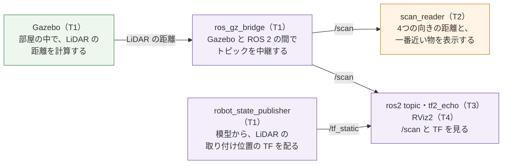

# フェーズ4-1: LiDAR を台車に載せて、値を見る

[学習計画](learning_plan.md) のフェーズ4の最初の部分。台車に2Dの **LiDAR**（レーザーの光を回しながら出し、周りの物までの距離を測るセンサ）を載せ、壁で囲んだ部屋のワールドの中で、Gazebo に距離を計算させる。値を `ros_gz_bridge` で ROS 2 へ中継し、[`sensor_msgs/msg/LaserScan`](https://github.com/ros2/common_interfaces/blob/jazzy/sensor_msgs/msg/LaserScan.msg) の中身の読み方を学んで、正面・左・後ろ・右の壁までの距離を表示するノードを書く。ここで載せた LiDAR は、フェーズ4-2（障害物の手前で止まり、切り返す）、フェーズ5（SLAM で地図を作る）、フェーズ6（Nav2）で、そのまま使う。部屋のワールドも、この後のフェーズで使い回す。新しい概念は、**LiDAR の距離のデータ（`LaserScan`）**の1つである。

- 想定環境: Ubuntu 24.04、ROS 2 Jazzy、Gazebo Harmonic（Gazebo の画面を開かなくても進められる。6-4節の RViz2 は、画面を開く）
- 前提: [フェーズ3-1](phase3_1_odometry.md)（このページは、フェーズ1-2の台車の模型・`sim.launch.py`・中継の設定と、フェーズ2-1で作ったパッケージ `ackermann_drive` に足す）。任意の [フェーズ3-2](phase3_2_ros2_control.md) は、読んでいてもいなくてもよい。親プロジェクトの節は、フェーズ3-1と同じ
- 所要の目安: 1〜2コマ
- 言語: xacro（XML。台車の模型）、SDF（XML。ワールド）、YAML（中継の設定）、Python（ノード・launch のファイル）

> **このページの位置づけ**: このページでは、台車を止めたまま、LiDAR の値を読む。値を使って台車を動かす（障害物の手前で止まる・避ける）のは、フェーズ4-2である。このページで `sim.launch.py` を直すと、T1 で開くワールドが、空のワールドから部屋のワールドに変わる。フェーズ1-2〜3-1の手順は、部屋の中でも、そのまま進められる（6-5節）。
>
> **期待する結果の出どころ**: 4-4節の `xacro`・`check_urdf`・`gz sdf` の表示、5-4節の `colcon build`・`ros2 launch --show-args`・`ros2 pkg executables` の表示、6節の launch のログ・`ros2 topic`・`tf2_echo`・ノードのログの表示と、6-5節の円の半径は、作成時に使い捨てのワークスペースで実際に実行して確かめたものである（Gazebo は、画面なしで起動した。launch の引数 `gz_args:='-r -s'`）。時刻・秒数・パス・ユーザー名・ノイズで揺れる距離の小数点以下3桁目は、実行ごと・環境ごとに変わる。画面なしの起動でも LiDAR の値が出ることは、作成時の予備の実験で確かめた。5-3節の、`gz_args` にワールドの名前を書いたときに部屋のワールドが開くことと、6-5節・8節の、`world:=empty.sdf` で起動すると `/scan` の値が届かないことも、作成時に起動して確かめた。6-1節の Gazebo の画面と、6-4節の RViz2 の画面の見え方は、作成時には開いて確かめておらず、設定とツールの振る舞いから想定したものである。8節のうち、`Non-unique names` のエラーは、作成時の下書きで起きたものである。8節のほかの誤りのときの表示は、作成時には起こしておらず、ツールの振る舞いから想定した要旨である。

## 0. 学習目標と完了条件

1. 2Dの LiDAR が測るものと、`LaserScan` の角度の情報（`angle_min`・`angle_increment`）と距離の並び（`ranges`）の関係を説明できる（2-1節・2-2節）。
2. 台車の模型に LiDAR の部品とセンサを足し、センサの値を計算するワールドを書いて、`/scan` を ROS 2 へ中継できる（4節・5節）。
3. 角度から光線の番号を求めて、決めた向きの距離を読むノードを書ける（5-4節・6-2節）。

**完了条件**:

- `scan_reader` が表示する正面の距離（`front`）が、正面の壁までの距離 2.40 m と 0.05 m 以内で一致する（6-2節）。左・後ろ・右も、1.50 m・1.60 m・1.50 m と 0.05 m 以内で一致する。
- `/scan` の `header.frame_id` が `lidar_link` で、`tf2_echo base_footprint lidar_link` が、LiDAR の取り付け位置（x 0.100、z 0.100）を表示する（6-3節）。

## 1. 全体像

T1 で、部屋のワールドと台車のシミュレーションを起動し、T2 で、このページで書く `scan_reader` を起動して、T3 で確かめる。T4 は、6-4節の RViz2（任意）に使う。


<details>
<summary>同じ図（mermaid版）</summary>



紫の箱は ROS 2 のノード・コマンド、橙の箱はこのページで書くノード、緑の箱は Gazebo（シミュレータ）である。

</details>

- **Gazebo の LiDAR**: 模型に書いたセンサ（4-1節）を、ワールドのシステム `Sensors`（5-1節）が、1秒に10回計算する。
- **`/scan`**: LiDAR の1回分の測定（1周360本の光線の距離）が、1つの `LaserScan` のメッセージになって届く。
- **`/tf_static`**: 台車に固定した LiDAR の位置は変わらないので、`robot_state_publisher` は、TF を、変わらない TF のトピック `/tf_static` で配る。

## 2. LiDAR と `LaserScan`

### 2-1. 2Dの LiDAR が測るもの

暗い部屋で、懐中電灯を持ってその場でくるりと回り、光が当たった壁までの距離を、少しずつ角度を変えて書き留めていくと、部屋の形が分かる。2Dの LiDAR は、これを、目に見えないレーザーの光で、1秒に何回も行うセンサである。光を出してから、物に当たって跳ね返ってくるまでの時間から距離を求め、光を出す向きを水平の面の上で回して、周りの物までの距離を、角度ごとに並べて出す。

測れるのは、LiDAR を取り付けた高さの、水平の1つの面の上だけである。それより低い物（この教材の台車では、地面から 0.10 m より低い段差）や、高い物は見えない。2D の LiDAR で地図を作る SLAM（フェーズ5）も、この面の上の壁の形を地図にする。

### 2-2. `LaserScan` の中身

LiDAR の1回分の測定は、`sensor_msgs/msg/LaserScan` の型のメッセージ1つになる。主な項目は次のとおりである（角度の単位は rad、距離は m）。

| 項目 | 意味 | このページの LiDAR |
|---|---|---|
| `header.frame_id` | どのフレームで測ったか（LiDAR の部品のフレーム） | `lidar_link` |
| `angle_min`・`angle_max` | 最初と最後の光線の角度。フレームの x 軸（正面）を0とし、上から見て左回りが正 | −π・約 3.124 |
| `angle_increment` | 隣の光線との角度の差 | 2π/360（1°） |
| `range_min`・`range_max` | 測れる距離の範囲。この外の値は、測れなかったことを表す | 0.10・8.0 |
| `ranges` | 光線ごとの距離。`angle_min` の向きの光線から順に並ぶ | 360個 |
| `intensities` | 光線ごとの、跳ね返った光の強さ（このページでは使わない） | 360個 |

`ranges` の `i` 番目の光線の角度は、

$$\theta_i = \theta_{min} + i \Delta\theta$$

である（ $\theta_{min}$ は `angle_min`、 $\Delta\theta$ は `angle_increment`）。逆に、角度 $\theta$ の向きの距離を読むには、番号を

$$i = \mathrm{round}\left(\frac{\theta - \theta_{min}}{\Delta\theta}\right)$$

で求める。このページの LiDAR では、0番が真後ろ（−π）、90番が右（−π/2）、180番が正面（0）、270番が左（π/2）になる。最後の光線（359番）は、真後ろの1°手前で終わる（360番目にあたる真後ろは、0番と同じ向きなので、作らない）。

**測れなかった値**: 光が `range_max` より遠くまで何にも当たらないと、その光線の距離は `inf`（無限大）になる。距離を使うときは、`range_min` 以上 `range_max` 以下の値だけを使う。

### 2-3. Gazebo の LiDAR は、描画の仕組みで距離を求める

Gazebo の LiDAR（センサの種類 `gpu_lidar`）は、画面を描くのと同じ仕組み（描画エンジン）を使って、光線の向きに何が見えるか、それがどれだけ遠いかを求める。そのため、ワールドには、センサの値を計算するシステム `Sensors` を置き、描画エンジン（`ogre2`）を指定する（5-1節）。フェーズ1-2から使ってきた空のワールド `empty.sdf` には、このシステムが入っていないので、LiDAR を載せても値が出ない。このページで、自分のワールドを書くのは、このためでもある。

描画の仕組みを使うが、Gazebo の画面を開かない起動（`-s`）でも、値は出る（作成時に確かめた）。ただし、ほかのセンサより計算が重く、PC の負荷が上がる。

## 3. 仕様

### 3-1. LiDAR

この教材で決めた値である。

| 項目 | 値 |
|---|---|
| 取り付け位置 | `base_link` から前へ 0.10 m、上へ 0.06 m（地面からの高さ 0.10 m。前輪の上端 0.08 m より高いので、光が自分の車輪に当たらない） |
| 測る範囲 | 水平の1周（360°）を、1°ごとに360本 |
| 測れる距離 | 0.10〜8.0 m（距離の刻み 0.01 m） |
| 頻度 | 1秒に10回 |
| ノイズ | 平均0、標準偏差 0.005 m の正規分布（実物のセンサのように、値が少し揺れる） |
| 部品の形と重さ | 半径 0.03 m・高さ 0.05 m の円柱、0.05 kg |

### 3-2. 部屋のワールド

- 内側は、x が −1.5〜2.5 m、y が −1.5〜1.5 m（4 m × 3 m）。壁の厚さは 0.1 m、高さは 0.4 m。
- 台車は、フェーズ1-2と同じく、原点に x の正の向き（正面）を向いて出る。

台車が出た位置で、LiDAR（x＝0.10）から各壁の内側の面までの距離は、正面が $2.5 - 0.10 = 2.40$ m、左と右が 1.50 m、後ろが $1.5 + 0.10 = 1.60$ m である（完了条件の値）。フェーズ2-2の円（半径約 0.5 m、中心 (0, 0.5)）は、部屋の中に収まる。

### 3-3. ファイル

| パッケージ | ファイル | 中身 |
|---|---|---|
| `ackermann_description` | `urdf/ackermann_car.lidar.xacro`（足す） | LiDAR の部品・取り付けの関節・Gazebo のセンサ |
| `ackermann_description` | `urdf/ackermann_car.urdf.xacro`（直す） | 上のファイルを読み込む1行を足す |
| `ackermann_gazebo` | `worlds/room.sdf`（足す） | 部屋のワールド |
| `ackermann_gazebo` | `config/bridge.yaml`（直す） | `/scan` の中継を足す |
| `ackermann_gazebo` | `launch/sim.launch.py`（直す） | 引数 `world`（既定は部屋のワールド）を足す |
| `ackermann_gazebo` | `setup.py`（直す） | `worlds/` のファイルを `install/` へコピーする |
| `ackermann_drive` | `ackermann_drive/scan_reader.py`（足す） | 4つの向きの距離を表示するノード `scan_reader` |
| `ackermann_drive` | `setup.py`（直す） | `scan_reader` を実行ファイルとして登録する |

## 4. 台車の模型に LiDAR を載せる

### 4-1. LiDAR の部品とセンサ

ファイル: `~/ros2_ws/src/ackermann_description/urdf/ackermann_car.lidar.xacro`

```xml
<?xml version="1.0"?>
<!-- 台車に載せる2Dの LiDAR（ackermann_car.urdf.xacro から読み込む） -->
<robot xmlns:xacro="http://www.ros.org/wiki/xacro">

  <!-- LiDAR の寸法と取り付け位置（この教材で決めた値。単位は m・kg） -->
  <xacro:property name="lidar_x" value="0.10"/>
  <xacro:property name="lidar_z" value="0.06"/>
  <xacro:property name="lidar_radius" value="0.03"/>
  <xacro:property name="lidar_height" value="0.05"/>
  <xacro:property name="lidar_mass" value="0.05"/>

  <!-- LiDAR の部品。原点は、光を出す面の中心 -->
  <link name="lidar_link">
    <visual>
      <origin xyz="0 0 ${-lidar_height / 2 + 0.015}"/>
      <geometry><cylinder radius="${lidar_radius}" length="${lidar_height}"/></geometry>
      <material name="tire_black"/>
    </visual>
    <xacro:cylinder_inertial m="${lidar_mass}" r="${lidar_radius}" h="${lidar_height}">
      <origin xyz="0 0 ${-lidar_height / 2 + 0.015}"/>
    </xacro:cylinder_inertial>
  </link>

  <joint name="lidar_joint" type="fixed">
    <parent link="base_link"/>
    <child link="lidar_link"/>
    <origin xyz="${lidar_x} 0 ${lidar_z}"/>
  </joint>

  <!-- Gazebo の LiDAR のセンサ（描画の仕組みで、光が物に当たるまでの距離を求める） -->
  <gazebo reference="lidar_link">
    <sensor name="lidar" type="gpu_lidar">
      <topic>/scan</topic>
      <gz_frame_id>lidar_link</gz_frame_id>
      <update_rate>10</update_rate>
      <always_on>true</always_on>
      <visualize>false</visualize>
      <lidar>
        <scan>
          <horizontal>
            <samples>360</samples>
            <min_angle>-3.141593</min_angle>
            <max_angle>3.124139</max_angle>
          </horizontal>
          <vertical>
            <samples>1</samples>
          </vertical>
        </scan>
        <range>
          <min>0.10</min>
          <max>8.0</max>
          <resolution>0.01</resolution>
        </range>
        <noise>
          <type>gaussian</type>
          <mean>0.0</mean>
          <stddev>0.005</stddev>
        </noise>
      </lidar>
    </sensor>
  </gazebo>

</robot>
```

- **`lidar_link` と `lidar_joint`**: LiDAR の部品を、固定の関節で `base_link` につなぐ。部品の原点（光を出す面）を、`base_link` から前へ 0.10 m、上へ 0.06 m に置いた。円柱の見た目は、原点から下へ 0.035 m、上へ 0.015 m の範囲にあり、本体の上面（`base_link` から上へ 0.025 m）に載っている。
- **`cylinder_inertial`**: フェーズ1-2で、`ackermann_car.urdf.xacro` に書いたマクロ。読み込む側のファイルで先に定義したマクロは、読み込まれたファイルの中でも使える。LiDAR の部品は、固定の関節で `base_link` とまとめられる（4-3節）ので、この重さは、台車の本体の重さと重心に加わる（6-5節で、円の半径が少し変わる理由）。
- **`<gazebo reference="lidar_link">` の `<sensor>`**: `lidar_link` に、Gazebo のセンサを付ける。`type="gpu_lidar"` が、2-3節の描画の仕組みの LiDAR である。
- **`<topic>`**: Gazebo の中で値を出すトピックの名前。
- **`<gz_frame_id>`**: メッセージの `header.frame_id` に入れる名前。Gazebo は、固定の関節でつながった `lidar_link` を `base_footprint` にまとめる（フェーズ1-2の2-3節）ので、書かないと、`ackermann_car/base_footprint/lidar` のような、ROS 2 の TF の木に無い名前になる。
- **`<horizontal>`**: 3-1節の、水平の光線の本数と、最初と最後の角度（rad）。最後の角度 3.124139 は、 $\pi - 2\pi/360$ で、光線の間隔が、ちょうど 1° になる。`<vertical>` の本数を1にすると、水平の1つの面だけを測る2D の LiDAR になる。
- **`<range>`・`<noise>`**: 3-1節の、測れる距離と、値に加えるノイズ。
- **`<visualize>`**: Gazebo の画面に、光線を描くかどうか。描くと画面が重くなるので、`false` にした。

### 4-2. 模型から、LiDAR のファイルを読み込む

模型のファイルの、`<xacro:include filename="ackermann_car.gazebo.xacro"/>` の行の後に、次の2行を足す（フェーズ3-2を進めた場合も、同じ行の後に足す）。

ファイル: `~/ros2_ws/src/ackermann_description/urdf/ackermann_car.urdf.xacro`（`ackermann_car.gazebo.xacro` の `xacro:include` の行の後に足す行）

```xml
  <!-- 2Dの LiDAR（フェーズ4-1） -->
  <xacro:include filename="ackermann_car.lidar.xacro"/>
```

### 4-3. 解説: 固定の関節と TF

`lidar_joint` は固定の関節なので、`robot_state_publisher` は、`base_link → lidar_link` の TF を、関節の状態を待たずに、起動したときに1回だけ、`/tf_static` で配る。`LaserScan` の `header.frame_id` が `lidar_link` なので、ほかのノード（RViz2・フェーズ5の SLAM 等）は、この TF を使って、LiDAR の点を台車や地図の座標に直す。

### 4-4. 展開して確かめる

```bash
cd ~/ros2_ws

colcon build --symlink-install --packages-select ackermann_description

xacro ~/ros2_ws/src/ackermann_description/urdf/ackermann_car.urdf.xacro > /tmp/ackermann_car.urdf

check_urdf /tmp/ackermann_car.urdf | tail -9

gz sdf -p /tmp/ackermann_car.urdf | grep -B2 -A2 '<gz_frame_id>'
```

**期待する結果**（`check_urdf` の木と、`gz sdf` の表示の抜粋。`gz sdf` の先頭に出る `Warning` の行は、後で説明する）:

```text
$ check_urdf /tmp/ackermann_car.urdf | tail -9
root Link: base_footprint has 1 child(ren)
    child(1):  base_link
        child(1):  front_left_steer_link
            child(1):  front_left_wheel
        child(2):  front_right_steer_link
            child(1):  front_right_wheel
        child(3):  lidar_link
        child(4):  rear_left_wheel
        child(5):  rear_right_wheel
$ gz sdf -p /tmp/ackermann_car.urdf | grep -B2 -A2 '<gz_frame_id>'
        </lidar>
        <pose>0.10000000000000001 0 0.10000000000000001 0 0 0</pose>
        <gz_frame_id>lidar_link</gz_frame_id>
      </sensor>
    </link>
```

- **`check_urdf`**: `base_link` の子に、`lidar_link` が加わった（子は名前の順に並ぶ。URDF の木のリンクは、フェーズ1-1の8つから9つになる）。
- **`gz sdf`**: センサは、`lidar_link` がまとめられた `base_footprint` のリンクの中に移り、その位置（`pose`）は、`base_footprint` から前へ 0.10 m、上へ 0.10 m（`base_link` の高さ 0.04 m と、取り付けの 0.06 m の和）になった。`0.10000000000000001` の末尾の桁は、計算の丸めの誤差である。

`gz sdf` の表示の先頭には、`XML Element[gz_frame_id], child of element[sensor], not defined in SDF. Copying[gz_frame_id] as children of [sensor].` という `Warning` の行が出る。`gz_frame_id` は、SDF の仕様には無く、Gazebo のセンサが読む独自の要素なので、「仕様に無い要素を、そのまま写した」と知らせているだけで、問題ない（T1 の起動のときにも出る）。

## 5. ワールド・中継・launch とノード

### 5-1. 部屋のワールド

`ackermann_gazebo` に `worlds` のフォルダを作り、ワールドのファイルを書く。

```bash
mkdir -p ~/ros2_ws/src/ackermann_gazebo/worlds
```

ファイル: `~/ros2_ws/src/ackermann_gazebo/worlds/room.sdf`

```xml
<?xml version="1.0"?>
<!-- 台車を走らせる部屋のワールド（内側 4 m × 3 m。台車は原点に、x の正の向きで出る） -->
<sdf version="1.9">
  <world name="room">
    <!-- 物理の計算の刻み（0.001秒）と、実時間との速さの比 -->
    <physics name="1ms" type="ignored">
      <max_step_size>0.001</max_step_size>
      <real_time_factor>1.0</real_time_factor>
    </physics>
    <plugin filename="gz-sim-physics-system" name="gz::sim::systems::Physics"/>
    <plugin filename="gz-sim-user-commands-system" name="gz::sim::systems::UserCommands"/>
    <plugin filename="gz-sim-scene-broadcaster-system" name="gz::sim::systems::SceneBroadcaster"/>
    <!-- LiDAR 等のセンサの値を計算する（LiDAR は、描画エンジン ogre2 で計算する） -->
    <plugin filename="gz-sim-sensors-system" name="gz::sim::systems::Sensors">
      <render_engine>ogre2</render_engine>
    </plugin>

    <light type="directional" name="sun">
      <cast_shadows>true</cast_shadows>
      <pose>0 0 10 0 0 0</pose>
      <diffuse>0.8 0.8 0.8 1</diffuse>
      <specular>0.2 0.2 0.2 1</specular>
      <direction>-0.5 0.1 -0.9</direction>
    </light>

    <!-- 地面 -->
    <model name="ground_plane">
      <static>true</static>
      <link name="link">
        <collision name="collision">
          <geometry><plane><normal>0 0 1</normal><size>20 20</size></plane></geometry>
        </collision>
        <visual name="visual">
          <geometry><plane><normal>0 0 1</normal><size>20 20</size></plane></geometry>
          <material><ambient>0.8 0.8 0.8 1</ambient><diffuse>0.8 0.8 0.8 1</diffuse></material>
        </visual>
      </link>
    </model>

    <!-- 部屋の4つの壁（厚さ 0.1 m、高さ 0.4 m）。内側は x が −1.5〜2.5 m、y が −1.5〜1.5 m -->
    <model name="room_walls">
      <static>true</static>
      <link name="link">
        <collision name="front_collision"><pose>2.55 0 0.2 0 0 0</pose><geometry><box><size>0.1 3.2 0.4</size></box></geometry></collision>
        <visual name="front_visual"><pose>2.55 0 0.2 0 0 0</pose><geometry><box><size>0.1 3.2 0.4</size></box></geometry></visual>
        <collision name="back_collision"><pose>-1.55 0 0.2 0 0 0</pose><geometry><box><size>0.1 3.2 0.4</size></box></geometry></collision>
        <visual name="back_visual"><pose>-1.55 0 0.2 0 0 0</pose><geometry><box><size>0.1 3.2 0.4</size></box></geometry></visual>
        <collision name="left_collision"><pose>0.5 1.55 0.2 0 0 0</pose><geometry><box><size>4.2 0.1 0.4</size></box></geometry></collision>
        <visual name="left_visual"><pose>0.5 1.55 0.2 0 0 0</pose><geometry><box><size>4.2 0.1 0.4</size></box></geometry></visual>
        <collision name="right_collision"><pose>0.5 -1.55 0.2 0 0 0</pose><geometry><box><size>4.2 0.1 0.4</size></box></geometry></collision>
        <visual name="right_visual"><pose>0.5 -1.55 0.2 0 0 0</pose><geometry><box><size>4.2 0.1 0.4</size></box></geometry></visual>
      </link>
    </model>
  </world>
</sdf>
```

- **`<physics>`**: 物理の計算の刻みを 0.001秒、実時間と同じ速さにする。フェーズ1-2から使ってきた `empty.sdf` と同じ設定である。
- **4つの `<plugin>`**: 物理の計算（`Physics`）、Gazebo の外から模型を出す等の命令の受け付け（`UserCommands`。`ros_gz_sim` の `create` が使う）、画面へ様子を送る（`SceneBroadcaster`）、センサの値の計算（`Sensors`。2-3節）。最初の3つは、`empty.sdf` にも入っている。
- **`<light>`**: 太陽のような、平行な光。LiDAR の値には関係しないが、Gazebo の画面で物が見えるように置く。
- **`ground_plane`**: 20 m 四方の平らな地面。`<static>` は、物理の計算で動かさない（重さを持たない）物であることを表す。
- **`room_walls`**: 4つの壁を、1つのリンクの、4つの箱の形（`collision` はぶつかる形、`visual` は見た目）で書いた。`<pose>` は、箱の中心の位置（x・y・z と、回転の3つ）である。同じリンクの中の `collision` と `visual` は、それぞれ違う名前にする（同じ名前があると、ワールドを読み込めない）。

### 5-2. 中継の設定に、`/scan` を足す

ファイル: `~/ros2_ws/src/ackermann_gazebo/config/bridge.yaml`（最後に足す行）

```yaml
# LiDAR の距離 → ROS 2
- ros_topic_name: /scan
  gz_topic_name: /scan
  ros_type_name: sensor_msgs/msg/LaserScan
  gz_type_name: gz.msgs.LaserScan
  direction: GZ_TO_ROS
```

### 5-3. launch のファイルに、ワールドの引数を足す

フェーズ1-2で書いた `sim.launch.py` を、次のとおりに書き換える。変えたのは、`world` の行（`LaunchConfiguration` と `DeclareLaunchArgument`）を足したところと、`gz_args` の既定値と説明、`IncludeLaunchDescription` に渡す `gz_args` の3か所である。

ファイル: `~/ros2_ws/src/ackermann_gazebo/launch/sim.launch.py`

```python
"""Gazebo を起動し、台車の模型を出して、ROS 2 とのトピックの中継を始める。"""
from launch import LaunchDescription
from launch.actions import DeclareLaunchArgument, IncludeLaunchDescription
from launch.launch_description_sources import PythonLaunchDescriptionSource
from launch.substitutions import Command, LaunchConfiguration, PathJoinSubstitution
from launch_ros.actions import Node
from launch_ros.parameter_descriptions import ParameterValue
from launch_ros.substitutions import FindPackageShare


def generate_launch_description():
    """launch の引数と、起動するもの（Gazebo とノード）をまとめて返す。"""
    gz_args = LaunchConfiguration('gz_args')
    world = LaunchConfiguration('world')
    xacro_file = PathJoinSubstitution(
        [FindPackageShare('ackermann_description'), 'urdf', 'ackermann_car.urdf.xacro'])
    robot_description = ParameterValue(Command(['xacro ', xacro_file]), value_type=str)
    gz_sim_launch = PathJoinSubstitution(
        [FindPackageShare('ros_gz_sim'), 'launch', 'gz_sim.launch.py'])
    bridge_config = PathJoinSubstitution(
        [FindPackageShare('ackermann_gazebo'), 'config', 'bridge.yaml'])

    return LaunchDescription([
        DeclareLaunchArgument(
            'gz_args', default_value='-r',
            description='gz sim に渡すオプション（-r ですぐに始める、-s で画面を開かない）'),
        DeclareLaunchArgument(
            'world', default_value=PathJoinSubstitution(
                [FindPackageShare('ackermann_gazebo'), 'worlds', 'room.sdf']),
            description='開くワールドのファイル'),
        IncludeLaunchDescription(
            PythonLaunchDescriptionSource(gz_sim_launch),
            launch_arguments={'gz_args': [gz_args, ' ', world],
                              'on_exit_shutdown': 'true'}.items()),
        Node(package='robot_state_publisher', executable='robot_state_publisher',
             parameters=[{'robot_description': robot_description, 'use_sim_time': True}]),
        Node(package='ros_gz_sim', executable='create',
             arguments=['-topic', 'robot_description', '-name', 'ackermann_car', '-z', '0.01']),
        Node(package='ros_gz_bridge', executable='parameter_bridge',
             parameters=[{'config_file': bridge_config}]),
    ])
```

- **`world`**: 開くワールドのファイル。既定値は、`install/` の中の、5-1節のファイルである。ほかのワールドを開くときは、`world:=empty.sdf` のように渡す（Gazebo に付属するワールドは、名前だけで開ける）。
- **`gz_args`**: `gz sim` に渡すオプションだけにした。`gz_sim.launch.py` には、`gz_args` と `world` を空白でつないだ文字（既定では `-r` とワールドのパス）を渡す。画面を開かずに起動するときは、`gz_args:='-r -s'` を渡す。フェーズ1-2〜3-1の手順書の、画面なしの起動の例 `gz_args:='-r -s empty.sdf'` は、このページ以降は `gz_args:='-r -s'` にする（ワールドを選ぶときは、`world:=` で渡す）。`gz_args` にワールドの名前を書いても、`gz sim` は、後に渡される `world` のファイルだけを開くので、黙って無視され、部屋のワールドが開く。

`worlds/` のファイルが `install/` へコピーされるように、`ackermann_gazebo` の `setup.py` の `data_files` に、最後の1行を足す。

ファイル: `~/ros2_ws/src/ackermann_gazebo/setup.py`

```python
from glob import glob

from setuptools import find_packages, setup

package_name = 'ackermann_gazebo'

setup(
    name=package_name,
    version='0.0.0',
    packages=find_packages(exclude=['test']),
    data_files=[
        ('share/ament_index/resource_index/packages',
            ['resource/' + package_name]),
        ('share/' + package_name, ['package.xml']),
        ('share/' + package_name + '/launch', glob('launch/*.launch.py')),
        ('share/' + package_name + '/config', glob('config/*.yaml')),
        ('share/' + package_name + '/worlds', glob('worlds/*.sdf')),
    ],
    install_requires=['setuptools'],
    zip_safe=True,
    maintainer='<ユーザー名>',
    maintainer_email='<ユーザー名>@todo.todo',
    description='TODO: Package description',
    license='Apache-2.0',
    extras_require={
        'test': [
            'pytest',
        ],
    },
    entry_points={
        'console_scripts': [
        ],
    },
)
```

`maintainer` と `maintainer_email` は、`ros2 pkg create` が書いた値のままでよい。

### 5-4. 4つの向きの距離を表示するノード

ファイル: `~/ros2_ws/src/ackermann_drive/ackermann_drive/scan_reader.py`

```python
import math

import rclpy
from rclpy.node import Node
from rclpy.qos import qos_profile_sensor_data
from sensor_msgs.msg import LaserScan

# 表示する4つの向き（台車の正面を0とし、左回りを正とする角度 [rad]）
DIRECTIONS = (('front', 0.0), ('left', math.pi / 2), ('back', math.pi), ('right', -math.pi / 2))


# 角度 angle [rad] に一番近い光線の番号を、LaserScan の角度の情報から求める。
def index_at(msg, angle):
    n = len(msg.ranges)
    i = round((angle - msg.angle_min) / msg.angle_increment)
    return i % n


# /scan を受け、4つの向きの距離と、一番近い物の距離と向きを、1秒ごとに表示するノード。
class ScanReader(Node):
    # Subscriber と、表示のタイマーを作る。
    def __init__(self):
        super().__init__('scan_reader')
        self.create_subscription(LaserScan, '/scan', self.on_scan, qos_profile_sensor_data)
        self.create_timer(1.0, self.report)
        self.last = None

    # 最後に受けた LaserScan を覚える。
    def on_scan(self, msg):
        self.last = msg

    # 4つの向きの距離と、測れた値の中で一番近いものを表示する。
    def report(self):
        msg = self.last
        if msg is None:
            return
        parts = [f'{name}={msg.ranges[index_at(msg, a)]:.3f}' for name, a in DIRECTIONS]
        valid = [(r, i) for i, r in enumerate(msg.ranges) if msg.range_min <= r <= msg.range_max]
        if valid:
            r, i = min(valid)
            deg = math.degrees(msg.angle_min + i * msg.angle_increment)
            parts.append(f'nearest={r:.3f} at {deg:.0f} deg')
        self.get_logger().info(', '.join(parts) + ' [m]')


def main():
    rclpy.init()
    node = ScanReader()
    try:
        rclpy.spin(node)
    except KeyboardInterrupt:
        pass
    finally:
        node.destroy_node()
        rclpy.try_shutdown()
```

**`scan_reader.py` の解説**

- **`index_at`**: 2-2節の式で、角度から光線の番号を求める。`% n`（n で割った余り）は、範囲の外の番号を、1周回した番号に直す。真後ろ（π）は、式では360番になるが、余りをとって0番（−π。同じ向き）になる。
- **`qos_profile_sensor_data`**: Subscriber の **QoS**（通信の品質の設定）を、センサのデータ向けの設定にする。この設定は、届かなかったメッセージを送り直させない（`BEST_EFFORT`）。センサの値は次々に新しいものが届くので、古い値を送り直すより、新しい値を受けるほうがよい。送り手（`ros_gz_bridge`）は、送り直す設定（`RELIABLE`）で送っているが、受け手が `BEST_EFFORT` なら組み合わせられる（逆の組み合わせ、送り手が `BEST_EFFORT` で受け手が `RELIABLE` だと、つながらない。8節）。
- **`on_scan` と `report`**: 値は1秒に10回届くので、届くたびには表示せず、最後の値を覚えておいて、1秒ごとのタイマーで表示する（フェーズ3-1の `odom_error` と同じ形）。
- **一番近い物**: `range_min` 以上 `range_max` 以下の値（測れた値）だけから、一番小さい距離と、その光線の角度（度）を求める。`min` に (距離, 番号) の組を渡すと、距離で比べる。

`scan_reader` を実行ファイルとして登録する。`ackermann_drive` の `setup.py` の `console_scripts` に、最後の1行を足す。

ファイル: `~/ros2_ws/src/ackermann_drive/setup.py`

```python
from setuptools import find_packages, setup

package_name = 'ackermann_drive'

setup(
    name=package_name,
    version='0.0.0',
    packages=find_packages(exclude=['test']),
    data_files=[
        ('share/ament_index/resource_index/packages',
            ['resource/' + package_name]),
        ('share/' + package_name, ['package.xml']),
    ],
    install_requires=['setuptools'],
    zip_safe=True,
    maintainer='<ユーザー名>',
    maintainer_email='<ユーザー名>@todo.todo',
    description='TODO: Package description',
    license='Apache-2.0',
    extras_require={
        'test': [
            'pytest',
        ],
    },
    entry_points={
        'console_scripts': [
            'ackermann_drive = ackermann_drive.drive_node:main',
            'circle_meter = ackermann_drive.circle_meter:main',
            'ackermann_odometry = ackermann_drive.odometry_node:main',
            'odom_error = ackermann_drive.odom_error:main',
            'scan_reader = ackermann_drive.scan_reader:main',
        ],
    },
)
```

`package.xml` は、直さない（`sensor_msgs` は、フェーズ3-1で足した）。

3つのパッケージをビルドし、launch の引数と、実行ファイルを確かめる。

```bash
cd ~/ros2_ws

colcon build --symlink-install

source ~/ros2_ws/install/setup.bash

ros2 launch ackermann_gazebo sim.launch.py --show-args

ros2 pkg executables ackermann_drive
```

**期待する結果**（`colcon build` の表示は省いた。`--show-args` の表示の先頭）:

```text
$ ros2 launch ackermann_gazebo sim.launch.py --show-args
Arguments (pass arguments as '<name>:=<value>'):

    'gz_args':
        gz sim に渡すオプション（-r ですぐに始める、-s で画面を開かない）
        (default: '-r')

    'world':
        開くワールドのファイル
        (default: PathJoinSubstitution('FindPackageShare(pkg='ackermann_gazebo'), 'worlds', 'room.sdf''))

$ ros2 pkg executables ackermann_drive
ackermann_drive ackermann_drive
ackermann_drive ackermann_odometry
ackermann_drive circle_meter
ackermann_drive odom_error
ackermann_drive scan_reader
```

`world` の既定値は、`install/` の中のファイルを探す式のまま表示される（起動するときに、実際のパスになる）。`--show-args` の表示は、この後に、フェーズ1-2と同じく、取り込んだ `gz_sim.launch.py` の引数が続く。

## 6. 動かす

### 6-1. 起動する

T1 で、シミュレーションを起動する。コマンドは、これまでと同じで、部屋のワールドが開く。

```bash
# T1
source ~/ros2_ws/install/setup.bash

ros2 launch ackermann_gazebo sim.launch.py
```

**期待する結果**（T1 の表示の抜粋。時刻は実行ごとに変わる）:

```text
[parameter_bridge-4] [INFO] [1794649396.894462325] [ros_gz_bridge]: Creating GZ->ROS Bridge: [/scan (gz.msgs.LaserScan) -> /scan (sensor_msgs/msg/LaserScan)] (Lazy 0)
[gazebo-1] Warning [Utils.cc:132] [/sdf/model[@name="ackermann_car"]/link[@name="base_footprint"]/sensor[@name="lidar"]/gz_frame_id:<urdf-string>:L0]: XML Element[gz_frame_id], child of element[sensor], not defined in SDF. Copying[gz_frame_id] as children of [sensor].
```

- **`Creating GZ->ROS Bridge: [/scan ...`**: 5-2節の中継が始まった。
- **`Warning ... gz_frame_id`**: 4-4節で説明した、問題ない警告である。

Gazebo の画面では、灰色の地面の上に、4つの壁で囲まれた部屋と、その中の台車が見える（台車の上に、黒い円柱の LiDAR が載っている）。

### 6-2. 4つの向きの距離を見る

T2 で、`scan_reader` を起動する。

```bash
# T2
source ~/ros2_ws/install/setup.bash

ros2 run ackermann_drive scan_reader
```

**期待する結果**（時刻と、小数点以下3桁目は、ノイズで実行ごとに変わる）:

```text
[INFO] [1794649424.183868546] [scan_reader]: front=2.400, left=1.497, back=1.590, right=1.503, nearest=1.485 at -91 deg [m]
[INFO] [1794649425.164714490] [scan_reader]: front=2.396, left=1.503, back=1.601, right=1.506, nearest=1.489 at -87 deg [m]
[INFO] [1794649426.165148938] [scan_reader]: front=2.396, left=1.509, back=1.602, right=1.500, nearest=1.495 at -91 deg [m]
[INFO] [1794649427.164765072] [scan_reader]: front=2.397, left=1.507, back=1.605, right=1.499, nearest=1.492 at 89 deg [m]
```

- **`front`**: 正面の壁まで、約 2.40 m。3-2節の値 2.40 m と 0.05 m 以内で一致する（完了条件）。
- **`left`・`back`・`right`**: 約 1.50 m・1.60 m・1.50 m で、3-2節の値と一致する。後ろが左右より 0.10 m 遠いのは、LiDAR が、台車の基準（後車軸の中心）より 0.10 m 前にあるからである。
- **揺れ**: 同じ壁でも、1秒ごとに ±0.01 m ほど揺れる。3-1節で決めたノイズ（標準偏差 0.005 m）である。
- **`nearest`**: 一番近いのは、左右の壁の、真横（±90°）の近くである。左右の壁までの距離はほぼ同じなので、ノイズで、毎回どちらかが選ばれ、角度も ±1〜3° ほど変わる。

### 6-3. `/scan` の中身と、TF を見る

T3 で、`/scan` の情報と、配列を除いた中身、LiDAR の取り付け位置の TF を見る。

```bash
# T3
source ~/ros2_ws/install/setup.bash

ros2 topic info /scan -v

ros2 topic echo --once /scan sensor_msgs/msg/LaserScan --no-arr

ros2 run tf2_ros tf2_echo base_footprint lidar_link
```

**期待する結果**（`ros2 topic info` は抜粋。`tf2_echo` は、`Ctrl+C` で止めるまで表示を続け、ここでは最初の1回分の先頭だけを載せた。時刻は実行ごとに変わる）:

```text
$ ros2 topic info /scan -v
Type: sensor_msgs/msg/LaserScan

Publisher count: 1

Node name: ros_gz_bridge
Endpoint type: PUBLISHER
  Reliability: RELIABLE

Subscription count: 1

Node name: scan_reader
Endpoint type: SUBSCRIPTION
  Reliability: BEST_EFFORT
$ ros2 topic echo --once /scan sensor_msgs/msg/LaserScan --no-arr
header:
  stamp:
    sec: 24
    nanosec: 500000000
  frame_id: lidar_link
angle_min: -3.1415929794311523
angle_max: 3.1241390705108643
angle_increment: 0.01745329238474369
time_increment: 0.0
scan_time: 0.0
range_min: 0.10000000149011612
range_max: 8.0
ranges: '<sequence type: float, length: 360>'
intensities: '<sequence type: float, length: 360>'
---
$ ros2 run tf2_ros tf2_echo base_footprint lidar_link
[INFO] [1794649426.358849021] [tf2_echo]: Waiting for transform base_footprint ->  lidar_link: Invalid frame ID "base_footprint" passed to canTransform argument target_frame - frame does not exist
At time 0.0
- Translation: [0.100, 0.000, 0.100]
- Rotation: in Quaternion (xyzw) [0.000, 0.000, 0.000, 1.000]
```

- **`ros2 topic info -v`**: 送り手は `ros_gz_bridge`（`RELIABLE`）、受け手は T2 の `scan_reader`（`BEST_EFFORT`）で、5-4節の QoS の組み合わせである。
- **`ros2 topic echo --no-arr`**: `--no-arr` は、配列（`ranges`・`intensities`）の中身を表示せず、長さだけを表示する。`frame_id` は `lidar_link`（完了条件）、角度と距離の範囲は、3-1節の値である（`3.1415929794311523` 等の末尾の桁は、32ビットの小数に直した丸めの誤差）。`ros2 topic echo` に型（`sensor_msgs/msg/LaserScan`）を渡したのは、型を渡さないと、起動の直後には、相手を見つける前に型を調べて `Could not determine the type for the passed topic` と失敗することがあるからである（作成時の予備の実験で起きた）。
- **`tf2_echo`**: `base_footprint` から見た `lidar_link` は、前へ 0.100 m、上へ 0.100 m で、回転は無い（完了条件）。`At time 0.0` は、`/tf_static` の TF が、時刻によらない値であることを表す。最初の `Waiting for transform` の行は、起動の直後で、まだ TF を受け取っていないときに出る。

`Ctrl+C` で `tf2_echo` を止める。

### 6-4. RViz2 で見る（任意）

RViz2 で、LiDAR の点を見る。T4 で、RViz2 を起動する（フェーズ3-1の6-4節と同じく、`use_sim_time` を付ける）。

```bash
# T4
source ~/ros2_ws/install/setup.bash

rviz2 --ros-args -p use_sim_time:=true
```

フェーズ1-1の8-1節と同じく、左下の「Add」から「RobotModel」と「TF」を足し、「RobotModel」の「Description Topic」を `/robot_description` にする。左の「Global Options」の「Fixed Frame」は、`base_footprint` にする（オドメトリのノードを起動していないので、`odom` は無い）。もう一度「Add」を押し、「By topic」のタブで `/scan` の下の「LaserScan」を選んで「OK」を押す。

**期待する結果**: 台車の周りに、部屋の4つの壁の形をした、点の長方形が表示される。台車は、長方形の中の、後ろと左右の壁に近い位置にある。「LaserScan」の項目の「Size (m)」を大きくすると、点が見やすくなる。

### 6-5. これまでのフェーズの手順を、部屋の中で動かす

このページで `sim.launch.py` を直したので、フェーズ1-2〜3-1の手順で T1 を起動すると、部屋のワールドが開く。台車は、フェーズ2-2の円（半径約 0.5 m）なら、壁にぶつからずに走れる。フェーズ1-2の7-4節の直進（0.2 m/s）は、正面の壁まで約 2.3 m なので、約10秒で壁に当たる。それより早く止める。フェーズ1-2の `gz model` の表示のワールドの名前は、`room` になる。作成時に、部屋の中で、フェーズ2-2の6-2節の指令（`v`＝0.2、`ω`＝0.4）で走らせたところ、`circle_meter` の円の半径は 0.513 m で、空のワールドでの 0.512 m とほとんど変わらなかった（LiDAR の重さの分だけ、台車の重さと重心が少し変わったため）。空のワールドで動かしたいときは、`ros2 launch ackermann_gazebo sim.launch.py world:=empty.sdf` で起動する（この場合、LiDAR の値は出ない。2-3節）。

確かめ終わったら、T4・T3・T2・T1 の順に、`Ctrl+C` で止める。

## 7. まとめ

- 2Dの LiDAR は、水平の1つの面の上で、周りの物までの距離を、角度ごとに並べて測る。`LaserScan` の `ranges` の `i` 番目の角度は $\theta_{min} + i \Delta\theta$ で、角度から番号を求めれば、決めた向きの距離が読める。測れなかった値（`inf` 等）は、`range_min`〜`range_max` の外の値として除く。
- Gazebo の LiDAR（`gpu_lidar`）は、描画の仕組みで距離を求めるので、ワールドに、描画エンジンを指定したシステム `Sensors` を置く。画面を開かない起動でも、値は出る。
- 台車の模型に LiDAR の部品とセンサを足し、`gz_frame_id` でメッセージのフレームを `lidar_link` にした。固定の関節の TF は、`robot_state_publisher` が `/tf_static` で配る。
- 部屋のワールドで、正面・左・後ろ・右の距離が、壁の位置から計算した値と 0.01 m ほどの差で一致した。

## 8. つまずきやすい点

- **`/scan` が `ros2 topic list` に出ない**: 中継の設定（5-2節）に `/scan` を足したかと、足した後に T1 を起動し直したかを確かめる。
- **`/scan` は一覧に出るが、`ros2 topic hz /scan` が何も表示しない**: 中継はできているが、Gazebo が値を計算していない。ワールドに `Sensors` のシステムが無いと、LiDAR の値は計算されない。`world:=empty.sdf` で起動していないか、5-1節のファイルの `gz-sim-sensors-system` の行を確かめる。ワールドを足した後に、`ackermann_gazebo` をビルドし直したかも確かめる（`--symlink-install` でも、`worlds/` のような新しいフォルダは、ビルドするまでコピーされない）。
- **T1 が「ワールドのファイルが見つからない」旨を出して止まる**: `setup.py` に `worlds` の行（5-3節）を足し、ビルドし直したかを確かめる。
- **Gazebo が「Non-unique names」のエラーを出し、ワールドを読み込まない**: 同じリンクの中の `collision` と `visual` に、同じ名前を付けると起きる（作成時の下書きを、ワールドの形式を点検するコマンド `gz sdf -k` にかけたときに出た）。5-1節のとおり、`front_collision`・`front_visual` のように、別の名前にする。
- **`/scan` の `frame_id` が `ackermann_car/base_footprint/lidar` のような名前になり、RViz2 に点が出ない**: `<gz_frame_id>` を書き忘れると、Gazebo の中の名前になる。4-1節のとおり、`lidar_link` を書く。
- **自分で書いた Subscriber が、何も受け取らない**: 送り手と受け手の QoS が合っていないことがある。送り手が `BEST_EFFORT` で受け手が `RELIABLE` だと、つながらない（5-4節）。このページの送り手（中継）は `RELIABLE` なので、既定の設定（`RELIABLE`）の Subscriber でもつながるが、実物の LiDAR のドライバ等、`BEST_EFFORT` で送るものもある。`ros2 topic info /scan -v` で、両方の `Reliability` を確かめ、センサのデータは、受け手を `qos_profile_sensor_data` にしておくと、どちらの送り手ともつながる。
- **正面の距離が、後ろの壁までの距離（約 1.60 m）になる**: 番号の計算で、`angle_min` を引き忘れると、0番を正面と取り違え、真後ろの値を読む。2-2節の式で、`angle_min` と `angle_increment` を使って求める。
- **PC が重くなる、シミュレーションの時刻が遅く進む**: LiDAR は、描画の仕組みで計算するので、ほかのセンサより重い。Gazebo の画面を閉じる（`gz_args:='-r -s'` で起動する）と、軽くなることがある。
- **フェーズ3-2の `sim_control.launch.py` で、LiDAR の値が出ない**: `sim_control.launch.py` は、空のワールド（`empty.sdf`）を開き、`/scan` を中継しない。フェーズ4以降は、`sim.launch.py` を使う。

## 次へ

フェーズ4-2（作成中）で、この LiDAR の正面の距離を使い、台車を壁に向かって走らせ、決めた距離の手前で止まり、後退しながら舵を切って向きを変える（切り返し）ノードを書く。手順書は作成中で、できたら README の「読む順番」に足す。

## 出典

このページの技術的な記述は、次の文書を読んで、自分の言葉でまとめたもの（逐語の転載ではない）。サンプルの模型・ワールド・設定・コードは、この教材で書いたもの（ワールドの一部の既定値は、下の注記のとおり）。

- Gazebo のセンサの付け方（`Sensors` のシステム、`gpu_lidar` の要素、描画エンジン）: [Sensors — Gazebo Harmonic](https://gazebosim.org/docs/harmonic/sensors/)
- `<sensor>` の要素の仕様: [SDFormat の仕様（1.9）の `sensor`](http://sdformat.org/spec?ver=1.9&elem=sensor)
- メッセージの型: [`sensor_msgs/msg/LaserScan`](https://github.com/ros2/common_interfaces/blob/jazzy/sensor_msgs/msg/LaserScan.msg)
- QoS の考え方: [About Quality of Service settings（ROS 2 Jazzy）](https://docs.ros.org/en/jazzy/Concepts/Intermediate/About-Quality-of-Service-Settings.html)。`qos_profile_sensor_data` の中身は、[`rmw` の `qos_profiles.h`（`jazzy` ブランチ）](https://github.com/ros2/rmw/blob/jazzy/rmw/include/rmw/qos_profiles.h) の `rmw_qos_profile_sensor_data`
- 中継: [ros_gz のリポジトリ（`jazzy` ブランチ）](https://github.com/gazebosim/ros_gz/tree/jazzy)（`ros_gz_bridge` の README）
- 部屋のワールド（5-1節）のうち、物理の設定・最初の3つのシステム・光・地面の書き方は、Gazebo に付属する `empty.sdf`（[gz-sim](https://github.com/gazebosim/gz-sim/blob/gz-sim8/examples/worlds/empty.sdf)、Apache-2.0）の既定値に合わせた。壁と `Sensors` のシステムは、この教材で書いたもの
- 図（`img/phase4_1_flow.svg`）は、この教材で作ったもの。
