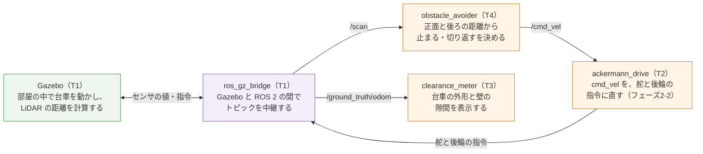

# フェーズ4-2: 壁の手前で止まり、切り返して向きを変える

[学習計画](learning_plan.md) のフェーズ4の2つ目。[フェーズ4-1](phase4_1_lidar.md) で載せた LiDAR の距離を使い、台車を部屋の中で走らせ続けるノードを書く。台車は、正面の壁が決めた距離より近づいたら止まり、後退しながら舵を切り、前進しながら逆に舵を切って向きを変える（**切り返し**）。向きが変わって正面が空いたら、また直進する。アッカーマン式の台車は、その場で向きを変えられない（[フェーズ0](phase0_overview.md) の2-3節）ので、狭い所で向きを変えるには、切り返しが要る。速度の指令は、[フェーズ2-2](phase2_2_drive_node.md) の駆動のノードに `cmd_vel` で送る。どう動くかの判断は、ROS 2 を使わないクラスに書いて確かめてから、ノードで包む。新しい概念は、**センサの値で動きを切り替える状態の移り変わり（状態機械）**の1つである。

- 想定環境: Ubuntu 24.04、ROS 2 Jazzy、Gazebo Harmonic（Gazebo の画面を開かなくても進められる。台車の動きを目で見たいときは、画面を開いて起動する）
- 前提: [フェーズ4-1](phase4_1_lidar.md)（このページは、部屋のワールドと LiDAR を使い、パッケージ `ackermann_drive` に足す）。[フェーズ2-2](phase2_2_drive_node.md)（駆動のノード `ackermann_drive` と真の位置 `/ground_truth/odom` を使う）。[フェーズ2-1](phase2_1_kinematics.md) の2-5節（後退と曲率の符号）。親プロジェクトの節は、フェーズ3-1と同じ
- 所要の目安: 1〜2コマ
- 言語: Python

> **このページの位置づけ**: 台車の位置は使わず、LiDAR の正面と後ろの距離だけで動きを決める。地図の上で目的地までの道を計画して走るのは、フェーズ6の Nav2 である。このページの壁との隙間を測るノードは、Gazebo の真の位置を使う答え合わせのためのもので、シミュレーションでだけ使える（フェーズ3-1の `odom_error` と同じ）。
>
> **期待する結果の出どころ**: 4節の `python3` の表示、5-3節の `colcon build`・`ros2 pkg executables` の表示、6節のノードのログは、作成時に使い捨てのワークスペースで実際に実行して確かめたものである（Gazebo は、画面なしで起動した。launch の引数 `gz_args:='-r -s'`）。時刻・秒数・距離の小数点以下2桁目・切り返しの回数と場所は、実行ごと・PC の速さで変わる。6-2節の Gazebo の画面での台車の動きは、作成時には開いて確かめておらず、ログと真の位置から想定したものである。6-3節の、しきい値を変えたときの動きと、2-5節の、Gazebo が実時間より遅いときの向きの変わり方は、作成時には試しておらず、2節の考え方から想定したものである。8節のうち、走っている途中に `cmd_vel timeout: stop` が出ることは、作成時の実行で起きたものである。8節のほかの誤りのときの表示は、作成時には起こしておらず、ツールの振る舞いから想定した要旨である。

## 0. 学習目標と完了条件

1. アッカーマン式の台車が、壁の手前で向きを変えるのに切り返しが要る理由と、後退と前進で舵を逆に切ると、どちらも同じ向きに向きが変わる理由を説明できる（2-1節・2-2節）。
2. 直進・停止・後退・前進の切り返しの4つの状態と、移る条件を、ROS 2 を使わないクラスに書き、作り物の距離で確かめられる（2-3節・4節）。
3. [`sensor_msgs/msg/LaserScan`](https://github.com/ros2/common_interfaces/blob/jazzy/sensor_msgs/msg/LaserScan.msg) の扇形の中の最短距離を求め、状態に応じた `cmd_vel` を送るノードを書ける（2-4節・5-1節）。

**完了条件**:

- 4節の表示で、状態が、直進 → 停止 → 後退 → 前進の切り返し → 直進の順に移る。
- 部屋の中で、回避のノードを2分以上走らせたとき、切り返しが5回以上あり、`clearance_meter` が表示する、台車の外形と壁の隙間の最小値（`min`）が0より大きい（6-2節）。
- 止まる判断をしたときの正面の距離（`forward -> stop` の行の `front`）が、しきい値の 0.5 m を下回った直後の値（0.45 m 以上）である（6-2節）。

## 1. 全体像

T1 でシミュレーションを、T2 でフェーズ2-2の駆動のノードを、T3 で壁との隙間を測るノードを起動し、T4 で回避のノードを起動して、台車を走らせる。


<details>
<summary>同じ図（mermaid版）</summary>



紫の箱は ROS 2 のノード、橙の箱は自作のノード、緑の箱は Gazebo（シミュレータ）である。

</details>

- **obstacle_avoider**: このページで書く回避のノード。`/scan` を受け、0.1秒ごとに、どう動くかを決めて `cmd_vel` を送る。判断そのものは、ROS 2 を使わないクラス `AvoidPlanner`（4節）がする。
- **ackermann_drive**: フェーズ2-2の駆動のノードを、そのまま使う。これまで `ros2 topic pub` で手で送っていた `cmd_vel` を、回避のノードが送る。
- **clearance_meter**: このページで書く、答え合わせのためのノード。

## 2. 切り返しと、状態の移り変わり

### 2-1. その場で向きを変えられないので、切り返す

狭い道の行き止まりで車の向きを変えるとき、運転する人は、ハンドルを切って少し進み、ハンドルを逆に切って少し下がり、を繰り返す。この教材の台車も同じで、曲がれる円の半径には下限（後車軸の中心で 0.372 m。フェーズ2-1の2-4節）があり、その場で回ることはできない。正面の壁が近いときに、そのまま左へ曲がろうとすると、円の外側へはみ出す分だけ、壁にぶつかる。そこで、いったん止まり、下がりながら向きを変えて、前の空きを作ってから進む。

### 2-2. 後退と前進で、舵を逆に切る

フェーズ2-1の2-5節のとおり、後ろへ進みながら舵を右へ切ると、台車は上から見て左回りに向きを変える（自動車で、下がりながらハンドルを右へ切ると、車の後ろが右へ回り込むのと同じ）。前へ進みながら舵を左へ切っても、左回りに向きを変える。つまり、

| 動き | `v` | 舵 | 曲率 $\kappa$ | 向きを変える速さ $\omega = v \kappa$ |
|---|---|---|---|---|
| 後退 | 負（−0.15 m/s） | 右 | 負（−2.5） | 正（0.375 rad/s。左回り） |
| 前進の切り返し | 正（0.15 m/s） | 左 | 正（2.5） | 正（0.375 rad/s。左回り） |

で、後退と前進の切り返しのどちらでも、台車の向きは左回りに変わる。行ったり来たりしながら、向きを同じ向きに少しずつ変えていくのが、切り返しである。曲率の 2.5（半径 0.4 m）は、曲率の上限 2.686（フェーズ2-1の2-4節）より少し小さくして、上限で切られずに、指令どおりの円を描くようにした。

`cmd_vel` に入れるのは `v` と `ω` なので、決めた曲率から $\omega = v \kappa$ で求める。後退では `v` が負で、曲率も負なので、`ω` は正になる。

### 2-3. 4つの状態と、移る条件

台車の動きを、次の4つの**状態**に分け、今の状態と、正面・後ろの距離と、その状態に入ってからの時間で、次の状態を決める。このように、状態と、状態の間を移る条件で動きを書いたものを、**状態機械**と呼ぶ。

| 状態 | 動き | 次の状態へ移る条件 |
|---|---|---|
| `forward`（直進） | `v`＝0.2 m/s、`ω`＝0 | 正面が `stop_distance`（0.5 m）より近い → `stop` |
| `stop`（停止） | `v`＝0、`ω`＝0 | 0.5秒たった → `reverse` |
| `reverse`（後退） | 2-2節の後退 | 2.5秒たった、または後ろが 0.3 m より近い → `turn` |
| `turn`（前進の切り返し） | 2-2節の前進の切り返し | 正面が 0.5 m より近い → `stop`（もう一度下がる）。正面が `clear_distance`（1.0 m）以上空いた → `forward` |

```text
forward ──正面 < 0.5 m──> stop ──0.5秒──> reverse ──2.5秒 または 後ろ < 0.3 m──> turn
   ^                       ^                                                     |
   |                       +──────────────────正面 < 0.5 m──────────────────────+
   +──────────────────────────────正面 >= 1.0 m─────────────────────────────────+
```

- **止まってから下がる**: 直進の 0.2 m/s から、いきなり後退に切り替えると、駆動のノードが、速く回っている後輪を一瞬で逆に回す指令を送る。0.5秒止まってから下がると、動きが落ち着く。後退と前進の切り返しの間は、速さが小さい（0.15 m/s）ので、このページでは止めずに切り替える。
- **しきい値を2つにする**: 直進に戻る距離（1.0 m）を、止まる距離（0.5 m）より大きくする。同じ値にすると、正面が 0.5 m のあたりで、直進と停止を細かく行き来してしまう。
- **後退の時間**: 1回の後退で、向きは $0.375 \times 2.5 \approx 0.94$ rad（約54°）変わる（Gazebo が実時間どおりに進むとき。2-5節）。後ろの壁が近ければ、早めに切り上げる。

### 2-4. 正面の距離は、扇形の中の最短距離にする

正面の距離を、真正面の光線1本だけで測ると、台車の幅の端の前にある物（斜め前の壁の角など）を見逃す。そこで、正面を中心に幅 60°（左右に30°ずつ）の扇形の中の、測れた距離の最小値を、正面の距離とする。後ろも、真後ろを中心にした同じ幅の扇形の最小値にする。測れなかった値（`range_min`〜`range_max` の外。フェーズ4-1の2-2節）は除く。

光線の角度は、フェーズ4-1の2-2節の $\theta_i = \theta_{min} + i \Delta\theta$ で求める。扇形に入るかどうかは、光線の角度と扇形の中心の角度の差を、−π〜π に直して比べる（真後ろの扇形は、−π と π をまたぐので、差を直さないと、半分しか入らない）。

### 2-5. 速度の指令は、送り続ける

フェーズ2-2の駆動のノードは、`cmd_vel` が1.0秒より長く届かないと止まる。回避のノードは、0.1秒ごとのタイマーで、状態が変わらなくても、毎回 `cmd_vel` を送る。状態の時間（停止の0.5秒、後退の2.5秒）も、タイマーの回数（1回 0.1秒）で数える。このタイマーは PC の時計で動く（ノードに `use_sim_time` を付けていない）ので、Gazebo が実時間より遅く進む PC（フェーズ1-2の2-5節）では、シミュレーションの中で後退する時間が短くなり、1回の後退で変わる向きは、2-3節の約54°より小さくなる。PC が重くて、タイマーそのものが遅れると、逆に長くなることもある。どちらの場合も、切り返しの回数が増えたり減ったりするだけで、正面と後ろの距離で止まる判断は変わらない。

## 3. 仕様

| ファイル | 中身 |
|---|---|
| `avoid_planner.py` | 2-3節の判断のクラス `AvoidPlanner`。**ROS 2 を使わない** |
| `obstacle_avoider.py` | `AvoidPlanner` を包むノード `obstacle_avoider`（実行ファイルの名前も同じ） |
| `clearance_meter.py` | 答え合わせのノード `clearance_meter`（実行ファイルの名前も同じ） |

- `AvoidPlanner(speed, turn_speed, curvature, stop_distance, clear_distance, back_distance, stop_time, reverse_time)`: 2-3節の値を受け取り（既定値は 0.2・0.15・2.5・0.5・1.0・0.3・0.5・2.5）、`forward` から始める。`update(front, back, dt)` で状態を進め、速度の指令 `(v, omega)` を返す。今の状態は `state` で読める。
- `obstacle_avoider`:
  - 受ける: `/scan`（`sensor_msgs/msg/LaserScan`。フェーズ4-1と同じく、センサのデータ向けの QoS）。
  - 送る: `cmd_vel`（[`geometry_msgs/msg/Twist`](https://github.com/ros2/common_interfaces/blob/jazzy/geometry_msgs/msg/Twist.msg)）を0.1秒ごとに。状態が変わったら、ログに、前と後の状態と、正面・後ろの距離を出す。
  - パラメータ: `speed`（0.2）・`stop_distance`（0.5）・`clear_distance`（1.0）・`sector_deg`（扇形の幅の度。60.0）。
- `clearance_meter`:
  - 受ける: `/ground_truth/odom`（[`nav_msgs/msg/Odometry`](https://github.com/ros2/common_interfaces/blob/jazzy/nav_msgs/msg/Odometry.msg)。フェーズ2-2で中継した、台車の真の位置）。
  - 台車を上から見た外形を、`base_footprint` から見て前へ 0.24 m（前輪の前の端）、後ろへ 0.04 m（後輪と本体の後ろの端）、左右へ 0.095 m（車輪の外側の 0.0925 m に、少し余裕を足した値）の長方形とし、その四隅と、部屋の壁の内側の面（フェーズ4-1の3-2節）の隙間の最小値を求める。2秒ごとに、今の隙間と、起動してからの最小の隙間を表示する。隙間が負なら、外形が壁にめり込んでいる（ぶつかった）ことを表す。

## 4. 判断のクラスを、ROS 2 を使わずに確かめる

ファイル: `~/ros2_ws/src/ackermann_drive/ackermann_drive/avoid_planner.py`

```python
# 直進・停止・後退・前進の切り返しの4つの状態
FORWARD = 'forward'
STOP = 'stop'
REVERSE = 'reverse'
TURN = 'turn'


# 正面と後ろの距離から、次の状態と速度の指令（v, omega）を決める（障害物の手前で止まり、切り返す）。
class AvoidPlanner:
    # 速さ [m/s]・切り返しの曲率 [1/m]・距離のしきい値 [m]・時間 [s] を受け取り、直進から始める。
    def __init__(self, speed=0.2, turn_speed=0.15, curvature=2.5, stop_distance=0.5,
                 clear_distance=1.0, back_distance=0.3, stop_time=0.5, reverse_time=2.5):
        self.speed = speed
        self.turn_speed = turn_speed
        self.curvature = curvature
        self.stop_distance = stop_distance
        self.clear_distance = clear_distance
        self.back_distance = back_distance
        self.stop_time = stop_time
        self.reverse_time = reverse_time
        self.state = FORWARD
        self.elapsed = 0.0

    # 今の状態から、正面 front・後ろ back の距離 [m] と経過時間 dt [s] で、次の状態へ移る。
    def update(self, front, back, dt):
        self.elapsed += dt
        if self.state == FORWARD and front < self.stop_distance:
            self.change(STOP)
        elif self.state == STOP and self.elapsed >= self.stop_time:
            self.change(REVERSE)
        elif self.state == REVERSE and (self.elapsed >= self.reverse_time
                                        or back < self.back_distance):
            self.change(TURN)
        elif self.state == TURN:
            if front < self.stop_distance:
                self.change(STOP)
            elif front >= self.clear_distance:
                self.change(FORWARD)
        return self.command()

    # 状態を変え、その状態に入ってからの時間を0にする。
    def change(self, state):
        self.state = state
        self.elapsed = 0.0

    # 今の状態の速度の指令 (v, omega) を返す。後退も前進の切り返しも、左回り（omega が正）になる。
    def command(self):
        if self.state == FORWARD:
            return self.speed, 0.0
        if self.state == REVERSE:
            v = -self.turn_speed
            return v, v * -self.curvature
        if self.state == TURN:
            v = self.turn_speed
            return v, v * self.curvature
        return 0.0, 0.0


# ROS 2 を使わずに、作り物の距離を与えて、状態の移り変わりを表示する。
def main():
    planner = AvoidPlanner()
    dt = 0.1
    # (秒数, 正面の距離, 後ろの距離)：壁に近づく → 止まる → 後退で後ろが近づく → 切り返しで正面が空く
    steps = [(1.0, 1.2, 2.0), (0.3, 0.45, 2.0), (1.0, 0.45, 1.0), (1.0, 0.6, 0.25), (1.0, 0.8, 0.5), (0.5, 1.5, 0.5)]
    t = 0.0
    last = None
    print('    t  front  back | state      v      omega')
    for seconds, front, back in steps:
        for _ in range(round(seconds / dt)):
            v, omega = planner.update(front, back, dt)
            t += dt
            if planner.state != last:
                print(f'{t:5.1f}  {front:5.2f} {back:5.2f} | {planner.state:8s} {v:6.3f} {omega:6.3f}')
                last = planner.state


if __name__ == '__main__':
    main()
```

**`avoid_planner.py` の解説**

- **状態の名前**: 4つの状態を、文字の定数にした。ログに、そのまま名前が出る。
- **`update`**: 2-3節の表を、上から順に、`if`・`elif` で書いた。1回の呼び出しで、状態は多くても1つしか進まない。最後に、今の状態の速度の指令を返す。
- **`elapsed`**: 今の状態に入ってからの時間。`update` のたびに `dt` を足し、`change` で状態が変わると0に戻す。停止と後退の時間を数えるのに使う。
- **`command`**: 2-2節の表の値を返す。後退の `ω` は、`v`（負）に、曲率（負。`-self.curvature`）をかけて、正になる。
- **`main`**: 作り物の正面と後ろの距離を、場面ごとに決めた秒数だけ、0.1秒ずつ与える。場面は、遠い壁に向かって直進（1.0秒）、正面が 0.45 m（0.3秒）、後退で後ろが近づく（後ろ 1.0 m で1.0秒、0.25 m で1.0秒）、切り返しで正面が空いていく（0.8 m で1.0秒、1.5 m で0.5秒）である。状態が変わったときだけ、1行を表示する。

```bash
python3 ~/ros2_ws/src/ackermann_drive/ackermann_drive/avoid_planner.py
```

**期待する結果**:

```text
    t  front  back | state      v      omega
  0.1   1.20  2.00 | forward   0.200  0.000
  1.1   0.45  2.00 | stop      0.000  0.000
  1.6   0.45  1.00 | reverse  -0.150  0.375
  2.4   0.60  0.25 | turn      0.150  0.375
  4.4   1.50  0.50 | forward   0.200  0.000
```

各行は、その時刻（`t`、秒）に状態が変わったことと、そのときの距離と、新しい状態の指令を表す。

- **1行目**: 始めは `forward`（直進）で、`v`＝0.2・`ω`＝0。
- **`stop`（1.1秒）**: 正面が 0.45 m になった最初の回に、0.5 m より近いので止まる。
- **`reverse`（1.6秒）**: 止まってから0.5秒後に、後退に移る。`v` が負、`ω` が正（左回り）である。
- **`turn`（2.4秒）**: 後退を2.5秒続ける前に、後ろが 0.25 m（0.3 m より近い）になった最初の回に、早めに前進の切り返しに移る。`v` も `ω` も正である。
- **`forward`（4.4秒）**: 正面が 0.8 m の間は切り返しを続け（1.0 m に届かない）、1.5 m になった最初の回に、直進に戻る。

状態が、直進 → 停止 → 後退 → 前進の切り返し → 直進の順に移った（完了条件）。

> 課題: `main` の `steps` の4つ目の後ろの距離を `0.25` から `1.0` に変えて実行し、`turn` に移る時刻を確かめる（後ろが近づかないので、後退を2.5秒続けてから移る。作成時は `4.1` 秒になった）。確かめたら、元に戻す。

## 5. ノードを書く

### 5-1. 回避のノード

ファイル: `~/ros2_ws/src/ackermann_drive/ackermann_drive/obstacle_avoider.py`

```python
import math

from ackermann_drive.avoid_planner import AvoidPlanner
from geometry_msgs.msg import Twist
import rclpy
from rclpy.node import Node
from rclpy.qos import qos_profile_sensor_data
from sensor_msgs.msg import LaserScan


# 角度 center [rad] を中心に、幅 width [rad] の扇形の中で、測れた距離の最小値を返す（無ければ inf）。
def sector_min(msg, center, width):
    best = math.inf
    for i, r in enumerate(msg.ranges):
        if not (msg.range_min <= r <= msg.range_max):
            continue
        angle = msg.angle_min + i * msg.angle_increment
        diff = math.atan2(math.sin(angle - center), math.cos(angle - center))
        if abs(diff) <= width / 2:
            best = min(best, r)
    return best


# /scan の正面と後ろの距離から、障害物の手前で止まって切り返す cmd_vel を送るノード。
class ObstacleAvoider(Node):
    # パラメータを宣言し、判断のクラスと、Subscriber・Publisher・タイマーを作る。
    def __init__(self):
        super().__init__('obstacle_avoider')
        self.planner = AvoidPlanner(
            speed=self.declare_parameter('speed', 0.2).value,
            stop_distance=self.declare_parameter('stop_distance', 0.5).value,
            clear_distance=self.declare_parameter('clear_distance', 1.0).value)
        self.sector = math.radians(self.declare_parameter('sector_deg', 60.0).value)
        self.period = 0.1
        self.pub = self.create_publisher(Twist, 'cmd_vel', 10)
        self.create_subscription(LaserScan, '/scan', self.on_scan, qos_profile_sensor_data)
        self.create_timer(self.period, self.on_timer)
        self.scan = None

    # 最後に受けた LaserScan を覚える。
    def on_scan(self, msg):
        self.scan = msg

    # 0.1秒ごとに、正面と後ろの距離で状態を進め、速度の指令を送る。状態が変わったらログを出す。
    def on_timer(self):
        if self.scan is None:
            return
        front = sector_min(self.scan, 0.0, self.sector)
        back = sector_min(self.scan, math.pi, self.sector)
        before = self.planner.state
        v, omega = self.planner.update(front, back, self.period)
        if self.planner.state != before:
            self.get_logger().info(
                f'{before} -> {self.planner.state} (front={front:.2f} m, back={back:.2f} m)')
        cmd = Twist()
        cmd.linear.x = v
        cmd.angular.z = omega
        self.pub.publish(cmd)


def main():
    rclpy.init()
    node = ObstacleAvoider()
    try:
        rclpy.spin(node)
    except KeyboardInterrupt:
        pass
    finally:
        node.destroy_node()
        rclpy.try_shutdown()
```

**`obstacle_avoider.py` の解説**

- **`sector_min`**: 2-4節の扇形の最短距離。光線ごとに、測れた値かを確かめ、角度を求めて、扇形の中心との差を `atan2(sin, cos)` で −π〜π に直してから、幅の半分と比べる。扇形の中に測れた値が1つも無ければ、`inf`（遠くまで何も無い）を返す。
- **`on_timer`**: 2-5節のとおり、0.1秒ごとに、距離を求めて `update` に渡し、返った `v`・`ω` を `cmd_vel` で送る。`/scan` をまだ1つも受けていない間は、何も送らない（駆動のノードは止まったまま）。
- **状態が変わったときのログ**: `update` の前と後の状態を比べ、変わったときだけ、前と後の状態と、そのときの正面・後ろの距離を出す。
- **パラメータ**: 走る速さと、2つのしきい値と、扇形の幅は、`--ros-args -p` で変えられる。切り返しの速さ・曲率・時間は、クラスの既定値のままにした。

### 5-2. 壁との隙間を測るノード

ファイル: `~/ros2_ws/src/ackermann_drive/ackermann_drive/clearance_meter.py`

```python
import math

from nav_msgs.msg import Odometry
import rclpy
from rclpy.node import Node

# 台車を上から見た外形（base_footprint の座標。前輪の前の端から後輪の後ろの端まで、左右の車輪の外側まで）[m]
CORNERS = ((0.24, 0.095), (0.24, -0.095), (-0.04, 0.095), (-0.04, -0.095))
# 部屋の壁の内側の面の位置（フェーズ4-1の部屋）[m]
ROOM = (-1.5, 2.5, -1.5, 1.5)


# 台車の真の位置から、外形の四隅と部屋の壁との隙間を求め、2秒ごとに、今の値と最小の値を表示するノード。
class ClearanceMeter(Node):
    # Subscriber と、表示のタイマーを作る。
    def __init__(self):
        super().__init__('clearance_meter')
        self.create_subscription(Odometry, '/ground_truth/odom', self.on_truth, 10)
        self.create_timer(2.0, self.report)
        self.now = None
        self.min = math.inf

    # 真の位置と向きから、四隅の位置を求め、壁との隙間の最小値を更新する。
    def on_truth(self, msg):
        p = msg.pose.pose.position
        q = msg.pose.pose.orientation
        yaw = 2 * math.atan2(q.z, q.w)
        xmin, xmax, ymin, ymax = ROOM
        gaps = []
        for cx, cy in CORNERS:
            x = p.x + cx * math.cos(yaw) - cy * math.sin(yaw)
            y = p.y + cx * math.sin(yaw) + cy * math.cos(yaw)
            gaps.append(min(x - xmin, xmax - x, y - ymin, ymax - y))
        self.now = min(gaps)
        self.min = min(self.min, self.now)

    # 今の隙間と、これまでの最小の隙間を表示する。
    def report(self):
        if self.now is not None:
            self.get_logger().info(f'clearance={self.now:.3f} m, min={self.min:.3f} m')


def main():
    rclpy.init()
    node = ClearanceMeter()
    try:
        rclpy.spin(node)
    except KeyboardInterrupt:
        pass
    finally:
        node.destroy_node()
        rclpy.try_shutdown()
```

**`clearance_meter.py` の解説**

- **`CORNERS`・`ROOM`**: 3節の外形の四隅（台車の座標）と、部屋の壁の内側の面の位置。舵を切った前輪は、外形から少しはみ出すことがあるが、ここでは無視した。
- **向き**: 四元数の z と w から、 $\theta = 2 \arctan(z / w)$（フェーズ3-1の6-3節）で求めた。`atan2(q.z, q.w)` は、w が負のときも正しい角度になる。
- **四隅の位置**: 台車の座標の点 $(c_x, c_y)$ を、向き $\theta$ だけ回して、台車の位置 $(x, y)$ に足すと、世界の座標の位置になる。

$$x_w = x + c_x \cos\theta - c_y \sin\theta, \qquad y_w = y + c_x \sin\theta + c_y \cos\theta$$

- **隙間**: 部屋は長方形なので、点と4つの壁の距離は、x と y の差だけで求められる。四隅のそれぞれで、4つの壁との差のうち一番小さいものを求め、さらに四隅の中で一番小さいものを、今の隙間とする。

### 5-3. 実行ファイルとして登録し、ビルドする

`setup.py` の `console_scripts` に、最後の2行を足す。

ファイル: `~/ros2_ws/src/ackermann_drive/setup.py`

```python
from setuptools import find_packages, setup

package_name = 'ackermann_drive'

setup(
    name=package_name,
    version='0.0.0',
    packages=find_packages(exclude=['test']),
    data_files=[
        ('share/ament_index/resource_index/packages',
            ['resource/' + package_name]),
        ('share/' + package_name, ['package.xml']),
    ],
    install_requires=['setuptools'],
    zip_safe=True,
    maintainer='<ユーザー名>',
    maintainer_email='<ユーザー名>@todo.todo',
    description='TODO: Package description',
    license='Apache-2.0',
    extras_require={
        'test': [
            'pytest',
        ],
    },
    entry_points={
        'console_scripts': [
            'ackermann_drive = ackermann_drive.drive_node:main',
            'circle_meter = ackermann_drive.circle_meter:main',
            'ackermann_odometry = ackermann_drive.odometry_node:main',
            'odom_error = ackermann_drive.odom_error:main',
            'scan_reader = ackermann_drive.scan_reader:main',
            'obstacle_avoider = ackermann_drive.obstacle_avoider:main',
            'clearance_meter = ackermann_drive.clearance_meter:main',
        ],
    },
)
```

`package.xml` は、直さない（`geometry_msgs`・`nav_msgs`・`sensor_msgs` は、フェーズ2-2と3-1で足した）。

```bash
cd ~/ros2_ws

colcon build --symlink-install --packages-select ackermann_drive

source ~/ros2_ws/install/setup.bash

ros2 pkg executables ackermann_drive
```

**期待する結果**（`colcon build` の表示は省いた）:

```text
ackermann_drive ackermann_drive
ackermann_drive ackermann_odometry
ackermann_drive circle_meter
ackermann_drive clearance_meter
ackermann_drive obstacle_avoider
ackermann_drive odom_error
ackermann_drive scan_reader
```

このページの `clearance_meter` と `obstacle_avoider` が加わった（名前の順に並ぶ）。

## 6. 動かす

### 6-1. 起動する

T1 でシミュレーションを、T2 でフェーズ2-2の駆動のノードを、T3 で壁との隙間を測るノードを起動する。

```bash
# T1
source ~/ros2_ws/install/setup.bash

ros2 launch ackermann_gazebo sim.launch.py

# T2
source ~/ros2_ws/install/setup.bash

ros2 run ackermann_drive ackermann_drive

# T3
source ~/ros2_ws/install/setup.bash

ros2 run ackermann_drive clearance_meter
```

**期待する結果**（T3 の表示。時刻は実行ごとに変わる。T1 と T2 の表示は、フェーズ4-1の6-1節とフェーズ2-2の6-1節と同じ）:

```text
[INFO] [1794651736.415064081] [clearance_meter]: clearance=1.405 m, min=1.405 m
[INFO] [1794651738.393236114] [clearance_meter]: clearance=1.405 m, min=1.405 m
```

台車は、原点に止まっている。隙間 1.405 m は、後ろの壁（x＝−1.5）と台車の後ろの端（x＝−0.04）の差、 $1.5 - 0.04 = 1.46$ m ではなく、左右の壁（y＝±1.5）と外形の横の端（y＝±0.095）の差、 $1.5 - 0.095 = 1.405$ m で、これが四隅と4つの壁の差の中で一番小さい。

### 6-2. 回避のノードで走らせる

T4 で、回避のノードを起動する。

```bash
# T4
source ~/ros2_ws/install/setup.bash

ros2 run ackermann_drive obstacle_avoider
```

台車は、正面の壁へ向かって直進し、壁の手前で止まって、切り返し、また直進する。T4 と T3 の表示を見ながら、2分以上走らせてから、T4 を `Ctrl+C` で止める（台車は、1.0秒後に、駆動のノードの時間切れで止まる）。

**期待する結果**（T4 の表示の抜粋。時刻・距離・切り返しの場所は、実行ごとに変わる）:

```text
[INFO] [1794651754.226989236] [obstacle_avoider]: forward -> stop (front=0.49 m, back=3.03 m)
[INFO] [1794651754.703800655] [obstacle_avoider]: stop -> reverse (front=0.47 m, back=3.03 m)
[INFO] [1794651757.203684210] [obstacle_avoider]: reverse -> turn (front=0.88 m, back=1.45 m)
[INFO] [1794651758.003798941] [obstacle_avoider]: turn -> forward (front=1.00 m, back=1.51 m)
[INFO] [1794651763.303725824] [obstacle_avoider]: forward -> stop (front=0.49 m, back=2.49 m)
[INFO] [1794651763.803900118] [obstacle_avoider]: stop -> reverse (front=0.47 m, back=2.51 m)
[INFO] [1794651766.303774068] [obstacle_avoider]: reverse -> turn (front=0.81 m, back=0.56 m)
[INFO] [1794651768.703709644] [obstacle_avoider]: turn -> forward (front=1.02 m, back=0.78 m)
[INFO] [1794651781.204046835] [obstacle_avoider]: forward -> stop (front=0.49 m, back=1.09 m)
[INFO] [1794651781.704166498] [obstacle_avoider]: stop -> reverse (front=0.50 m, back=1.09 m)
[INFO] [1794651784.204000498] [obstacle_avoider]: reverse -> turn (front=1.83 m, back=0.35 m)
[INFO] [1794651784.303724512] [obstacle_avoider]: turn -> forward (front=1.85 m, back=0.35 m)
```

- **1回目**: 正面の壁（台車が出た位置の LiDAR から約 2.4 m）へ直進し、正面が 0.49 m になったところで止まる（完了条件。止まる判断は、0.5 m を下回った最初の回で、0.45 m 以上）。止まっている0.5秒の間に、勢いで少し進み、正面は 0.47 m になる。2.5秒下がる間に、向きが左回りに変わり、正面の扇形が壁の角から外れて、0.88 m になる。前進の切り返しで、1.0 m 以上空いたところで、直進に戻る。
- **`back=3.03 m`**: 後ろの扇形の最短距離。止まった位置から後ろの壁までは約 3.5 m あるが、後ろの扇形（左右に30°）の端の光線が、それより近い左右の壁に当たる（ $1.5 / \sin 30^{\circ} \approx 3.0$ m）。扇形の最短距離は、扇形の中の一番近い物までの距離で、真後ろの距離とは限らない。
- **3回目の `reverse -> turn` の直後の `turn -> forward`**: 後退の間に、正面が 1.83 m まで空いたので、前進の切り返しを0.1秒で終えて、すぐに直進に戻った。
- この後も、直進・停止・切り返しを繰り返す。作成時は、2回の実行のどちらでも、約2分半〜3分の間に、切り返し（`forward -> stop`）が13回あった（完了条件の5回以上）。

**期待する結果**（T4 を止めた後の、T3 の表示の抜粋）:

```text
[INFO] [1794651930.393597211] [clearance_meter]: clearance=0.502 m, min=0.167 m
[INFO] [1794651932.393233203] [clearance_meter]: clearance=0.502 m, min=0.167 m
```

- **`min`**: 走っている間の、台車の外形と壁の隙間の最小値。作成時は 0.167 m（もう1回の実行では 0.201 m）で、0より大きく、一度も壁にぶつからなかった（完了条件）。
- **`clearance`**: 止まった位置での、今の隙間。

6-3節を試さないときは、ここで、T3・T2・T1 の順に、`Ctrl+C` で止める。

### 6-3. 値を変えて試す（任意）

しきい値を変えると、動きの違いが見られる。台車の位置と、T3 の最小の隙間を始めからにするため、T4・T3・T2・T1 をすべて `Ctrl+C` で止めてから、6-1節のとおり T1・T2・T3 を起動し直し、T4 で、しきい値を変えて回避のノードを起動する。

```bash
# T4
source ~/ros2_ws/install/setup.bash

ros2 run ackermann_drive obstacle_avoider --ros-args -p stop_distance:=0.3 -p clear_distance:=0.6
```

止まる距離を短くすると、壁に近いところまで進んでから切り返すので、T3 の `min` は小さくなると考えられる。値を小さくしすぎると、切り返しの円の外側（前輪の外側の角）が壁に届き、`min` が負（ぶつかった）になるおそれがある。確かめ終わったら、T4・T3・T2・T1 の順に、`Ctrl+C` で止める。

## 7. まとめ

- アッカーマン式の台車は、その場で向きを変えられないので、壁の手前では、後退で舵を右へ、前進で舵を左へ切って、行ったり来たりしながら向きを左回りに変える（切り返し）。後退と前進で曲率の符号が逆になり、`ω` の符号は同じになる。
- 直進・停止・後退・前進の切り返しの4つの状態と、移る条件（正面と後ろの距離、状態に入ってからの時間）で、動きを状態機械として書いた。判断のクラスを ROS 2 を使わずに確かめてから、ノードで包んだ。
- 正面と後ろの距離は、幅 60° の扇形の中の最短距離にした。しきい値は、止まる距離（0.5 m）と、直進に戻る距離（1.0 m）の2つに分けた。
- 部屋の中で約2分半〜3分走らせると、切り返しが13回あり、台車の外形と壁の隙間は、最小で 0.167 m だった（2回の実行で、0.167 m と 0.201 m）。

## 8. つまずきやすい点

- **台車が少し動いては止まる、`cmd_vel timeout: stop` が出る**: 回避のノード（T4）を起動していない、または止めた。フェーズ2-2の駆動のノードは、`cmd_vel` が1.0秒より長く届かないと止まる。T4 が動いている間にも、PC が一時的に重くなると、時間切れにかかることがある（作成時も、約2分半〜3分の間に、走っている途中で数回出た）。次の指令が届けば、すぐに走り出す。頻繁に出るときは、T2 の駆動のノードを、時間切れを延ばして起動し直す。

  ```bash
  # T2
  ros2 run ackermann_drive ackermann_drive --ros-args -p cmd_timeout:=2.0
  ```

- **台車がまったく動かない、T4 にログが出ない**: 回避のノードは、`/scan` を1つも受けていない間は、指令を送らない。`ros2 topic hz /scan` で、LiDAR の値が届いているかを確かめる（フェーズ4-1の8節）。
- **台車が、直進と停止を細かく繰り返す**: `clear_distance` を `stop_distance` と同じか、それより小さくすると起きる（2-3節）。`clear_distance` を大きくする。
- **後退で、後ろの壁にぶつかる**: 後ろの扇形を、真後ろの角度で求めていない（`center` を0のままにした等）と、後ろが近づいたことに気づかない。2-4節のとおり、後ろの扇形の中心を π にする。真後ろの扇形は −π と π をまたぐので、角度の差を `atan2` で直す。
- **切り返しの向きが、思った向きと逆になる**: 後退の `ω` の符号を誤ると、後退と前進で、逆向きに向きを変え、いつまでも向きが変わらない。2-2節の表のとおり、後退の `v` は負、曲率も負で、`ω` は正になる。
- **部屋の角で、切り返しを何回も繰り返す**: 角では、どちらへ向きを変えても正面が空くまで時間がかかる。何回か切り返すと抜け出せる。抜け出せないときは、`clear_distance` を小さくするか、`avoid_planner.py` の `reverse_time` の既定値を大きくして（後退の時間は、ノードのパラメータでは変えられない）、ビルドし直す。前も後ろも近い所では、後退がすぐに切り上がり、ほとんど動かずに切り返しを繰り返すことがある。このページの作り方は、前と後ろの距離だけで判断するので、そのような所からは抜け出せないことがある（地図を使って道を計画するのは、フェーズ6）。
- **`clearance_meter` の値が、部屋の外に出たような大きな値になる、負のまま変わらない**: このノードは、フェーズ4-1の部屋の壁の位置を決め打ちにしている。ほかのワールドで起動すると、意味の無い値になる。

## 次へ

フェーズ4-3（任意。作成中）で、横の壁までの距離を一定に保って走る、壁に沿った追従を書く。必須の流れは、フェーズ5（SLAM で地図を作る）へ進む。手順書は作成中で、できたら README の「読む順番」に足す。

## 出典

このページの技術的な記述は、次の文書を読んで、自分の言葉でまとめたもの（逐語の転載ではない）。サンプルのコードは、この教材で書いたもの。

- メッセージの型: [`sensor_msgs/msg/LaserScan`](https://github.com/ros2/common_interfaces/blob/jazzy/sensor_msgs/msg/LaserScan.msg)、[`geometry_msgs/msg/Twist`](https://github.com/ros2/common_interfaces/blob/jazzy/geometry_msgs/msg/Twist.msg)、[`nav_msgs/msg/Odometry`](https://github.com/ros2/common_interfaces/blob/jazzy/nav_msgs/msg/Odometry.msg)
- 切り返しと状態機械: 一般的な運転と制御の考え方を、筆者の言葉で書いたもの。数値は、この教材の台車の寸法から計算した値と、使い捨ての環境で測った値
- 図（`img/phase4_2_flow.svg`）は、この教材で作ったもの。
